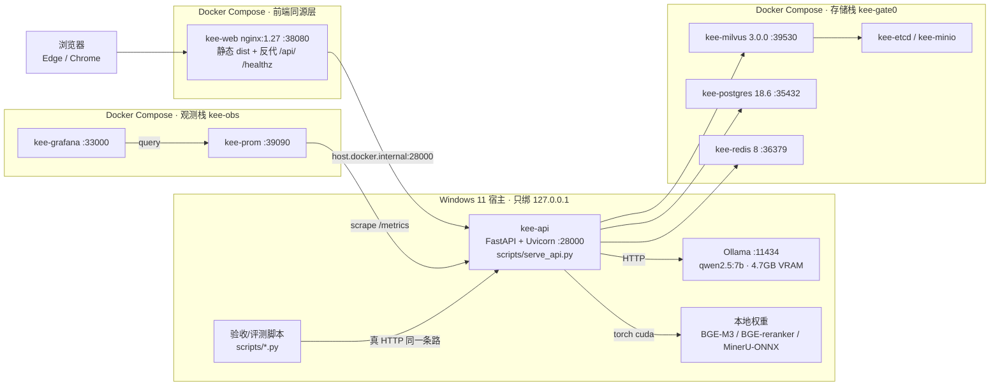
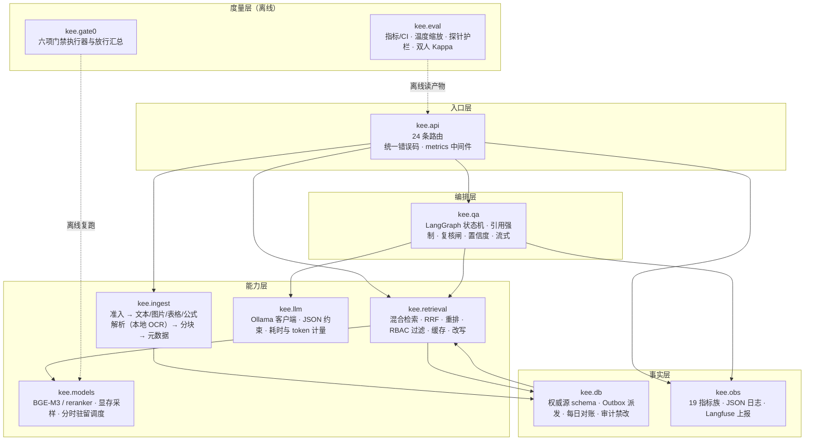
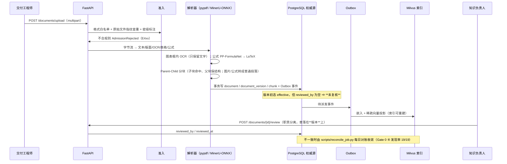
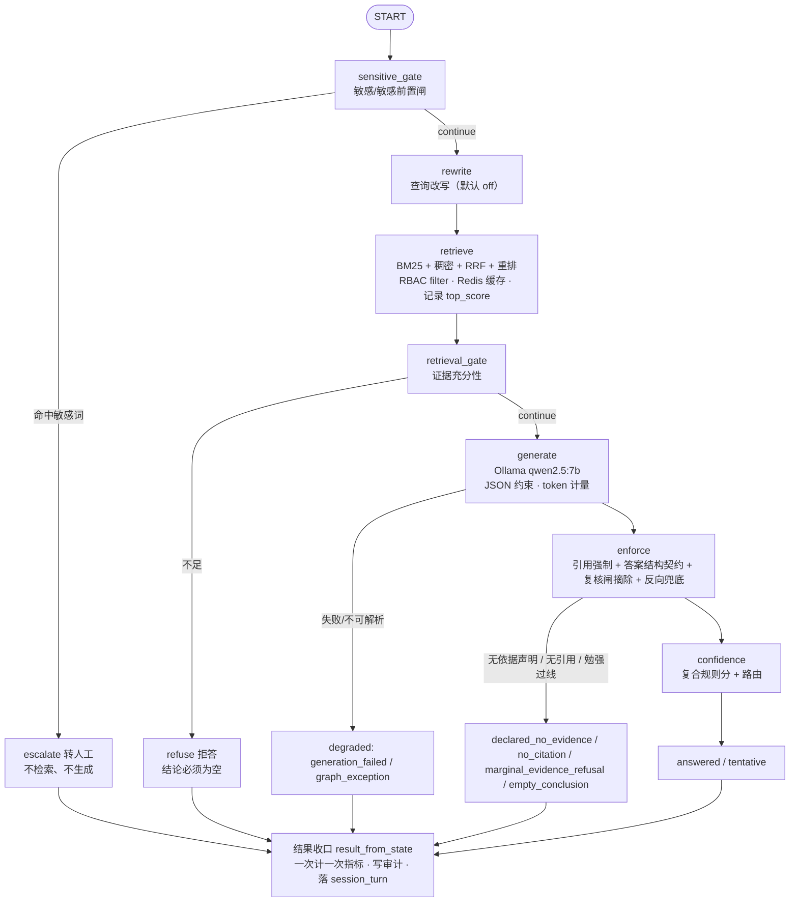
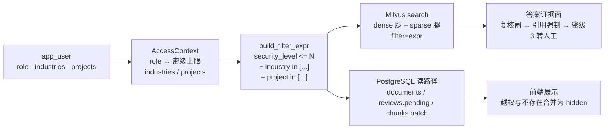

# 架构图文档

> **读法建议**：先看第 0 节 30 秒总览，再按需要往下看。每张图前有一句「这张图回答什么问题」。
> **依据**：模块 = `src/kee/` 实际包；节点 = `src/kee/qa/graph.py` 的装配顺序；端点 = `src/kee/api/app.py` 的 **24 条路由**
> （22 条 `/api/v1` + `/healthz` + `/metrics`）；容器 = `infra/docker-compose.*.yml`。
> **材料版次**：2026-10-27（重构版）；本次运行检查见第 7 节。

---

## 0. 30 秒总览

```
                        ┌──────────────────────── 内网单机（数据不出域）────────────────────────┐
  浏览器 (React) ──────▶│ Nginx(38080) ─┬─ 静态 dist                                           │
                        │               └─ 反代 /api/ /healthz /SSE ──▶ FastAPI 宿主(28000)   │
                        │                                   │                                 │
                        │        ┌──────────────┬───────────┼────────────┬──────────────┐    │
                        │        ▼              ▼           ▼            ▼              ▼    │
                        │  Milvus 3.0      PostgreSQL 18  Redis 8   Ollama 7B    本地权重    │
                        │  向量+BM25        权威源+审计    检索缓存   qwen2.5:7b  BGE-M3/     │
                        │  (etcd/minio)     Outbox                                          reranker │
                        │        ▲              │                                             │
                        │  Prometheus 39090 ◀───┴──▶ Grafana 33000（15 面板 / 9 告警）        │
                        └────────────────────────────────────────────────────────────────────┘
```

四句话：

1. **PostgreSQL 是唯一权威源，Milvus 是可重建的索引**——两者不一致时以 PG 为准，靠 Outbox + 每日对账收敛。
2. **一次问答 = 一条七节点状态机**，其中三道闸可以提前结束（敏感、检索不足、生成/引用不可用）；出口标签是 **10 值闭合枚举**。
3. **权限与复核的强制点都在服务端**（检索层过滤 + 答案层摘除），前端只是呈现，不是安全边界。
4. **图片/图表/公式只在入库期处理**：本地 MinerU/PP-OCR 只把图内文字转成普通文本，公式走本地 PP-FormulaNet；
   不做图表语义理解，也不引入额外视觉模型。

---

## 1. 部署拓扑

**回答：机器上到底跑着哪些进程/容器，谁连谁。**



要点：

- **宿主 API 在容器外**（ADR-12 定案）。代价写在《技术文档》§7：`torch` 不在 pyproject、断网端到端未证。
- **Nginx 不反代 `/metrics`**——这是 `/metrics` 免鉴权成立的前提之一。
- Prometheus 抓宿主靠 `host.docker.internal` + `file_sd`，宿主端口换了只重跑 `scripts/obs_targets.py`，容器不重启。
- **图片/图表不增加外部进程**：OCR 与公式都在 API 进程内用本地 ONNX 推理；不调用云端视觉 API。

---

## 2. 模块划分

**回答：代码怎么分包，每包只干什么。**



| 包 | 唯一职责 | 关键文件 |
|---|---|---|
| `kee.api` | 路由、鉴权咽喉、错误契约、指标中间件 | `src/kee/api/app.py`、`src/kee/api/auth.py` |
| `kee.qa` | 把检索+生成+判定编排成有限状态机；答案出口契约 | `src/kee/qa/graph.py`、`answer.py`、`streaming.py`、`stream_json.py` |
| `kee.retrieval` | 「一次检索」的全部：双腿、融合、重排、权限、缓存、改写 | `pipeline.py`、`milvus_store.py`、`rbac.py`、`cache.py`、`rewrite.py` |
| `kee.ingest` | 字节流到知识块：准入/解析/图片/图表/公式 OCR/分块/元数据/版本/复核 | `service.py`、`parsers.py`、`mineru_onnx.py`、`media.py`、`metadata.py`、`admission.py` |
| `kee.db` | 权威源 schema、Outbox、对账、审计（禁改触发器） | `db/pg.py`、`outbox.py`、`reconcile.py` |
| `kee.models` | 本地权重装载、设备与 dtype、显存采样与驻留策略 | `models/embedder.py`、`reranker.py`、`registry.py`、`gpu.py` |
| `kee.llm` | 唯一出模型的口子：Ollama HTTP、JSON 约束、计量 | `llm/ollama.py` |
| `kee.obs` | 观测面：指标、日志、链路上报 | `obs/metrics.py`、`logging.py`、`langfuse.py` |
| `kee.eval` | 离线测量：指标与 CI、校准、探针护栏、Kappa、RAGAS 复现 | `eval/metrics.py`、`probe_guard.py`、`kappa.py`、`ragas.py`、`judge.py` |
| `kee.gate0` | 六项可行性门禁的执行器与放行判定 | `gate0/g01…g06、g00_summary.py` |
| `scripts/` | **61 支**作业与验收脚本：评测、复跑、真机验收、一键复验 | `ci_local.sh`、`m2_eval.py`、`verify_m1/m3/m4.py` 等 |

---

## 3. 写路径：一份文档怎么变成可被引用的知识

**回答：上传之后数据在四个地方各长成什么样，谁保证它们一致。**



**复核闸为什么在答案层**：未复核版本**仍可被检索**（复核人必须看得见才能复核），但 `gate_unreviewed()` 会在检索节点
之后把它从答案证据面摘掉；摘光就走既有的「无充分依据」拒答出口。所以对外表述只能是
「**未经复核的内容不会被引用作答**」，不能写「不会被检索到」。

**解析触发条件（容易答错的一点）**：`pdf_parse_backend=auto` 默认**按页路由**——逐页用 pypdf 统计字符，
**单页 < 40 字**的页才把该页渲染给 MinerU；文本页保留精确文本。图表区域不是触发条件，只有 MinerU 跑起来后才处理。
文本页的内嵌位图仍会走 `_append_pdf_images` 做 PP-OCR（`media_scan_text_pdf=true` 默认），所以「正文可抽字、中间夹一张位图」
不会漏掉图内文字；**缺口**是矢量图 / 文字转曲的图表不是 `page.images` 位图，文本页不会触发 MinerU，图内文字不会被 OCR。
`KEE_PDF_PAGE_ROUTING=false` 回到旧的整份平均口径；`pdf_parse_backend=pypdf` 或 `media_scan_text_pdf=false` 会关闭位图 OCR。

```
              ┌─────────── PG（权威源，唯一真相）───────────┐
   上传 ─────▶│ document / document_version / chunk / outbox │──┐
              │ audit_log（追加写 · 禁改删触发器）           │  │ 派发
              └──────────────────────────────────────────────┘  ▼
                    ▲                        │      ┌── Milvus（可重建索引）──┐
                    │ 对账差异修复            └─────▶│ kb_chunks：dense + BM25 │
                    └────────────────────────────────┴────────────────────────┘
                     每日 reconcile：missing / extra / stale → 报告并修
```

**版本治理的边界**：复核章在 `document_version` 上，回滚不擦章；reject 会撤下该版本索引；上传者不能自审（职责分离）。

---

## 4. 读路径：一次问答的七节点与十类出口标签

**回答：一个问题进来要过几道闸、每个出口各自意味着什么。**



出口标签**取自 `state["gated"]` 的实际值**（10 值闭合枚举 + 陌生值一律落 `other`），不是从 `notes` 里猜字符串——
否则一个陌生出口会在看板上伪装成 `answered`。

两条判定纪律（都源于踩过的坑）：

- **拒答类与转人工类是两把尺**：前者要求结论为空，后者**允许答**但必须转人工。合成一把会把正确行为报成泄漏。
- **检索层面收益与答案层面收益分开报**：多轮消解曾把 q-003 的检索分从 0.0391 救回 0.9697，但答案层因密级正确地不给结论。

**流式同一条链**：`POST /answers/stream` 用**同一份 `initial_state`**，一次 JSON 生成即可从未闭合信封按路径读已成形字段逐段推送；
门禁认的口径是 **`first_visible_ms`（首个可读字）**，不是信封首字符 `{`。

---

## 5. RBAC：部门 / 项目 / 密级怎么进过滤

**回答：账号上的范围如何变成检索与读取的硬约束，哪些路径是同口径的。**



要点：

- **密级上限来自角色**：newcomer 1；delivery/presales/ops 2；pm/owner/admin 3。治理角色跳过部门/项目维度，但仍受密级上限约束。
- **部门/项目为空表示不限定**：账号可选的收敛范围，不是默认全隔离。
- **身份来自登录账号**：有 Token 时请求头不参与判定；无 Token 时请求头通道默认关闭（`KEE_ALLOW_HEADER_IDENTITY=false`）。
- **表达式先过白名单**：所有标识符经 `_SAFE` 字符校验再拼接，防 Milvus 表达式注入。
- **缓存不跨身份**：权限表达式与改写模式进 Redis 缓存键，不同范围不会命中同一份结果。
- **同口径路径**：检索、答案、`chunks/batch`、`reviews/pending` 都按三维参数过滤；`chunks/batch` 把越权与不存在合并进 `hidden`。
- **已知口径缺口**：知识库列表的 `industry` 查询参数当前是替换账号行业而非取交集；文档详情只判密级、不判部门/项目（只返回元数据）。
  正文面仍受三维保护；若对外承诺「所有读路径完全一致」，需先收紧这两处（见《技术文档》§7 第 11 条）。

---

## 6. 可观测：三套数据各有各的嘴

**回答：想看某种事实，该去问哪个系统。**

```
    一次问答
       │
       ├─▶ Prometheus   「聚合趋势」：QPS / P95 / 阶段耗时分解 / 降级原因计数 / 出口占比
       │                 19 个 kee_* 族，进程内累计、**不落库**，重启归零
       │                 抓取前跑依赖探针（与 /healthz 同一份代码）
       │
       ├─▶ PostgreSQL   「单轮事实 + 谁问了什么」：session_turn.total_ms、audit_log（追加禁改）
       │
       └─▶ Langfuse     「单条链路现场」：trace + span(qa.rewrite/qa.retrieve) + generation
                         **默认关闭**；载荷已用本地采集器实采验证（真容器待裁）

    Grafana 15 面板 ──▶ 只查 Prometheus。面板第一格固定写着：
        「看板分位数 = 桶插值近似 + 统计全部轮次 ⇒ 不是门禁读数」
```

| 想知道 | 去问 | 为什么不是别处 |
|---|---|---|
| 现在检索 P95 是不是漂了 | Prometheus / Grafana | 门禁读数仍以离线探针为准，但趋势要连续 |
| 入库时图片 OCR 跳过/失败多少 | 摄取响应的 `parse_notes` + 审计 payload | 图片 OCR 不新增指标族，避免图片内容/高基数标签进入指标面 |
| 昨天某个人问了什么、看了哪几段 | `audit_log` | 指标不落业务内容，日志不保证留痕 |
| 这一轮慢在哪一段 | `session_turn` + `timings_ms` | 单轮事实，不含采样误差 |
| 某个出口为什么被触发 | Langfuse（启用时）/ 结构化 JSON 日志 | 需要现场证据链 |

---

## 7. 复验与回归：改动之后怎么知道自己没改坏

```
 一条命令： scripts/ci_local.sh
 ───────────────────────────────────────────────────────────────
  preflight → static → backend → frontend          （不碰 GPU，约 40s）
                 │
                 ├─ verify-m1 / verify-m3 / eval   ← 先停宿主 API（8GB 零余量，进程内加载模型）
                 │        └─ eval = m2_eval --skip-grid --out   **检索版本回归**
                 │             退出码 1=门禁没过 ／ 2=同尺子跌超 0.02（回归）
                 │             ruler 指纹不一致 ⇒ 只报「不可比」，不给 regressed=false
                 │
                 ├─ warm（api_warm.py：先付模型冷装载的账）
                 │        └─ warm 未过 → 跳过下面三段，而不是让它们带病出数
                 ├─ verify-m4 直连 12 项 + 经 Nginx 13 项（真 HTTP + Bearer 令牌）
                 ├─ obs-probe（七条恒等式 + 31 条 PromQL + A/B 开销 + 外泄面核查）
                 └─ 收尾：证据产物 md5 对比 + 宿主 API 复原到起跑前状态
```

三条硬纪律（都是撞到才写进代码的）：

1. **不许拿"单测过了"当行为等价的证据** → 用 git 抽出旧实现当 oracle 做差分（`m3_graph_equivalence.py`）。
2. **跑前记 md5、产物另存、绝不覆盖历史证据** → `eval` 用 `--out` 写到本次运行目录；`g06` 这类一次写三份固定路径的脚本要先全备份。
3. **依赖故障会伪装成一次通过** → 所有真机探针先过 `probe_guard`，判废不写 artifact。

**2026-10-27 实际运行态**：存储栈 5 容器 healthy；`kee-web` 38080 同源代理 200；API 28000；`kee-prom` 39090 抓取 `kee-api` 为 up；
`kee-grafana` 33000 健康、`KEE 知效引擎 · 在线链路` 看板已加载；M4 经 Nginx **13/13**；写路径 scratch **19/19**；后端 **394 passed**、前端 **40 passed**。
未复跑项见《技术文档》§6.3。

---

## 8. 数据流转总表（一份数据在几个存储里各是什么）

| 数据 | PostgreSQL | Milvus | Redis | 指标/日志 | 备注 |
|---|---|---|---|---|---|
| 文档与版本 | ✅ 权威源（含 `reviewed_by`） | 投影 | — | `kee_pg_documents` | 版本回滚不擦复核章 |
| 知识块文本 + 元数据 | ✅ | 摘要字段 | 检索结果快照 | — | 子块命中；父块存结构；图片/图表/公式以 OCR 文字/LaTeX 文本进入同一链路 |
| 图片/图表/公式 | ✅ chunk 文本（`图内文字` / `【公式】`） | 投影 | — | — | 只做本地 OCR/LaTeX；已有索引不回填；不存原图 |
| 稠密向量 + 稀疏(BM25)向量 | 物料仓可重建 | ✅ 索引 | — | `kee_milvus_chunks` | 索引坏了不丢数据 |
| 检索事件与降级原因 | — | — | — | `kee_retrieval_rounds_total{mode,cached}`、`…_degraded_total{reason}` | 原因收敛为 13 类 |
| 答案与出口 | `session_turn` | — | — | `kee_qa_rounds_total{status,exit_gate}` | 出口标签 10 值闭合枚举 |
| 置信度与引用数 | `session_turn` | — | — | `kee_qa_composite_score{basis}`、`kee_qa_citation_count` | 规则分不称概率 |
| 谁问了什么 / 看了哪段 | ✅ `audit_log` 追加禁改 | — | — | 结构化日志带同一 `trace_id` | 触发器挡 `UPDATE/DELETE`；`TRUNCATE` 由权限面挡（应用角色非表属主、非超级用户） |
| 评测集与 gold | ✅ | — | — | `var/gate0/*.json` 产物 | `ruler` 指纹绑定尺子 |
