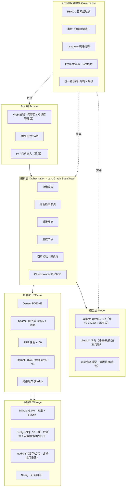
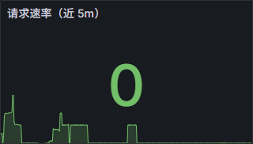
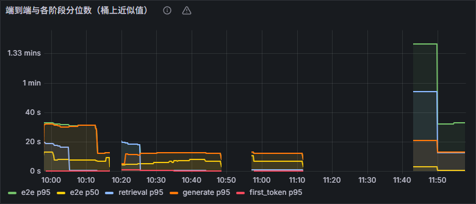
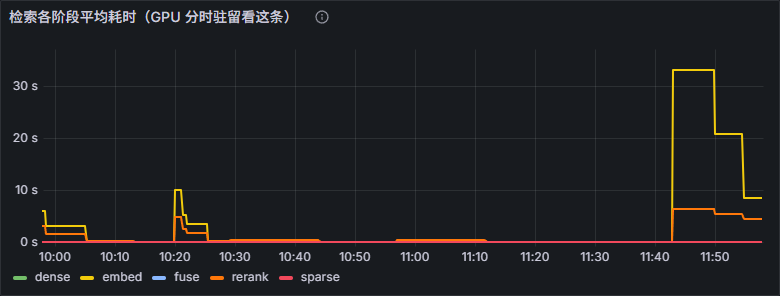

# 企业级知识库 RAG Agent · 技术方案与 MVP 设计（V1.0.39）

> **基准行业**：数字技术服务 / IT 服务与数字化运营（面向多行业的咨询、解决方案与交付服务）。
> **文档用途**：为个人自研项目给出可对外展示的技术方案全景、五维选型决策、可行性验证门禁（Gate 0）与 MVP 交付定义；
> 设计与验收**两阶段的记录都在文内留痕**（修订记录逐版标注了哪些是当时的状态）。
> **口径声明（V1.0.29 校准）**：本系统**已实现并完成本地验收**。本文内量化数字**分两类，引用时必须指明是哪一类**：
> ① **设计目标 / 验收门禁**（阈值本身不是达成声明）；② **本地实测读数**（单机、自建语料、无真实用户条件下取到，
> **不等于线上数据**）。任何指标一律不得解读为「已上线 / 真实环境达成」。文中凡出现具体数值，
> 均须以「设计目标」「验收门禁」「本地实测」等前缀或上下文明确其性质——**这一条不因"项目完成了"而放松**。
> **执行主体**：个人独立设计与开发。
> **日期**：2026-10-09。
> **与 V1.1 的关系**：本文以《企业级知识库 RAG Agent · 项目定义（数字技术服务企业版 V1.1）》为**唯一基准**，是其第十节「技术方案概览」与第十一节「关键能力设计」的**工程化展开与 MVP 定型**；凡本文与 V1.1 冲突，以 V1.1 口径为准。约束继承 V1.1 第八节（数据不出域、行业/项目/密级隔离、单机部署、GPU 显存 8GB 硬瓶颈、本地优先云端兜底、Windows 11 + WSL2 + Docker Desktop、合规对标 CMMI/ISO/CCRC/ITSS）。
> **版本**：V1.0.45（**拒答的两种成因在契约上分开了**：答案层复核闸摘光证据后，原本与真无依据共用
> `refuse + no_sufficient_evidence` 一个出口 ⇒ 「资料在、只是没人复核」被说成「这事无解」。
> 现在 `AnswerResult` 多两栏（`refusal_reason` = `no_evidence` / `all_evidence_unreviewed`，
> 以及 `unreviewed_evidence_count`），图上多一个出口 `evidence_all_unreviewed`（已登记 `GATED_LABELS`，
> 扫源码的单测会盯），前端按 reason 写两句不同的人话；新增只读端点 `GET /api/v1/reviews/pending`
> （范围过滤与知识管理查询同一套参数）。实测：`m4_upload_http_check.py` 14 → **19 项全过**、
> `tests/test_review_gate.py` 13 条、前端 16 条。生产 24 个版本已全部复核 ⇒ **新出口现网暂无对象**，
> 证据全在 scratch 真机。另修一处端口默认值隐式耦合（`KEE_PROD_API_PORT` 只认 38000，
> 本机/CI 用 28000 ⇒ 护栏报「生产 API 不可达」误导），改三级取值并印出所探 URL。
> 与《项目定义》V1.43 同批；阈值与既有读数一字未动。）
> **上一版**：V1.0.44（**分块策略对照跑通 + percentile 口径更正**：`scripts/m1_chunking_ab.py` 把同批内容重塑成
> 长章节（父块中位 603 字 vs 子块 251 字、94.5% 父块含 ≥2 子块、F 臂 32.0% 块跨章），两臂同题同参数、
> gold 用**答案句包含判定**（不用整条 span、不用关键词——两者都偏心）。**检索层跑 3 轮，轮间极差 0.0、Top-5 成员翻转 0 行**：
> 答案句覆盖 Recall@5 **P 0.9279 vs F 0.7991（+0.1288 = 8.76 题当量）⇒ 实质收益**；Hit@5（1 题当量）/ MRR（1.4 题当量）
> ⇒ 单题分辨率内，**不定结论**。**生成层以两轮独立全量互比为漂移地板（2–3 题当量）**：P_child vs F_flat 的串落地
> +0.0148、可完成 +0.0147 **测不出**，只有引用落 gold **+0.0736（5.0 题当量 > 地板 4.0）有效**
> ⇒ 收益停在检索层与「可核对」，没传导到「答得更对」。父块回捞两种接法在长章节上把引用落 gold 拉低 9.0 / 6.0 题当量
> ⇒ C6 从「无收益」改判「**负收益**」，「本语料章节短」那条免罪条款作废。
> 另：`percentile(v, p)` 的 p 是 **0–100**，两个 M1 脚本按 0–1 传 `0.5` ⇒ 标「p50」的列实为 0.5 分位；
> 已修 9 处 + 补回归测试，M1 产物四列中位数就地重算、prompt 改用均值（**A1 代价 +1219.6 tok 均值**，原印 +1056 作废）。
> 全程不写 PG、只建两个 scratch 集合跑完删 ⇒ **人工标注与生产读数零作废**（生产 193 块 / 24 篇前后相同）。
> 与《项目定义》V1.42 同批；阈值与既有门禁读数一字未动。）
> **上一版**：V1.0.43（**Parent-Child 名实对齐 + 消融装置自身两处缺陷**：`format_evidence` 只喂子块，父块正文从未进
> 答案组装，而 §6.1/术语表/流程图三处都写着「父块补全上下文」。四档消融（67 题、检索面恒定、A0 重跑噪声地板 2/67）
> 实测**接上父块正文无可测收益**（可完成率 Δ −0.0299 恰等于地板、同分母落 gold 净 −1 行），代价 prompt 均值 **+1219.6 tok**、
> escalate **1→3 行**；**错配父块劣化超地板**（Δ −0.0597、escalate 1→5）⇒ 现状那个 `章节标题｜` 前缀删掉也测不出后果。
> 装置侧修两条：护栏 **G3 原先拿 LLM 裁判成立率当闸门**（κ=−0.0645 的尺子），把一轮 40 分钟的好数据**误判废**，
> 已改机械量；**判废轮原先在落盘前 `return`**，数据全丢——现在照落盘并打 `void` 标记。跨档比 gold 一律走**同分母配对**
> （各档分母自己会变：A0 62 → A1 60 → A1b 58，掉出去的正是改走 escalate 的行）。另：`infra/docker-compose.langfuse.yml`
> 里那个「示例」PG 口令**正是在跑那套栈的真口令**，已改回占位（真值只在 gitignore 的 `var/`）。
> 需求原文要不要随之修订见待定清单 **C6**；阈值与既有读数未动，人工标注零作废。证据 `reports/m1/M1_父块上下文消融.md`。
> 与《项目定义》V1.41 同批。）
> **上一版**：V1.0.42（**Langfuse 自托管真跑通**：`langfuse/langfuse:2` = **1.12GB 只一个镜像**（PG18/Redis8 本机已有）、
> 3 容器常驻 **~259MiB 内存 / CPU 0%**、数据卷 67MB 落 `D:\project\var`（不是 C 盘）；Docker Hub 直连不可达但
> **走 Docker Desktop 已配的 registry mirror 拉通了**——以后判断「能不能拉镜像」别按直连结论。
> 走生产入口（真 HTTP + Bearer）问三轮，真服务器收下并渲染 `kee.qa.round → SPAN qa.retrieve → GENERATION qa.generate`、
> Usage 1,253→121 token、Metadata 里 `degraded=[dense_timeout>2500ms]` 可见、转人工那条 0 observation（早退不编造）。
> **实跑照出并修掉 `infra/docker-compose.langfuse.yml` 两处起不来的缺陷**：PG18 挂载点应为 `/var/lib/postgresql`
> （原写 `/var/lib/postgresql/data` ⇒ crash-loop）、`depends_on` 需配 `healthcheck` + `service_healthy`
> （否则 Prisma 迁移抢在 PG 可连前跑 ⇒ `P1001` 后容器退出）。**这两条 stub 契约测试给不出来**。
> 截图 `docs/assets/langfuse/`；风险登记册那条待裁决 → 已闭合（现待裁 0 条）；
> **交付默认值 `langfuse_enabled=False` 一字未动**，只有本机 `.env` 打开。与《项目定义》V1.40 同批；阈值与既有读数未动。）
> **上一版**：V1.0.41（**RAGAS 补齐到四条并逐条对 §6.1 目标值判过/不过**：新增 Context Precision（逐块判相关性 +
> **名次加权** Σ P@k·v_k / 相关块数）与 Context Recall（参考答案拆声明 → 逐条归因到检索块），
> 两条的 contexts 一律用**复跑 Top-5**（测检索面，与被引块分工不同）。实测
> F(Top-5) **0.9382** > 0.85 过 / CP **0.9209** > 0.80 过 / CR **0.9460** > 0.85 过 / **AR 0.6582 > 0.90 不过**——
> **这条不过是量纲不是质量**：装置里常驻了一条标尺「题面 vs 它自己的参考答案」= **0.6662**（最高 0.8075、
> **0 行 ≥ 0.90**），本地 BGE-M3 尺度上「完全切题」本身就到不了 0.90，而 0.90 是照 RAGAS 默认的 OpenAI embedding 写的
> ⇒ **目标值待裁，本轮没自行改线**。CR 最低两行 **q-044 = 0.0、q-013 = 0.0**，与 #58 检索漏召、
> 人判「证据层引错块」**独立对上**。护栏 5 → **7 道**（新增「检索面换成别题 ⇒ CP/CR 必须掉」；
> 该条第一版判废过一次，根因是把「换面后一块都不相关 ⇒ CP 未定义」当成「没下降」，而未定义在这里就是最大下降）。
> 另堵一类静默劣化：`cost.max_prompt_tokens` 实测 1295（服务默认 `num_ctx=4096`，超长提示会从头部截且不报错）。
> 三轮整套独立重跑六条读数逐位相同；后端单测 289 → **346**；与《项目定义》V1.39 同批；**阈值一字未动**。）
> **上一版**：V1.0.40（**RAGAS 两指标与 LLM-as-Judge 落地为可跑装置——自研复现，ragas 库仍未引入**：
> `src/kee/eval/ragas.py`（Faithfulness 两步：拆原子陈述 → 每条只依据材料判支持性；Answer Relevance：反向生成 3 问 ×
> BGE-M3 余弦均值）+ `src/kee/eval/judge.py`（判据卡驱动的本地裁判，两张卡分别管作答行与拒答行，判据照真人工单原文、
> **明写不给参考答案**）+ `scripts/m5_ragas_eval.py`（三阶段显存换乘：evict 7B → 复跑检索取 Top-5 → warm 7B 判定 →
> evict 7B → 载 BGE-M3 算余弦；**读真人标签配对的那代留档产物、不重跑生成 ⇒ 62 行人判读数零作废**）。
> 实测 F(cited) **0.9866**（n=62，95% CI [0.9651, 1.0]）/ F(Top-5 原口径) **0.9382** / AR 作答行 **0.6582**；
> 裁判与真人判一致率 86.36% 但 **κ = −0.0645**（真人判错的 6 行抓到 0 行）⇒ **两条指标都是报告值、不进门禁，
> 且这套裁判现在不能当人工初筛**。五道反面对照护栏全过、两轮整套独立重跑四个指标逐位相同；481 次 7B 调用 / 整套 530s。
> 不引库的硬理由：ragas 0.4.3 依赖闭包拖 `scikit-network`→`numba`（有 numpy 上限），会顶掉本项目 `numpy==2.5.3`
> 而 torch 是经 `.pth` 挂进 `.venv` 的；且官方默认走 OpenAI 客户端，数据不出域仍要自写本地 wrapper。
> 与《项目定义》V1.38 同批；**阈值与既有门禁读数一字未动**，后端单测 289 → **327**。详见文末 V1.0.40。）
> **上一版**：V1.0.39（**本机复验强制点落地：`scripts/ci_local.sh` 十一阶段，把「版本回归」接成闸门**：
> `eval` 段跑 `m2_eval.py --skip-grid --out`，与 `m2_eval_prev.json` 同尺子对照，退出码分开报「门禁没过」与「回归」；
> 新增 `warm` 段（`api_warm.py`）——第一次全量复验的三连红根因是重启后没预热，本机实测首个问答 177.4s、第二趟 3.5s。
> 与《项目定义》V1.37 同批；**阈值与既有门禁读数一字未动**，`eval` 首跑四条全过、`delta_strict=0.0`。详见 7.4 节与文末 V1.0.39。）
> **上一版**：V1.0.38（**可观测体系落地**：Prometheus `/metrics` + Grafana 看板与告警 + 结构化日志已实跑实测；
> Langfuse 上报器与自托管部署文件出稿、**容器未拉取待裁**。与《项目定义》V1.36 同批；
> **阈值与既有门禁读数一字未动**，指标层不写 state、不改判定；`pytest` 252 → 289，
> `scripts/m5_observability_probe.py` 七条计数器恒等式与宿主/Prometheus 对账全绿）。
> **上一版**：V1.0.37（**四条安全敞口按用户裁决落地：请求头身份默认关闭 / 退出撤销全部会话 + 强制下线 / 审计 TRUNCATE 绕过堵住 / hybrid 单腿量纲闸门**，与《项目定义》V1.35 同批；**阈值与既有读数一字未动**，动的是权限面与上报口径）。
> 一处原清单**不可执行**已如实登记：`ALTER ROLE kee NOSUPERUSER` 被 PG 拒绝（`kee` 是 initdb 的 bootstrap 超级用户），
> 终态改用非特权应用角色 `kee_app` 达成同一防线——**部署多了一个必经步骤**：存储栈起好后先跑
> `scripts/harden_audit_store.py`，否则 `kee_app` 不存在、服务连不上库。
> 量纲那条同时更正了登记时的两点归因（详见《M5 风险登记册定稿》同名条目）：36.94 这个读数要求**重排腿同时被绕过**，
> 只补 `dense_empty` 堵不住；而「degraded 是空的」实际是**探针产物里从来没有 degraded 这一列**。
> 重验：后端 244 passed（+12）、前端 37 passed（+2）、`verify_m1` 全步骤通过（含新增的 TRUNCATE 闸门步）、
> `verify_m3` 全步骤通过（含量纲步）、`verify_m4` 直连 12 项 / 经 Nginx 13 项，0 失败，全部走真实 HTTP 与 Bearer 令牌。
> **上一版**：V1.0.36（**权限维度统一表述为「部门」+ Should/未实现项就地标注**，与《项目定义》V1.34 同批；**阈值与读数一字未动**）。
> **上一版**：V1.0.35（**措辞改判（第三次）**：语料来源改为中性陈述，界面状态条不再挂「模拟语料 / 未接入生产文档」；**阈值与读数一字未动**，与《项目定义》V1.33 同批）。
> **上一版**：V1.0.34（**问答记录不再随模块切换丢失 + 左侧会话历史栏**，与《项目定义》V1.32 同批；**阈值一字未动**）。
现象是「切到知识库管理再切回来，刚才问的没了」——根因不在数据（`session_turn` 一直落库），
而在**状态住在哪一层**：对话存在问答页组件里，切 tab 组件卸载就一起没了。现在对话状态提到
`ConversationProvider`（tab 之上），历史一律从服务端取，新增 `GET /api/v1/sessions` 列表端点，
`GET /api/v1/sessions/{id}` 改带 `answer` 整包并加归属校验（E403）。
实测：浏览器里问两问 → 切模块 → 切回，两轮与结论原样在（且**不是**重新拉取，恢复标记数为 0）；
点开 6 轮旧会话 → 6 条引用/规则分/检索概况全部复原；刷新后自动接回上次会话；经 Nginx 列表端点通。
后端 232 passed（+8 会话历史测试）、前端 34 passed（+5 生命周期测试）。详见文末 V1.0.34。）
> **上一版**：V1.0.33（**RBAC 入口换成真登录 + 问答页改成一问一答、输入置底**，与《项目定义》V1.31 同批；**阈值一字未动**）。
服务端补 `src/kee/api/auth.py`（scrypt 口令 + 服务端可撤销会话 + 注册不得自授治理角色）与六个 `/api/v1/auth/*` 端点、
两张表（`app_user` / `user_session`）；前端删掉「角色下拉框」那条假权限入口，未登录只有登录/注册页。
实测：生产入口鉴权 19/19 过（含「登录后请求头伪造 actor 无效——审计 actor 是登录账号」）、
经 Nginx 登录+`/auth/me`+SSE（50 个 delta 帧）通、浏览器 1440×900 下整页不滚（`docScrollH=900=innerHeight`）、
正文区自身滚动（视口 503px / 内容 1656px）、输入栏顶边 784 == 正文底边、6 轮各 1 问 1 答、
流式中手动上翻 739px 后**不再被拽回**、翻回底部后下一轮自动跟随（收尾距底 39px）。
后端 224 passed（+1 回归）、前端 29 passed（19→29）。**抓到并修掉两个真缺陷**：
① `RoleGrantRequest.role` 的 `min_length=3` 把合法角色 `pm` 判成非法输入（授权 400 校验噪声）；
② 令牌存放键被写成占位符 `"***"`——登录/登出自洽地全绿，只有「会话过期要清令牌」那条测试把它照出来。
未做：`KEE_ALLOW_HEADER_IDENTITY` 默认仍 `true`；退出只撤销当前那枚令牌（同用户其他会话到 12h 过期）；
`failed_count` 只计数不锁号；首个账号引导例外要求**首次注册在受控网络内完成**。详见文末 V1.0.33。）
> **上一版**：V1.0.32（**交付前清场 + 审计防篡改缺口登记**，与《项目定义》V1.30 同批）。
代码/配置里 `demo` 0 命中（最后一处是报告文件名，已 `git mv` 更名并改写 8 处活引用；归档证据快照不动）。
审计页残留的 26 行 `demo.*` 是**数据**，经用户选定整表清空：`scripts/reset_audit_state.py`
（要求 `--confirm=RESET` + 非空 `--reason`，只动 audit_log/session/session_turn，结果落**表外凭据**
`var/gate0/audit_reset.json`——审计表记不了自己的抹除）。**顺带量出真缺口**：`audit_log_immutable`
只拦 DELETE/UPDATE，**TRUNCATE 绕过它**，且应用角色 `kee` 是 superuser 使表级 REVOKE 失效
（事务内实测：TRUNCATE→0 行→ROLLBACK，复原 1662）。收紧需改属主+撤 superuser+只授 INSERT/SELECT，
会动整个权限面，**留给用户拍**；动完须重跑 verify_m1/m3/m4。清场后复验全通过。
> **上一版**：V1.0.31（**界面撤下安全提示语与 demo 默认值，约束保留在文档层**，与《项目定义》V1.29 同批）。
`actor` 默认值 `demo.engineer` → `operator`；身份条收尾只留「过滤发生在检索层」这半句。
**删的是提示语不是约束**：7.2.1 的「请求头身份可伪造 ⇒ 限内网、接生产换真实身份源」三条原样保留，
后端行为一字未改（仍拒非回环绑定）。《前端流式渲染契约》里「界面在身份条上如实写着…」随之改掉，
否则就成了文档宣称有、界面上没有。tracked 源码 `demo` 0 命中；`Demo` 只剩历史修订记录与报告文件名。
⚠ 验证坑：改完界面上仍是旧值，根因是**身份持久化在 localStorage**——验默认值前必须清存储，别把缓存读成代码。
阈值与读数未动。详见文末 V1.0.31。）
> **上一版**：V1.0.30（**完整运行核查：三套 verify 全过 + 三条指标名实对齐**，与《项目定义》V1.28 同批；**阈值一字未动**）。
本轮把"完成了吗"逐条实测：`verify_m1` 全步骤过并自净（生产 193/193）、`verify_m3` 12 步、`verify_m4` 直连 12/12 与经 Nginx 13/13、`m2_eval` 复跑读数逐位相同（P95 302.8ms）。修三处：`verify_m4` 还写着「1.2s 待裁决·未达标」（V1.0.23 已定案 first_visible）→ 冷热分开，**热态 first_visible 成为真门禁项**（307ms 过，冷装载单列，历史见过 13268ms）；`m2_retrieval_gap` 重复字典键；**Faithfulness / Answer Relevance / 「人工 3 级评分」三条有名无装置**（RAGAS 从未引入），门禁文字改为点名实际装置。40 处样式告警未清（非阻塞）；ruff 的 3 条 F821 是 `del` 误报。详见文末 V1.0.30。）
> **上一版**：V1.0.29（**业务格按测试用户口径改判 + 真机走查抓到两处契约漏项**，与《项目定义》V1.27 同批；**阈值一字未动**）。
运行排查的第一件事很朴素：38000 上**没人监听**——存储栈 / kee-web / Ollama 都健康，缺的是宿主 API 那一半。
起来后 `scripts/m5_test_user_run.py` 走生产入口跑 84 任务 / 90 轮，**链路检查 13/13 过**，
读数为 **模拟自助解答率 64/68=0.9412、一次通过率 63/68、权限拦截 4/4、转人工 5/5、该拒 7/7、检索静默降级 0 轮**。
业务四条里**只有一条被测试用户喂出数**：「重复提问下降 ≥30%」缺上线前基线、「新人上手周期缩短 ≥30%」缺真人时间维度，
**两条继续不可测**；DoD#6 状态改由产物推导（缺产物写「产物缺失」而不是「不可测」，冒烟剧本一律判「待复测」）。
现场抓到并修掉两处实现漏项：**① 拒答/转人工出口缺 `score_basis` 与 `temperature`**（作答出口有——于是下游拿到
`composite=0` 却没有一句说明这个 0 是什么，而 0 比 0.79 更容易被读成概率；六个出口统一走 `_gate()`）；
**② 前端把 `degraded` 类型声明成 `boolean|string`**，而它其实是原因数组，JS 里 `[]` 是真值 ⇒ 热态每轮都挂「检索降级」
（改为判长度并把原因显示出来）。另登记一条运行期事实：API 冷启动第一呼 `dense_timeout>2500ms` ⇒
检索**静默退化成 BM25 单腿**、status 与分数都看不出差别，故验收脚本加 warm-up 且**逐轮记录 `retrieval_degraded`**。
交叉印证由脚本从 `answer_correct_calibration.json` 取数：本轮没答上的 q-044/047/051/052 与人判登记的检索漏召同一批。
同代码两轮复跑（16:23 / 16:38）：**80 个首问的 status 无一翻动**，四项读数逐位相同 ⇒ status 层可复现；
但这**不等于结论文本逐字相同**（#56 量过 7.46% 的文本漂移，T=1.0 生成本来不逐字确定）。
单测 **214** + 前端 **19**。详见文末 V1.0.29。）
> **上一版**：V1.0.28（**状态核对抓到「产物在标签回收后谎报空白」：边界句由硬编码改为推导**，与《项目定义》V1.26 同批；**阈值与读数一字未动**）。
`answer_correct_calibration.json` 的 `coverage_boundary` 原先写死「无答案 7 + 敏感 5 这 12 题没有真人标签」，
而 #57 早已判完回收 ⇒ 现在由 `hallucination_rate.json` 推导，四态各有一句（缺文件／判一半／判完但分母 0／有分母报实数）。
第二类方向也要防：真幻觉率哪天有了分母，句子不能再停在「不适用」。同源过期陈述清三处，含风险册把代理读数
硬写成「编造数字 13 题」而产物取数是 **15 道**——数字不手写，条目改为指明取数口。
**当前状态**：M0–M5 全做完、三件套交付物齐；DoD **达标 3／部分达标 3／不达标 0／不可测 1／本次产出 1**，
**不等于「全部达标」**；剩三类敞口都是「按构造拿不到数」（业务指标要真实用户、ECE 要更多有方差负例、真幻觉要有非作答题上真给出过结论的样本）。
除 `coverage_boundary` 外产物其余键逐位相等、ECE 0.2006 原样复现。单测 **201**。详见文末 V1.0.28。）
> **上一版**：V1.0.27（**《版本锁定清单》三条 `未固定` 全部按实测销账 + `langgraph-checkpoint-postgres` 依赖处置定案**，与《项目定义》V1.25 同批；**不动任何阈值、不改 lockfile、本轮无新读数**）。
生成模型改按 `/api/tags` 的 **digest** 认权重（`ollama list` 不输出 sha256 ⇒ 同 tag 被覆盖本机不报错）；
宿主 torch/CUDA 记实测指纹 `2.14.0+cu130` / cuDNN 92400 / CUDA available / 驱动 616.56；OS 记到 `25H2 / UBR 7171`。
⚠ **torch 那格是「换成要复刻的精确指纹」，不是「ADR-12 根因已闭合」**——`pyproject` 仍不声明它，`.pth` 挂载仍要人手做。
`未固定` 列表**改为由探针结果推导、不再写死**（写死会在补上实测值之后继续谎报缺口）。
新增依赖 import 闸门：19 声明 = 17 在用 / **1 隐式使用** / 1 零导入——`python-multipart` 本仓库扫不到 import，
但 FastAPI 在 `UploadFile = File(...)` 时按需 import 它（`src/kee/api/app.py:209`），**摘掉上传端点即 500**，
所以「扫不到」单列成判定而不并入「没用」。`langgraph-checkpoint-postgres` **保留**：零导入是计划（原因见 `src/kee/qa/graph.py:17`），
代价 = 传递拉进 langgraph-checkpoint / psycopg-pool / orjson；复核闭环若不落地就 `uv remove` 后重跑清单。
同版更正两处假账：`npm` 曾记 `__ERR__`（Windows `subprocess` 找不到 Git Bash shim，工具其实在），
容器清单曾把宿主 41 行镜像全列（多数属其它项目）⇒ 收窄为 compose 引用的 6 个。详见文末 V1.0.27。）
> **上一版**：V1.0.26（**#58 后续：书面语别名小样本验证，结论不做**，与《项目定义》V1.24 同批；**不动生产索引**）。
`scripts/m5_alias_probe.py` 只写 scratch、`chunk_id` 不变（人工标注零作废），27 个别名全过数字落地检查，
14 道口语化题 strict @5 却由 13 → **12**：q-044 翻上来，q-040/q-051 掉下去，
而掉的正是被注入别名的块——拼接进 `text` 在加词面的同时稀释了块自身的稠密表征（q-051 那块原本排第 1，直接出榜）。
**上界探针都为负 ⇒ 不做**；剩下的唯一形态（别名独立字段 + 独立一路）代价是 schema + 融合 + 全库重建，
收益上界 1/68 题 ⇒ 建议不投入。方法学：改动的作用面必须与被改对象同宽，只验被改的题会把净负当已验证的修复。
scratch 已删、生产集合计数前后 193/193。详见文末 V1.0.26 与 `reports/m2/M2_检索缺口归因.md` 六。）
> **上一版**：V1.0.25（**#57 人判标签回收**，与《项目定义》V1.23 同批；**不动任何阈值**）。
12 道非作答题的处置正确率 12/12、误拒 0/7（只算 `status=refuse`）、该转未转 0/5。
**读数边界**：「无依据却出结论」分母为 0（系统在这 12 题上没给出过任何结论）⇒ 报「不适用」不报 0%，
**故 DoD#3 的「幻觉率 ≤ 10%」仍是代理读数**，12/12 不等于幻觉率达标。
现场修掉一次假红：误拒的机械定义未排除转人工，把 q-070 那次**正确的密级转人工**算成了误拒（12.5%）；
现口径 + 单测钉住。标签-产物同代配对由题面哈希强制（不一致直接拒绝出数）。详见文末 V1.0.25。）
> **上一版**：V1.0.24（**「引用正确率」拆成两个具名指标**，与《项目定义》V1.22 同批；**判定值一个没动**）。
2.2 量化目标与 8.3 DoD#3 现在写的是：**「引用落 gold 率 ≥ 90%」= 门禁**（机械可复算，现值 0.9839）+
**「答案正确率（真人判 answer_correct）」= 报告值**（现值 0.9677，附 n=62 与覆盖边界），不当门禁——
理由写进文档：不可复跑、负类仅 2 例（AUC CI 0.627–0.914）、且标签只配它判过的那代产物
（重跑生成会改 ~7% 行文本）。**对外展示必须同屏给人判那一列**：机械那条是下限，不能独占「可信」这个词。
详见文末 V1.0.24 与《项目定义》V1.22。）
> **上一版**：V1.0.23（**端到端延迟口径定案**，与《项目定义》V1.21 同批；**不动实现、不动判定值**）。
DoD#5 从「P95 端到端 < 3s」定案为「**P95 < 6s 且只统计作答轮次**」，8.1 链路目标与 2.2 量化目标同步；
**流式首 token 口径钉 `first_visible_ms`**，信封/首事件不得当达标依据。实测依据（#56 净环境 76 个作答轮次）
p50 3287 / p95 4118.8ms、0% 超 6s（>3s 68.42%）；含拒答 n=100 max 7854.6ms、4% 超 6s，**代价同记**。
3s 不可达的理由留在原文里：90% 时间在生成段，要达须砍 1.1s 以上，可动的只有生成预算 256→96 token
（Gate 0 实测该档 2477ms）或换更小模型（与「7B 是本地下限」冲突）——那是实现改动。
剔拒答的理由是结构性的：其耗时由判定层决定，混进门禁会让 p95 随「证据勉强过线」题占比漂移。
顺带关掉一条尾巴：q-063 的 7.8s 已查明是**过闸后模型自宣无依据**这条路径（中位 7234.5ms，5/5 稳定，
闸前拒答只要 401.4ms）——不是抖动也不是缺陷；收紧门禁能省它但会把"模型自宣"变成"系统替模型宣布无依据"，
误拒归判定层，故**不动阈值**。`m5_dod_check.py` 的 DoD#5 状态改为由判据字典推导（不再手写状态词），DoD#5 → 达标。
详见文末 V1.0.23 与《项目定义》V1.21、`reports/m5/M5_净环境延迟复测.md` 六/七。）
> **上一版**：V1.0.22（**#57 工单下发 + #58 检索缺口归因**）。**不动任何阈值与检索参数**。
**#57**：12 道非作答题（无答案 7 + 敏感 5）的**处置正确性**工单落地——`m5_hallucination_sheet.py`（源=生产入口真调用，
证据正文走 `/api/v1/chunks/batch` 与检索层同口径过滤）+ `m5_hallucination_rate.py`（`--emit`/`--merge`/读数三模式）。
设计要点：工单**不印 category**（类别字面就是答案）、只问「处置 vs 所见证据」、幻觉分子**机械导出**、
`?` 与空都不进分母、**分母为 0 报「不适用」不报 0%**。现场拦下两次真事故：
6/12 行的 `status=degraded` 实为 **Ollama 挂了**（`ConnectError 10061`）而非系统行为 ⇒ 现在查「**有没有那个模型**」
而不是「端口通不通」，并把 `generation_failed`（基础设施，拒绝出单）与 `unparseable`（真实行为，放行但点名）分开处置。
⚠ 结构性限度：**12 行系统全部没给出结论**、其中 4 行敏感闸在检索前就拦下（无证据面可判）
⇒ 这张表此刻能定量的是误拒与该转未转，真幻觉率还需有结论的样本。**三列只由真人填。**
**#58**：`m2_retrieval_gap.py` 把漏召拆成 misranked / needs_rc / needs_legs / needs_both / needs_deep / absent，
并**同一趟**跑六把 what-if。实测 68 道可答题**只漏 1 道（q-044）**：三块 gold 在原查询下**稠密腿前 50 全无**、
BM25 排 7/17/28、融合落 26/37/52，被重排池（前 20）漏掉；喂进书面语词后融合 #1/#2（上限检验，偷看答案不可当功能）。
`rrf_k 60→20/10`、`腿 20→40`、`上限 20→40` **全部不翻转**；唯一有效的「腿 40 + 上限 50」把检索
**p95 319.3→759.8ms**、门禁余量剩 40ms（< 延迟噪声地板 93.6ms）⇒ **不买**，为 1/68 道题顶破门禁是把可复核性换成好看的数。
下一条路在**索引侧**（书面语别名字段，离线成本、不加在线延迟），动 schema 与 gold 映射，待裁范围、本轮未实施。
⚠ 我自己的两处错留在报告：把双因子宽配置当单因子证据（误写 `cut_by_pool`）；预设的「干扰块词面更像挤掉 gold」被否
（漏召题上 gold 重合度 0.1765 > 第 1 名 0.0）。词法假说类别层面成立（口语化 0.239 vs 其他 0.65–0.76，
全库 <0.3 的 11 题全是口语化）**但低重合 ≠ 漏召**（13/14 命中）。单测 **192**（+5 条工单护栏）。
详见文末 V1.0.22 与《项目定义》V1.20、`reports/m2/M2_检索缺口归因.md`。）
> **上一版**：V1.0.21（**#56 净环境复测批：延迟线补齐 + ⑤ 探针重跑，并修掉一处让历史分位数全体偏高的漏计**）。**不动任何阈值**。协议：先归档 `var/gate0/pre_reprobe/` → 清 Redis 检索缓存 → 一问一 session → 冷启动单列 → 串行 → 走宿主 API 生产入口。读数（4 轮 / 100 个未命中缓存轮次，进生成 76）：P95 检索 **334ms** 达标；端到端客户端 p50 **3287ms** / p95 **4118.8ms** ⇒ **<6s 过、<3s 不过（68.4% 超 3s）**——3s vs 6s 从「两边都过不了」变成只差裁决；首 token 三口径同轮量齐（n=24），**最严的首个可读字 p50 695.4 / p95 859.2 / max 1008.6ms ⇒ 1.2s 达标**，作废 V1.0.7 那条「按可见内容口径达不到（p50 1642.7ms）」。**三件顺带查出来的**：① `e2e_ms` 此前只写在 generate 节点，**拒答/转人工轮次 `total_ms` 恒 NULL** ⇒ 从 `session_turn` 算的每个分位数都在悄悄丢最快的轮次（那份 n=205 就是），已在图唯一出口 `result_from_state` 收口 + 回归测试；② **检索缓存 TTL 300s** 让第二轮同题复跑整条检索腿短路（`retrieval_ms=0.0`、p50 掉 ~250ms）——第一次我把它读成「噪声」，其实是**换了被测系统**，脚本现默认起跑前清缓存且分位数只取未命中轮次；③ 重跑探针改 **5/67 行结论文本**（7.46%，与人重标 ~10% 噪声地板同量级）⇒ 标签只能配它判过的那代产物，`--probe` 落地 + qid 对不上拒绝产出。**噪声地板**：轮间 p50 极差 93.6ms，小于它的 Δ 不得写成改善或恶化。单测 **187**。详见文末 V1.0.21 与《项目定义》V1.19。）
> **上一版**：V1.0.20（**第六批尺子改动：q-044 题面修正，并把一次侥幸命中摊开**）。文档类型一致性检测器上线后处理的第一个对象——题面问「**规范里**哪句话堵死了直连改库」，而该 project 名下只有售前方案与运维手册、全库「审计追踪+直连」同现的子块只有 1 块（在通用手册里），**指向了一份语料里不存在的文档类型**；改落点无处可落 ⇒ 改题面，gold 两块不动，也不换成「手册里」（那会按细则③ 把售前方案那块合法证据判 0）。⚠ **我预告「gold 不变 ⇒ 读数不变」被实测打脸**：strict Recall@5 0.9853→0.9779、Hit@5(strict) 1.0→0.9853、MRR 0.9743→0.9706，q-044 整题漏召。机制不是字面巧合挣分（「规范」二字不在 gold 块里），而是**这题排名本就在噪声里**——旧题面下第 1 名只领先第 2 名 0.0002，换词即跌出前 5。教训写进工具：**题面文本就是查询串**，所以 `m2_eval` 的尺子指纹现加入题面哈希，改题干后回归对照如实报「不可比」而不是给假 delta。由此钉死 ⑤ 那 4 行「该答却拒」中 q-044 的机制：不是判定太严，是证据没被稳定排进前 5（口语化 vs 书面用语词法面不重合）。代价：q-044 在 547 行集里 10 行作废，重标工单 `annotations_a2_relabel3` 已下发（B 栏只能真人填）；改前全套 `var/gate0/pre_q044fix/`。四把门禁仍全过，但**这是读数变差的一版**——`--fail-on-gold-defect` 本轮首次可开（q-044 那条未豁免缺陷已清，现存唯一缺陷 q-054 已书面豁免）。详见文末 V1.0.20 与《项目定义》V1.18。）
> **上一版**：V1.0.19（**丙口径落地 + 第五批尺子改动 + 文档类型一致性检测器**）。第三批 19 行标注回来后，一块「题面点具体项目、答案在另一项目的合规摘录里」的题没法判——第二人对逐字写着「SIS 输出回路不得由优化类应用写入」的那块**两次独立都判 0**，却对同一份摘录的其他 13 行判 1 ⇒ 争议形状在观测域里只出现 1 次，**没有判例可依据，只能裁**。用户裁**丙**：问**约束/口径**时自我声明适用于该范围的规范/摘录/通用手册**算**证据，问**该项目实际交付或参数**时只认该项目自己的文档；且这条排除**只在题面点名具体项目时生效**（一般化写法会让 q-016/q-025/q-046/q-057/q-071/q-079 六道题的 gold 清零——11 块、12.9% 的 strict gold 在伞形文档里）。⚠ **这条裁定的门禁影响实测为零**，不是顺带：真机 top-5 里 q-071 的三个候选答案块排 1/2/3、q-080 排 1/2，甲/乙/丙任选 Hit@5 与 Recall@5(strict) 都不动 ⇒ 可以纯按语义裁，也不许被读成择优。第五批 gold（一次改完一次重跑，改前全套 `var/gate0/pre_bing/`）：q-071 **保留**该摘录块 + 补该项目接口规范块（正文「SIS 输出量强制列为只读」，两人同认）；q-080 **删**描述型那块（「整定值不随优化目标调整」无强制词，按细则② 第二人是对的、我这块收宽了）；第二人判错/判宽的三行**一行没改他的数**。重跑：section 0.8399→**0.8423**、strict **0.9853 不变**、Hit@5 1.0、MRR 0.9743、P95 307ms，四把门禁全过。**新增第二条检测器（把丙变成代码而不是口径）**：题面点了「规范/手册/摘录」而 gold 全在别类文档 ⇒ 登记缺陷。它上线第一秒就抓出 **q-044**（题面说「规范里」而两块 gold 在售前方案与通用运维手册）——此前这事只靠我在注释里记着。q-044 **未擅动**：改题面会让它在 547 行集里的 10 行作废，属用户决定；现以未豁免缺陷挂在产物里，`--fail-on-gold-defect` 会因此拒绝装配（本轮未开）。⚠ 读数分三档且引用必须带档：0.8593（第四批改尺前，独立）／0.8475（含第三批新独立标签，丙前）／**0.8984（丙后再动 gold 的残差，又不是独立证据）**；section 注水由前两档支撑，第五批合并读数的差值是 0.2725（CI 0.146–0.400，2000/2000 同号）。单测 **185**（新增 3 条：检测器正反两向 + 丙的数据形状）。详见文末 V1.0.19 与《项目定义》V1.17。）
> **上一版**：V1.0.18（**第四批尺子改动，一次改完一次重跑**：判据补到文档级 + q-071 题型修正 + 「>3 段即缺陷」做成代码闸门）。三件事都来自重标 124 行回收后的分歧。① **细则 2 补第 ③ 条**：题面点名单一文档时，同项目别那份文档里内容相同的块也不算——证据是 q-058#2 一行分歧，而第二人在其余 7 道点名单一文档的题上判是的块**全部落在被点名的那份文档**，所以是判据缺规则不是两人不合。⚠ 这条把人判的 1 改成 0、**方向对第一人有利且规则是看过分歧后才补的**，故 `m4_kappa` 两版并排报（补前 0.9703 / 补后 1.0），只用于相关性叙述、不进检索门禁。② **q-071 是我写歪的题**：原题面「输出回路**或**整定值」是伪装成单问的双对象题，逐块读正文确认没有任何单块正面答全两半（各块只答一半、含两词那块靠推论），而我为它写的 `gold_manual_why`「三块各自独立答全本问」没逐块核过、`reference_answer` 也只答一半 ⇒ 收窄为输出回路单对象（gold 1 块），整定值另立 q-080（gold 2 块，逐块读过），题量 79 → 80；q-071 原 10 行重标作废，新问法 + q-080 工单已下发（`annotations_a2_relabel2`，2 题 / 19 行）。③ **检测器落地**：「命中面 > 3 段即缺陷」写在《项目定义》V1.1 与 `eval_data` docstring 里却**没有代码执行**，所以发 9 道新题时一次都没跑过；现在 `build_eval` 每次装配算 `gold_defects`，默认只登记、`--fail-on-gold-defect` 才拒，**豁免必须写理由（空理由视为没豁免）**。第一版量纲取错（按覆盖前的关键词命中面），q-056 报 7 块而它最终 gold 是 3 块且逐块与第二人判是对齐——**检测器在误伤修正本身**，改为量在最终 strict gold 上；现仅 q-054 命中并带书面豁免。④ 重跑：section 0.8435→**0.8399**、strict 0.9801→**0.9853**（n=68），四把门禁全过，同尺子连跑两次读数一致；改前全套留档 `var/gate0/pre_q071fix/`。⑤ **修掉一处四批没被发现的风险**：`m2_eval` 的回归对照读固定指针 `m2_eval_prev.json`，而那文件**四批没动**，于是「delta=+0.0179 / regressed=false」是在跟 70 题、更早 gold 的那把尺子比。现在产物带 `ruler` 指纹（题量/可判行数/gold 总数），**不一致就不给 delta 也不给 regressed=false**，只报「不可比 + 原因」；另修名实不符：`regressed` 以前算的是 section 差而注释写「以 strict 为准」，现在真看 strict。⑥ ⚠ **改尺后的一致性不是独立证据**：q-025 加块、q-058 改判、q-071 收窄全部来自这批标签本身，vs strict 0.8593（改前、独立）→ 0.9703（改后残差）→ 补细则 1.0 只能读成「残差被我自己抹平」，对外仍引用 0.8593；section 注水的结论由改前那批支撑（差值 0.2472、CI 不含 0、2000/2000 同号）。详见文末 V1.0.18 与《项目定义》V1.16。）
> **上一版**：V1.0.17（**真人 `answer_correct` 标签回收：⑤ 的 ECE 敞口从「没测」变成「测了且不合格」，温度缩放两档都拒绝采纳**）。#40 那张工单（`var/gate0/answer_correct_fill.csv`，67 行）已由第二人填满，**60 正 / 7 负**——这是本项目第一个**有方差的正确性标签**，此前 ECE 全是用代理标签算的（L1 落 gold 恒为 1、L4 数字召回把拒答拖进来）。新脚本 `scripts/m5_answer_correct_calibration.py` → `var/gate0/answer_correct_calibration.json`。**分两档报，不合成一个数**（负类含义不同：答错 vs 该答却拒）：`answer_prod`（n=62）accuracy **0.9677**、mean_conf 0.7671、**ECE 0.2006**、Brier 0.079、AUC 0.7833（CI 0.627–0.914）；`all_behav`（n=67）ECE 0.1857、AUC 0.9381。**门禁 ECE ≤ 0.10 仍不达标**，但方向是**欠置信**（分数 0.7671 < 实测 0.9677），不是危险的那一边；高置信带（≥0.75，53 行）内漏了 2 行贴线错答案（q-013 0.7813、q-076 0.7523，带内正确率 0.9623）。**两档温度拟合都拒绝采纳**：`answer_prod` 负类仅 2 例不可辨识；`all_behav` 的 7 个负类里 5 行是拒答、复合分被规则**钉死为 0.0**，T<1 拟合的是「没作答当然不算答对」这条同义反复 ⇒ 运行时维持 T=1.0、复合分仍是规则分不进门禁（6.4 那条「恢复概率口径的条件」就地标注：**条件已满足，结论仍是「不主张概率」**）。**最有价值的一条不是那个 ECE 数**：7 行错行为按层归因后**没有一行是校准能救的**（4 检索漏召 q-044/047/051/052、1 判定层 q-003 强证据却声明无依据、1 生成层 q-076、1 证据层 q-013 引了错块）——校准只改分数的显示口径，不改行为。⚠ **边界**：标签集只覆盖 `expected_behavior == answer` 的 67 题，**无答案 7 + 敏感 5 题没有真人标签**，所以「误拒 5/67」不是系统总体拒答行为，而「该拒却答了」这半边（真幻觉率）仍只有代理读数；62 行 + 2 负类也撑不起「总体正确率 ≥ X%」的断言。台账同步：DoD#3/#4 改为取这份人判读数（`m5_dod_check.py`，缺文件时显式打「无数」而不是 0.00%）、风险册四条处置重写并清掉 4 个被同名后键**静默遮蔽**的死条目、§九 加状态更新子行、顺手把「缺陷是答得不全不是瞎编」收窄为「2 行是答错、5 行是该答却拒，数字仍全部有出处」。**同轮另一件：用户要求我代填重标 124 行的 B 栏，我没做，并把它写成硬纪律**——B 栏的价值就在「填它的人不是我」（语料我写、gold 我算、判据我朝第二人方向改过两批），我填了「外部人独立复现 strict 口径」这句当场失效，而 **Kappa 检测不出这件事**（它只比每行两列标签一不一致），自证会伪装成双人一致性 ⇒ **B 栏只能真人填**（ADR-09）。改交不碰判断的脚手架：`scripts/m4_annotation_fill_helper.py`（小表 `qid#编号=值` 防错行；写回前备份；漏行 / `?` / 越界键 / 改已填格一律拒绝）+ `--worksheet-only`（只重排版式、不碰 CSV，md5 自检前后一致）。过程中抓出我自己造的两条错：工单写着「正文只截前 320 字」而实测 124 行**一行没截**（这句会让人把「其实写全了」的行压成 0，是系统性偏置不是笔误），以及「100% 含 A 未标块」被我一度写死成 1.0——两者都改成实测/聚合算。详见文末 V1.0.17 与《M3 编排·引用·置信度》第九节。）
> **上一版**：V1.0.16（**评测集拆题落地：第三批尺子修订，题量 70 → 79**）。判据定为乙之后，有六道题**没有任何单块能答全**——不是标注错，是题型不合：q-013/q-025 两问分居两文、q-053 是清单型、q-054 第二问是集合型、q-055 问三线、q-058 是比较型。处置：原题面**收成单一问点**，溢出的问另立 q-071…q-079（9 道），每道的 `gold_keywords` 都先在语料里逐块验过（命中 1~3 块）。strict gold 87→90、可答题 58→67；重跑 section 0.8309→**0.8435**、strict 0.9793→**0.9801**、Hit@5 1.0，门禁仍按 DoD 判**通过**（n 变了，前后数字**不可直接比较**，改前全套留档 `var/gate0/pre_split/`）。**两处据实更正我自己的草案**：① 草案说两地三中心「按金融/能源/化工各拆一道」，实测语料**没有化工侧的块**，第三道据实落在能源手册；② 草案给 q-055 的理由写成「每线一块、合起来才是答案」，准确说法是「合起来才答得全整体，拆开后每问都有单块可独立答全」。⚠ **代价要说清**：547 行双人标注里有 **63 行（11.5%）**属于题面被改的 6 道题，它们判的已是旧问法，**自动作废**；其余 484 行仍然有效。重标工单另起一套前缀输出，不覆盖已收的那份证据。技术方案侧同时把「>3 段即缺陷」这条在 q-054 上的**下界受标注约束**写死（收窄后仍 6 块，不再硬凑）。详见文末 V1.0.16。）
> **上一版**：V1.0.15（**ADR-12 定案：维持「存储+前端进容器、API 在宿主」，并把「整机断网下端到端问答」从承诺里划掉**）。定案的实测依据是本轮新量的：同一套本机权重强制换 device（零下载、可复跑，`scripts/m4_cpu_path_probe.py`），合成一次检索 **cuda+fp16 178.1ms ／ cpu+float32 5166.9ms ／ cpu+fp16 26153.7ms**，而门禁是 P95 检索 < 800ms ⇒ **容器化只装 CPU torch 不是"慢一点"，是把②的量化门禁从达标变成不可达**；且 fp16 在 CPU 上是软件模拟、比 float32 慢 5.1 倍（进容器连 dtype 都要与宿主分叉）；本机 `docker images` 无任何 GPU 基础镜像，走 GPU 就得拉 nvidia/cuda，顶在「不下载 GB 级大件」上。**随定案做完三件事**：《项目定义》第八节「部署环境」原文改写（V1.14，此前写「全组件本地容器化」与实现不符，属假账）、「断网下端到端」**从验证清单划掉并注明原因**（不留成待办；⑥ 的无外呼判定仍由容器封公网/仅绑定回环/宿主审计 0 出网/云端兜底 false 四条支撑）、ADR-12 转已定 + 版本锁定清单增列 API 宿主环境要求。另纠正自己一处量纲错：探针第一版把 20 条查询的总嵌入时长当成一次检索时间，GPU 行报出 909.7ms（基线是 326ms，两者不同量纲不能互证）。详见文末 V1.0.15。）
> **上一版**：V1.0.14（**复核闸落地：处置 C——章在版本上、闸在答案层**）。把 V1.0.13 DoD 核对撞出的那条安全语义定下来并实现：Must#1 的「准入审核」此前**混指两件事**（机械准入已实现 / 人工复核没做成闸），实测是「版本一上传即 `effective`，复核**之前** `/retrieval/search` 命中、`/answers` 直接引用作答」，即复核只是事后撤销——任何有写权限角色灌一篇，下次问答就可能引用它。落地四点：① 新增 `document_version.reviewed_by/reviewed_at`，**章落在版本上**（与 effective/superseded 分开，回滚不擦章；章若在文档上，一次复核自动放行以后所有版本）；② **闸在答案层**：未复核版本仍可被检索（复核人得看得见），但不进答案证据面，摘光后走**既有**「无充分依据」拒答出口，不新造路径；③ 存量 24 个版本由迁移一次性回填 `migration:pre-review-gate`（不回填=让现有语料一夜之间答不出，那是断服务不是加闸），迁移包在判列存在的 `DO $mig$` 里、**幂等**；④ 对外只能说**「未经复核的内容不会被引用作答」**，不能说「不会被检索到」。为什么不选 B（不进索引）：那把复核延迟转嫁成知识不可用，还要动已经验过的对账口径。验收：真机 14/14（`var/gate0/m4_upload_http.json`，独立 scratch 库+集合+端口，生产 193/24 未动）+ 防回归 8 条 + 全量单测 174 passed + `verify_m4` 经 Nginx 12/12。详见文末 V1.0.14 与《项目定义》V1.13。）
> **上一版**：V1.0.13（**M5 验收与定型：三份交付物产出，核对过程撞出三处口径互相打架**）。DoD 表 / 版本锁定清单 / 风险册定稿各由脚本从产物取数生成（`scripts/m5_*.py`），可复跑。汇总：DoD 达标 2 ｜ 部分达标 3 ｜ 不达标 1 ｜ 不可测 1 ｜ 本次产出 1；清单三条 `未固定`；风险册已闭合 6 ｜ 继承未触发 3 ｜ 敞口未闭 4 ｜ 待裁决 4（**逐行核对，缺一行处置就拒绝生成**）。撞出来的三件事此前没人写下来：① **DoD#5 端到端写 `< 3s`，《项目定义》第六节与本文 8.1 写 `< 6s`**，现值 p50 4003ms / p95 20700ms（线上 `session_turn`，n=205，含 18 行冷装载）——**照哪一边都不达标**；② **「引用正确率 ≥ 90%」语义未定**，现在只有「引用落 gold 53/53」，它证明出处可信、不证明结论正确；③ **ECE 0.2347 > 0.10** 且其 accuracy=1.0 来自零方差标签。业务指标三条标 **不可测**（无真实用户；构造语料的 status 分布只是代理，写成业务指标即编数）。另记两条纪律：DoD 汇总**不能靠散文里有没有「达标」二字来数**（第一版就这么把「检索达标；端到端不达标」算成了达标）；`git add -f var/gate0/` 曾把 Gate 0 运行日志一并收进出库，已用新 commit 移出跟踪。详见文末 V1.0.13。**（本版记的清单三条 `未固定` 已于 V1.0.27 全部按实测销账；原文不抹，它记的是当时的状态。）**）
> **上一版**：V1.0.12（M4 收口版：**门禁判定实现对齐已裁决 DoD** + **gold 第二批（逐块结论覆盖关键词口径）** + **写路径真库跑通**）。① `m2_eval` 的判定项此前把 **section** 读数喂进 `Recall@5≥0.85` 且不查 Hit@5，本版按 2026-10-10 裁决第 1 项（主判定 = Hit@5 ≥ 95% + **strict** Recall@5 ≥ 85%）改成查 strict 两把尺——**阈值一个没动，改的是「它测哪把尺子」**，判定因此从「不通过」变「通过」，section 仍 0.8309 < 0.85 只作报告值。② gold 第二批：`gold_keywords` 只是 gold 的机械近似，第二人逐块结论与它冲突时**以逐块结论为准**，新增 `gold_manual_add/drop` 覆盖机制（只作用 strict，section 保持纯机械）；收 3 块、删 6 块，strict 90→87，并**登记 6 行不采纳第二人判是的理由**（半问 / 实测≠目标 / 描述型）。重跑 section 0.8251→**0.8309**、strict 0.9658→**0.9793**、Hit@5 0.9828→**1.0**。③ #48 写路径在**同一容器另建 scratch 库 + scratch 集合**上跑通 13/13（上传→复核→升版→回滚→对账→审计，跑完删净、生产语料 193/24 未动），过程中撞出一个真缺陷：**宿主 API 的上传路径在真嵌入下必 500**（`create_app()` 不传 scheduler，而只有检索端点惰性建；`verify_m1` 一直自己传，所以测试照不到）——已修。④ 断网补路负结果：`enable_ip_masquerade=false` 在 Docker Desktop 上**切不掉容器出网**（容器内 `curl http://1.1.1.1` 仍 301），「断网下端到端问答」仍只能等 ADR-12。⑤ #40 的 `answer_correct` 工单已生成 **58 行**（此前说 53 行，按当前探针源更正）。⑥ ① 的首 token 1.2s **仍未裁决**（本轮新读数：热 1218ms / 冷 21118ms）。详见文末 V1.0.12。）
> **上一版**：V1.0.11（M4 gold 修订执行版；**不动任何阈值**）。按第二人逐行结论收紧 q-008 / q-054 / q-057 三题的 `gold_keywords`：strict gold **100 → 90**、section gold **164 → 150**，删掉的 14 块**逐条等于第二人判否的行**，未凭机械规则多删一块；题干与题量（70）不变，改前实测另存 `var/gate0/pre_goldfix/`。重跑基线：section Recall@5 **0.822 → 0.8251**、strict **0.965 → 0.9658**、Hit@5 **0.9828 不变**（无回归，改善幅度在 n=58 噪声内）。**两条没自行做的**：q-056 机械补词会删掉第二人判「相关」的块 → 留待人工裁决；`m2_eval` 门禁把 **section** 读数喂进 `Recall@5≥0.85` 且缺 Hit@5 检查（与 V1.0.3 DoD 不符）→ 修它会立刻把「不通过」翻成「通过」，属门禁判定变更，**本轮不动**。详见文末 V1.0.11。）
> **上一版**：V1.0.10（M4 双人标注全量收口版；**不动任何阈值**）。终版读数 vs strict **0.8066** / vs section **0.5595**（差值 CI 不含 0），section 注水在全量上复现；两项评测集结构裁决落地——**敏感/拒答题退出相关性测量**（含敏感 0.8288 与剔除敏感 0.8562 并列报，对外只用前者；**跨文档题不得为抬数剔除**）、**3 道集合型题待拆**（q-053/q-055/q-058，与 gold 修订同批执行）；并**作废 V1.0.9 里两处 25 题外推**：gold 净变化实为删 14 / 加 2 确证（非「+2 −2」），「拆题是空集」不成立。详见文末 V1.0.10。）
> **上一版**：V1.0.9（（本行末两处结论已被 V1.0.10 作废）M4 评测集判据裁决版；**不动任何阈值**）。补上此前文档没定义的一件事：**双人标注逐块判据到底是什么**。裁决结果 = 一块须能**独立答全该题全部内容**（另两条细则：题面点名主体时别的项目/行业的同名章节不算；描述型块不算）。依据是首轮 25 题 / 210 行实测的 9 行真分歧——其中 **4 行不是人不一致，是判据没写清**。同版记录两条反面诚实：① 该口径下 Kappa 由 0.8321 升到 0.9014，但**双正例 27→27 一个没多**，抬升全部来自负例变多，不得读成「两人更合」（与复合分的零方差标签同属一类陷阱）；② 「答不全就拆题」这一支经逐题核对在本语料上是**空集**，故评测集题数不变、不因此重跑基线。gold 待改量随之从 +7 收敛到 **+2 −2**。详见文末 V1.0.9 与《项目定义》V1.8。）
> **上一版**：V1.0.8（M4 交付层落地版；**不动任何门禁阈值**，做三件事：① 补写此前**完全没写进契约的鉴权面**（7.2.1 身份头约定，含「取值必须百分号编码」——真浏览器实测直接发中文头会拒发整个请求）；② 新增两个读接口 `POST /api/v1/chunks/batch`（引用片段正文，与检索层**同口径**过滤、只返回生效版本）与 `GET /api/v1/audit`（限管理角色）；③ ADR 表按已实测证据改判 ADR-02/03/06 并补「依据」列，新增 ADR-11 前端形态（Vite+React，此前正文完全未提）、**ADR-12 记录「API 未容器化」这条对方案的明示偏离（待裁决）**。① 的「流式首 token < 1.2s」**仍按未达标·待裁决处理**，本版任何数字不作该门禁达标依据。详见文末 V1.0.8。）
> **上一版**：V1.0.7（M4 token 级流式落地版；在 V1.0.6 基础上**不动任何门禁阈值**，做两件事：① 流式契约由阶段级升级为 token 级（`retrieval` → `delta`* → `answer`，delta 带 provisional、answer 带可观测撤回）；② **作废一条被实测证否的判断**——「token 级流式与『只输出 JSON』结构化门禁互斥、须改两趟」不成立，一次 JSON 生成即可流。① 的 1.2s 首 token 门禁按可见内容口径实测达不到（p50 1642.7ms），如实记录、**未改门禁**。详见文末 V1.0.7。）
> **上一版**：V1.0.6（M3-04 置信度口径裁决版；在 V1.0.5 基础上**不动任何门禁阈值**，只做两件实测否证后的收回：① 复合分不再称「校准概率」，改标为规则分并自带性质声明；② 温度本轮不启用（Gate 0 的 6.655 拟合自零方差标签），并统一 API 与探针的温度来源——此前两套温度导致报出的「answer 42」描述的是一套从未上线的配置。详见文末 V1.0.6。）
> **上一版**：V1.0.5（M3-05 编排落地版；在 V1.0.4 基础上**不动任何门禁口径**，只把在线链路的实际形态、多轮状态的存放位置与端点契约写实：LangGraph 状态机 7 出口、敏感闸前置、Checkpointer 本轮不接、流式为阶段级非 token 级。行为等价性由 17 场景差分回归网证明。详见文末 V1.0.5。历史版本口径均在对应位置保留对照，不抹除。）
> **上一版**：V1.0.4（M3 证据复核更正版；在 V1.0.3 基础上**不新增门禁口径，只撤回一条错误归因**：Gate 0 ⑤ 的「引用落 gold 仅 23.5%」系指标误读，实测引用落点 100%，真问题是 39 行空结论被判成功答案。详见文末 V1.0.4。历史版本口径均在对应位置保留对照，不抹除。）

---

## 一、摘要与阅读指引

### 1.1 一页结论

**定位**：面向**数字技术服务企业内部**的**知识服务引擎**（不做对外多租户 SaaS），把「咨询—实施—运维」全链路沉淀的项目与行业知识，转化为**可追问、可溯源、可评估**的 RAG 知识服务，核心价值口径为"成效交付"——以交付知识复用率与自助解答率度量（设计目标）。

**核心链路**：

在线问答：`自然语言提问 → 查询改写 → 混合检索(Dense+BM25) → RRF 融合 → 重排 Top-5 → 生成 → 引用强制校验 → 结构化答案 + 置信度 + 来源 → 多轮追问`
离线构建：`文档上传 → 准入审核 → MinerU 解析 → Parent-Child 分块 → 元数据/版本标注 → 多存储写入 → Outbox 对账`

**技术主线**：FastAPI（后端）+ Milvus v3.0.0（向量 + 服务端 BM25）+ PostgreSQL 18（唯一权威源）+ Redis 8（运行态缓存/会话）+ BGE-M3（稠密）+ BGE-reranker-v2-m3（重排）+ LangGraph StateGraph（确定性编排）+ Ollama qwen2.5:7b（本地在线单模型）+ LiteLLM 网关（云端兜底）。

**三句结论性判断**：

1. **先验证、后开发**：本项目最大不确定性集中在 **8GB 显存硬瓶颈下的三模型共存** 与 **中文稀疏检索有效性**，因此将**可行性验证 Gate 0** 前置为里程碑 M0，**Gate 0 不通过则冻结主体开发并走回退分支**。
2. **确定性优先，而非能力堆叠**：在线链路采用 **Workflow 式确定性编排（LangGraph StateGraph）**，Function Calling 仅在**工具白名单**内使用；不做开放式自治 Agent，以保障可复现、可评估、可降级。
3. **可信度是一等公民**：**引用强制（无来源不出结论）+ 复合置信度 + 低置信度降级 + 转人工** 是本项目与通用问答的分水岭，也是合规（CMMI/ISO/CCRC/ITSS）落地抓手。

### 1.2 阅读指引

| 读者关注点 | 建议阅读章节 |
|---|---|
| 快速了解项目定位与结论 | 第 1 章 |
| 判断方案是否可行、风险多大 | 第 2、3 章（设计原则 + Gate 0） |
| 评审架构与技术选型是否合理 | 第 4、5 章（总览 + 五维选型） |
| 评审工程实现细节 | 第 6、7 章（关键技术 + 数据/接口契约） |
| 关心交付范围、工期与验收 | 第 8 章（MVP 定义） |
| 关心风险与决策过程 | 第 9、10 章（风险登记册 + ADR） |
| 需要术语、版本锁定与映射 | 第 11 章（附录） |

---

## 二、设计原则与总体目标

### 2.1 架构设计原则

| 原则 | 含义 | 落地机制 |
|---|---|---|
| **确定性优先** | 在线主链路行为可预测、可复现、可回归 | LangGraph StateGraph 固化为有限状态机；每步类型化（Pydantic）；避免开放式自主循环 |
| **本地优先** | 数据不出域，能力默认本地闭环，云端仅兜底 | Ollama 本地模型为主；LiteLLM 网关在低置信度时才路由云端，设 token 预算熔断 |
| **可溯源** | 每条结论可回溯到原文片段 | 引用强制 + 分块级来源标注（文档/章节/页码/片段 ID） |
| **可评估** | 关键环节有量化门禁，可离线回归 | RAGAS 两指标（**V1.0.40 起为自研复现装置，ragas 库未引入**）+ 自建评测集 + 消融对照 + 版本回归 |
| **可降级** | 任一环节失败不返回错误答案，而是显式降级 | 检索超时降纯关键词；生成失败降"仅片段+标注"；低置信度降级"初步判断" |
| **最小权限** | "搜得到"的前提是"有权限看" | RBAC 在**检索层**做过滤，而非答案层裁剪 |
| **单一权威源** | 消除多存储静默不一致 | PostgreSQL 为元数据/版本/审计唯一权威源，向量索引可重建 |
| **审计不可篡改** | 全操作可追溯、不可删改 | 审计追加表 + 禁改触发器 |

### 2.2 总体目标（设计目标 / 验收门禁口径）

| 维度 | 目标（设计目标 / 验收门禁） |
|---|---|
| 检索质量 | **V1.0.3 修订口径**：主判定 **Hit@5 ≥ 95%** + **strict gold Recall@5 ≥ 85%** + MRR ≥ 0.75；section gold Recall@5 降为**报告值**（不设门禁），且任何 Recall 类数字必须同时给出样本量 n 与 95% 置信区间。原口径「Recall@5 ≥ 85%」未写明按哪套 gold 判定——section 级 gold 把相关章节内**所有**子块都算 gold，一道 gold=13 的题 Recall@5 理论上限只有 5/13，该口径测的其实是章节大小而不是检索能力（依据见文末 V1.0.3） |
| 生成可信 | **引用落 gold 率 ≥ 90%（门禁，机械可复算）**；**答案正确率（人判，报告值，附 n 与覆盖边界）**；Faithfulness / Answer Relevance **V1.0.40 已落地为自研复现装置（ragas 库未引入），V1.0.41 补齐 Context Precision / Context Recall 成四条**——四条**都是报告值、不进门禁**，实测 F(Top-5 原口径) **0.9382** / F(cited) 0.9866 / CP **0.9209** / CR **0.9460** / AR **0.6582**（对 §6.1 的 > 0.90 不过，**经查是 BGE-M3 量纲不是质量：题面 vs 自己的参考答案也才 0.6662、0 行 ≥ 0.90**）；机械装置数字落地率 + 人判答案正确率仍在跑、并列不互替；LLM-as-Judge 与真人判一致率 86.36% 而 **κ = −0.0645**（真人判错的 6 行抓到 0 行 ⇒ 现在不能当人工初筛）；幻觉率 ≤ 10% 只有**代理读数**（编造数字检测 + 无依据却出结论，后者分母为 0） |
| 校准与结构化 | ECE ≤ 0.10；结构化输出首次成功率 ≥ 90% |
| 延迟 | P95 检索延迟 < 800ms（**#56 净环境：p95 334ms，达标**，n=100 轮次）；**P95 端到端 < 6s —— V1.0.23 定案口径：只统计作答轮次**（实测 p50 3287 / p95 4118.8ms、0% 超 6s；含拒答轮次则 max 7854.6ms、4% 超 6s，须另并报）；流式首 token < 1.2s，**口径钉 `first_visible_ms`**——**#56 净环境复测：p50 3287ms / p95 4118.8ms / max 4548.5ms（n=76 进生成的轮次，4 轮合并）⇒ <6s 过、<3s 不过（68.4% 超 3s）**，客户端与服务端两把尺都报（服务端 p95 4063.1ms），3s vs 6s 至此**只差一个口径裁决**；流式首 token < 1.2s（**#56 已按净环境 + 清缓存重测：达标**。三种读法同轮量齐 n=24——信封首字节与首事件 p50 324ms，**最严的「首个可读字」p50 695.4 / p95 859.2 / max 1008.6ms**。⚠ **作废 M4 那条「按可见内容口径达不到（p50 1642.7ms、仅 1.85% 低于 1.2s）」**：那是非净环境、且缓存状态当时未记录下的读数；信封首字符只是 `{`，**不拿来充数**。token 级流式覆盖面与撤回读数不变：54/58=93.1%（未覆盖 4 题全是合法拒答，按答出来的题算 54/54=100%），结论级撤回 0、条目级丢失 0）——本地命中路径口径。原口径「P95 端到端 < 3s」经 Gate 0 ① 实测判定在 8GB 单卡 + 本地 7B 路径上不可达（256 token 档实测 P95 4.4s），已于 V1.0.2 修订。**测量纪律（#56 起写进工具）**：走生产入口、一问一 session、冷启动单列、**起跑前清 Redis 检索缓存**（TTL 300s 内复跑同题会整条检索腿短路，p50 掉 ~250ms，那不是噪声是换了被测系统）、分位数只取未命中轮次；轮间 p50 极差 93.6ms = 本机噪声地板，小于它的 Δ 不得写成改善或恶化。证据 `var/gate0/m5_latency_replicates.json`，工具 `scripts/m5_latency_clean.py` + `m5_latency_merge.py` |
| 业务 | **V1.0.29 修订口径（用户裁「测试用户可替代真实用户」）**：**模拟自助解答率 ≥ 60%**（门禁；剧本=评测集全量自动派生、走生产 HTTP 入口与真实角色身份）＋ 一次通过率 / 权限拦截正确率 / 转人工触发率作同族报告值。**仍不可测两条**：重复性提问占比「下降 ≥30%」要上线前基线、新人上手周期「缩短 ≥30%」要真人时间维度——测试用户都给不出，**不得因「有测试用户」被读成已闭合**（依据见文末 V1.0.29 与 `reports/m5/M5_测试用户运行验收.md`） |
| 成本 | 云端预算熔断、无固定云开销；缓存命中率作为报告值监控 |

> 说明：以上为**验收门禁值（设计目标）**，项目当前处于方案定型阶段，尚无实测达成数据。

### 2.3 范围边界（继承 V1.1）

- **做**：企业内部知识服务、面向客户交付场景的底层检索引擎（同源可嵌）。
- **不做**：对外多租户 SaaS、业务决策/自动执行动作、模型全参训练/微调、移动端原生 App、超长上下文硬扛、自建基础大模型。

---

## 三、可行性验证（Gate 0）

### 3.1 为什么需要 Gate 0

本项目最大工程不确定性并非"能否做出 RAG"，而是三件"生死攸关"的事：**8GB 显存能否支撑嵌入+重排+7B 生成**、**Milvus 服务端 BM25 的中文有效性**、**多存储与单机本地化的一致性/合规可落地性**。三者任一不成立，将动摇整体方案。因此采用**先可行性再主体开发**的次序：**M0 = Gate 0**，为**阻塞门禁**。

### 3.2 Gate 0 验证项（逐项门禁表）

| # | 验证对象 | 验证方法 | 判定门禁指标 | 通过标准（验收门禁） | 验证出口 |
|---|---|---|---|---|---|
| ① | **8GB 显存下嵌入/重排与本地生成模型的分时/降级调度可行性** | 单机跑通"分段驻留"压测：嵌入(BGE-M3)与重排(BGE-reranker-v2-m3)按需加载/释放，**本地 7B 生成模型常驻**；构造长短 query 混合流量，观测显存峰值、OOM 次数、冷启切换耗时 | 显存峰值、OOM 次数、模型切换耗时、单位问答耗时 | V1.0.2 修订口径（依据 Gate 0 ① 实测）：全流程**零 OOM**；**嵌入与重排可与 7B 生成模型共存驻留**（不越界、无 OOM）；**P95 检索 < 800ms**；**P95 完整答案（256 token）< 6s**；流式首 token < 1.2s 待 M4 补测。原口径要求「嵌入、重排按需加载/释放，与生成分时互斥」+「P95 端到端 < 3s」——实测：per-query 互斥释放的冷启为 4.6–9.0s/次，P95 端到端劣化到 14.3s（约为共存策略的 3.3 倍），3s 门禁不可达，故改为「共存常驻 + 空闲超时释放」并重定延迟门禁 | 产出《显存调度验证报告》+ 分时调度策略参数 |
| ② | **Milvus v3.0.0 服务端 BM25 + jieba 中文分析器可用性与中文检索有效性** | 配置 `FunctionType.BM25` + jieba analyzer，灌入中文评测集；对比"默认分析器 vs jieba"的 BM25 命中；对术语/编号/方案名类 query 做人工抽检 | BM25 相对默认分析器召回增益、中文检索 Top-K 命中率 | jieba 生效且 **BM25 相对默认分析器有明确正增益**（非≈0）；术语/编号类 query 明显改善 | 产出《中文稀疏检索验证报告》+ analyzer 配置基线 |
| ③ | **混合检索相对单一稠密的增益（Dense vs Sparse vs 混合）** | 在自建评测集上做**消融对照**：Dense-only / Sparse-only / Dense+Sparse+RRF（k=60）+Rerank 三组，测量 Recall@5、MRR | Recall@5、MRR 增益归因 | 混合检索相对单一稠密**Recall@5 提升可归因、可复现**，且混合方案 **Recall@5 ≥ 85%（设计目标）** 具备达成路径 | 产出《检索消融对照报告》，锁定默认检索参数。**V1.0.3 口径补注**：本项当时的 0.822 是按 section 级 gold 出的，未同时报 strict 口径与置信区间；M2 复测同一配置为 section 0.822 / **strict 0.965 / Hit@5 0.9828**，n=58 时 Recall@5 的 95% CI 宽 0.13。历史判定「有条件通过」不改，但读数须按 2.2 节的双口径理解 |
| ④ | **多存储一致性（Outbox + 每日对账）工程可行性** | 模拟写入元数据库后向量写入失败/部分失败；验证 Outbox 补偿队列与每日对账能发现并修复差异 | 差异发现率、补偿成功率、对账耗时 | 人为注入的不一致能被**发现并修复**；不出现"静默缺数据" | 产出《多存储一致性验证报告》+ Outbox/对账作业骨架 |
| ⑤ | **引用强制与置信度校准（温度缩放 + ECE）可信性** | 在标注校准集上运行温度缩放；测 ECE；对"检索失败/无来源"场景验证强制拒答与降级 | ECE、引用强制命中率、降级触发正确率 | V1.0.2 修订口径（走方案 3.4 回退分支⑤）：**无来源必不输出结论**（零引用结论数 = 0）；**无依据必拒答**；**敏感证据（密级 3）与低置信必转人工**；**结构化输出首次成功率 ≥ 90%**。连续 ECE 由硬门禁降为**报告值**继续跟踪（原口径「ECE ≤ 0.10 具备达成路径」保留为跟踪目标） | 产出《置信度校准验证报告》+ 校准参数 |
| ⑥ | **单机 Docker Compose 全组件本地化与数据不出域部署可行性** | 在 Windows 11 + WSL2 + Docker Desktop 下一键起全组件（Milvus / PostgreSQL / Redis / 可选 Neo4j / 应用 / Nginx）；断网运行；校验无外呼 | 一键启动成功率、断网可用性、外呼检测 | 全组件**一键启动可用**；断网下核心链路可运行；**确认无数据出域外呼** | 产出《单机本地化部署报告》+ docker-compose 基线 |

### 3.3 Gate 0 判定规则

- **必备项（阻塞）**：①、②、⑥ —— 任一不通过，判 Gate 0 **不通过**，**冻结主体开发**。
- **非必备项**：③、④、⑤ —— 允许"具备达成路径"为通过，但需有明确修复计划。
- **整体通过**：6 项中 **≥ 5 项通过**，且**三项必备项全部通过**。
- **判定时点**：Gate 0 结论出具后，方进入 M1 主体开发；五维选型（第 5 章）的最终决策均发生在 **Gate 0 之后**。

### 3.4 不通过时的回退分支

| 未通过项 | 回退分支 |
|---|---|
| ① 显存调度 | 降级路线：嵌入/重排改 **CPU 分时** 或 **更小嵌入模型**；生成改 **量化 4-bit / 更小 7B**；必要时云端兜底承载重排 |
| ② 中文 BM25 | 回退到 **应用侧 BM25（如 rank_bm25/Elasticsearch 旁路）** 或升级 Milvus 版本重测；jieba 失效则评估其他中文分析器 |
| ③ 混合增益不足 | 保底保留 Dense + Rerank 两段式；BM25 作为可选增强；复查分块与查询改写 |
| ④ 一致性不足 | 收敛为"**单一权威源 + 可重建索引**"的最小姿态，暂缓图谱等非权威存储 |
| ⑤ 校准不可行 | 退化为**规则化置信度分档**（高/中/低）替代连续 ECE，强化强制拒答 |
| ⑥ 本地化部署不可行 | 缩小到**最小核心组件**（Milvus+PostgreSQL+Redis+应用）先行，Nginx/图谱后置 |

---

## 四、技术方案总览

### 4.1 分层架构图



### 4.2 端到端数据流

**（A）在线问答链路**（本地命中路径，目标 P95 端到端 < 6s —— **V1.0.23 口径定案**：只统计给出答案的轮次；原 < 3s 在 256 token 完整答案档实测不可达）

```
用户提问(+角色/部门/项目/权限上下文)
   │
   ▼
[接入层] 鉴权 → RBAC 上下文注入 → 幂等键校验
   │
   ▼
[编排层] 查询改写(指代消解/口语化→检索友好)  ← 历史摘要(Checkpointer)
   │
   ▼
[检索层] Dense(BGE-M3) ‖ Sparse(BM25+jieba)  → RRF(k=60) → Rerank 至 Top-5
   │        (Redis 结果缓存命中则短路)         [检索层做权限过滤]
   ▼
[模型层] 本地单模型 qwen2.5:7b（改写/工具/生成）；低置信度/难例 → 云端兜底(预算熔断)
   │
   ▼
[编排层] 引用强制校验(无来源不出结论) → 复合置信度 → 低置信度降级/转人工
   │
   ▼
[接入层] 流式返回：结论 + 要点 + 引用(文档/章节/页码/片段) + 置信度 + 免责提示
   │
   ▼
[治理层] 全操作审计(追加) + Langfuse 链路 + Prometheus 指标
```

**（B）离线知识构建链路**

```
项目结项 / 文档上传
   │
   ▼
[准入审核] 格式校验 → 重复检测 → 来源可信度分级
   │
   ▼
[MinerU 解析] PDF/Word/表格 → 结构化文本
   │
   ▼
[Parent-Child 分块] 子块(精准检索) + 父块(章节/表格结构入库，正文不进答案组装)
   │
   ▼
[元数据/版本标注] 行业/客户/项目/来源/章节/密级/状态 → 写入 PostgreSQL(权威源)
   │
   ▼
[多存储写入] Outbox 事件 → 异步写 Milvus(向量) → 可选 Neo4j(关系)
   │
   ▼
[每日对账] 比对权威源与索引差异 → 差异入补偿队列 → 修复
```

---

## 五、技术方案五维（Gate 0 后决策）

> **统一说明**：本章五个维度的最终选型，其**决策时点均在可行性验证 Gate 0 之后**——即先以 Gate 0 收敛技术不确定性，再据验证结论定选型。每节给出「候选项对比 → 推荐路径 → 决策依据 → 决策时点」。

### 5.1 维度一：模型选型方案

**候选对比**

| 方案 | 代表形态 | 优点 | 缺点 | 适配本项目 |
|---|---|---|---|---|
| **闭源 API 为主** | 云端大模型直接调用 | 能力强、免运维、上线快 | 数据出域、持续成本、无本地可控性 | ✗ 违反数据不出域与预算约束 |
| **开源模型为主** | 本地 7B/嵌入/重排 | 数据不出域、零边际成本、可控 | 能力弱于顶级闭源、受 8GB 显存约束 | ◐ 符合约束但需调度 |
| **混合（本地优先 + 云端兜底）** | 本地开源为主 + 网关路由 | 兼顾合规成本与能力上限 | 需网关与预算治理 | ✓ **推荐** |

**推荐路径**：**混合模式（本地优先、云端兜底）**——生成层为**本地单模型 `qwen2.5:7b`**，仅低置信度/难例经 **LiteLLM 网关** 走**云端兜底**。

- 本地嵌入：**BGE-M3**（稠密向量）；本地重排：**BGE-reranker-v2-m3**。
- **本地生成单模型**：Ollama `qwen2.5:7b` **单模型**承担查询改写、工具调用、JSON Schema 约束与答案生成（在线主路径，**单模型常驻、无模型切换**）。
- **原"本地双模型分工"方案已否决**：8GB 单卡无法同时常驻两个 7B，模型切换会击穿 P95 端到端 <3s，且二者同属 Qwen2.5 系底座、能力高度重叠，分工收益趋近于零。
- 统一走 **LiteLLM 网关**；仅在**低置信度 / 本地不可用**时路由**云端兜底**，并施以 **token 预算熔断 + 限流**。

**决策依据**：① 数据不出域（V1.1 第八节）要求默认本地闭环；② 8GB 显存硬瓶颈要求本地模型体积受控（7B 级）；③ 无固定云开销要求云端只作兜底；④ 单模型常驻可消除模型切换、保障 P95 端到端 <3s；本地双 7B 分工在 8GB 单卡不可行且与单模型能力重叠，故不采纳。

**决策时点**：**Gate 0 之后**——依据 ①（显存调度）与 ⑤（校准）验证结论锁定具体量化版本与云端兜底阈值。

### 5.2 维度二：架构编排方案

**选型矩阵**

| 范式 | 能力上限 | 确定性/可复现 | 可控性 | 幻觉风险 | 本项目适用性 |
|---|---|---|---|---|---|
| **Prompt** | 低 | 高 | 高 | 高（无依据） | 仅作基础范式，不足 |
| **RAG** | 中 | 高 | 高 | 低（有依据） | **核心必需** |
| **Function Calling** | 中 | 中 | 中 | 中 | 工具白名单内使用 |
| **Agent（自治）** | 高 | 低 | 低 | 高 | ✗ 不采用开放式自治 |
| **Workflow** | 中高 | **高** | **高** | 低 | **核心编排范式** |

**推荐组合**：**Workflow（主）+ RAG（核心能力）+ 工具白名单 Function Calling（受控增强）**

- 采用 **LangGraph StateGraph** 构建**类型化（Pydantic）确定性工作流**：`查询改写 → 混合检索 → 重排 → 生成 → 引用校验`。
- 以 **Checkpointer** 支撑**多轮状态持久化与中断-恢复**。
- **Function Calling 仅在工具白名单内**（如知识管理查询、元数据检索），不开放任意工具，避免不可控副作用。
- **不采用开放式自治 Agent**：与"确定性优先"原则一致。

**决策依据**：① 企业知识服务要求**可复现、可评估、可审计**，自治 Agent 难以满足；② V1.1 第十节明确 LangGraph StateGraph 编排；③ Workflow 便于逐节点埋点做消融与门禁。

**决策时点**：**Gate 0 之后**——依据 ③（检索消融）与④（一致性）结论固化节点与状态定义。

### 5.3 维度三：数据层方案

**候选对比**

| 子层 | 候选 | 推荐 | 理由 |
|---|---|---|---|
| **向量库** | Milvus / FAISS / pgvector | **Milvus v3.0.0** | 支持**服务端 BM25（`FunctionType.BM25`）+ jieba**，天然支撑混合检索；单机容器化友好 |
| **数据库** | PostgreSQL / MySQL | **PostgreSQL 18** | **唯一权威源**（元数据/版本/审计）；追加表 + 禁改触发器便于合规 |
| **缓存** | Redis / 内存 | **Redis 8** | 运行态缓存与会话；**非权威、可重建**，TTL 可驱逐 |
| **图谱** | Neo4j / 无 | **Neo4j（可选）** | 实体/流程/方案关联增强；非权威，可选后置 |
| **日志/追踪** | 文件日志 / Langfuse | **结构化日志 + Langfuse** | 链路追踪与可观测 |

**存储归属原则**：向量索引（Milvus）、元数据与版本（PostgreSQL，唯一权威源）、关系图谱（可选）、运行态缓存与会话（Redis，非权威可重建）。**向量索引可由权威源重建**，消除多存储静默不一致。

**推荐路径**：**Milvus v3.0.0（向量 + 服务端 BM25）+ PostgreSQL 18（唯一权威源）+ Redis 8（非权威缓存/会话）+ Neo4j（可选图谱）+ 结构化日志 + Langfuse**，与 V1.1 第十节存储归属原则一致。

**决策依据**：① 混合检索依赖服务端稀疏能力；② 合规要求审计权威且不可篡改；③ 8GB 单机要求组件轻量可控；④ 图谱为增强项，避免范围膨胀（V1.1 Won't）。

**决策时点**：**Gate 0 之后**——依据 ②、③、④ 验证结论锁定 Milvus 版本与分析器配置、对账策略。

### 5.4 维度四：工程层方案

**候选对比**

| 子层 | 主要候选 | 取舍要点 | 适配本项目 |
|---|---|---|---|
| **后端** | FastAPI / Flask / Django | FastAPI 原生异步、Pydantic 类型化、自动 OpenAPI，最契合流式与契约诉求 | ✓ **FastAPI** |
| **前端** | Web 应用 / 移动端原生 App / 桌面端 | Web 覆盖企业内多角色、开发交付成本最低；原生 App 属 V1.1 Won't | ✓ **Web 应用** |
| **评测** | RAGAS + 自建集 / 纯人工抽检 / 公开评测集 | 无公开评测集 → 自建（双人标注 + Cohen's Kappa）+ RAGAS 自动化回归 | ✓ **RAGAS + 自建集** |
| **监控** | Langfuse + Prometheus/Grafana / 自建日志 | 链路追踪与指标看板开箱即用，避免自建可观测的成本 | ✓ **Langfuse + Prometheus/Grafana** |
| **权限** | RBAC + 职责分离 / ACL / 不做隔离 | 部门/项目/客户/密级多维隔离，检索层过滤满足合规审计 | ✓ **RBAC + 职责分离** |

**推荐路径**：**FastAPI（后端）+ Web 前端 + RAGAS 自建评测 + Langfuse/Prometheus/Grafana 可观测 + RBAC 职责分离**，全量对齐 V1.1 第十节技术栈基线。

**推荐落地明细**

| 子层 | 推荐 | 关键点 |
|---|---|---|
| **后端** | **FastAPI** | 异步高吞吐、Pydantic 类型化、OpenAPI 契约 |
| **前端** | **Web 前端**（问答页 + 知识库管理页） | 流式对话、引用高亮、追问建议；Web 优先（不做原生 App） |
| **评测** | **RAGAS + 自建评测集** | 无公开评测集 → 自建（双人标注 + Cohen's Kappa）；版本回归 |
| **监控** | **Langfuse + Prometheus + Grafana** | 链路追踪 + 指标看板 |
| **权限** | **RBAC + 职责分离** | 部门/项目/客户/密级；**检索层过滤**；职责分离避免权限集中 |

**决策依据**：① V1.1 第十节技术栈基线；② 合规要求审计与职责分离；③ 自建评测集是门禁落地前提；④ 可观测是"可评估"原则的支撑。

**决策时点**：**Gate 0 之后**——前端形态随上线方式（5.5）联动定稿，评测/监控基线随 ③⑤ 验证结论固化。

### 5.5 维度五：上线方式方案

**候选对比**

| 方式 | 覆盖用户 | 集成成本 | 体验上限 | 合规可控 | 本项目适配 |
|---|---|---|---|---|---|
| **内部工具** | 有限 | 低 | 低 | 高 | ◐ 可作初期形态 |
| **对内 API** | 系统集成方 | 中 | 中 | 高 | ✓ 必需（同源可嵌） |
| **插件（IM/门户）** | 广 | 高 | 中 | 中 | ◐ 预留、非 MVP |
| **Web 应用** | 广（企业内） | 中 | **高** | 高 | ✓ **推荐主形态** |

**推荐路径**：**内网 Web 应用（主）+ 对内 REST API（辅）**

- **主形态**：内网 **Web 应用**（问答页 + 知识库管理页），承接主用户（交付工程师/FDE、售前、PM、新人）。
- **辅形态**：**对内 REST/流式 API**，供既有 ChatBot / 智能客服 / 企业知识管理**同源嵌入**（V1.1 第十二节）。
- **预留**：IM / 门户**插件**集成，非 MVP 范围。
- **明确不做**：**对外多租户 SaaS**。

**决策依据**：① 服务企业内部，Web 应用即可覆盖主要角色；② 对内 API 满足"作为底层检索引擎"的复用诉求；③ 插件集成成本高，缓做；④ 对外 SaaS 属明确非目标。

**决策时点**：**Gate 0 之后**——依据 ⑥（单机本地化）确认内网部署形态可行后定稿。

---

## 六、关键技术设计

> 本章将 V1.1 第十一节深化到可实施粒度。

### 6.1 知识库构建与文档解析

| 环节 | 设计要点 |
|---|---|
| **准入流程** | 格式校验 → 重复检测（内容指纹）→ 来源可信度分级；未通过不入库 |
| **解析** | **MinerU** 解析 PDF / Word / 表格，产出结构化文本与版面信息 |
| **分块** | **Parent-Child 双粒度**：**子块**入向量库做精准检索，**父块**（整章节 / 整张表）入权威源保结构与表格完整性，`parent_id` 全程可查。**答案组装只喂子块**（子块开头带 `章节标题｜` 前缀），父块正文回捞**未实现**——2026-10-21 四档消融实测：接上父块正文无收益（可完成率 Δ −0.0299 = 噪声地板、同分母落 gold 净 −1 行），代价是 prompt 均值 +1219.6 tok 且 escalate 1→3 行；灌**错配**父块劣化超地板（Δ −0.0597）⇒ 见《M1 父块上下文消融》与待定清单 C6。**相对固定分块值不值**另于 2026-10-21 用长章节语料实测（《M1 分块策略对照》）：答案句覆盖 Recall@5 **0.9279 vs 固定滑窗 0.7991（+12.88 个百分点 = 8.76 题当量，3 轮轮间极差 0.0）**——固定窗把答案句切断，被切的句子任何窗口都整块含不住；另有 **32.0%** 的固定窗块跨章 ⇒ 引用元数据与正文不一致。但**「答得更对」测不出差**（串落地差在两轮漂移地板 2–3 题当量内），只有**引用落 gold +7.36 个百分点（5.0 题当量）有效** ⇒ 收益落在检索层与可核对性，不落进正确率 |
| **元数据标注** | 行业 / 客户 / 项目 / 来源 / 章节 / 密级 / 状态 → 支撑跨行业隔离、跨项目复用、版本回滚 |
| **多存储写入** | 权威源（PostgreSQL）确认后经 **Outbox** 异步写 Milvus / 可选 Neo4j |

### 6.2 混合检索与检索质量优化

- **双路检索**：**Dense（BGE-M3）** + **Sparse（服务端 BM25 + jieba 中文 analyzer）**，解决单一稠密检索对**术语、编号、方案名**召回不全。
  - **V1.0.2 配置形态修正（Gate 0 ② 实测）**：Milvus v3.0.0 服务端**拒绝** `analyzer_params={"type": "jieba"}`（`unknown build-in analyzer type: jieba`，tantivy `tokenizer.h`）。可用形态是 **`analyzer_params={"tokenizer": "jieba"}`**；另有内置 **`{"type": "chinese"}`** 可作备选。默认（仅 `enable_analyzer=true`、不给 params）对中文查询近乎无效——实测 Recall@5 0.399 对 jieba 0.761（Δ+0.362），本文「默认分析器对中文近乎无效」的判断已被实测坐实。
- **融合与重排**：**RRF（k=60）** 融合 → **BGE-reranker-v2-m3** 重排至 **Top-5**。
- **查询改写**：口语化 / 多轮指代 → 检索友好 query。
- **缓存**：检索结果 **Redis** 按 hash 缓存，TTL 可驱逐。
- **消融对照**：Dense / Sparse / 混合三组对照，使"效果提升"**可归因、可复现**。

### 6.3 Agent 编排状态机

```
[START] → 查询改写 → 混合检索 → 重排 → 生成 → 引用校验 → [END]
              ▲                              │
              └──────── 多轮追问（Checkpointer 状态恢复）──────┘
```

**V1.0.5 落地形态**（原草图保留在上，作为口径对照；差异与理由见文末 V1.0.5）：

```
START → sensitive_gate → rewrite → retrieve → retrieval_gate → generate → enforce → confidence → END
            └ gated ────────┴─ gated ────────────┴─ gated ────────────────────────────┘
```

- **类型化状态**：V1.0.5 裁决改用 `TypedDict(total=False)` 而非 Pydantic——状态要携带
  `RetrievalResult` / `AccessContext` 等运行时对象，且「节点只返回要更新的键」与 TypedDict 的
  增量合并语义同构；Pydantic 需开 `arbitrary_types_allowed` 并在每个节点增量上重校验。
  节点仍纯函数化（只读 state、只返回更新），便于单测与回归。
- **多轮状态**：V1.0.5 裁决**本轮不接 Checkpointer**，上文由 PostgreSQL `session_turn` 提供
  （与「PG 为唯一权威源、其余存储皆可丢」一致；Checkpointer 会把同一份会话状态存两处）。
  代价明确：**无中断-恢复**，链路中途失败只能整条重来。待人工复核闭环需要断点续跑时再接，
  且届时要落到同一张权威表而不是另一套表。
- **降级分支**：检索不足 → 拒答（`refuse`）；生成失败 / 输出不可解析 / 结论为空 → `degraded` 并转人工；
  敏感命中 / 低置信 / 强证据却声明无依据 / 引用落在密级 3 → `escalate` 转人工。
  7 个出口在图上以 `gated` 驱动，可从拓扑直接数出，不靠读散落 return 确认。

### 6.4 引用强制与置信度

| 机制 | 设计 |
|---|---|
| **引用强制** | 每条结论必须携带来源（文档/章节/页码/片段 ID）；**无来源不出结论** |
| **复合置信度** | 检索分数 + 生成自评 + 引用一致性 → 复合分 |
| **温度缩放** | 对分类/判别概率做温度缩放，使 **ECE ≤ 0.10（设计目标）** |
| **低置信度降级** | 显式标注"初步判断"，不自动出正式结论；触发转人工 |

**V1.0.6 落地裁决**（上表为设计草图，保留对照；下列为本版实际口径）：

| 机制 | V1.0.6 口径 |
|---|---|
| 引用强制 | 不变。无有效引用的结论一律整条降级，是确定性规则而非提示词请求 |
| **复合分数（不再称「置信度」）** | 仍由 `0.45×检索分 + 0.35×引用一致性 + 0.20×模型自评` 组成，但**对外明确标注 `score_basis=rule_composite_not_probability`**——它是规则分，不是「答案正确的概率」。M3-04a 实测：三个成分里 `citation_consistency` 恒为 1.0、`self_assessed` 仅取 {0.0, 0.9} 且均值 0.034、`retrieval` 已饱和（均值 0.8911，79% ≥ 0.9），合成分 **93% 是常数偏移**；对唯一有方差的标签（结论是否含齐 reference 全部数字）AUC = **0.346**（bootstrap 95% CI 0.194–0.512），即**无信号、方向偏反** |
| **温度缩放：本轮不启用（T=1.0）** | Gate 0 ⑤ 那次拟合用的标签是「任一引用落 gold」，在可判集上 **53/53 恒为 1**——零方差标签上 NLL 的最优解只能是 T→∞（把一切压向基率），那是**抹平不是校准**。`fit_temperature` 已加零方差拒绝分支（返回恒等并带 `refused`）。服务路径改读 M3 自有的 `confidence_calibration.json`，**不回落**到 Gate 0 那份 6.655（该文件作为历史证据原样保留） |
| **温度必须单一来源** | API 与所有离线探针共用 `load_calibration_temperature()`。此前 API 读 T=6.655、探针用 1.0，导致报出去的「answer 42 / tentative 11」描述的是一套**从未上线过的配置**；而 6.655 下 `calibrated` 可达上界仅 0.6388 < `answer` 门槛 0.75，即 `answer` 状态对外永不可达。现统一为 1.0 后 `answer` 可达，测的与服务的是同一套 |
| **低置信度降级** | 不变，仍按 `composite` 与 `confidence_low/high` 分档。但要写清：分档本身是**策略**（阈值决定谁转人工），不代表分数有预测力；ECE 继续作为**报告值**跟踪（V1.0.2 起已非门禁） |
| **恢复「概率」口径的条件** | 出现**有方差且真正在意的标签**（例如双人标注的 `answer_correct`）时，才重新拟合并重新主张校准。在此之前不得对外称「校准概率」。**［2026-10-12 条件已满足，但结论是「仍不主张」]**：`answer_correct` 67 行回收（60 正 / 7 负，第一个有方差的正确性标签），ECE 实测 **0.2006（n=62，欠置信方向）**，两档温度拟合**都拒绝采纳**——`answer_prod` 负类仅 2 例不可辨识；`all_behav` 的 7 个负类里 5 行是拒答、其复合分被规则**钉死为 0.0**，T<1 拟合的是「没作答当然不算答对」这条同义反复。所以口径不变：`composite` 仍是规则分、不进门禁、不对外称概率，ECE 作为**报告值**跟踪。见 `var/gate0/answer_correct_calibration.json` 与 `reports/m3` 第九节 |

**顺带记录一条正面事实**：`number_groundedness`（结论中的数字有多少真出现在被引用证据正文里）
在 44/44 行上为 1.0 —— **没有一个数字是无中生有**。这批答案的缺陷是**答得不全**，不是**瞎编**。
**［2026-10-12 用人判标签把这句收窄]**：67 行真人标签回来后，缺陷分布是「4 行该答却拒（检索漏召）+ 1 行强证据却声明无依据 +
2 行**答错**」，其中 `q-013` 的数字全部落在它所引块正文里、却引了**错的块**——所以「数字有出处」与「结论正确」
是两件事，前者不能拿来担保后者。仍成立的是：**没有一个数字是无中生有**。
把它作为可对外报出的**事实项**（可核对），比把它折算成一个概率更诚实。

### 6.5 可靠性与一致性

| 机制 | 设计 |
|---|---|
| **Outbox** | 权威源写入后异步写向量库，失败入补偿队列 |
| **每日对账** | 比对权威源与索引差异，修复"静默缺数据" |
| **降级** | 检索超时→纯关键词；生成失败→片段+标注；低置信度→初步判断 |
| **显存驻留** | V1.0.2 修正（Gate 0 ① 实测）：8GB 单卡采用「**嵌入 + 重排与 7B 生成共存常驻，空闲超时释放**」，而非原文的 per-query 按需加载/释放。实测共存峰值 8098/8188 MiB（零 OOM、无越界采样），余量仅约 90 MiB——因此必须锁死嵌入批大小与生成上下文长度；互斥释放档冷启 4.6–9.0s/次、P95 端到端 14.3s，不可用于交互链路；CPU 兜底档 P95 125.8s，仅作不可用时的最后退路 |
| **契约** | 统一错误码 / 超时 / 重试 / 幂等 |
| **编排** | Docker Compose healthcheck / 资源限制 / 命名卷；备份与恢复 |

### 6.6 安全与合规

- **四道防线**：① 数据接入层本地闭环；② Agent 层工具白名单 + 输入净化；③ 答案层引用强制 + 降级显式化；④ 知识层准入审核 + 来源分级。
- **RBAC 检索层过滤**：按部门/项目/客户/密级过滤，确保"搜得到"的前提是"有权限看"。
- **审计追加禁改**：查询/追问/引用/知识变更全量追加，禁改触发器保护。
- **投毒与注入防护**：知识准入 + 输入净化 + 工具白名单，防知识库投毒　**［2026-10-12 实测限定：这里的「准入」只是机械校验（格式/长度/元数据）；人工复核不是前闸——未复核文档一上传即 effective、立即可被检索与引用作答，见风险册同一行］**与 Prompt 注入。

---

## 七、数据模型与接口契约

### 7.1 核心表 / 集合

| 存储 | 实体 | 关键字段（示意） |
|---|---|---|
| **PostgreSQL** | 文档元数据 `document` | id, title, industry, customer, project, source_level, security_level, status, created_at |
| **PostgreSQL** | 文档版本 `document_version` | id, doc_id, version, chunk_scheme, checksum, effective_at |
| **PostgreSQL** | 分块 `chunk` | id, version_id, parent_id, content_ref, page, section, order_no |
| **PostgreSQL** | 会话 `session` | id, user_id, role_ctx, created_at, updated_at |
| **PostgreSQL** | 审计 `audit_log` | id(追加), actor, action, target, trace_id, ts（禁改触发器） |
| **PostgreSQL** | Outbox `outbox_event` | id, aggregate, payload, status, retry_count |
| **Milvus** | Collection `kb_chunks` | 向量 + 稀疏字段（BM25）+ 标量字段（industry/project/security_level 等用于过滤） |
| **Redis** | 缓存/会话 Key | query hash → 结果；session state；TTL 可驱逐 |
| **Neo4j（可选）** | 图谱节点/关系 | 方案/组件/流程实体与关联 |

### 7.2 主要 API 契约（示意）

| 方法 | 路径 | 说明 | 关键请求/响应 |
|---|---|---|---|
| POST | `/api/v1/qa/ask` | 单轮问答 | req: question, role_ctx, idempotency_key；resp: answer, citations[], confidence, trace_id |
| POST | `/api/v1/qa/ask/stream` | 流式问答（SSE/Socket.IO） | 同上，增量推送 token + 引用高亮 |
| POST | `/api/v1/qa/followup` | 多轮追问 | req: session_id, question；基于 Checkpointer 恢复状态 |

**V1.0.5 落地对照**（原三行路径为设计草图，实际契约如下）：

| 方法 | 实际路径 | 与草图的差异 |
|---|---|---|
| POST | `/api/v1/answers` | 对应 `/qa/ask`，`question` + `session_id` + `Idempotency-Key` + `rewrite` 开关。响应即草图所列 `answer / citations / confidence / trace_id`，另加 `session_id / turn_no / new_session`；V1.0.45 起再加两栏拒答诊断：**`refusal_reason`**（`no_evidence`=库里真没有 / `all_evidence_unreviewed`=检到了但所属版本没复核）与 **`unreviewed_evidence_count`**（本轮被复核闸摘掉的条数，**答出来了也照样带**）。没有这两栏，两种情形共用同一个出口，业务读到的「语料内无依据」会把"流程没走完"说成"这件事无解" |
| POST | `/api/v1/answers/stream` | 对应 `/qa/ask/stream`，**V1.0.7 起为 token 级 SSE**：`retrieval` → `delta`* → `answer`（异常以 `error` 收尾；`answer` 恰好一次且为最后事件）。`delta` 带 `provisional: true`，**前端必须用未完成态渲染**；`answer` 带 `provisional_retracted` / `provisional_lost` 可观测撤回。未闭合 JSON 由 `kee.qa.stream_json` 按路径读已成形字段，**不需要改成两趟**，故与 ⑤「只输出 JSON」的结构化门禁不冲突（草图与 V1.0.5 曾判为互斥，实测证否）。`token_stream=false` 退回阶段级，是对照开关 |
| POST | `/api/v1/chunks/batch` | **M4 新增**。按 id 批量取引用片段正文（前端展示「文档/章节/页码/片段」用）。`ids` 上限 50；**过滤口径与检索层一致**（密级/部门/项目），且只返回**生效版本**的内容；越权与不存在的 id 合并进 `hidden`，不区分——区分本身就是信息泄露。每次读取落一条 `chunks_read` 审计 |
| GET | `/api/v1/reviews/pending` | **V1.0.45 新增**。待复核队列（只读）：已生效但 `reviewed_by IS NULL` 的版本清单与总数，给拒答那句「有 N 份相关资料待复核」提供**全库口径**，并给催复核一个落点。**范围按调用者可见性过滤**（密级/部门/项目），参数与 `GET /api/v1/documents` 同一套（不另开判定——两套判定迟早分叉，分叉那天就是越权那天）。不对治理角色独占：复核闸拦的是「被当成答案」而不是「被看见」，这与处置 C 的原始裁决一致 |
| GET | `/api/v1/audit` | **M4 新增**。审计读接口，限 `knowledge_owner` / `system_admin`（其余角色拿到 E403 原文）。按 `id` 倒序分页（`ts` 有并列，按它排会翻页重漏）。只有读路径：`audit_log` 的 UPDATE/DELETE 由触发器一律拒绝 |
| — | （未开端点） | 草图的 `/qa/followup` **不单独开**：`POST /api/v1/answers` 带 `session_id` 即追问，上文从 `session_turn` 读。单开端点会让同一条链路有两个入口、两套审计，而多轮与单轮走的图是同一张 |
| GET | `/api/v1/sessions` | **V1.0.34 新增**。当前身份的会话列表（左侧「会话历史」栏）：`id / n_turns / title(首轮问题) / last_status / last_at`，按最近活动排序，**只返回自己的**（`user_id == actor`）且**过滤掉零轮次**的空会话。治理角色也看不到别人的——能读全库密级不等于能读别人的提问历史，这条判的是**归属**不是角色。列表不落审计（逐条列表各落一行只会把表灌成噪声），点开某一条才落 `session_read` |
| GET | `/api/v1/sessions/{id}` | 单条会话的轮次。V1.0.34 起**带 `answer` 整包**（要点 / 引用落点 / 规则分 / 判定记录）——只回结论的历史记录是**被削薄过的**，看着完整其实少了可核对的那几栏；检索概况由 `answer.retrieval` 复原，取不到就不显示那一行（**用 0 凑等于把「没记录」画成「检索到 0 块」**）。非本人读取 E403、不存在 E404 |
| GET | `/metrics` | **V1.0.38 新增**。Prometheus 文本格式，**19 个 `kee_*` 指标族**。**免鉴权是权衡过的**：标签全是闭合枚举（无查询文本、无用户名、无文档 id），且这条通路有两道结构性收口——API 只绑回环、Nginx 只反代 `/api/`、`/healthz` 与静态资源，**不含 `/metrics`**。要彻底关掉设 `KEE_METRICS_ENABLED=false`，那时返回 404。抓取期跑依赖探针（与 `/healthz` 同一份代码），所以它也是「看板上的绿」与「healthz 的绿」不会各说一套的原因 |
| GET | `/api/v1/observability/status` | **V1.0.38 新增**。这台实例的观测面开成了什么样：指标开关、日志格式、Langfuse 状态（含**被关闭的原因原文**）、依赖自检，并原样带出一条口径声明——看板分位数是桶近似值，门禁读数仍由离线探针产出。限治理角色（与审计读同权限面：它报的是部署形态，本身是运维信息） |
| POST | `/api/v1/documents/upload` | 文档上传 | req: file, meta(industry/project/security_level)；resp: doc_id, admission_status |
| GET | `/api/v1/documents` | 知识管理查询 | 分页 + 权限过滤 |
| POST | `/api/v1/documents/{id}/review` | 文档复核（职责分离：上传者不得复核自己的） | `pass` → 文档转 active **且给该版本盖复核章** `reviewed_by/reviewed_at`；`reject` → 版本 superseded + 撤索引。V1.0.14 起：**章在版本上，闸在答案层**（未复核可检索、不进答案） |

### 7.2.1 身份与鉴权约定（V1.0.33 改版：主通道改为登录令牌，请求头降为兜底通道）

本节此前只写了请求头。V1.0.33 起服务端有了真账号（`app_user` / `user_session`），
所以按实现重写，并把「哪条通道优先」这件事说死：

| 通道 | 怎么给身份 | 优先级与边界 |
|---|---|---|
| **登录令牌（主）** | `Authorization: Bearer <token>`，由 `POST /api/v1/auth/login` 签发 | 有有效令牌时**身份完全以令牌为准**：角色、部门、项目（存储字段名仍是 `industry`）、审计 actor 都取库里的账号，请求头一律不参与判定 |
| **请求头（兜底）** | `X-Kee-Role` / `X-Kee-Actor` / `X-Kee-Industries` / `X-Kee-Projects` | 仅在**没有**令牌时使用，供内网脚本与运维通道；**`KEE_ALLOW_HEADER_IDENTITY` 默认已是 `false`**（V1.0.37 裁决），即无令牌即 `E401`。确需该通道时必须显式设成 `true`，交付物不带 |

**账号侧规则**（`src/kee/api/auth.py`，实现即契约）：

- 口令只存 **scrypt 散列 + 每用户独立盐**（n=2^14、r=8、p=1、dklen=32），存储格式被改动时
  `verify_password` 一律拒绝——宁可拒登录，不放行一个来路不明的散列。
- 会话是**服务端可撤销**的：库里只存令牌的 SHA-256 摘要与过期时间（默认 12 小时，
  `KEE_SESSION_TTL_HOURS`），退出即删行。只把令牌从浏览器 localStorage 抹掉不叫退出。
- 登录失败**不区分**「用户不存在」与「口令错」，两句都是「用户名或口令不正确」——
  否则用户名枚举是免费功能。失败计数落 `app_user.failed_count`（当前只计数，不锁账号）。
- **注册不能自授治理角色**（`knowledge_owner` / `system_admin`）。唯一的例外是**库里一个账号都没有
  时的首个注册者**，否则没人能当上第一个管理员（鸡生蛋）。这条例外本身要记：它意味着
  **首次启动的那次注册必须在受控网络上完成**，先到先得。
- 授权动作 `POST /api/v1/auth/users/{name}/role` 只有治理角色能打，且**它自己进审计**
  （`user_role_granted`，带授予人）。

**取值必须百分号编码**（`encodeURIComponent` ↔ 服务端 `unquote`）。这不是风格：HTTP 头只允许
latin-1 字节，而本语料的行业取值就是中文（金融/能源/化工）。M4 浏览器实测——直接发中文头时
`fetch` 当场抛 `String contains non ISO-8859-1 code point`，**整个请求发不出去**；
`httpx` 侧同样在编码前报 `UnicodeEncodeError`。所以编码是契约，不是实现细节，
漏掉任何一端都会得到「界面点了行业筛选就白屏」这种最难查的故障。

**权限的强制点在检索层**（`build_filter_expr` 把密级/部门/项目收敛进 Milvus 过滤表达式），
不在前端、也不在答案生成之后裁剪。V1.0.33 同时把**界面上的角色下拉框撤了**：
旧版任何人都能把自己从「新人」切成「系统管理员」，那等于权限模型只在服务端成立、
在界面上不成立。现在未登录只有登录页，可见范围由账号推导并只读显示。
DoD 第 7 项「RBAC 检索层过滤」判的还是检索层那一刀，没有因此变弱。

> **过滤维度的表述已裁决（V1.0.36，用户定）**：文档曾有三种不一致表述
> （部门/项目/客户/密级 ↔ 部门/项目/密级 ↔ 行业/项目/密级），**现统一为「部门 / 项目 / 密级」**，
> 本项目的「部门」取行业线口径（金融 / 能源 / 化工）。
> **一处刻意保留**：代码与存储字段名仍是 `industry` / `document.industry` / Milvus 的 `industry` 列 /
> 请求头 `X-Kee-Industries`——改这些要重建向量集合 schema 与全库索引、重跑 `m2_eval` 基线，
> 并让 `var/gate0/` 里所有含 `industry` 的既有读数留档变成历史版本，属另一次改动，未与本次措辞裁决合并执行。

**两条待裁决已于 V1.0.37 定案（用户 2026-10-15）**

| 事项 | 裁决 | 落点与代价 |
|---|---|---|
| `KEE_ALLOW_HEADER_IDENTITY` 的默认值 | **交付物默认 `false`，脚本显式带令牌** | `config.py:71-78` 默认翻成 `False`。原来「不带令牌、只发一个 `X-Kee-Role: system_admin` 就能拿到该角色全部范围」这条路在交付物里关掉；`/healthz` 与 `/auth/me` 继续如实报 `header_identity_allowed`。代价按裁词兑付：11 支验收脚本改走 `/auth/login` + Bearer（`scripts/_identity.py` 播种验收账号，口令只落 `var/verify_credentials.json`，不入库），`verify_m1` 审计里的 actor 从 `owner-01` 变成 `verify-owner`；测试通道由 `tests/conftest.py` **显式打开**并写明理由，默认值本身由 `tests/test_auth.py::test_header_identity_defaults_off` 钉住 |
| 接企业统一身份（OIDC / LDAP / 网关 JWT）时如何迁移 `app_user` | **留**（不写进交付承诺，不列入待拍清单） | 要拍的两件事已在风险登记册第三节第 7 项摊开：`app_user` 降级成「外部主体 → 本地授权」映射表、还是让 claim 直接携带部门/密级；以及网关 JWT 与现有「Bearer 优先、请求头只在无登录态时生效」这条优先级的关系。留着的代价是明确的：交付物自带一套口令体系，接企业网络时是**替换**而不是配置 |

**同批把数据库权限面也收紧了（这是鉴权真正落地时才发现的另一半）**
`audit_log` 的防篡改触发器只声明 `DELETE/UPDATE`，而 PostgreSQL 的触发器**不覆盖 TRUNCATE**；
只要应用角色是超级用户，表级 REVOKE 一律无效。处置见《M5 风险登记册定稿》同名条目，落点是
`scripts/harden_audit_store.py`（幂等，`--check` 只报不写）：表与触发器函数的属主交给 NOLOGIN 的 `postgres`，
应用改用非特权角色 **`kee_app`**，在 `audit_log` 上只有 `INSERT, SELECT`。
⚠ 原方案的 `ALTER ROLE kee NOSUPERUSER` **本机不可执行**——`kee` 是 initdb 的 bootstrap 超级用户，
PG 明文拒绝摘它的 SUPERUSER；且降级后系统不留任何管理入口，所以同批建了 `kee_admin`
（LOGIN 超级用户，随机口令只落 `var/pg_admin_credentials.json`）。
**部署因此多了一个必经步骤**：存储栈起好后必须先跑一次 `scripts/harden_audit_store.py`，
否则 `kee_app` 不存在、服务连不上库。

### 7.2.2 观测面清单：19 个指标族、一条实采 trace、三块真截图（V1.0.38）

**指标族**。`curl -s <api>/metrics | grep '^# TYPE kee_'` 去掉 `_created` 就是这张表，
清单本身也由 `scripts/m5_observability_probe.py` 逐条打进报告，不靠这份手抄。

| 族 | 类型 | 标签（全是闭合枚举） | 回答什么问题 |
|---|---|---|---|
| `kee_http_requests_total` | counter | `route`(模板)·`method`·`status` | 哪些接口在被打、返回码分布 |
| `kee_http_request_seconds` | histogram | `route` | 接口耗时。⚠ SSE 端点只量到**响应头**，整轮看 `kee_qa_stage_seconds` |
| `kee_api_errors_total` | counter | `code` | E4xx/E5xx/E9xx 各多少（唯一收口是 `_fail()`，六个 handler + 三处直接 return 都经过它） |
| `kee_qa_rounds_total` | counter | `status`·`exit_gate` | 一轮问答走到哪个出口（`answered` = 七个节点全走完） |
| `kee_qa_stage_seconds` | histogram | `stage` ∈ e2e/retrieval/generate/first_token/rewrite/embed/dense/sparse/sparse_rw/rerank/fuse/cache_read/rewrite_leg | **三阶段耗时分解**、首 token |
| `kee_qa_top_score` | histogram | 仅 `le` | 检索最高分分布；`le="0.2"` 那一档就是**没过检索闸门**的占比。记的是闸门实际比较的那个数（复核闸摘完之后） |
| `kee_qa_composite_score` | histogram | `basis` | 规则分漂移；`basis` 恒为 `rule_composite_not_probability`，不许当概率读 |
| `kee_qa_citation_count` | histogram | 仅 `le` | 每轮对外给出几条引用 |
| `kee_qa_stream_retractions_total` | counter | `kind` ∈ conclusion/item | 流式撤回率（M4 起就在量那个数） |
| `kee_retrieval_rounds_total` | counter | `mode`·`cached` ∈ hit/miss/**disabled** | 检索轮次。`disabled` = 没配缓存（`/retrieval/search` 与全部离线评测），**不进命中率分母** |
| `kee_retrieval_degraded_total` | counter | `reason`（13 类白名单） | 降级原因构成。带数值的标记已收敛成原因类，否则每个新分数一条时序 |
| `kee_search_cache_ops_total` | counter | `kind` ∈ search/rewrite·`result` ∈ hit/miss/store/error | 缓存命中率与 Redis 故障（两类缓存共用一个实例，混算就把「检索没命中、改写命中」读成一次命中） |
| `kee_dependency_up` | gauge | `dep` ∈ milvus/postgres | **抓取期实测**，与 `/healthz` 同一份代码 |
| `kee_milvus_chunks` / `kee_pg_documents` | gauge | — | 索引与权威源规模（界面状态条上那两个数的同源版） |
| `kee_scrape_probe_errors_total` | counter | — | 探针自己挂了——此时上面三个 Gauge 停在最后一次成功的值上，**不可信** |
| `kee_langfuse_events_total` | counter | `result` ∈ enqueued/flushed/error/dropped/disabled | 上报链路健康；`dropped` 非零 ⇒ trace 是不完整样本 |
| `kee_langfuse_queue_depth` | gauge | — | 上报队列深度 |
| `kee_process_start_timestamp_seconds` | gauge | — | 累计值对账的窗口基准（counter 进程内累计、重启归零） |

⚠ **「有多少个指标」只能数声明族**：`prometheus_client` 会给每个 counter/histogram 另发一条
`<名>_created` 序列，而它**只在指标被摸过之后才出现** ⇒ 数 `# TYPE kee_` 行数是个浮动的数
（本机先后见过 23 / 24 / 32）。同理 `/metrics` 按当前状态生成：同一进程内实测从
**7,102 字节 / 62 样本**（刚起、零星流量）长到 **41,455 字节 / 480+ 样本**（跑过一轮验收之后）。

**一条实采的 trace**。`scripts/obs_langfuse_capture.py` 起一个本地采集器、把宿主 API 的
`KEE_LANGFUSE_HOST` 指过去，走真实 HTTP 问三轮，落盘 `var/gate0/m5_langfuse_capture.json`。
**收下这批字节的是本机采集器而不是 Langfuse UI**（真容器仍未拉，见 §十二 V1.0.38 待裁那条），
但字节就是我们会送进 `/api/public/ingestion` 的东西，一个字段没改：

| 轮次（真实出口） | 事件构成 | 说明 |
|---|---|---|
| `tentative`（作答，引用 4 条） | trace + `qa.retrieve` span + `qa.generate` **generation** = 3 | retrieve `03:49:18.654→03:49:31.245`(12591.4ms)，generate `03:49:31.261→03:49:43.518`(12257.0ms)，**首尾相接不重叠** |
| `escalate`（敏感闸在检索前拦下） | 只有 trace = 1 | 没有任何计时 ⇒ 不编造 span |
| `refuse`（证据不足） | trace + `qa.retrieve` span = 2 | 没进生成 ⇒ 没有 generation 事件 |

trace 上挂的字段：`input`=问题原文、`output`={status, conclusion, key_points, needs_human}、
`sessionId`、`userId`=actor、`tags`=[status/mode/cache]、`metadata`={kee_trace_id, role, notes,
degraded, cache_hit, top_score, confidence(含 `score_basis`), timings_ms, **residual_unmeasured_ms**}；
generation 另带 `model`、`usage={input,output,TOKENS}`、`done_reason`、`prompt_chars`、
`json_valid_first_attempt`。每批都是 `POST /api/public/ingestion` + `Authorization: Basic <pk:sk>`。

**这一趟实采照出两个我自己写的错**（都已修 + 有单测）：
① span 的**起止方向反了**——`_shift()` 的偏移量语义是「距本轮结束多少毫秒、越大越早」，
我当成起点用，于是实采里出现 `03:42:26 → 03:41:36`（结束早于开始）；
② `qa.generate` **同时发 span 和 generation**，同一阶段在 Langfuse 里挂两遍。
钉法：`tests/test_langfuse_exporter.py::test_span_times_ordered_and_generate_not_duplicated`
断言每个子事件 `startTime < endTime`、`qa.generate` 只出现一次、且 retrieve 的结束不晚于 generate 的开始。

**三块面板的真截图**（Microsoft Edge 1600×1200、`?kiosk` 模式，登录 admin 后采集）：

| 文件 | 面板 | 看什么 |
|---|---|---|
|  | #1 请求速率 | `sum(rate(kee_http_requests_total[5m]))`，QPS |
|  | #6 端到端与各阶段分位数 | e2e/retrieval/generate/first_token 的 p50/p95（**桶上近似值，不是门禁那条**） |
|  | #9 检索各阶段平均耗时 | embed/dense/sparse/rerank/fuse 分解——GPU 分时驻留就盯这条 |
| [整页](assets/obs/看板全页.png) | 全部 | 15 个面板全渲染，整页只有 **1 块 No data**（#14 Langfuse，因为默认关闭） |

截图里那些**断档**是 API 进程重启把 counter 归零造成的（指标不落库），不是采集缺口——
这正是上面那条「`kee_process_start_timestamp_seconds` 存在的理由」。

### 7.3 统一错误码 / 超时 / 重试 / 幂等契约

| 项 | 约定 |
|---|---|
| **错误码** | 分级：`E4xx` 客户端、`E5xx` 服务端、`E9xx` 依赖（检索/模型/存储）；结构含 code/message/trace_id/retryable |
| **超时** | 检索、重排、生成分设超时；超时触发降级分支 |
| **重试** | 仅对 `retryable=true` 的幂等操作做**指数退避**；生成不盲目重试 |
| **幂等** | 写操作以 `idempotency_key` 保证幂等，防重复上传/重复提问副作用 |

### 7.4 本机复验强制点（V1.0.39 新增：`scripts/ci_local.sh`）

**为什么是「本机」而不是 CI 服务**：仓库无 remote（用户定过不推），而且被测系统绑着 D 盘的 CUDA 权重、
本机 Ollama、Milvus 与宿主回环端口——搬到第三方 runner 上既跑不动，也会把带业务原文的测试语料送出域外。
所以这一层的形态是**一条命令、顺序固定、失败即停、产物留档、服务状态复原**，不是服务。

| 阶段 | 跑什么 | 判据 |
|---|---|---|
| `preflight` | `check_stack.py`：torch/CUDA、权重目录、Milvus/PG/Redis、Ollama 模型、容器健康 | 后面每段的前置事实 |
| `static` | `ci_static.py`：`compileall` × 3 + JSON 解析 + 四份 compose `config -q` + `promtool check config` | 拦当场炸的形状（少收尾花括号 / 告警 YAML 两行各带引号） |
| `backend` / `frontend` | `pytest -q` 全量 / 前端单测 + `npm run build` | 构建产物就是 `kee-web` 挂的那份 `dist` |
| `verify-m1` / `verify-m3` / **`eval`** | 先 `api_down`（8GB 零余量，两边同时占模型是静默退化不是报错） | 三支都要独占 GPU |
| `warm` | `api_warm.py`：登录 + 一次非流式问答 | 只付冷装载的账，不产生读数 |
| `verify-m4`（直连 + 经 Nginx）/ `obs-probe` | 真 HTTP 通路、观测面实测 | `warm` 未过则**跳过**而非带病出数 |
| `test-user` / `reports` | 默认跳过，需 `--with-test-user` / `--regen-reports` | 前者刷新带 LLM 漂移的业务读数，后者重写 `reports/m5/*.md` |

**这一层把「版本回归」从口径变成强制点。** `m2_eval.py` 早就有回归对照（`--prev` 指针 + `ruler` 尺子指纹 +
`regressed` 判定，见 V1.0.18 第 ⑤ 条），但**没人跑就等于没有**。接进来的做法是 `--skip-grid`：只跑预先声明的
基线配置、67 秒出一行读数；`--out` 让它写到本次运行目录——默认路径 `var/gate0/m2_eval.json` 是**带 dev 网格**的
历史证据，`--skip-grid` 写回去会把 `grid_dev` 抹成空 dict，那是毁证据不是复跑。
退出码分开有实义：`1` = 四条检索门禁有条没过，`2` = 同尺子 strict Recall@5 掉超 0.02（回归），两者修法不同。
2026-10-16 首跑读数：四条全过、`comparable=true`、`delta_strict=0.0`、`regressed=false`。

**`warm` 这一格是撞出来的，不是设想出来的。** 正因为 `verify-m1/m3/eval` 要独占 GPU，脚本会先停宿主 API
再起回来；而起回来那一刻进程是冷的——`/healthz` 立刻 200（它不碰模型），但首个问答要把 BGE-M3 与 reranker
装进一张 Ollama 已占 4.7GB 的卡。本机 2026-10-16 两次实测首个问答：**177.4s**（检索段 162.7s、生成 14.2s）
与 **27.5s**（检索段 22.3s）——同一台机器差 6.5 倍，没拆到成分级，所以**没法预先预算**，只能先付。
而 `verify_m4` 的 httpx 超时是 180s。第一次全量复验因此三连红（`verify-m4-direct` 185s 超时、
`verify-m4-web` 3s 拿到 Nginx 的 502 HTML、`obs-probe` 424s socket 超时）——**那不是回归，是没预热**；
加 `warm` 后同三段变 **11s / 10s / 71s 全通过**，十一阶段全绿、`var/gate0` 证据 md5 一字未变。

两处顺带钉住的默认值不一致（都会导致「冷启动那一次必红」）：`infra/docker-compose.m4.yml` 的 nginx 模板取
`${KEE_API_PORT:-38000}`，而 `serve_api.py` / `obs_targets.py` 的默认也是 38000，复验脚本用 28000
⇒ 脚本现在 `export KEE_API_PORT`，compose / 宿主服务 / file_sd 目标三处同源。
`ruff` 在本机装了但仓库从来没有 `[tool.ruff]` 配置，其默认规则集在现有代码上报 590 项（263 项是 `RUF100`：
满仓 `# noqa: BLE001` 注的都是没启用的规则）⇒ **只报数、不判失败**；升级成门禁需要「写配置 + 清 590 项」，
那是独立一次改动，不属于复验脚本。同理，脚本刻意不装任何东西。

---

## 八、MVP 定义

### 8.1 MVP 范围

**Must（必须端到端闭环，映射 V1.1 第九节 9 条）**

| # | Must 能力 | 对应 V1.1 |
|---|---|---|
| 1 | 文档上传 → 准入审核 → 解析分块 → 多存储落库 | 9-① |
| 2 | 混合检索（Dense+BM25+RRF+Rerank）返回带来源证据集（Hit@5 ≥ 95% 且 strict gold Recall@5 ≥ 85%，V1.0.3 口径） | 9-② |
| 3 | Agent 编排（LangGraph）生成答案 + 要点 + 置信度 | 9-③ |
| 4 | 引用强制：每条结论均有出处，无来源不出结论 | 9-④ |
| 5 | 低置信度路由：显式标注"初步判断" | 9-⑤ |
| 6 | 敏感/低置信度问题转人工复核（确定性规则） | 9-⑥ |
| 7 | 会话式多轮追问（流式推送） | 9-⑦ |
| 8 | 基础 RBAC（部门/项目/密级隔离）+ 全操作审计 | 9-⑧ |
| 9 | Web 前端：问答页 + 知识库管理页可用 | 9-⑨ |

**Should（增强，非阻塞）**：Neo4j 图谱增强；IM/门户插件；云端兜底精细化路由；答案反馈闭环。
**（V1.0.36 核对：这四项均未实现，逐条状态见《项目定义》§十一 末尾的「实现状态对照表」——
写在这里是为了让人读到 Should 的当下就知道它没做，而不是去翻验收报告才发现。）**

**Won't（明确不做）**：对外多租户 SaaS；业务决策/自动执行；模型全参训练/微调；移动端原生 App；超长上下文硬扛；自建基础大模型。

### 8.2 MVP 里程碑

| 里程碑 | 目标 | 交付物 | 依赖 | 预估工期（工作日） |
|---|---|---|---|---|
| **M0 = Gate 0** | 可行性验证 6 项门禁 | 《Gate 0 验证报告》+ 回退决策 | 无 | 8–12 |
| **M1** | 知识构建链路 + 存储骨架 | 准入/解析/分块/多存储 + Outbox/对账骨架 | M0 通过 | 12–18 |
| **M2** | 混合检索 + 评测基线 | 检索链路 + 自建评测集 + 消融报告 | M1 | 10–15 |
| **M3** | 编排 + 引用 + 置信度 | LangGraph 工作流 + 引用强制 + 校准 | M2 | 12–18 |
| **M4** | 前端 + RBAC + 审计 + 一键部署 | Web 页面 + 权限 + 审计 + Docker Compose 一键部署 | M3 | 12–18 |
| **M5** | 验收与定型 | DoD 核对 + 版本锁定清单 + 风险登记册定稿 | M4 | 5–8｜**已产出并按最新读数重生成（V1.0.19）**：DoD 达标 2／部分达标 3／待复测 1（#5 延迟，净环境）／不可测 1（#6 业务指标）／本次产出 1；检索四把门禁全过（Hit@5(strict) 1.0、Recall@5(strict) 0.9853、MRR 0.9743、P95 检索 308ms）；**ECE 0.2006 > 0.10 不达标**（人判标签、方向欠置信，温度两档拒纳——从「没测」变成「测了且不合格」）；清单 3 条 `未固定`（**→ V1.0.27 已全部按实测销账**）；风险册逐行有处置，缺一行拒绝生成）

> **总计划次序**：**先可行性（M0）→ 再主体开发（M1–M4）→ 后验收（M5）**。Gate 0 不通过则冻结 M1 起的主体开发。


> **措辞更正（V1.0.20）**：本方案里程碑**止于 M5**，此前正文与脚本里出现的「M6」是一条**未定义就被沿用的引用**——它指的一直是「M5 收口前的对外定型与锁定」，而非新增一个里程碑。现已全部改为「版本锁定清单 / MVP 收口前」，**不新增里程碑**（新增就等于给 MVP 加范围）。原句保留在 git 与修订记录里，不改写历史。
### 8.3 MVP 验收标准（DoD）

| # | 验收项 | 判定标准 | 映射 V1.1 |
|---|---|---|---|
| 1 | Must 链端到端可演示 | 9 条 Must 全链路可跑通 | 第九节停止条件① |
| 2 | 检索质量 | **V1.0.3 修订口径**：Hit@5 ≥ 95% 且 strict gold Recall@5 ≥ 85% 且 MRR ≥ 0.75 为达标；section gold Recall@5 作报告值随附（须给 n 与 95% CI）。原口径「Recall@5 ≥ 85%；MRR ≥ 0.75」见 2.2 节的 gold 口径说明 | 第六节技术指标 |
| 3 | 引用可信 | **引用落 gold 率 ≥ 90%（门禁）**；**答案正确率（人判）为报告值，不当门禁**；幻觉率 ≤ 10%（**代理读数**：编造数字检测 + 人判「无依据却出结论」；RAGAS 两指标与 LLM-as-Judge 已于 V1.0.40 落地为**自研复现装置**，同样只是报告值，ragas 库未引入） | 第六节 |
| 4 | 校准与结构化 | ECE ≤ 0.10；结构化输出首次成功率 ≥ 90% | 第六节 |
| 5 | 延迟 | P95 检索 < 800ms；**P95 端到端 < 6s，且只统计作答轮次（`status ∈ {answer, tentative}`）**——拒答/转人工不计入门禁、但每次验证须另并报其分位数与两条路径的成本差；流式首 token 门禁口径 = **`first_visible_ms`（首个可读字）** < 1.2s | 第六节（V1.0.23 定案，实测依据见《项目定义》V1.21 与 `reports/m5/M5_净环境延迟复测.md`） |
| 6 | 业务 | **V1.0.29 修订口径**：**模拟自助解答率 ≥ 60%** 为门禁，测量装置 = `scripts/m5_test_user_run.py`（测试用户任务剧本按评测集全量派生、角色按可见性自动指派、走生产 HTTP 入口）；「重复性提问占比下降 ≥30%」「新人上手周期缩短 ≥30%」两条**继续标不可测**（一个缺上线前基线、一个缺真人时间维度）。状态由产物推导，**缺产物时写「产物缺失」而不是「不可测」** | 第六节（V1.0.29 定案，证据 `var/gate0/m5_test_user.json`） |
| 7 | 合规 | 数据不出域；RBAC 检索层过滤；审计追加禁改。**不含**「整机断网下端到端问答」——ADR-12 定案后该项**不在承诺范围**（理由与四条替代证据见 8.1/风险册） | 第八节约束 |
| 8 | 交付物 | 版本锁定清单 + 风险登记册定稿 | 第九节停止条件③ |

### 8.4 停止条件（沿用 V1.1）

① **Must 链端到端可演示**；② **≥ 3 项量化指标达标**（`Hit@5 ≥ 95% + strict gold Recall@5 ≥ 85%` + `P95 检索 < 800ms` + 结构化输出首次成功率 ≥ 90%，检索项为 V1.0.3 口径）；③ **版本锁定清单 + 风险登记册定稿**。

---

## 九、风险登记册

| 风险 | 类别 | 影响 | 概率 | 等级 | 缓解措施 | 触发信号 |
|---|---|---|---|---|---|---|
| 8GB 显存不足导致三模型无法协同 | 算力 | 高 | 高 | **高** | Gate 0 ① 前置验证；分时调度/量化/CPU 降级；云端兜底 | OOM、切换超时、P95 超标 |
| jieba 中文分析器失效致 BM25 收益≈0 | 检索 | 高 | 中 | **高** | Gate 0 ② 验证；应用侧 BM25 旁路；分词人工抽检 | BM25 增益≈0、术语类召回差 |
| 混合检索相对稠密无增益 | 检索 | 中 | 中 | 中 | Gate 0 ③ 消融；保底 Dense+Rerank | 三组对照 Recall@5 无差异 |
| 多存储静默不一致 | 一致性 | 高 | 中 | **高** | Outbox + 每日对账；索引可重建 | 对账出现差异、缺数据 |
| 置信度校准不可行（ECE 不达标） | 可信 | 中 | 中 | 中 | 温度缩放 + 规则分档退路 | 校准集 ECE 偏高 |
| └ **状态更新（V1.0.7）：已发生** | 可信 | 中 | — | **已发生** | M3-04a 实测所有 gold 层级标签在本语料零方差、复合分 93% 是常数、对唯一有方差标签 AUC=0.346。处置：置信度**降为规则分、不再称概率**（V1.0.6），温度缩放本轮不启用（V1.0.6） | 敞口未关闭：真正缺的是**有方差的正确性标签**（待双人标注），不是算法 |
| └ **状态更新（2026-10-11，双人标注首轮 25 题）：敞口仍未关闭** | 可信 | 中 | — | **未关闭** | 本轮工单测的是**块级相关性**（修的是评测集的 gold），**不是 `answer_correct`**——校准还需要一次**每题一行**的正确性标注（53 行，源 `m3_confidence_probe.json` 的 conclusion + cited_ids，且**不得把 reference 显示给标注人**）。顺带得到的：strict 口径被**看不到第一人标签**的第二人独立复现，Kappa **0.8321**（按题聚类 CI 0.7129–0.9574），section 口径仅 **0.5547**（CI 0.4517–0.6598），差值 0.2804（CI 0.1986–0.3685，2000/2000 次重采样同号）→ **V1.0.3 把 section 降为报告值这一步由外部人证成了** | 见 `reports/m4/M4_双人标注一致性.md` |
| └ **状态更新（2026-10-12，`answer_correct` 67 行回收）：敞口关到了可判定的位置，ECE 仍不达标** | 可信 | 中 | — | **未关闭·但已可判定** | 工单 `var/gate0/answer_correct_fill.csv` 67 行填满（60 正 / 7 负），`scripts/m5_answer_correct_calibration.py` → `var/gate0/answer_correct_calibration.json`。**分两档报，不合成一个数**：`answer_prod`（status∈answer/tentative，n=62）accuracy 0.9677、mean_conf 0.7671、**ECE 0.2006**、Brier 0.079、AUC 0.7833（CI 0.627–0.914）；`all_behav`（全 67 行，误拒计 0）ECE 0.1857、AUC 0.9381。门禁 **ECE ≤ 0.10 仍不达标**，但读法变了：现在标签有方差，这是**真偏差**，且方向是**欠置信**（分数 0.7671 < 实测 0.9677）——危险的反向（错答案顶高分放行）没出现，高置信带（≥0.75）内漏 2 行贴线答案（q-013 0.7813、q-076 0.7523）。**温度缩放两档都不采纳**：负类仅 2 例不可辨识 / 拒答行复合分被规则钉在 0.0，T<1 拟合的是「没作答当然不算答对」这条同义反复；运行时维持 T=1.0、复合分不进门禁（沿用 2026-10-11 裁决）。**最该留下的结论：7 行错行为按层归因后没有一行是校准能救的**（4 检索漏召 q-044/047/051/052、1 判定层 q-003、1 生成层 q-076、1 证据层 q-013）。边界：只覆盖 `expected_behavior==answer` 的 67 题，**无答案 7 + 敏感 5 题无真人标签**，所以真幻觉率那半边仍是代理读数 | 见 `reports/m3/M3_编排引用与置信度.md` 第九节、`reports/m5/M5_DoD核对表.md` #3/#4 |
| **评测集 gold 自身有缺陷 → 检索门禁读数失真** | 评测 | 高 | **已量到·全量** | **中** | 双人标注全量完成（63 题 / 547 行；判据=一块须独立答全，V1.0.9）；改 gold 走三件套（改条款 + 记裁决 + 留改前实测），与「拆 3 道集合型题」**合并成一次改动、一次重跑**，另存不覆盖 `m2_eval.json` | **全量：strict gold 需删 14 块 / 加 2 块确证**——删因两类：跨文档题收了「提到方法但没列全」的块（q-054×5、q-056×4、q-057×3，第二人对）；跨项目扩收（q-008×2，**检索到错误行业文档也算命中，假绿方向**）。加：q-012#3、q-014#2（q-030、q-044 待读全文再定）。另 3 道题**在乙口径下无任何单块能答全**（q-053/q-055/q-058）→ 拆题裁决｜**两批 gold 修订均已执行**：第一批收窄 `gold_keywords`（strict 100→90），第二批加 `gold_manual_add/drop` 按逐块结论覆盖关键词口径（90→87，收 3 / 删 6，另有 6 行不采纳第二人判是并留理由）；**拆题仍未做**（要新题干 + 新人工标注），且 q-013、q-025 新升为拆题候选 |
| └ **状态更新（2026-10-12，V1.0.11）：「删」这半已执行，「加」与「拆」未动** | 评测 | 高 | 中 | **部分处置** | q-008 / q-054 / q-057 按第二人逐行结论补限定词，strict gold 100→90、section 164→150，删除量与其判否行逐条对齐；改前实测另存 `var/gate0/pre_goldfix/`，题量仍 70。重跑 section 0.822→0.8251、strict 0.965→0.9658、Hit@5 0.9828 不变——**Δ 在 n=58 噪声内，这是尺子变准不是检索变好**。q-056 未动：机械补词与第二人结论相反，以人为准。q-012 / q-014 加块与 q-053 / q-055 / q-058 拆题**要新题干 + 新人工标注**，未并入本次 | 门禁判定另有一条待裁决：`m2_eval` 用 **section** 读数判 `Recall@5≥0.85` 且不查 Hit@5，与 V1.0.3 DoD 不符；按 DoD 口径（strict 0.9658 / Hit@5 0.9828）实为通过，**修它会当场翻转判定，故只登记不擅动**。［**2026-10-12 V1.0.12 已落地**：判定项改为按 DoD 查 **strict** 的 Hit@5 与 Recall@5，门禁现为「通过」（strict 0.9793 / Hit@5(strict) 1.0）；**section 0.8309 仍 < 0.85，按裁决只是报告值，不得当达标引用**；改前判定留档 `var/gate0/pre_gatefix/m2_eval.json`］ |
| 流式「首 token < 1.2s」在本地 7B 路径上达不到 | 体验 | 中 | 中 | 中 | M4 补测。**V1.0.7 实测：按可见内容口径 p50 1642.7ms，仅 1.85% 达标**（信封首字符 849ms 但那只是 `{`，不作达标依据）。用户可感知的进度信号实为「首个事件含检索骨架 p50 440ms」 | 首个可见内容 > 1.2s 的占比过高 |
| └ **处置：整条延迟线后置复测（用户 2026-10-12 决定）** | 体验 | 中 | — | **待复测** | 本机同时跑着其他容器（auscult 一套）与宿主应用，`session_turn` 里还混着验证脚本自己打的流量——**这不是净环境，量出来的延迟不能当 DoD#5 的判定数据**。用户将清空其他进程后重测；在那之前所有延迟类结论（P95 端到端、首 token 1.2s）一律挂『待复测』，DoD#5 的 3s vs 6s 口径冲突也一并挂起——**没有干净数据就先定口径，定完还得重测** | 净环境复测读数出来再讨论 |
| └ **处置：暂缓（用户 2026-10-11 决定）** | 体验 | 中 | — | **待裁决** | 门禁值未改；口径留到 M5 验收前一起判：改判据为「首事件（含骨架）」或降为报告值。**定下来之前，任何对外材料都不得声称该门禁达标** | 见 `reports/m4/M4_流式交付实测.md` 第六节 |
| 数据出域/合规风险 | 合规 | 极高 | 低 | **高** | 全组件本地化、断网运行、外呼检测、审计禁改 | 检测到外呼、审计被改 |
| └ **状态更新（2026-10-12，⑥ 断网无外呼复跑）：通过，但一句限定** | 合规 | 极高 | 低 | **已复核** | `g06 --isolation`（不带 `--from-scratch`，数据卷未动；⑥ 历史产物按 md5 还原，本轮结果另存 `var/gate0/m4_g06_rerun2.json`）：一键 1.4s 5/5 healthy、非回环绑定 0、容器侧可疑对外 0、宿主进程连接审计**非回环 0 / 公网 0**、静态扫描出域 0、云端兜底 `false` → ⑥ 判定**通过** | ⚠ **「断网下核心链路可运行」仍未端到端证明**：`internal: true` 同时切断宿主↔容器发布端口（`host_can_reach_published_ports=false`），而应用按 ADR-12 跑在宿主，故核心链路只能在 iso 相位之外跑；iso 相位证到的是「容器封公网 + 容器间互联可用」。真「整机断网跑通问答」待 API 容器化后测。**另记一条假绿样本**：第一次复跑时 kee-web 挡住网络删除、iso 栈没起来，探针打在空容器集上却报 `containers_blocked_from_public=true`——空集上的真，零证据价值，见 `reports/m4/M4_前端与一键部署.md` 第八节 |
| 知识库投毒 / Prompt 注入 | 安全 | 高 | 中 | **高** | 准入审核 + 来源分级 + 输入净化 + 工具白名单 | 异常来源入网、越权指令 |
| └ **处置：复核闸已落地（V1.0.14，用户选定 C：章在版本、闸在答案层）** | 安全 | 高 | 已发生 | **中** | `scripts/m4_upload_http_check.py` 在 scratch 后端（同容器另建库与集合，生产 193/24 未动）实测：以 delivery_engineer 上传一篇未复核文档后，**复核之前** `POST /retrieval/search` 就命中该块，`POST /answers` 直接返回 status=answer 并引用它（结论「心跳连续缺失 3 次即开工单；工单 30 分钟内响应」）；版本一上传就是 `effective`。当前「复核」是**事后撤销**（reject 才 superseded + 删索引），而 Must#1 写「上传 → 准入审核 → 解析分块 → 落库」——顺序相反；「准入审核」指机械准入（`AdmissionRejected`，已实现）还是人工复核，需求从未定义 | 三条处置路见 `reports/m4/M4_前端与一键部署.md` 第十节；须用户选一条并**改需求原文**，已实现并真机 14/14 验收；可对外说的那句是**「未经复核的内容不会被引用作答」**（不是「不会被检索到」） |
| 范围膨胀（滑向自治 Agent/SaaS） | 范围 | 中 | 中 | 中 | 严守 Won't 清单；Workflow 优先 | 需求溢出 Must 边界 |
| 个人独立开发进度风险 | 资源 | 中 | 中 | 中 | 里程碑可判定出口；不设无限期 | 里程碑延期超阈值 |
| 云端兜底成本失控 | 成本 | 中 | 低 | 中 | token 预算熔断 + 限流 + 本地优先 | 预算触顶告警 |

---

## 十、技术选型决策记录（ADR 摘要）

| # | 决策 | 状态 | 背景 | 备选 | 结论 | 影响 | 依据（可复跑的证据） |
|---|---|---|---|---|---|---|---|
| ADR-01 | 模型选型采用混合模式 | 提议（待 Gate 0） | 数据不出域 + 8GB 显存 + 预算约束 | 闭源 API / 纯开源 / 混合 | 本地单模型 + 云端兜底 | 需 LiteLLM 网关与预算熔断；已否决本地双模型分工 | 状态留待用户裁决。已实测的部分：`var/gate0/g01_vram_scheduler.json`（云端兜底开关恒 `false`） |
| ADR-02 | 编排采用 Workflow（LangGraph StateGraph） | **已定（M3 落地）** | 需确定性、可评估、可审计 | Prompt/RAG/FC/Agent/Workflow | Workflow + RAG + FC 白名单 | 固化为状态机，逐节点埋点 | `src/kee/qa/graph.py` 7 出口状态机；等价性由 `scripts/m3_graph_equivalence.py` 18 场景差分（按 sha 钉住旧实现当 oracle）+ `m3_graph_ab_live.py` 真机 12/12 证明；`reports/m3/M3_编排引用与置信度.md` |
| ADR-03 | 向量库选 Milvus v3.0.0 | **已定（② 支撑；③ 增益结论已降级）** | 需服务端 BM25 + 中文分析器 | Milvus/FAISS/pgvector | Milvus | 依赖其 BM25/jieba 可用性 | ② 实测服务端 BM25 + jieba 中文有效：`var/gate0/g02_chinese_bm25.json`。③「混合优于单一稠密」在 dev 半区仅 +0.004、落在 n=24 噪声地板内，**已从「实测确认」降级为待更大评测集复核**：`var/gate0/g03_ablation.json`、`reports/m2/M2_检索评测基线.md` |
| ADR-04 | PostgreSQL 18 为唯一权威源 | 已定 | 需审计权威、版本可回滚 | PostgreSQL/MySQL | PostgreSQL | 索引可由权威源重建 | `src/kee/db/pg.py`；④ 对账一致：`var/gate0/g04_consistency.json`。M4 的引用片段读取也走权威源并按检索层口径过滤：`POST /api/v1/chunks/batch` |
| ADR-05 | Redis 8 仅作非权威缓存/会话 | 已定 | 缓存可重建 | Redis/内存 | Redis | TTL 可驱逐，不作权威 | `kee/retrieval/cache.py`；会话轮次以 PG `session_turn` 为唯一来源（LangGraph Checkpointer 本轮不接） |
| ADR-06 | 重排选 BGE-reranker-v2-m3 | **已定（① + M2 支撑）** | 需重排提质且受显存约束 | 多种 cross-encoder | BGE-reranker-v2-m3 | 与嵌入分时调度 | ① 实测嵌入+重排可与 7B **共存常驻**、零 OOM：`var/gate0/g01_vram_scheduler.json`（原「分时互斥」口径已由 V1.0.2 修订）；M2 基线含 rerank Top-5：`var/gate0/m2_eval.json` |
| ADR-07 | 上线主形态为内网 Web 应用 + 对内 API | 提议（待 Gate 0⑥） | 服务企业内、同源可嵌 | 内部工具/API/插件/Web | Web 应用 + 对内 API | 插件后置，不做 SaaS | 状态留待用户裁决。⑥ 本地化与无外呼：`var/gate0/g06_localization.json` |
| ADR-08 | 引用强制 + 置信度校准为一等约束 | 已定 | 合规与可信要求 | 可选/强制 | 强制 | 无来源不出结论 | ⑤ 四条机制达标：`var/gate0/m3_refusal_guard.json`。**但「校准」那一半已被实测否证**：复合分无预测力，降为规则分对外（`score_basis=rule_composite_not_probability`）。**V1.0.17 更新**：敞口已从「没测」推进到「用人判标签测了且不达标」——`answer_correct` 67 行回收后 **ECE=0.2006（n=62，欠置信）**、温度两档均拒绝采纳，按层归因后 7 行错行为**没有一行是校准能救的**（4 检索漏召/1 判定层/1 生成层/1 证据层）。见 `var/gate0/answer_correct_calibration.json`、`reports/m3` 第九节；原代理证据 `var/gate0/m3_confidence_probe.json`、`reports/m4/M4_双人标注一致性.md` 第六节保留不删。**V1.0.21 补**：#56 重跑探针时顺带量到**生成不可复现——同题同配置 67 行里 5 行结论文本变了（7.46%）**，与人判重标的 ~10% 噪声地板同量级 ⇒ 人判标签**只能配它判过的那一代产物**；脚本已加 `--probe` 显式配对，qid 集合对不上就拒绝产出（新题 q-080 无标签是拒绝、不是静默跳过）。按 `pre_reprobe/` 那份配对，ECE 0.2006 / 0.1857 原样复现，**读数未因重跑而变** |
| ADR-09 | 自建评测集（双人标注 + Kappa） | **已定（判据 + 测量面 + 拆题均已裁决）** | 无公开评测集 | 公开集/自建 | 自建 | 门禁落地前提 | **全量 63 题 / 547 行**：vs strict **0.8066**（CI .7209–.8948）/ vs section **0.5595**（CI .4956–.6307），差值 0.2473（2000/2000 重采样同号）→ section 注水由独立第二人全量复现。判据：一块须能独立答全该题全部内容（V1.0.9）。测量面：**敏感/拒答题退出相关性、只测路由**，含敏感 0.8288 与剔除敏感 0.8562 并列报、对外用前者；**跨文档题不得剔除**（斜坡护栏）。结构改动：**拆 3 道集合型题**（q-053/q-055/q-058，执行待存储栈恢复）。**V1.0.11 更新**：gold「删」这半已执行（q-008/q-054/q-057 补限定词，strict 100→90、section 164→150，逐条对齐第二人判否行；q-056 因机械补词与第二人结论相反**未动**；「加块」与「拆题」要新题干+新人工标注，未并入）；改前实测存 `var/gate0/pre_goldfix/`；重跑 section 0.822→0.8251 / strict 0.965→0.9658 / Hit@5 0.9828 不变，**Δ 在噪声内，不得写成检索质量提升**。修 gold 后 Kappa 升到 vs strict 0.8634 / 乙 0.8875，**含自我确认成分，非独立证据**（`m4_kappa.py` 已改为按当前 `qrels.jsonl` 重推并盖 `gold_version`）。工具：`scripts/m4_kappa.py`（读数+警告随产物走）、`m4_gold_diff.py`（逐行 gold 清单）、`m4_split_candidates.py`（候选面）、`m4_criterion_kappa.py`（口径影响）。**V1.0.17 加一条硬纪律：B 栏只能由真人填**——语料我写、gold 我算、判据我改过两批（都朝第二人方向挪），我再填 B，「外部人独立复现 strict 口径」这句当场失效，而 **Kappa 看不出这件事**（它只比每行两列标签一不一致），所以这不是省一步人工而是把证据换成自证。**拆题已执行**（70→79，作废 63 行）、重标 124 行工单已下发（`annotations_a2_relabel_*`，前缀另起不覆盖已收那份）；配套 `scripts/m4_annotation_fill_helper.py` 把填表成本降下来（小表 `qid#编号=值` 防错行；写回前备份；漏行/`?`/越界键/改已填格一律拒绝），`--worksheet-only` 只重排人读版式不碰 CSV（自检 md5 前后一致）。工单里那句「正文只截前 320 字」经实测是**假话**（本批最长 287 字、0 行被截），它会让人对「其实写全了」的行倾向给 0，现按实测算并写（没截就说没截）|
| ADR-10 | 图谱 Neo4j 为可选增强 | 提议 | 关系增强 vs 范围膨胀 | Neo4j/无 | 可选、后置 | 非权威、非阻塞 | 未实施，也无 M4 依赖 |
| ADR-11 | 前端形态 = **Vite + React + TypeScript 独立工程** | 已定（用户 2026-10-11 选定） | M4 要 Web 页面 + 权限 + 审计界面 | 零构建服务端渲染 + SSE / 独立前端 | 独立前端（用户否掉了推荐的零构建方案） | 要养 node 构建链、静态托管与同源反代；**方案正文此前完全未提这个选型**，本节是补记 | `frontend/`（Vite 8.3.4 + React 19.3 + TS，无 UI 框架、无路由库）；`npm run build` 产出 `dist`（245KB / gzip 78KB）；`infra/nginx.m4.conf.template` 同源反代（upstream 端口由 `KEE_API_PORT` 注入） |
| ADR-12 | 一键部署的容器边界：**存储 + 前端进容器，API 留在宿主** | **已定（接受偏离，2026-10-12 用户拍板；需求原文已同步改，见《项目定义》V1.14）** | 方案把「应用与 Nginx 容器化」列入 M4 | 全容器化 / 部分容器化 | 部分容器化（本版） | `pyproject` 刻意不声明 torch/transformers——它们由本机 `D:\\py312-torch` 的 CUDA 环境经 .pth 挂载提供，容器化要么拉 GB 级轮子（违反本机「大件不重复下载」）、要么在容器里再要一份 CUDA 运行时 | `infra/docker-compose.m4.yml` 顶部注释写明偏离；`scripts/serve_api.py` 为宿主入口；实测：经 Nginx 的 SSE 不被缓冲（12 事件分散到达），`up -d` 对已运行存储栈是 no-op（不重建） |
| └ **定案（V1.0.15）：维持现状，并把「断网下端到端」划出承诺** | — | — | — | — | 三条路摊开在 `docs/ADR-12_容器化代价实测.md`：维持现状 / 容器化+GPU（要拉 nvidia/cuda 基础镜像，本机**没有任何 GPU 基础镜像**，顶在「不下 GB 级大件」硬约束上）/ 容器化+CPU（**同一套权重实测**：合成一次检索 CPU+float32 **5167ms**、CPU+fp16 **26154ms**，而门禁是 P95 检索 < 800ms → ② 的量化门禁直接不可达；且 fp16 在 CPU 上比 float32 慢 5.1 倍，dtype 还要与宿主分叉）。**建议维持现状并把「断网下端到端」明确降级为不承诺。**用户已拍板维持现状**，三条附随义务当场做完：第八节适用范围改写、「断网端到端」从验证清单划掉并注原因（不留成待办）、ADR-12 转已定 + 版本锁定清单增列 API 宿主环境要求。证据 `var/gate0/m4_cpu_path.json` |

---

## 十一、附录

### 11.1 术语表

| 术语 | 含义 |
|---|---|
| **RAG** | 检索增强生成 |
| **Dense / Sparse** | 稠密向量检索 / 稀疏（关键词）检索 |
| **RRF** | Reciprocal Rank Fusion，倒数排名融合（k=60） |
| **Rerank** | 交叉编码器重排 |
| **Parent-Child 分块** | 子块检索、父块补上下文的双层分块（**通用定义**；本项目父块正文不进答案组装，实测依据见 §6.1 分块行） |
| **Outbox** | 事务性发件箱模式，保障多存储最终一致 |
| **ECE** | Expected Calibration Error，期望校准误差 |
| **RBAC** | 基于角色的访问控制 |
| **FDE** | 前向部署工程师 |
| **DoD** | Definition of Done，完成定义 |

### 11.2 版本锁定清单（拟定，Gate 0 后确认）

| 组件 | 锁定版本 | 锁定状态 |
|---|---|---|
| 向量库 Milvus | v3.0.0（服务端实测 3.0.0，standalone + etcd v3.5.25 + minio） | **已确认（Gate 0 ②⑥）** |
| pymilvus 客户端 | 3.0.2 | **已确认** |
| 元数据库 PostgreSQL | 18（镜像 postgres:18，服务端实测 18.6） | **已确认** |
| 缓存 Redis | 8（服务端实测 8.10.1，maxmemory 512mb / allkeys-lru） | **已确认** |
| 嵌入模型 BGE-M3 | BAAI--bge-m3 本地权重（XLMRobertaModel，hidden 1024 / 24 层，CLS pooling + L2，fp16 驻留约 1.1 GiB） | **已确认（Gate 0 ①）** |
| 重排模型 BGE-reranker-v2-m3 | BAAI--bge-reranker-v2-m3 本地权重（XLMRobertaForSequenceClassification，sigmoid(logit)，fp16 约 1.1 GiB） | **已确认（Gate 0 ①）** |
| 生成模型（本地在线单模型） | Ollama `qwen2.5:7b`（Q4_K_M，4748 MiB 满显存常驻，ctx 4096，约 43–47 tok/s） | **已确认（Gate 0 ①）** |
| 推理框架 | torch 2.14.0+cu130 / transformers 5.19.0 / CPython 3.12.8（venv 内经 .pth 挂载本机 CUDA 底座） | **已确认** |
| 中文分析器 | `analyzer_params={"tokenizer": "jieba"}`（备选 `{"type": "chinese"}`） | **已确认（Gate 0 ②）** |
| 云端兜底模型 | 经 LiteLLM 路由，具体模型待定 | 待定（Gate 0 期间恒关，数据不出域验证要求） |
| 编排框架 LangGraph | `langgraph 1.2.14` + `langchain-core 1.6.9`（`pyproject` 钉 `>=1.2,<2`；依赖树全为新增，底座零改动） | **已确认（M3-05 状态机落地）** |
| Checkpointer | `langgraph-checkpoint-postgres 3.1.2` 已安装、**当前零导入** | **V1.0.5 裁决：本轮不接**，多轮状态以 PG `session_turn` 为唯一权威源；**V1.0.27 裁决：依赖保留 + 登记处置，不改 lockfile**（零导入是计划而非遗漏，代价 = 传递拉进 langgraph-checkpoint / psycopg-pool / orjson；复核闭环不落地就 `uv remove` 后重跑锁定清单。判定由 `scripts/m5_version_lock.py` 逐包扫 import 得出，见文末 V1.0.27） |
| 网关 LiteLLM | 待锁定 | 待定（M3/M4 引入） |

### 11.3 与 V1.1 的映射对照表

| V1.1 章节 | 本文对应 | 说明 |
|---|---|---|
| 第一节 基准行业 | 文档头 / 第 2.3 节 | 行业化泛称，内容纯净 |
| 第三节 目标用户 | 第 5.5 节 | 上线方式覆盖角色 |
| 第四节 核心场景 | 第 4.2 节 | 在线/离线/治理三链路 |
| 第六节 成功指标 | 第 2.2 / 8.3 节 | 口径一致，标注设计目标 |
| 第七节 非目标 | 第 2.3 / 8.1 节 | Won't 清单 |
| 第八节 约束 | 文档头 / 第 3 章 | Gate 0 与部署约束 |
| 第九节 MVP 范围 | 第 8 章 | Must 9 条映射 |
| 第十节 技术方案概览 | 第 4、5 章 | 五维展开 |
| 第十一节 关键能力 | 第 6 章 | 深化到实施粒度 |
| 第十三节 设计取舍 | 第 11.4 节 | 复盘要点 |

### 11.4 设计取舍与复盘要点

- **取舍**：为保障在线体验，牺牲部分召回换取低延迟；召回不足时宁可走 fallback 澄清，也不给出无依据答案。
- **模型方案取舍**：曾设计本地双模型分工（qwen2.5:7b + deepseek-r1:7b），因 8GB 显存无法共存、模型切换击穿时延、底座同源能力重叠，改为**本地单模型 + 云端兜底**。
- **典型迭代**：中文分词器失效（BM25 收益≈0）→ 强制 jieba + 分词人工抽检；长文档召回不全 → 章节级切分 + 查询扩展；多存储不一致 → Outbox + 每日对账。
- **规模化的下一步**：知识量扩大时索引分层/分片扩展，评测集同步扩容，接入在线反馈形成持续评估闭环。
- **为什么自研而非现成平台**：通用平台适合快速验证业务流程，自研更适合展示**底层检索可控性、可评估性与工程化能力**。
- **Gate 0 复盘锚点**：任何后续方案调整，须回看 Gate 0 六项验证结论，避免"验证结论与实现脱节"。

---

> **一句话总结**：面向**数字技术服务企业**的知识服务引擎，以 **Gate 0 前置可行性**为纪律、以 **Workflow 确定性编排 + 混合检索 + 引用强制**为骨架，把"咨询—实施—运维"沉淀的项目与行业知识，做成**可追问、可溯源、可评估**且**每条结论可溯源**的 RAG 知识服务；文中全部量化数字均为**设计目标 / 验收门禁**，非实测或上线数据。

---

## 十二、修订记录

### V1.0.45（2026-10-22，拒答要说清是「没料」还是「没复核」：判据必须机械、断言必须两头）

**代码事实**：`gate_unreviewed` 在 `kee/qa/graph.py` 的检索节点里、**早于** `retrieval_gate` 执行，
摘光 ⇒ `res.chunks=[]` ⇒ `top_score` 走 `max(..., default=0.0)` ⇒ `retrieval_gate` 判成 `weak_retrieval`。
所以「有资料没复核」与「库里没资料」在**状态码 / 出口标签 / 指标**三层完全同形，差别只剩 notes 里一串内部标记。

**改法**：① 摘除条数从"只写进 notes"升为**状态字段** `dropped_unreviewed`；
② `retrieval_gate` 用机械判据（摘除数 > 0 且摘完不剩）分流出新出口 `evidence_all_unreviewed`，
并登记进 `GATED_LABELS`（`tests/test_observability_metrics.py` 反向扫 `graph.py` 的字面量，漏登记当场红——
**"图上一共几个出口"从来不许靠读代码确认**）；③ 对外字段 `refusal_reason` + `unreviewed_evidence_count`，
后者**在正常作答时也带**（"这道题的证据面比看起来的窄"这句话值钱）；④ 只读队列端点，
范围参数与 `GET /api/v1/documents` 同一套——**两套范围判定迟早分叉，分叉那天就是越权那天**。

**断言两头都做**：真没资料不许显示成待复核、复核之后必须从队列消失且原因清空。
只验一侧的话，把文案写死成任一句都能过——这是本仓那条反面对照纪律的第 N 次套用。

**真机读数**：scratch 库/集合 + 真 HTTP + 真嵌入/重排/7B，`m4_upload_http_check.py` 14 → **19 项、0 失败**，
跑完自检生产计数不变（193 块 / 24 篇）并自删 scratch。
后端 `pytest -q` 全绿、前端 `AskPage.test.tsx` 16 条。

**边界（必须随读数一起说）**：生产 24 个版本全部已复核（23 个建闸时回填 `migration:pre-review-gate`、
1 个 `operator`），这条新出口**在现网暂时没有对象**；`m5_test_user_run.py` 还有一条断言在钉这个状态。
所以本次是**防线补强**，不是现网行为变化的验证。

### V1.0.44（2026-10-21，分块对照的实现细节：判据偏心怎么长进自己手里的，以及 percentile 口径事故）

**装置**：`scripts/m1_chunking_ab.py`。同批内容重塑（相邻 `--per` 个小节并成一章，段落一字不改），
P 臂用生产 `chunk_document`、F 臂用整篇 280/40 全局滑窗；两臂各建一个 **scratch Milvus 集合**，
**不写 PG** ⇒ 权威源、strict gold、绑子块的人工标注全部不动（护栏 G0 核前后计数）。
`--repeat 3` 把同一套检索原样跑三轮量轮间极差；`--floor-from 另一轮产物` 把两轮独立全量的各档差当生成层漂移地板；
`--render-only` 从既有产物重出报告（不打 GPU）。覆盖写产物前自动 `.pre-<时间戳>` 留底——上一轮丢过 40 分钟数据，这条是那次买的。

**两处判据偏心是我自己写进去的，都在 review 时拆掉**：
① 一开始拿**整条原 gold 子块正文**（中位 251 字）当 span 判「块必须整条包含」，而窗口只有 280 字
⇒ 这条判据只奖励与 span 同形状的分块，等于让 F 臂为我的判据形状买单（smoke 里 F 的 Hit@5 只有 0.33 就是这么来的）。
改成**答案句**（≥12 字）后两臂同尺，F 的 Hit@5 回到 0.9559、真正拉开的是句级覆盖。
② 关键词法（生产 gold 的推定方式）天然偏爱章节对齐的那臂，本轮直接不用它。
**教训同形**：对照实验里「判据的形状」比「被测对象的形状」更容易偷偷决定结论。

**「可复现」不等于「成差别」**：检索层三轮零抖动，于是 Δ 全部"超出地板"——但 Hit@5 只差 1 题、MRR 差 1.4 题当量。
所以补一条与上一轮同源的实质门槛：**跨臂 Δ 要 ≥2 题当量**（1 题 = 单题分辨率，一题涨一题跌就能凑出「+1」）。
生成层更狠：temp=0 下两轮独立全量的四档各漂 1–3 题，**连「P_parent 可完成率下降 5 题」都是抖动**
（我上一轮在对话里把它当结论说过，本轮收回）。

**护栏四条是新加的，每条都对应一个能让整轮失真的坑**：G0 span 必须能在重塑语料定位（否则两臂量的不是同一批事实）、
G2 两臂块长可比（否则比的是谁塞的字多）、G3 **F 臂必须真跨章 + 父块必须含 ≥2 子块**（否则两臂又是同一东西）、
G4 生成层改写必须落到**证据文本字数**上（`P_child 1536 → P_parent 4810 → trim 1859`；先试过用 prompt 中位数判，
小样本下四档中位数撞在同一个值上，那是退化统计量）、G5 主对照三档不得撞 `num_ctx=4096`
（P_parent 的 max 已到 **4092**，距静默截断只差 4 token——再长就得换接法而不是换结论）。

**percentile 口径事故**：`kee.eval.metrics.percentile(v, p)` 按 **0–100** 取分位（`latency_report` 传 50/95/99），
我在两个 M1 脚本里传了 `0.5` ⇒ 打印的「p50」是 0.5 分位≈近最小值。污染面 9 处调用、只在这两个脚本里
（其余脚本传的是 50/95，未受影响）。后果举例：A0 结论字数中位真值 **34 字**（印成 0.0）、复合分 **0.7923**（印成 0.4628）、
检索分 **0.98**（印成 0.0422）⇒「结论字数 Δ 0.0」那类"跨档持平"是口径造出来的。
处置：修 9 处 + `test_percentile_takes_0_to_100_not_a_fraction`（**用递增样本让两种传法产出不同的数**，
对称样本测不出方向错这条纪律本轮又一次用上了）；M1 产物不重跑——四列中位数由逐行数据在 `--render-only` 里重算，
prompt 中位数不可从聚合值恢复，**如实改成均值并连带改列名**（A1 代价由 +1056 更正为均值 **+1219.6 tok**）。

`pytest -q` 全绿；生产语料计数、门禁阈值、既有读数一字未动。

### V1.0.43（2026-10-21，父块那一半是空的：四档消融 + 消融装置自己的三道缺陷）

**代码事实**：`src/kee/qa/answer.py:158` 的 `format_evidence` 只拼子块 `c.text`；`parent_id` 出现在
chunk 行、Milvus 标量字段和引用 index 里，但**没有任何一处按它取过正文**。父块在离线侧是有用的
（`build_eval.py` 靠父块正文推 gold、表格结构断言落在父块），在生成侧是零参与。
`src/kee/ingest/chunking.py` 与 `parsers.py` 的模块说明原先写着「答案组装时按 parent_id 回捞」，
属名实不符，已改直并在原处写清「未实现」。

**实验怎么做的**：`scripts/m1_parent_child_ablation.py` 把生产 `format_evidence` 按档位包一层
（`graph_mod.format_evidence = arm_evidence`，走的是真 `AnswerEngine` + 真置信度与门禁路径），
检索只跑一次并回放给四档 ⇒ 跨档唯一变量是证据文本。四档 = 现状 / +其父块 / 删标题前缀 / +错配父块。
**两次预热再计量**：首呼要把 BGE-M3 与重排换入显存，稠密腿必超预算而**静默退化成单腿 BM25**，
把冷启动算进测量轮会让护栏 G5 稳定误判废（这坑本项目在 #56 与 `ci_local.sh` 的 warm 段都踩过）。

**读数与判读规则**：A1 Δ −0.0299 恰等于噪声地板（同档重跑结论翻转 2/67）、同分母落 gold 净 −1 行、
prompt 均值 +1219.6 tok、escalate 1→3；A1b Δ −0.0597 超地板、escalate 1→5；A2 全在地板内。
判读不靠手写措辞：**每个 Δ 与它自己的同档抖动地板比**，「收益」还额外要求同分母落 gold **净 ≥2 行**
（净 1 行是单题分辨率，一涨一跌就凑得出来）。⇒ 读数支持**不接**回捞；需求是否随之修订列待定清单 C6。

**装置缺陷**：① 护栏 G3 拿 LLM 裁判成立率当闸门 → 被 κ=−0.0645 的尺子误废一轮好数据，改机械量；
② 判废分支在落盘前 `return` → 40 分钟逐行数据丢失，改为照落盘 + `void` 标记 + 报告头横幅；
③ 跨档比 gold 原直接用「率」，而各档分母不同 → 补 `paired_gold_view` 同分母配对（含涨/跌行号与掉出判定行）。
新增 `--render-only`：派生读数（配对、结论、口径）可从既有产物重算重出，**不必再打 GPU**。

**顺带**：`infra/docker-compose.langfuse.yml` 里当作示例的 PG 口令是**当前在跑那套栈的真口令**，
已改回 `待填_` 占位（真值只在 gitignore 的 `var/observability/langfuse.runnable.yml`）；
主存储栈的 `待填_KEE_PG_APP_PASSWORD` 仍写在 `.env.example` 与若干脚本里，同口径要不要一起收紧另裁。

### V1.0.41（2026-10-19，RAGAS 四条齐了：一条「不过」经查是量纲，护栏从五道加到七道）

用户下发《6.1 RAGAS 自动化指标》四条目标值并要求「我只要这四个值」。这张表原先不在仓库里
（本文 §6.1 是「知识库构建与文档解析」），属新增口径；**阈值一条都没自行改**，只报实测并判过/不过。

**两条新指标的算法要点（都写在代码注释里，不靠记忆）**
- `Context Precision` = Σ_k (Precision@k × v_k) / 相关块总数，v_k ∈ {0,1} 由 LLM 判「这块是否含有支撑
  **参考答案**所需的信息」。两处刻意的设计：
  ① **未定义 ≠ 0**：分母是相关块数，「整面里一块都不相关」时该式无定义，本装置报「不适用」并单独计数
  （官方实现折成 0.0 计入均值 ⇒ 两种写法数值不同，引用必须说明是哪一种）；
  ② **漏答的那一块按「不给信用」处理，不从名次序列里删**——删了会让后面的块自动升位，
  等于用一次 JSON 故障换一个更高的 Precision。这与 Faithfulness 的分母纪律（None 不进分母）**故意不一致**，
  因为两处危险方向相反。单测 `test_unjudged_context_gets_no_credit_instead_of_promoting_the_ones_behind_it`
  就是专门造出「删位版本分更高」这个形状来钉它的。
- `Context Recall`：参考答案拆声明（均值 2.7612 条/题）→ 逐条判能否归因到检索块 → 覆盖比例。
  拆解复用 `decompose`（RAGAS 的 StatementGenerator 同样喂 question + reference）。
  需要参考答案与人工工单「不给参考答案」那条纪律不冲突：那条管「结论对不对」，这条测「检索面够不够」。
- **两条都用复跑 Top-5，不用被引块**：CP/CR 测检到了没有，F 测说出来的有没有依据，
  所以同一题 F=1.0 而 CP=0.2 不是矛盾。覆盖全 67 行（含 5 道拒答/转人工——「该答却检不到」正是这里要暴露的）。

**读数**：F(Top-5) **0.9382**（CI [0.879, 0.9839]，n=62）过 > 0.85｜CP **0.9209**（CI [0.8697, 0.9627]，n=67）过 > 0.80｜
CR **0.9460**（CI [0.8963, 0.9846]，n=67）过 > 0.85｜AR **0.6582**（CI [0.6205, 0.6928]，n=62）**不过 > 0.90**。

**那条「不过」差点被我写成「质量不达标」**——这是本轮最值钱的判断。装置里常驻一条标尺：
同批 62 题「**题面 vs 它自己的参考答案**」的余弦 = 均值 **0.6662**、最高 **0.8075**、**≥0.90 占比 0.0**，
也就是本地 BGE-M3 尺度上「完全切题」这个上限本身就够不到 0.90，而 AR 实测与它只差 0.008；
下界对照（同题配别题答案）= 0.4588。结论：**0.90 是照 RAGAS 默认 OpenAI embedding 写的线，换 embedding 不能原样搬**。
这条标尺进了产物（`summary.answer_relevance_scale_anchor`）与报告第一节，**不是一次性探针**。
三种处置（改成本尺度绝对值 / 改成相对判据 / 显式声明用哪种 embedding）交给用户裁，登记在《待定流程清单》。

**新装置第二次复现了老缺口**：CR 最低两行 **q-044 = 0.0**（#58 检索漏召，书面语词法缺口，已按证据决定不修）
与 **q-013 = 0.0**（人判归因里的「证据层」错行：引了讲 1oo1→1oo2 的块，题问 2oo3）；
CP 最低三行 q-050 0.20 / q-040 0.25 / q-044 0.25。这是独立于 Hit@5 / strict Recall@5 的第二条证据链。

**护栏 5 → 7 道，且新那道第一版判废过**：新增「检索面换成别题的 Top-5 ⇒ CP / CR 必须显著下降」。
第一次冒烟报「CP 下降:不过」——**根因不是装置失灵，是我的对照规则**：换成别题的面之后模型判「一块都不相关」
⇒ CP 未定义，而我把未定义当成了「没测到」剔除。未定义在这里恰恰是**最大下降**，所以只在对照口径里按 0 计
（读数口径仍报不适用），修完 10 对全过。CP 这道护栏的价值是它按名次加权：**若模型没真在逐块看，
换成别题的面照样给高分，那条指标就是装饰**。

**顺手堵一类静默劣化**：本机 8GB 下 Ollama 默认按显存算 `num_ctx=4096`，超长提示会从**头部截掉且不报错**
（症状是模型在看一段没有材料的判定提示）。`cost.max_prompt_tokens` 现在是实测上报值（本轮 **1295**），
另手算过最坏情形 2100 token ⇒ 有余量。改 prompt 后要回看这一列。

**环境事实**：本轮跑前 Ollama 已经不在（11434 无监听、进程消失），按本机口径
`OLLAMA_MODELS=D:\.ollama\models` 起回来后**先核 `/api/tags` 有两个模型**再跑——端口通不代表模型在。

**复现性与账**：三轮整套独立重跑六条读数**逐位相同**、裁判 label 翻转 0/67；本轮 712 次调用 / 837s。
后端单测 289 → **346**（本装置 57 条）；`ci_local.sh --only reports --regen-reports` 全绿；
DoD 汇总仍 **达标 3 / 部分达标 4 / 不达标 0**——四条 RAGAS 全是报告值，一格状态都没推动。

### V1.0.40（2026-10-16，RAGAS 两指标与 LLM-as-Judge：装置、护栏与一处自抓的假绿）

工程上是四件独立的事，分开记，因为它们的失败模式不同。

**1. 为什么不引 `ragas` 包（依赖层的决定，不是偷懒）**
`ragas` 0.4.3 的直接依赖 21+ 个包：`numpy<3,>=1.21` / `datasets>=4`（→ pyarrow、pandas、huggingface-hub）/
`tiktoken` / `openai` / `instructor` / `langchain` + `langchain-community` + `langchain_openai` /
`scikit-network` / `networkx` / `typer` / `rich` / `diskcache` / `appdirs` / `nest-asyncio`。两处硬冲突：
① `scikit-network`→`numba` 有 numpy 上限，而本项目 `pyproject` 钉 `numpy==2.5.3`、
torch/transformers 由 `D:\py312-torch` 经 `.pth` 挂进 `.venv`（`.venv` 是 trampoline），
解析器一旦为 numba 降 numpy，症状不是报错而是**检索栈静默失效**；
② 官方 `Faithfulness`/`AnswerRelevance` 的 LLM 与 Embeddings 默认走 OpenAI 兼容客户端，
数据不出域要求下仍要自写 Ollama + BGE-M3 的 wrapper ⇒ 装了库也不省改造。
这与 V1.36 那批「刻意不装 `langfuse` SDK」是同一判断：**每个依赖都要过 `m5_version_lock.py` 的
「声明≠用到」闸门，为默认关闭或可用 300 行替掉的功能不值得**。**结果零新依赖**，闸门不受影响。

**2. 装置形态**
- `src/kee/eval/ragas.py`：纯函数 + `RagasRunner`（注入 LLM 客户端）。
  `faithfulness_from_verdicts` 的分母**只计判得出的陈述**，全判不出 ⇒ `value=None` + reading「不适用」；
  `parse_statements(None)` 与 `parse_statements({"statements": []})` 是两个不同含义（信封坏 ≠ 回答里没陈述）；
  `parse_verdict` 只认 0/1，`2`/`"也许"`/坏 JSON 一律 None；
  `answer_relevance_from_vectors` 里 noncommittal ⇒ 0.0 是**官方行为**，但把「解析失败」与「回答确实不含信息」
  分成两支（前者 None），否则一次 JSON 崩故障会伪装成「相关性很低」。
- `src/kee/eval/judge.py`：`Rubric` 判据卡 ×2 + `LlmJudge` + `agreement_with_human`。
  判据文字照真人 `answer_correct` 工单原文，含「**不给参考答案**（给了就是抄）」这条——
  裁判拿到参考答案就退化成抄写比对，量不到「成立与否」。非作答行的观测域是**系统实际检到的 Top-5**，
  与真人 #57 工单给标注人的同一套材料；复跑检索被跳过时这一格记「没证据面所以没判」，不拿空材料判「该不该拒」。
- `scripts/m5_ragas_eval.py`：三阶段换乘 + 五道反面对照 + 噪声地板 + `--tag`/`--render-only`。
  读 `var/gate0/pre_reprobe/m3_confidence_probe.json`（md5 与 qid 双向对齐进产物），**不重跑生成**——
  重跑会改 ~7.46% 行的结论文本，人判标签与裁判标签就配不到同一段输出上了。

**3. 两处偏离，都带护栏而不是带免责声明**
- **Faithfulness 第二步默认批量判定**（一题 N 条陈述合成一趟调用）。实测依据：逐条在 67 题 × 两口径下
  ~740 次调用、整套约 2 小时（第一次全量跑到第 18 行才崩，那批数据就是这么等出来的时间），批量版 ~5 次/题、整套 530s。
  风险是模型一次要看全部陈述、可能漏答 ⇒ 漏答记 None 不进分母，而「证据换成别题的块，分数必须掉」那道护栏
  专门兜这种失明（实测平均掉 0.9、9/10 逐对下降；裁判 label 9/10 翻转）。要原口径 `--per-statement`。
- **两口径共用同一次拆句**。早先各拆各的，差值里混着「这次拆得不一样」，量到的不是证据面宽度；
  现在 `decompose` 每行只调一次，`verify_set` 换 contexts 复用于 cited / top5。

**4. 自己抓到的一处反向假绿（值得单独留痕）**
`agreement_with_human` 的"真人判错的行被裁判抓到多少"这一列，分子误取了 `human0_judge1`
——那是裁判与人判**不一致**的行数。真值应为 `human0_judge0`。后果是**一行都没抓到会被报成"抓到 100%"**，
与 V1.30 那次把「证据充分但仍转人工」算成 12.5% 误拒是同一形状的错，方向相反。
补的测试一开始也拦不住：`test_agreement_*` 用的是对称数据（人判错 2 行、裁判各判一半），
分子取错也凑出同一个 0.5。**改成"点头机形状"才拦得住**：一致率 0.4、κ 为负、recall 必须 0
（`test_yes_sayer_shape_has_high_agreement_but_zero_recall`）——教训是**测方向的用例必须让两种算法输出不同的数**。

**5. 实测与边界**（详见 `reports/m5/M5_RAGAS与LLM裁判实测.md`）
F(cited) 0.9866（n=62，CI [0.9651, 1.0]）｜ F(Top-5) 0.9382（CI [0.879, 0.9839]，3 行整行判 0——
被引块 67/67 都在复跑 Top-5 内，所以是长上下文稀释，不是证据变窄）｜ AR 作答行 0.6582、全行档 0.6091
（官方口径把「拒得对」记 0，单独引这一档等于说反话；本地 BGE-M3 余弦压在 0.55–0.75，
**不可与论文里 OpenAI embedding 的数比**，标尺是错配对照掉 0.2918）｜
裁判 vs 真人判：一致率 86.36%（57/66）、**κ = −0.0645**、点头率 95.45%、**真人判错 6 行抓到 0 行**、1 行判不出。
噪声地板：裁判重跑翻转 0/67、Faithfulness 抽 19 行平均变化 0.0、**两轮整套独立重跑四个指标逐位相同**。
成本 481 次调用 / 模型侧 468s / prompt 221,632 + completion 18,326 token / 整套 530s。
**两条指标一律报告值、不进门禁**；`scripts/m5_dod_check.py` 的 DoD#3 直接取 `ragas_eval.json`，
装置没跑时那一格显式写「装置未跑」，不留空当通过。

**没因此改变的三件事**：① 幻觉率 ≤10% 那半边仍是「不适用」（非作答题上系统真给出结论的样本还是 0 个）；
② 真人 `answer_correct` 仍是「结论对不对」的唯一读数来源，LLM 判不覆盖它；
③ 与门禁无关的 6 项未实现清单（图谱 / IM 插件 / 反馈闭环 / LiteLLM / Socket.IO / prompt 压缩）一字未动。

### V1.0.39（2026-10-16，本机复验强制点：把「版本回归」从口径做成闸门）

**一、缺口在哪。** 此前项目的复验是**人按顺序跑八支脚本**：`check_stack` → 单测 → 前端 → `verify_m1/m3/m4` →
观测探针。没有 remote（用户定过不推），被测系统又绑着 D 盘权重、本机 Ollama、Milvus 与宿主回环端口，
第三方 runner 既跑不动也会把带业务原文的语料送出域外——所以做的不是 CI 服务，是**本机强制点**
`scripts/ci_local.sh`：一条命令、十一阶段、失败即停、日志与清单落 `var/ci/<RUN_ID>/`、服务状态按原状复原。

**二、接进来的两件要紧事。**
① **检索侧版本回归**（这就是 7.4 节所说「从口径变闸门」）：`eval` 段跑 `m2_eval.py --skip-grid --out`。
`m2_eval` 早就有 `--prev` 对照 + `ruler` 尺子指纹 + `regressed` 判定（V1.0.18 第 ⑤ 条修的），
但**没人跑就等于没有**。给它加 `--out` 是必须的而不是方便：默认路径 `var/gate0/m2_eval.json` 是**带 dev 网格**的
历史证据，`--skip-grid` 写回去会把 `grid_dev` 抹成空 dict——那是毁证据不是复跑。退出码分开有实义：
`1` = 四条门禁有条没过，`2` = 同尺子 strict Recall@5 掉超 0.02（回归），修法不同。
本机首跑读数：**四条门禁全过、`comparable=true`、`prev_strict 0.9779 → now 0.9779`、`delta_strict=0.0`、`regressed=false`**（68s）。
② **静态层**（`scripts/ci_static.py`）：`compileall` × 3 + JSON 解析 + 四份 compose `config -q` + `promtool check config`。
它拦的正是这两天真发生过的两类形状——`dict` 少收尾花括号（改脚本时踩了两次，第二次靠重跑才发现）、
告警 YAML 写成两行各自带引号（症状是 Prometheus 整个起不来）。

**三、第一次全量复验三连红，照出来的是「没预热」而不是回归。** `verify-m1/m3/eval` 要独占 GPU ⇒ 脚本先停宿主 API
再起回来；起回来那一刻进程是冷的（`/healthz` 立刻 200，它不碰模型）。实测首个问答 **177.4s / 27.5s** 两次
（同一台机器差 6.5 倍，未拆到成分级 ⇒ 没法预算，只能先付），而 `verify_m4` 的 httpx 超时 180s。
新增 `scripts/api_warm.py`（登录 + 一次非流式问答，只打印冷/热两个数、不写产物、不进任何读数），
且 `warm` 未过就**跳过**真 HTTP 三段而不是让它们带病出数。加前后对照：185s 失败 / 3s 失败 / 424s 失败
→ **11s / 10s / 71s 全通过**，最终**十一阶段全绿、`var/gate0` 证据 md5 一字未变**。

**四、顺带钉掉两处「冷启动那一次必红」的默认值不同步。** `infra/docker-compose.m4.yml` 的 nginx 模板取
`${KEE_API_PORT:-38000}`，`serve_api.py` 与 `obs_targets.py` 的默认也是 38000，而复验脚本用 28000
⇒ 现在脚本 `export KEE_API_PORT`，compose / 宿主服务 / file_sd 目标三处同源。
另把 `ci_static.py` 里「命令不在 PATH 就记 ✓ 跳过」改成**记 ✗ 未测**——那是「空集上的真」的另一种写法。

**五、`ruff` 降为只报数、不判失败（是决定，不是遗漏）。** 本机装了 ruff 0.16.8，但仓库从来没有 `[tool.ruff]` 配置，
其默认规则集在现有代码上报 **590 项**，其中 263 项是 `RUF100`（满仓 `# noqa: BLE001` 注的都是没启用的规则）。
让这种状态判失败＝给复验脚本装一条永远红的闸门。查过那 3 条 `F821`：`m4_cpu_path_probe.py` 第 112 行
`del emb, rer`（故意释显存）造成的**误报**，闭包在 `del` 之前已调用完，不是潜在 NameError，不动。
升级成门禁需要「写配置 + 清 590 项」，属独立一次改动；脚本刻意**不装任何东西**。

**六、边界（别把这一层读成它没有的能力）。** 它是**本机**闸门，不会在我不在场时跑，没有 push 触发；
「装了闸门」不等于「有人按时拉闸门」。`test-user` 与 `reports` 两段默认跳过（前者刷新带 LLM 漂移的业务读数、
后者重写 `reports/m5/*.md`），要跑须显式加 `--with-test-user` / `--regen-reports`。人工标注工单没有任何阶段会写。
本次复验同一天两趟 `pytest` 分别 **320 passed**（16:00）与 **326 passed**（16:14）、前端 **37 passed + 构建干净**——
增量全部来自另一路会话正在进行的 RAGAS 工作（`src/kee/eval/ragas.py` 16:08、`tests/test_ragas_metrics.py` 16:10 两次写入），
**所以这个数不取为本版基线，谁做完 RAGAS 谁定数**（同期这些文件在本仓库里是未跟踪的在写状态，与本文 6.4/§九
「RAGAS 未引入」的记载不冲突：那句话说的是**读数与门禁**，不是"树里没有代码"）。

### V1.0.38（2026-10-16，可观测体系：把「最薄的一块」补成「有抓手的一块」）

**范围**：新增 `src/kee/obs/`（`metrics.py` / `logging.py` / `langfuse.py`）、`infra/prometheus/`、`infra/grafana/`、
`infra/docker-compose.observability.yml`、`infra/docker-compose.langfuse.yml`、`scripts/obs_targets.py`、
`scripts/m5_observability_probe.py`；`pyproject` 加一个 `prometheus-client`。**在线链路的判定逻辑一行未改**：
指标层不写 state、不改门禁，把它整层拔掉问答链路照样跑。

| # | 决定 | 为什么这么定 |
|---|---|---|
| 1 | **标签一律闭合枚举**，数值走直方图 | 查询文本、用户名、会话 id、文档 id 都不进标签：一是基数无界会把 Prometheus 压垮，二是这些恰恰是最不该外泄的字段。副作用是**没有任何一张图能回答「谁问了什么」**——那是 `audit_log` 的职责，两者不互相替代。`degraded` 的原因类是唯一像开放集合的，按生产者白名单收敛（`KNOWN_DEGRADED`），并有单测反向扫 `pipeline.py` / `rewrite.py` 的 `degraded.append(` 核对登记 |
| 2 | 出口标签取 `state["gated"]` 的**实际取值**，不靠 `notes` 子串猜 | `notes` 是给人看的，里面夹着 `secret_level_cited`、`unreviewed_evidence_dropped` 这类与出口无关的东西；拿它判出口迟早看走眼。图上 8 个 `gated` 值全部登记在 `GATED_LABELS`，单测扫源码：**新开出口没登记就红**——「一共有几个出口」不能靠读代码确认 |
| 3 | `kee_qa_top_score` 记在**检索闸门实际比较的那个数**上（复核闸摘完之后、在 `graph.retrieve` 里） | 摘之前的最高分与判定用的最高分可以不同；记早了，看板上 `le="0.2"` 那一档算出来的就不是过闸率 |
| 4 | `cached` 用三值 `hit / miss / disabled` | `cache=None` 的调用（`/api/v1/retrieval/search` 与全部离线评测）没有「未命中」这回事。并进 `miss` 会让命中率的分母混进不该参与的轮次，而缓存命中率是要当**报告值**对外说的（§十 指标表第 331 行） |
| 5 | 注册表是**模块私有**的，不用 `prometheus_client` 全局默认注册表 | 同进程里 `create_app()` 会被调很多次（契约测试、验收脚本、宿主实例各一次），全局注册表第二次就撞名，撞名后的症状是 `/metrics`「部分可用」——那种半坏最难发现 |
| 6 | 抓取期依赖探针与 `/healthz` **共用同一份代码**（`dep_snapshot()`） | 两处各写一遍就会分叉，于是「健康检查说绿、看板说红」这种最难查的矛盾会真实发生。顺序也刻意：先跑探针再序列化，否则报出去的是**上一次**抓取的状态 |
| 7 | 指标间**恒等式**是漏计探测器 | `m5_observability_probe.py` 用增量互查七条（轮次==e2e 样本、缓存 hit==cached=hit 轮、hit+miss==带缓存轮、store≤miss、disabled==无缓存端点调用、top_score 样本==带缓存轮、响应体 degraded==计数增量）。`pipeline.py` 三个 `return` 全部走 `_emit()`，并有单测扫源码禁止出现未接 `_emit` 的出口：漏一条 = 那条出口的降级计数**永久为 0**，而「永久为 0」在看板上和「真的没降级」长得一样 |
| 8 | 观测开销用**配对交错 A/B** 量，测量期间暂停抓取器，且**跨运行结论由历史账推导** | 第一版按「先 50 次开指标、再 50 次关指标」跑，同一端点的 Δ 在两次运行里从 −0.3ms 翻到 +7.1ms——**符号会翻的差不是差**，量的是进程状态。改成每对请求 A/B 交替、奇偶换序，并 `docker stop kee-prom` 排除每 15s 那次抓取的竞争；累计 **7 次配对运行 / 21 个端点轮次**（截至 2026-10-16；当前数以 `var/gate0/m5_observability_ab_history.json` 与报告为准——带日期就可证否，不带就是等着腐烂）：配对差中位数分布 **−1.09 ~ +1.89ms、8 个为负、均值 0.36±0.77ms（5% 置信半宽）** ⇒ `|mean| < 临界`，**既拒绝「有 2ms 开销」也证明不了有正开销**，只能报「不高于 2ms、与噪声同量级」。这句话写在脚本里会随下一次运行变成假话，所以它由 `var/gate0/m5_observability_ab_history.json` 推导。计数器微基准 **17µs/轮**（差三个数量级）⇒ 若那不到 1ms 真存在，来源是**多一层 `BaseHTTPMiddleware` 的包装成本**、不是打点；为省它改纯 ASGI 中间件会破坏与本文件另两处中间件同构的写法，本版没做 |
| 9 | Langfuse **自拼官方 ingestion 批量接口**，不装 SDK | SDK v3 走 OpenTelemetry，会拖进一整套 exporter/protobuf；而每个依赖都要过 `scripts/m5_version_lock.py` 的「声明≠用到」闸门。为一个默认关闭的功能引 6 个包不值。`/api/public/ingestion`（Basic = pk:sk）v2/v3 同形，将来升 v3 不用改代码 |
| 10 | Langfuse **默认关闭 + 域内地址硬闸门** | 载荷含问题与结论原文，所以 `langfuse_host` 必须是回环/私网或显式名字白名单，公网目标直接判不可用；越过它要 `KEE_LANGFUSE_ALLOW_REMOTE=true`，而这个开关的存在本身就是一条风险登记。与 `scripts/serve_api.py` 拒绝非回环绑定同性质：**「数据不出域」由代码承担，不由部署说明承担** |
| 11 | 上报在后台线程、队列满就**丢并计数** | 采集器不许反噬被采集的对象：网络抖动不能把用户的问答拖慢或打挂。代价是 Langfuse 里的 trace 可能不完整，所以 `dropped` 有独立计数器 + 一条告警，`/api/v1/observability/status` 也报队列深度 |
| 12 | 抓取目标走 `file_sd`，端口由 `scripts/obs_targets.py` 生成 | 宿主 API 端口不是常量（Windows 会随机保留 TCP 段，本机就从 38000 挪到过 28000）。写死在 `prometheus.yml` 里就是上一轮 Nginx 反代 502 的同一个坑：改了端口、观测面静默变成「一直 No data」，而那副样子和「指标坏了」一模一样 |
| 13 | 看板与告警的每条 PromQL **逐条在真 Prometheus 上执行**，另走 Grafana 的 `/api/ds/query` | 一条写错的表达式在 UI 上只表现为 No data，与「这个指标本轮没发生」不可分辨；只测 Prometheus 侧也证明不了 Grafana 那层的数据源、鉴权、POST 编码通。本轮 31 条：有数 22 / 空 9 / **报错 0** |
| 14 | 看板分位数与门禁读数**不互相替代** | 直方图分位是桶上线性插值的近似值，且这张图统计**全部**轮次；① 那条 6s 门禁的口径是「6s + 仅作答轮次 + first_visible」，权威读数仍由离线探针产出。实测就是证据：看板 p95 e2e 报 **31.5s**（含 `dense_timeout` 的冷启动轮），而门禁那条是达标的——两个数都对，说的是两件事 |

**如实登记的边界**（不是缺陷清单，是不许被读成别的东西）：

- 指标**进程内累计、不落库**：API 重启即归零。跨重启的历史在 Prometheus 的 TSDB 里，单轮的事实仍在 `session_turn`。
- `/metrics` 免鉴权的前提是「只绑回环 + Nginx 不反代该路径 + 标签无业务内容」三条同时成立，缺一条就要开鉴权。
- SSE 端点的 HTTP 直方图量到**响应头**为止（`BaseHTTPMiddleware` 的性质），整轮耗时看 `kee_qa_stage_seconds{stage="e2e"}`。
- 缓存命中轮的 `degraded` 与改写来历在检索层就被抹掉（**既有边界，V1.0.38 未改行为**），所以命中轮的降级计数恒为 0——现在这件事在指标上看得见，但仍然只是「记下来」。
- Langfuse 的 generation 事件带 `usage` 与 `done_reason`，但**原始 prompt 与模型原文不在 `AnswerResult` 里**（`llm_meta` 只有 `prompt_chars` 与 metrics）；要上报逐字 prompt/completion 得改收口字段，那会动响应契约，本版没做。
- 时间轴是按各阶段耗时**顺序回推重建**的（图上三个节点本来不计时），残差进 `metadata.residual_unmeasured_ms`，不摊平。
- **Langfuse 容器未实跑**：代码侧 19 项测试对本地 stub 采集器全绿（另含一条实采照出来的「span 起止方向 / 重复上报」回归测试），真容器要拉 `langfuse/langfuse:2`（GB 级、落 C 盘 Docker VM），与本机「大件不重复下载 / 重资产留 D 盘」冲突，等一次裁决。
- 顺带证否一条我自己的推断：原以为 `sum(increase(直方图_count))` 会被 `le` 放大桶数倍，实测 **13 个桶对应 1 条 `_count`**（`_count`/`_sum` 不带 le），故面板保持朴素 `sum(...)` 写法。
- **同批还证否了我自己写进文档的一个数**：「`/metrics` 有 24 个 `kee_*` 家族」是错的，真数 **19**。
  原因是计数方式：`prometheus_client` 给每个 counter/histogram 额外发一条 `<名>_created` 时间戳序列，
  而它**只在指标被摸过之后才出现** ⇒ 「数 `# TYPE kee_` 的行数」是个随运行浮动的数
  （本机先后见过 23 / 24 / 32）。现在探针分开报「声明族数 / `_created` 派生族数」并把声明族清单打进报告。
  ⚠ 同一机制的另一面：`/metrics` 是**按当前状态生成**的，体积随已触发的标签组合增长——
  同一进程实测：刚起且只有零星流量时 **7,102 字节 / 62 条样本**，跑过一轮验收与观测流量之后
  **41,455 字节 / 480+ 条样本**（p50 26.1ms、p95 47.6ms、min 15.8ms、max 47.8ms，20 次连抓）。
  所以「抓取一次多贵」只能按**同一个进程的当前体积**报，跨进程比这两个数就是把重启当成劣化。

**重验**：`pytest` 252 → **289 passed**（新增 37 项：指标层 17 + Langfuse 上报器 19〔含 10 条域内地址矩阵〕
+ 1 条测试替名签名护栏；另修一处测试替名落后于 `SearchCache.get(kind=…)` 的签名分叉）；
`m5_observability_probe.py` 退出码 0；两份 compose `config -q` 通过；`promtool check config` 通过（9 条规则）；
存储栈 + 观测栈 + 宿主 API 同时在跑，`/healthz` 仍报 milvus 193 块 / postgres 24 篇（语料未动）。

### V1.0.37（2026-10-15，四条安全敞口按裁决落地：身份默认值 / 会话撤销 / 审计防篡改 / 检索量纲）

用户对本轮摊开的五项逐条拍板：①量纲「乙为主、甲为辅」②身份「交付物默认 `false`、脚本显式带令牌」
③审计「按顺序执行，确认」④退出「修复」⑤企业统一身份迁移「留」。落地如下，**阈值与既有读数一字未动**。

- **请求头身份默认翻成 `false`**（`config.py:71-78`）。这条原本是「限内网」由部署环境承担而不是由代码承担：
  不带令牌、只发 `X-Kee-Role: system_admin` 就能拿到该角色的全部范围。关掉后 11 支验收脚本改走
  `/auth/login` + Bearer（新增 `scripts/_identity.py`：播种验收账号、口令只落 `var/verify_credentials.json`）。
  **两个坑记下来**：① 测试套件里整批用例测的就是这条通道本身，所以 `tests/conftest.py` 显式打开它并写明理由——
  默认值由 `test_header_identity_defaults_off` 单独钉住，且读 `Settings.model_fields` 的默认而不是实例，
  否则那条测试会退化成在测本机环境变量；② `verify_m4` 有一句断言原名「中文行业名经百分号编码后仍进了过滤表达式」，
  翻成令牌后范围来自账号、编码不再是机制，**名字跟着改了**（否则成了测 A 报 B）。
- **退出默认撤销该账号全部会话**（`app.py:280-297`，`?all_devices=false` 保留只退本机），
  并新增治理角色的 `POST /auth/users/{name}/revoke-sessions`。原状态是：一次 logout 后 `user_session` 仍剩 4 行，
  同用户其余会话要等 12h 自然过期，「踢人下线」没有任何对应动作。现在三条测试分别覆盖全撤销、只退本机、强制下线
  （含 403/404 与审计 `user_force_logout`）。账号那四条边界因此**只剩两条**（`failed_count` 不锁号、首个注册者可为治理角色）。
- **审计 TRUNCATE 绕过堵住，并做成验证项**。落点 `scripts/harden_audit_store.py`（幂等，`--check` 只报不写）：
  `audit_log` 与**其触发器函数**的属主 → NOLOGIN 的 `postgres`；应用改用非特权角色 `kee_app`；
  在 `audit_log` 上只授 `INSERT, SELECT`，序列 `USAGE/SELECT` 单独授回。三处非显然的必需项：
  ① 函数不换属主的话，应用角色 `CREATE OR REPLACE FUNCTION … RETURN NEW` 就把触发器空转了；
  ② 序列随表换属主，漏授会在写审计时撞 `permission denied for sequence`；
  ③ **原清单第②步不可执行**——`ALTER ROLE kee NOSUPERUSER` 报
  `The bootstrap superuser must have the SUPERUSER attribute`，所以「应用角色不是超级用户」只能靠换角色达成；
  顺带必须先建 `kee_admin`，否则降级后系统不留任何管理通路。
  顺序也调了：授权排在降级之前，否则会失败在「表已换属主、角色已降级」的半完成状态上。
  `init_schema` 相应改为**装不上触发器时先确认它已存在**，不存在则拒绝启动（`pg.py:194-220`）——
  不写这一段，「应用碰不到触发器」会表现成「每次启动都静默地没装上」。
  实测：以 `kee_app` 试探 `TRUNCATE` 与 `DELETE` 双双被拒，审计行数 596 → 596 一字未动；
  `verify_m1` 新增一步断言「TRUNCATE 被拒 + `not rolsuper` + 属主 ≠ 当前角色 + 前后行数相等」。
- **hybrid 单腿的量纲闸门（乙为主、甲为辅）**。甲：`dense_empty` 放开到 hybrid（超时腿自己标 `dense_timeout`，不重复追加）。
  乙：`probe_guard.score_scale_violation()` 在写 artifact **之前**判废，与 `unusable_run` 同一条纪律——
  检索分量 >1 说明这个分不是重排给的 sigmoid 概率而是某条腿的原始量纲漏下来，`min_retrieval_score=0.20`
  于是「在一个它从未打算比较的尺度上通过」。运行时另加 `hybrid_single_leg` 与 `score_scale_out_of_range:<分>`，
  只上报不动阈值；`m3_confidence_probe` 产物新增 `retrieval_degraded` 列。
  **两点归因更正**（登记时写错了）：单腿只要重排跑成就会把分覆盖回 0–1，所以 36.9408 要求**重排腿同时被绕过**，
  只补 `dense_empty` 堵不住这次的实际读数——这正是不拿①当主闸门的理由；而「degraded 是空的」更准的说法是
  **产物里从来没有 degraded 这一列**，所以「静默」是记录缺失，不只是标记缺失。
  复跑实测第一呼 `['dense_timeout>2500ms','hybrid_single_leg']` 而 `retrieval=0.9937` ⇒ 单腿答现在看得见，
  量纲在范围内所以不判废（与 #56 那条冷启动敞口的处置一致：不设硬闸，只让它可见）。
- **本轮抓到并修掉一处先前存在的名实不符**：`review` 路由是**先查角色、再查职责分离**，
  所以 `verify_m1` 里「delivery_engineer 自审拿到 403」证明的一直是角色闸门，不是职责分离——
  两条 403 撞在同一个状态码上，断言分不出是谁在拦。现在既验状态码也验文案，
  并补一条真正落在职责分离上的自审（带复核权的账号复核自己传的那篇）。
**同批补跑：六支此前只做了语法检查的验收脚本全部实跑通过，并照出一处坏掉的护栏**
- `m3_multiturn_probe`（14/14 消解发生、检索层面救回 1 道）／`m4_kb_write_path`（scratch 13 项 0 失败）／
  `m4_upload_http_check`（scratch 14 项 0 失败，生产计数跑前跑后一致）／`m5_latency_clean`（`--tag` 另存、
  n=3 冒烟，**不当读数引用**）／`m5_hallucination_sheet`（12 行工单，见下）／`m4_airgap_check`
  （**负结果原样复现**：19 项布尔判定与 2026-10-13 那份逐位相同，`容器封公网=false`、`复原无损伤=true`）。
- ⚠ **撞出一道真缺陷**：两张人工工单的「已填过就拒绝覆盖」护栏**是瞎的**——工单开头有 `#` 判据注释，
  护栏用裸 `csv.DictReader` 读它，于是把注释行当表头、已填行数恒等于 0、**在填过的表上也放行覆盖**。
  我因此覆盖过一次 `hallucination_fill.csv` 的 12 行真人判断，靠事先记了 md5 + `git checkout` 才还原
  （与 `5d0b7a8` 那次回收的提交逐字节一致）。修法：新增 `kee.eval.sheets.read_fill_rows()`（跳注释与空行
  再按真表头解析），两道护栏都改用它；回归测试 `tests/test_sheet_guards.py` 8 条，其中两条是关键——
  **拿仓库里真工单验护栏看得见**（67/67、12/12，行数写死）与**「没填过仍要放行」的反面对照**。
  同形缺陷在 `m4_annotation_fill_helper.py` 里本来就有正确解法（`commented_lines()`），只是两道护栏没用它。
- 两处端口写死跟着改了：`infra/nginx.m4.conf` → **`.template`**（upstream 端口由 compose 的 `KEE_API_PORT`
  注入，否则 API 不在 38000 时 38080 整条同源通路 502——而这正是"文档写的地址打不开"那种最难查的故障）；
  `m4_upload_http_check` / `m4_airgap_check` 的 API 端口走环境变量。
  `serve_api.py` 加启动自检：角色不存在时直接说「先跑 `scripts/harden_audit_store.py`」并以 3 号退出码拒绝启动
  （实测），而存储栈没起这类**暂时性**故障仍然放行——那该由 `/healthz` 如实报降级，不该由启动器猜。

- 测试：**后端 244 passed**（+8 量纲/降级、+3 会话撤销、+1 默认值）、**前端 37 passed**（+2 退出与强制下线）。
  `verify_m1` / `verify_m3` 全步骤通过，`verify_m4` 直连 12 项 / 经 Nginx 13 项均 0 失败，全部经真实 HTTP + Bearer。
- **⑤ 企业统一身份迁移按用户裁「留」**：不写进交付承诺，风险登记册第三节第 7 项摊开要拍的两件事与代价。

### V1.0.36（2026-10-14，权限维度统一为「部门」；未实现项就地标注）

- **7.2.1 的三种表述不一致从待裁决转为已裁决**：统一为「部门 / 项目 / 密级」，本项目「部门」= 行业线口径
  （金融 / 能源 / 化工）。**字段名保留 `industry`**（DB 列、Milvus 字段、`X-Kee-Industries` 头），
  理由与代价写在 7.2.1 原文里：改字段名要重建集合 schema、全库重索引、重跑 `m2_eval` 基线，
  并让既有读数留档变成历史版本——**不夹在措辞改动里做**。
- **§8.1 的 Should 四项就地标注「均未实现」**，并指向《项目定义》§十一 末尾的实现状态总表。
- 界面标签同步（账号条 / 注册页 / 知识库列与筛选 / 手册），前端 35 passed、构建干净。
- 阈值、门禁、DoD 汇总、全部读数：一字未动。

### V1.0.35（2026-10-14，措辞改判：语料来源中性化，状态条只报规模）

用户令：把「模拟行业语料 / 未接入任何生产文档 / 不构成对真实客户资料的答案质量承诺」从
所有文档与代码中删除或替换，含前端界面。落地范围与保留项：

- **界面**：`HealthStrip` 的状态条去掉那半句限定，只报 `语料：193 块 / 24 篇`；
  **索引为空时仍显式说「索引为空或依赖未就绪」**——这一格不是免责，是把"没建库"和"建好了没内容"分开，
  属于依赖状态而不是来源陈述。测试同步改钉这一格。
- **代码与产物**：`corpus_data` / `eval_data` / `admission` / `ingest.service` / `g00_summary` / `g03_ablation`
  的「模拟语料」→「自建语料」；`corpus_data` 的「数据真实性声明」→「数据构成说明」，
  里面**不含真实企业名称、项目编号为虚构**两条原样保留（它们是「数据不出域」的支撑证据）。
- **文档**：需求与方案正文、README、`reports/**` 的口径声明行统一为「自建行业语料」，
  「真实客户语料/资料」→「企业真实语料/文档」，「不构成上线承诺」→「上线前须用企业自有语料重跑同一套门禁」。
- **不动的三处**：① 口径两分法（设计目标/门禁 vs 本地实测读数 ≠ 线上）；
  ② V1.27/V1.29 的修订记录正文（历史决定按规矩只覆盖不改写）；
  ③ `var/gate0/verdict_03.json` 里的旧措辞（Gate 0 冻结产物，跑 `g03` 时自然刷新，不回填）。

阈值、门禁、读数、DoD 汇总**全部未动**；前端 35 passed、构建干净。

### V1.0.34（2026-10-13，问答记录不再随模块切换丢失；左侧加会话历史栏）

用户报的现象是「问答模块数据没持久化，切换模块会清空」。**数据其实一直在**——每一轮都写进了
`session` / `session_turn`（M3-05 起就写了，多轮上文正是从这张表读的）。缺的是两件别的东西：

1. **状态住错了层**：对话存在 `AskPage` 组件的 `useState` 里，切到「知识库管理」时该组件被卸载，
   对话与**正在流式生成的那一轮**一起消失。修法是提到 `ConversationProvider`（在 tab 之上）——
   切模块只是不渲染它，状态与流都继续跑。
2. **没有回到旧会话的入口**：服务端有记录，但界面上没有任何地方能把它取回来。
   补 `GET /api/v1/sessions`（列表）+ 左侧历史栏，并把 `GET /api/v1/sessions/{id}` 改为**带 `answer` 整包**。

三条实现决定都有理由，不是风格：

- **恢复必须带整包**。`turns_of` 原先只选问题/状态/结论/耗时，够图里造上文，不够界面复原：
  只回结论的历史记录是**被削薄过的**——要点、引用落点、规则分、判定记录全丢，
  而那一整块恰恰是这套系统对外声称「可核对」的部分。改为 `with_answer=True` 只在读接口用，
  造上文那条路径继续不捞 jsonb（每轮多读几 KB 没人用）。
- **列表判归属，不判角色**。`user_id == actor` 是唯一条件，治理角色也看不到别人的会话：
  能读全库密级不等于能读别人的提问历史。`GET /sessions/{id}` 同步补 E403——
  会话 id 是 `s-<12 hex>`，猜中不难，挡它的理由必须是「不是你的」。
- **拿不到的东西不许画成 0**。检索概况从 `answer.retrieval` 复原；那一列没有耗时读数时
  **整段不显示**，而不是显示 `undefined ms` 或 `0ms`——后者等于把「没记录」说成「检索花了 0 毫秒」。
  恢复出来的轮次带一行「本轮由服务端历史恢复」，说清它缺的是当时的流式过程。

**实测（真浏览器 + 真服务端）**：问两问 → 切到知识库管理（此时正文区渲染数 0）→ 切回，
两轮问题与结论原样在、`turn-restored` 计数 0（证明是**状态活着**而不是重新拉取）；
点开一条 6 轮旧会话 → 6 轮全部复原，引用数逐轮为 1/2/1/0/1/1、规则分带 `score_basis`、检索概况 6 条；
刷新页面 → 自动接回上次那条（按用户名分键存 `kee.session:<username>`，同一台机器换账号不会串对话）；
经 Nginx（38080）列表端点通。测试：后端 **232 passed**（+8 条会话历史，含 A 看不到 B 的会话、
空会话不入列表、非本人 E403）、前端 **34 passed**（+5 条生命周期）。

**顺带**：`AskPage` 的对话状态搬走后，页面组件只剩渲染；三态渲染契约一字未动，
`kee-state--*` 那组类名与 testid 仍是断言面。


**改的是权限的"入口"，不是阈值**。此前 RBAC 的强制点一直在检索层（DoD#7 判的就是它），
但界面上放着一个角色下拉框——任何人都能把自己从「新人」切成「系统管理员」再发请求。
那句话在旧版是**如实的**（7.2.1 写明请求头身份可伪造、限内网），可它同时意味着
「RBAC 已实现」只在服务端成立。本版把身份来源换成账号：`src/kee/api/auth.py` +
`app_user` / `user_session` 两张表 + 六个 `/api/v1/auth/*` 端点，前端删掉 `IdentityBar.tsx`，
未登录只有登录/注册页，登录后范围**只读**显示。

四条实现决定都不是风格问题：① 口令 scrypt（n=2^14）+ 每用户独立盐，存储格式被改动时一律拒绝；
② 会话服务端可撤销，库里只存令牌 SHA-256 摘要，退出即删行——"从 localStorage 抹掉"不叫退出；
③ 登录失败不区分用户是否存在（防枚举），两句合成一句；④ **注册不能自授治理角色**，
唯一例外是库里为空时的首个注册者（否则没人当得上第一个管理员）——这条例外把风险从
"谁都能注册管理员"换成"首次注册必须在受控网络内先到先得"，是收窄不是抹平。

**问答页版式**：提问栏固定在下方，历史正文在上方且**只有正文区滚动**，一轮 = 一条问题气泡 + 一条答案气泡。
实现里唯一不显然的一条是跟随策略：流式每来一帧都刷新视口会顶掉用户的手动上翻，
所以「贴底才跟随」（距底 <40px 视为贴底，发新问强制回到底）。

**实测（全部走生产入口，不是进程内调用）**：

| 项 | 读数 |
|---|---|
| 鉴权端到端 | 19/19 过（注册/引导例外/防自授治理角色/防枚举/服务端撤销/审计落痕/伪造头无效） |
| 登录后伪造 `X-Kee-Role: system_admin` + `X-Kee-Actor` | 审计 actor 记的是登录账号，引用密级 ≤ 其范围 |
| 经 Nginx（38080） | 登录 + `/auth/me` + SSE 通，`retrieval → delta×50 → answer` |
| 浏览器 1440×900 | 整页不滚（`docScrollH=900=innerHeight`）；正文区视口 503px / 内容 1656px 自滚；输入栏顶边 784 == 正文底边；6 轮各 1 问 1 答 |
| 滚动跟随 | 流式中上翻 739px → 收尾仍在 739px（不抢）；翻回底部后下一轮收尾距底 39px（恢复跟随） |
| 测试 | 后端 224 passed（+1 回归）、前端 29 passed（19→29）、`npm run build` 干净 |

**两个自己造的缺陷，都是被"看起来绿"的测试放过去的**：

1. `RoleGrantRequest.role` 写了 `min_length=3`，而合法角色里 `pm` 只有两个字符 ⇒
   界面上「授予 项目经理」必失败，返回的是校验噪声而不是一句人话。已去掉长度下限，
   角色合法性只由 `auth.set_role` 判；补回归测试（含"非法角色仍要挡且给人话"的反向断言）。
2. 令牌存放键被写成占位符 `"***"`。登录、登出、请求头注入**全部自洽地通过**——因为读写用的是同一个错键。
   照出它的是「服务端说会话过期时本地令牌必须被清掉」这条测试：它按 `kee.token` 断言，
   而代码在 `***` 上自娱自乐。修法是把键导出并让测试引用同一个常量，两边不可能再各写各的。

**未做与敞口（登记，不含隐藏）**：`KEE_ALLOW_HEADER_IDENTITY` 默认仍为 `true`（既有脚本通道不断），
接企业身份源时应翻成 `false`；退出只撤销当前令牌，同用户其余会话到 12h 自然过期；
`failed_count` 只计数、不做锁定/限速；账号无删除端点（注销需走 DB）；`/favicon.ico` 404（控制台一条红字）。
本轮鉴权与问答走查在 `audit_log` 里留下 `e2e-*` 与登录/授权事件，属真实操作记录，未清。


**两层要分清**：代码侧 `demo` 已 0 命中（含把 `M4_前端与一键Demo.md` 更名为 `M4_前端与一键部署.md` 并改写
8 处活引用；归档快照 `var/gate0/pre_q044fix/*.json` 属历史证据，不重写）；界面上看到的 `demo.engineer` 等
26 行是 `audit_log` 里的**数据**，为本轮演示所留，经用户选定「整表清空」后由 `scripts/reset_audit_state.py` 清除。

工具的三条设计约束值得单独记：① 必须 `--confirm=RESET` 且 `--reason` 非空——**不给理由的抹除动作正是这套系统
要拦的形状**；② 只动 `audit_log / session / session_turn`，文档、版本、块、Milvus 集合与 `var/gate0/*.json`
一律不碰，动权威源会让 M2 基线与全部人工标注作废，那不该是"擦干净界面"的代价；③ 清空结果写**表外凭据**
`var/gate0/audit_reset.json`，因为审计表无法为自己的消失作证。`--only-demo` 主动拒绝执行：只删部分行要走
DELETE，而 DELETE 被触发器拦着——**那是防线在正常工作，不该为清理演示数据去拆它**。

**缺口（登记为敞口，未擅自修）**：`audit_log_immutable` 声明的是 `BEFORE DELETE OR UPDATE`，PostgreSQL 触发器
不覆盖 TRUNCATE；应用角色 `kee` 又是 superuser，表级 REVOKE 对其无效 ⇒ `TRUNCATE TABLE audit_log` 可整体灭证且不留痕。
实测在事务内完成并回滚（0 行 → ROLLBACK → 1662 行）。收紧路径：改属主给 `postgres` + `ALTER ROLE kee NOSUPERUSER`
+ 只授 `INSERT, SELECT`——三步缺一都堵不住，且会改变整个应用的权限面（迁移 `DO $mig$`、建表、扩展都要重验），
故留给用户决定；执行后必须重跑 verify_m1/m3/m4 全套。

清场后复验：问答 `answer` 正常、审计重新累积且 actor=`operator`、含 demo 的行 0、行级 DELETE 仍被拦、
`verify_m1` 全步骤通过并自净（193/193、m1-* 文档 0）。阈值与验收读数未动。

### V1.0.31（2026-10-13，界面撤下提示语；约束下沉到文档层）

`操作者 actor` 默认值改为 `operator`；身份条收尾句删去「本条身份走请求头，可伪造，因此限内网部署——
接生产必须替换为真实身份源」，只留「过滤发生在检索层，不是前端把结果遮住」这半句（与渲染有关的那部分）。

**约束的落点变了，强度没变**：请求头身份可伪造、仅内网可用、接生产必须换真实身份源——这三条留在
7.2.1（本节上方）、《版本锁定清单》宿主环境要求与风险登记册；后端依旧只接受请求头身份、`serve_api.py`
依旧拒绝非回环绑定。同版把《前端流式渲染契约》里「界面在身份条上如实写着…」一句改掉，
否则文档会宣称一个界面上已经不存在的东西——那是与「指标有名无装置」同一类的名实不符，方向相反而已。

tracked 源码里 `demo` 不分大小写 **0 命中**；仍含 `Demo` 的只有历史修订记录原文与报告文件名
`reports/m4/M4_前端与一键部署.md`（被多处引用，改名会牵动证据链，故不改）。

验证坑一条：改完在页面上仍读到 `demo.engineer`——身份 state 持久化在 `localStorage`，那是旧会话残留，
不是构建没生效。**验默认值前先清 localStorage**。前端 19 passed、`npm run build` 通过。

### V1.0.30（2026-10-13，完整运行核查：三套 verify 全过，三条指标名实对齐）

**逐条实测而不是读代码。** 结果与账面：

| 装置 | 本轮结果 |
|---|---|
| `scripts/verify_m1.py` | 全步骤 PASS：四类真实文件、扫描件 OCR（4221 字符/1 页）、表格结构还原（父块 17×7、行级子块可按单元格命中）、幂等重放、错误契约 409/415/400、RBAC（newcomer 只见密级 1）、升版/回滚、复核契约（自审 403）、对账注入 2 块→补偿→复检归零、审计禁改；**跑完还原：索引 193、权威源 24、m1-\* 文档 0** |
| `scripts/verify_m3.py` | 12 步全 PASS（含 RBAC 在答案链上、`session_turn` 落库、多轮消解、幂等不增轮） |
| `scripts/verify_m4.py` | 直连 **12/12**、经 Nginx **13/13** |
| `scripts/m2_eval.py --skip-grid` | 四把门禁全过；`section 0.8374 / strict 0.9779` 与留档**逐位相同**（delta 0.0、`comparable=true`）；P95 302.8ms |

**修掉的三处**
1. `verify_m4` 的报告行还写「① 的 1.2s 门禁仍按待裁决·未达标处理，这里不作判定」——V1.0.23 已把口径钉成
   `first_visible_ms` 且净环境达标，留着这句就是报告与需求原文互相打脸。现在**冷热分开**：第一呼（可能含
   7B/嵌入换入换出）只留档，第二次调用的热态 first_visible 才进门禁判定（实测 307ms 过；历史冷值见过 13268ms，
   那是分时驻留的装载成本，不是首字延迟）。**这项以前"报告但不判定"，等于门禁 ① 在验收脚本里根本没被检查过。**
2. `m2_retrieval_gap.py` 里 `hit5_rrf20/rrf10` 两个键各写了两遍（表达式逐字相同 ⇒ 今天不影响读数，
   但今后只改一处就会静默分叉）。删除重复。
3. **三条指标有名无装置**：`Faithfulness` 与 `Answer Relevance` 的测量方式写着 RAGAS，而 RAGAS 从未引入；
   `幻觉率` 的测量方式写着「人工 3 级评分」，而双人标注是**二元相关性**判断。门禁文字已就地改为点名
   实际装置（数字落地率、人判 `answer_correct`、编造数字检测），不再保留没有仪器的名字。

**没做的事按形状记清**（不是占位代码，是范围决定）：公式解析未接（权重在本地）；RAGAS 不引入；
真实身份源未接（故限内网部署，界面已显式写明）；API 不进容器（ADR-12）；企业真实语料与真实用户流量（业务两条仍不可测）。
另有 40 处 F401/F841/F541 样式告警未清（非阻塞，且多在已出证据的脚本里，动它们风险大于收益）；
`m4_cpu_path_probe` 的 3 条 F821 是 ruff 对 `del` 后闭包引用的误报（所有调用都在 `del` 之前，第 101–107 行 vs 112 行）。

**演示中的一处自我更正**：多轮指代第一次演示漏传 `rewrite=true`，`query_used` 回显原话，看着像消解坏了——
**是调用形状不对，不是系统行为**。补开关后正常（原话仍对外保持、检索侧被补全）。

阈值一字未动。后端 214 passed、前端 19 passed。

### V1.0.29（2026-10-13，业务格改判为「测试用户可测」+ 真机走查抓到两处契约漏项）

**阈值一字未动、不改 `pyproject`。** 用户原话是「真实用户可以用测试用户替代，我要的是项目能正常运行工作」，
于是这一版先把「在跑」证明出来，再把证明过程中撞出来的两处实现问题修掉。

**一、运行排查的起点是个很笨的原因**：`netstat` 显示 38000 无人监听——存储栈、`kee-web`(38080)、
Ollama（`qwen2.5:7b` 在位）全健康，缺的就是宿主 API 那一半。`uv run python scripts/serve_api.py` 起来后
`/healthz` 报 milvus 193 块 / postgres 24 篇。**「项目没跑起来」和「项目跑坏了」是两件不同的事**，
分辨它们的办法不是读代码，是看端口和 healthz。

**二、`scripts/m5_test_user_run.py`：走生产入口的运行验收**（84 任务 / 90 轮，链路检查 13/13）

| 面 | 检查 |
|---|---|
| 契约 | 每轮含 `status/conclusion/citations/session_id`；**零引用却出结论 = 0 起** |
| 计时 | `session_turn` 90 行**全带 `total_ms`**（#56 那个 e2e 漏计修复在线生效） |
| 治理 | 审计落库 347 行 + `GET /api/v1/audit` 可用 |
| 交付 | SSE 可通且有可读首字（929.4ms） |
| 判定 | 多轮指代可用；该拒 7/7 无结论；该转人工 5/5 `needs_human` |
| 权限 | 权限拦截 4/4；越权探测引用里没有高于角色密级的块 |
| 约束 | 生产「已生效但未复核」= 0；云端兜底 = False |

读数：**模拟自助解答率 64/68 = 0.9412**、一次通过率 63/68 = 0.9265、追问占比 5.56%、检索静默降级 0 轮
（**同代码两轮逐位相同**，见本节第八条）。
**n=68 是任务不是用户**，且**分母不含被权限挡掉的题**——引用时必须同句带这两条。

**三、业务四条只有一条能被测试用户喂出数**（这是本次改判的全部范围，不是「业务指标达标」）
「重复提问占比**下降** ≥30%」缺上线前基线；「新人上手周期**缩短** ≥30%」缺真人时间维度。
两条继续标不可测。DoD#6 状态**由 `m5_test_user.json` 推导**，四态各有落点：
缺产物→不可测（写「产物缺失」而不是把没跑说成结构性拿不到）、冒烟剧本→**待复测**（手挑题不出业务结论）、
链路有失败→不达标、门禁过→**部分达标**（封顶，因为整格仍有两条无数）。
推导函数 `business_status()` 有 5 条单测，因为这四种落点的**危险方向各不相同**。

**四、真机走查抓到的两处契约漏项（都不是口径分歧）**

1. **拒答/转人工的出口缺 `score_basis` 与 `temperature`**。六个不进生成的出口里三处是各自手写的字典，
   只有 `composite=0`；作答出口却带那句「这是规则分不是概率」。后果是下游拿到一个**没有任何说明的 0**，
   而 0 比 0.79 更容易被读成概率。前端显示「score_basis 缺失」＝用 UI 兜住了后端的形状错误，
   所以没有测试变红——**与 `e2e_ms` 那次同一类：出口形状少一个字段，单测覆盖不到**。
   修法：六个出口统一 `_gate()`，防回归既测构造子也测两条真实拒答通路。
2. **前端 `degraded` 的类型声明是 `boolean | string`，后端发的是原因数组**。
   `ev.degraded ? 显示 : 隐藏` 里 `[]` 是 JS 真值 ⇒ **热态每一轮都挂着「检索降级」**。
   修法：类型回 `string[]`、判 `length > 0`、并把**原因**显示出来。
   ⚠ 我最初把这条当成「纯粹的显示 bug」，实测才发现另有真相：**API 冷启动第一呼确实降级**
   （`dense_timeout>2500ms`，检索只剩 BM25 一条腿，而 status 与 retrieval 分数都看不出差别），热态四轮全空。
   所以 badge 有时候报的是真事——**假信号与真信号混在同一个灯里，比只有假信号更糟**。

**五、warm-up 与逐轮记录**：验收脚本起跑前打一发 warm-up（该呼自己单独记档、不进任何分母），
并**逐轮记 `retrieval_degraded`**——不设硬门禁（热态偶发超预算是真事，硬闸只会让读数天天红）。

**六、交叉印证（本轮最值钱的副产品）**：这条全新通路（HTTP + 真实角色）没答上的题 =
q-044 / q-047 / q-051 / q-052，与人判标签归因里登记的检索漏召**同一批** ⇒ 通路没在制造新的失败类型。
对照由脚本从 `answer_correct_calibration.json` 取数计算，题号不手写。

**七、分母的两个坑（都有单测）**：① 冒烟剧本手挑 11 题跑出 5/5=100%——n 小且题由作者挑的比率只会复现挑题动作；
② 把 gold 在密级 3 的题交给 ≤2 的角色，系统**按权限正确拒答**却被记成失败。
现由 `role_expectation()` 按可见性推导四桶（作答/拒答/转人工/权限拦截），
并显式追加拦截任务——否则「权限拦截正确率」是**空集上的真**（`tests/test_test_user_plan.py` 7 条）。

**八、同代码两轮复跑**：修完契约后用同一份代码连跑两轮（16:23 / 16:38），
**80 个首问的 status 无一翻动**，自助解答率同为 64/68、一次通过率同为 63/68、追问占比同为 5.56%、
降级轮同为 0，链路检查两轮都 13/13。⚠ 这条只证明 **status 层可复现**，
**不等于结论文本逐字相同**——#56 量过「重跑改 5/67 行结论文本（7.46%）」，T=1.0 的生成本来就不逐字确定。
（更早两轮曾出现 1 处 `answer` ⇄ `escalate` 翻动，那两份产物已被覆盖，**不作证据引用**。）

产物 `var/gate0/m5_test_user.json` + 同代码第一轮留档 `m5_test_user.run3.json`｜报告
`reports/m5/M5_测试用户运行验收.md`｜单测 **214** + 前端 **19**（`npm run build` 通过，`kee-web` 已服务新 bundle）。

**九、名称更正**：界面与运维文案里的「Demo」字样全部清除（banner 改「内网部署版」、身份条改「限内网部署，
接生产必须替换真实身份源」、`serve_api.py`/compose/nginx/版本锁定清单/README 同步）。
**这是呈现的更正不是状态的升级**，所以同版一起改了两处更误导的东西：README 头部还写着
「当前阶段 Gate 0，不代表 MVP 已完成」（M5 之后是假话），以及两份文档的口径声明「所有数字均为设计目标、
非实测达成值」（与文内大量本地实测读数自相矛盾）。口径声明现改为**两分法**：
① 设计目标 / 验收门禁；② 本地实测读数（单机、自建语料、无真实用户 ⇒ 不等于线上）。
「**模拟语料**」没有删——它从贬低性标签换成显式披露：状态条新增「语料：193 块 / 24 篇（当前为模拟行业语料，
未接入生产文档）」，数字取自 `/healthz`；索引为空时改口「索引为空或依赖未就绪」，
免得把「没建库」念成「建了个演示库」（`HealthStrip.test.tsx` 3 条）。

### V1.0.28（2026-10-13，产物里的硬编码边界句在标签回收后谎报空白——改成推导）

**阈值与读数一字未动。** 记一个**形状**，它比这条具体的错值钱：

**缺陷**：`m5_answer_correct_calibration.py` 往 `answer_correct_calibration.json` 写 `coverage_boundary` 时，
把「无答案 7 + 敏感 5 这 12 题**没有真人标签**，仍是空白」写成常量。#57 已把那 12 行判完并回收，
于是**一份由脚本生成的产物在继续谎报缺口**。两个方向都会说谎：标签回来了还说没回来；
真幻觉率有了分母还会停在「不适用」。它难被读出的原因是**方向看起来保守**（宁可说自己没测）——
保守方向的假账同样会让下游引用错。

**修法**：`non_answer_boundary(hall)` 从 `hallucination_rate.json` 推导，四态各有一句。
缺文件 → 说空白并点名缺哪个文件；判一半 → 报「判完 5/12 行、空格是谁」且**不出数**；
判完但分母 0 → 「不适用，**不是没标也不是 0%**」+ 题面哈希（说清是哪一代产物）；
分母 > 0 → 报实数并同句要求带代次。第 4 态本轮**没有被真实数据触发过**，是测试造出来的——
目的正是让数据到位那天不用再有人回来改字符串。测试 `tests/test_non_answer_boundary_derivation.py`（4 条）。

**同批清掉三处同源过期陈述**（都属「手写汇总没跟着裁决走」）：
风险册「引用幻觉」条目、第四节「剩下的敞口」列的三条已关闭待裁项，
以及代理读数被硬写成「编造数字 **13** 题」而 DoD 从产物取到 **15 道** ⇒ 数字不手写，
条目改为指明取数口在 `m5_dod_check.py` 的 DoD#3 行。第四节同时加一条自我限制：
**本段是手写汇总，过期过三次；凡 DoD 与产物能推导的结论一律以推导为准。**

**顺带给「完成了吗」一个可引用的回答**：M0–M5 全部做完、M5 三件套齐；
DoD **达标 3／部分达标 3／不达标 0／不可测 1／本次产出 1** ⇒ **不能称「全部达标」**；
剩下三类敞口都是**按构造拿不到数**而不是没做（业务指标要真实用户；ECE 0.2006 要更多有方差的负例，是人力；
真幻觉率要在非作答题上真给出过结论的样本）。两条缺口**已按证据决定不修并留账**：q-044 检索缺口、书面语别名。
核过除 `coverage_boundary` 外产物其余键逐位相等、ECE 0.2006 / accuracy 0.9677 原样复现；单测 **201**。

### V1.0.27（2026-10-13，版本锁定清单销账 + 依赖处置定案；顺带修一处文档自身的账）

**不动任何阈值、不改 `pyproject` / `uv.lock`、本轮没有产生任何新的检索或生成读数。**

**先记一处文档自身的缺陷**：V1.0.26 那一版只在文档头写了「详见文末 V1.0.26」，**文末却没有这一节**——
指针指向空处。已在下面补出 V1.0.26 节，并在本节说明。这类错不会让任何测试变红，只能靠对着读。

**一、三条 `未固定` → 三条实测值**（`scripts/m5_version_lock.py` 真跑取值，产物 `reports/m5/M5_版本锁定清单.md`）

| 原缺口 | 登记值 | 取法与理由 |
|---|---|---|
| 生成模型无 digest | `qwen2.5:7b` `845dbda0ea48ed749caafd9e…` / 4.683 GB、`deepseek-r1:7b` `755ced02ce7befdb13b7ca74…` / 4.683 GB | `/api/tags`。**`ollama list` 不输出 sha256** ⇒ 同 tag 被 `ollama pull` 覆盖后本机不报错、换机可能拿到不同权重；按 digest 认权重 |
| torch 未声明（ADR-12 根因） | torch `2.14.0+cu130`、CUDA 编译 13.0、cuDNN 92400、`cuda.is_available()=True`、RTX 4060 Laptop 8188 MiB、驱动 616.56、Python 3.12.8 | 真 `import torch` 读运行时值 |
| OS 只到 build 号 | Windows 11 **25H2** / CurrentBuild 26200 / **UBR 7171** / BuildLabEx `26100.1.amd64fre.ge_release.240331-1435` | 注册表 `CurrentVersion`；并点明 `ProductName` 在 Win11 上是遗留值（仍写 Windows 10 Pro），免得一表两个产品名 |

⚠ **torch 那格的读法边界**：ADR-12 的根因**没有闭合**。`pyproject` 依旧不声明 torch，
`D:\py312-torch` + `.pth` 挂载仍是换机必须手工复刻的一步。本版做到的只是把「不知道装的是哪个」
变成「换机要复刻的精确指纹」——把它写成「缺口已闭合」就是假账。

**二、`未固定` 列表改为由探针结果推导，不再写死**

原来那三行是硬编码字符串。硬编码的清单会在实测值已经补上之后**继续谎报缺口**（而且方向是「保守」，最容易没人去查）。
现在每一项由对应探针的状态推导；探针失败时降级成 `未固定（原因）` 而不是让整张表起不来。

**三、新闸门：声明 ≠ 用到**

清单脚本逐个依赖扫 `src/ scripts/ tests/` 的 import：**19 个声明 = 17 在用 / 1 隐式使用 / 1 零导入**。
单列「隐式使用」是这一格的全部价值——`python-multipart` 在本仓库**扫不到任何 import**，
但 FastAPI 在参数出现 `UploadFile = File(...)` / `Form(...)` 时才按需 import 它（调用点 `src/kee/api/app.py:209`）。
若机械判定把它归进「零导入」，下一次依赖清理就会把线上上传端点删成 500。
命名空间包另设人工映射（`IMPORT_PREFIX`）：`langgraph-checkpoint-postgres` 的 `top_level` 是 `langgraph`，
照名扫会把父包的 `from langgraph.graph import …` 算成它在用，于是「零导入」这条事实被工具自己抹掉。
前缀取不到时记 **「未判定」而不是「没用到」**。防回归 4 条 `tests/test_version_lock_dep_probe.py`
（其中一条正是它先抓出 `numpy.libs` 这种非模块目录混进了前缀）。

**四、`langgraph-checkpoint-postgres` 裁决 = 保留 + 登记处置**

零导入是**计划而非遗漏**：复核闭环的中断-恢复要用它，`src/kee/qa/graph.py:17` 已写明现在不接的理由
（`session_turn` 是会话状态唯一权威源，同一份状态不存两处）。代价量化：传递拉进
langgraph-checkpoint / psycopg-pool / orjson。**摘依赖属于改 lockfile 的动作，未擅自执行**；
处置文字由脚本渲染进清单正文（`DECLARED_UNIMPORTED_DISPOSITION`），不再只活在注释里。
若复核闭环最终不落地，正解是 `uv remove langgraph-checkpoint-postgres` 后重跑清单脚本。

**五、顺手更正两处此前记错的账**

- `npm` 曾记 `__ERR__ FileNotFoundError`：Windows 下 `subprocess` 找不到 Git Bash 那个 shim，工具其实在（v11.17.0）。
  属**探测方式错**，不是本机缺工具；现改走 `npm.cmd` 并记下是经哪个命令取到。任何工具链格取到 `__ERR__` 现在都会进 `未固定`。
- 容器清单曾把 `docker images` 的宿主 41 行全列（多数属其它项目）：收窄为 compose 真正引用的 6 个 + 本机镜像 ID。
  列全量会把「换机要拉什么」答成「这台机器上有什么」。

### V1.0.26（2026-10-13，#58 后续：书面语别名小样本验证——结论是不做；本节为 V1.0.27 补记）

**不动生产索引**，`scripts/m5_alias_probe.py` 只写 scratch 集合、`chunk_id` 不变 ⇒ 547 行块级标注与 67 行 `answer_correct` 零作废。
给 14 道口语化题的 27 个 gold 块在正文末尾追加一句本地 7B 生成的「可能问法」，其余 166 块与生产逐字相同。
27/27 个别名通过数字落地检查（0 被拒），但口语化 14 题 strict @5 由 **13 → 12**：q-044 确实翻上来，
q-040 / q-051 掉出前 5，**而掉的正是被注入别名的那两个块**——拼接进同一个 `text` 字段在加词面的同时
稀释了块自身的稠密表征（q-051 那块原本排第 1，直接出榜）。⇒ 同一装置对两类题作用方向相反，这轮是 1 换 2；
**在上界探针上都为负**（别名由 gold 块自身正文生成 = 知道答案在哪块再替用户写问法），真实全库推广只会更差 ⇒ **不做**。
唯一还可试的形态是「别名独立字段 + 独立一路融合」，代价是 Milvus schema + 融合逻辑 + 全库重建 + 全部检索基线重跑，
而收益上界只有 1/68 题 ⇒ 建议不投入，q-044 那道缺口留在账上。
方法学：**改动的作用面必须与被改的对象同宽**——若只验 q-044（"翻上来了！"），这项就会被当已验证的修复合进来。
scratch 集合已删除，生产计数前后均 193/193。详见 `reports/m2/M2_检索缺口归因.md` 六。

### V1.0.25（2026-10-13，#57 标签回收：读数 12/12，以及一次我自己造出来的假红）

**不动阈值。** 工程上记三件事：

1. **读数与其解释同等重要**：处置正确率 12/12、误拒 0/7、该转未转 0/5，而"无依据却出结论"
   **分母为 0**（系统在这 12 题上没给过结论）⇒ 读数脚本对分母 0 报「不适用」不报 0%。
   因此 **DoD#3 的「幻觉率 ≤ 10%」仍是代理读数**；把 12/12 读成幻觉率达标就是这一格最容易出的假绿。
   要真闭合，需要"非作答题上系统给出过结论"的样本（扩题或改判定路径才会有），这是下一步人工活的方向。
2. **一次现场假红**：误拒的机械定义没排除转人工，把 q-070 那次**正确的密级转人工**记成误拒（12.5%）。
   修正后的口径写进 `definition_notes.over_refusal`（随产物走，不只在代码里），
   并加"证据充分但仍转人工"的单列计数 + 单测 `test_escalation_is_not_counted_as_over_refusal`。
   这类 bug 的形状很典型：**分类口径错位不会让数变错得难看，而是让数错得好看或错得可信**。
3. **配对由哈希强制**：`hallucination_run.json` 带题面哈希，读数脚本发现工单与运行记录不同代就 `return 3`
   且**不落产物**。#56 量到重跑生成会改 ~7% 行文本 ⇒ 混代算出的率没有解释力，
   而"静默把两代混起来算"不会报错，只会安静地是错的。

`m5_dod_check.py` 的 DoD#3 实测读数栏现直接取 `hallucination_rate.json` 的三个 `reading` 字段
（分母为 0 时自动显示「不适用」），不再有手写百分比的余地。

### V1.0.24（2026-10-13，「引用正确率」拆名：门禁取可复算的那条，人判那列当报告值但必须同屏）

**不动任何判定值。** DoD#3 的 ≥90% 从 V1.1 就在，本轮只处理"一个名字两个数"。

- **改判前**：`引用正确率 ≥ 90%` 一项，实测里有两个候选——行级引用落 gold（0.9839，机械）与
  真人判 `answer_correct`（0.9677，人工）。两者都能自称达标，说的却不是同一件事（出处对 ≠ 结论对）。
- **改判后**：`引用落 gold 率 ≥ 90%` = **门禁**；`答案正确率（人判）` = **报告值**，须附 n 与覆盖边界。
- **为什么门禁不给人判那条**：门禁的价值是别人重跑能拿到同一个数，人工标注做不到；
  n=62 且负类仅 2 例（AUC CI 0.627–0.914）撑不起判定；且标签绑定"它判过的那一代生成产物"
  （#56 量到重跑会改 ~7% 行的文本），把它当门禁会让"改动前后对比"同时混进模型抖动与标注漂移。
- **反过来的一条硬要求**：对外必须同屏给人判那一列——机械那条是**下限**，不能独占「可信」。
  这与 V1.4 撤回「引用落 gold 23.5%」、#57 工单的分子机械导出，是同一条纪律的三个面。
- 改动落点：本文 2.2 / 8.3、《项目定义》第六节与一句话定位段、`m5_dod_check.py` 的 DoD#3 判据文字、
  风险册「语义未定」条目关闭（⇒ 待裁决只剩 langgraph 依赖与索引侧别名两件）。
  历史段（V1.0.13 冲突清单第 2 条）原文不改、只加定案横幅。

### V1.0.23（2026-10-13，端到端延迟口径定案：DoD#5 改判据、尾巴 q-063 归因，判定值一个没动）

**不动实现、不动任何门禁数值。** 这一版做的是一件文书与一次归因：把挂了三版的 3s/6s 冲突按三件套关掉，
并把 DoD#5 的状态从"我手写一个词"改成"由判据推导"。

**三件套**（写进 `reports/m5/M5_DoD核对表.md` 与本文 8.3 DoD#5、2.2 量化目标、8.1 链路目标）

| 项 | 内容 |
|:---|:---|
| 原口径 | DoD#5 `P95 端到端 < 3s` |
| 修订口径 | `P95 端到端 < 6s`，**且只统计 `status ∈ {answer, tentative}` 的轮次**；拒答/转人工不计入门禁但每次验证须另并报其 p50/p95/max；**首 token 口径 = `first_visible_ms`** |
| 实测依据 | 净环境 4 轮 / 76 个作答轮次 p50 3287 / **p95 4118.8ms** / max 4548.5ms、0% 超 6s（>3s 68.42%）；服务端 p95 4063.1ms；含拒答 n=100 p95 4242.5ms、max 7854.6ms、4% 超 6s；首可读字 n=24 p50 695.4 / p95 859.2 / max 1008.6ms；轮间 p50 极差 93.6ms |

**两条"为什么不"留在原文里，不留在对话里**

- **不是 3s**：时间构成上 90% 在生成段，要达 3s 须砍 1.1s 以上 ⇒ 可动的只有生成预算（256→96 token，
  Gate 0 实测该档 P95 2477ms 可达）或换更小模型（与「7B 是本地下限」的裁决冲突）。这是实现改动，
  而 MVP 承诺的是 256 token 完整答案档。**把门禁写成一个实测不可达的数，再用"临界/噪声"解释它**，
  才是 V1.15 那格"两边都过不了"的来历。
- **不是全轮次**：拒答轮次没有"答案"可等，耗时由判定层决定；混进门禁后 p95 会随语料里
  "证据勉强过线"的题目占比漂移。**剔它的理由必须在数值之前成立**，否则就是择优取样本。

**尾巴 q-063 的 7.8s 归因**（`scripts/m5_latency_outlier_probe.py`：同题 5 次、每跑前清缓存）
拒答其实有两条路径，成本差 18 倍：闸前拒答中位 401.4ms（检索门禁拦下、不进生成），
过闸后模型自宣无依据中位 **7234.5ms**（整趟 LLM 跑完才空结论；5/5 全在 6.97–7.39s，
不是抖动——噪声地板 93.6ms）。行为正确、走既有出口，所以**不是缺陷**；
它改变的是门禁口径含义（⇒ 上面"为什么不是全轮次"）。收紧检索门禁能省这 7s，但那会把
「模型自宣无依据」变成「系统替模型宣布无依据」，误拒风险归判定层（⑤ 那 4 行同类）⇒ **不动阈值**。

**工程连带**：`m5_dod_check.py` 的 DoD#5 状态改由判据字典推导（`{检索 p95<800, 作答轮次 p95<6000, 首可读字 p95<1200}`），
DoD#5 → **达标**，汇总变 达标 3／部分达标 3／不可测 1／本次产出 1；
风险册关三条（3s/6s 冲突、读数不在净环境、首 token 1.2s）；
`m5_latency_outlier_probe.py` 的缓存清理排在**每一跑前**而不是整批前——只在批前清一次的话，
第 2~5 跑仍命中缓存、检索列全成 0.0（#56 那条陷阱的第二次现身，同一课不能靠人记得）。

### V1.0.22（2026-10-13，#57 工单下发 + #58 检索缺口归因：产出是测量与标价，不是把读数改好）

**不动任何阈值，也不动检索参数默认值。** 处理 M5 之后剩下的两条口子，一条要人工、一条要标价。

**#57 —— 幻觉率那半边从「没标签」变成「有工单、有护栏、等人填」**

工程上四件事：① 出题必须走**生产入口**（`POST /api/v1/answers` 一问一 session，
证据正文走 `POST /api/v1/chunks/batch`——它必须与检索层**同口径过滤**，所以标注人看到的正文和用户看到的一样）；
② 工单**不印 category**（这 12 题的类别字面就是「无答案 / 敏感」，印上去等于把「该不该拒」先告诉标注人）；
③ 判据只问「处置 vs **所见证据**」，幻觉分子**机械导出**（结论非空 且 证据不足），
`?` 与空都不进分母；④ 标签与产物**同代配对**：`hallucination_run.json` 带题面哈希，
读数脚本发现工单与运行记录不同代就**拒绝出数**（#56 量到重跑生成会改 ~7% 行的文本）。

现场被护栏拦下两次，都不是设想：
- 第一遍 **6/12 行 `status=degraded`**，看着像系统在这些题上选择降级。查 `notes` 是
  `generation_failed: ConnectError 10061`——**Ollama 没在跑**；我把它起回来时第一次把 `OLLAMA_MODELS`
  指到了空的默认目录，`/api/tags` 返回 200 但模型列表为空。⇒ 前置检查从「端口通不通」改成
  「**有没有那个模型**」；并把 `generation_failed`（基础设施失败，拒绝出单）与
  `unparseable`（真实模型行为，放行但在产物里点名）分开处置。这条与 `probe_guard` 是同一纪律：
  **依赖故障会伪装成一次通过**。
- 本轮 12 行**系统全部没给出结论** ⇒ 「无依据却出结论」分母为 0，读数脚本给**「不适用」而不是 0%**，
  单测钉住（`tests/test_hallucination_sheet.py`）。同时 4 行是敏感闸在检索前拦下（**没有证据面可判**），
  所以这张表此刻能定量的是**误拒**与**该转未转**——这句话必须和读数一起出现。

**#58 —— 把「漏召」拆开归因，再给每把钥匙标价**

`scripts/m2_retrieval_gap.py`：同一次运行里跑七种配置（生产 + 宽 + 五把 what-if），
逐题记 `pool_membership`（在不在各配置的列表里），诊断**只由这些布尔按固定 precedence 推出**：
`hit / misranked / needs_rc / needs_legs / needs_both / needs_deep / absent`。
另加 `--explain` 机制探针：分别报 gold 在**稠密腿 / BM25 腿 / 融合列表**里的名次。

实测：生产（腿 20 / 上限 20 / rrf_k 60）下 **68 道可答题只漏 q-044 一道**。
它的三块 gold 在原查询下**稠密腿前 50 全无**，BM25 排 **7 / 17 / 28**，融合后落 **26 / 37 / 52**
——重排只看融合前 20，**从没看过它们**。把书面语词喂进查询（上限检验，用了 `gold_keywords` ⇒ 偷看答案、
不可当功能）后：稠密 #3/#9、BM25 #1/#2、融合 **#1/#2**。

代价阶梯（p95 检索，门禁 800ms）：`rrf_k 60→20` 317–319ms **无效** ／ `rrf_k 60→10` **无效** ／
`腿 20→40` 322.5ms **无效** ／ `上限 20→40` 515.7ms **无效** ／ `腿40+上限40` 612.6ms **无效** ／
**`腿40+上限50` 759.8ms 才翻转**（@5 67→68、strict 67→68，且**没有一行从命中掉出去**）。

**处置：不改生产参数。** 唯一有效的那把钥匙把门禁余量从 478ms 压到 **40ms**，
而 #56 量到的本机延迟噪声地板是 **93.6ms**——那意味着下次复跑可能直接顶破 ②。
**为 1/68 道题去牺牲门禁的稳定性，是把可复核性换成好看的数**，与本项目一贯的纪律相反。
下一条有希望的路在**索引侧**：入库时给每块生成书面语别名/术语化摘要，让 BM25 与稠密各多一条可命的腿——
离线一次性成本、不加在线延迟。它动索引 schema 与 gold 映射（要全库重跑 + 重配标注），**需用户裁范围，本轮未实施**。

**我自己的两处错（写进报告第六节，不删）**：
① 第一版把病因写成 `cut_by_pool`（以为扩重排池就能救）——宽配置**同时**动了腿宽与候选上限，
我把双因子证据当单因子用了；实测「上限 20→40」单跑完全不翻转。⇒ 改成每把钥匙单独跑、成员关系逐个记录。
② 预设的故事「干扰块词面更像、把 gold 挤掉了」被实测否掉：漏召那道题上 **gold 重合度 0.1765 > 第 1 名 0.0**。
词法假说在**类别层面**成立（口语化题面与 gold 的词重合度 0.239 vs 其他四类 0.65–0.76；
全库重合度 < 0.3 的 11 道题**全部是口语化**），**但低重合 ≠ 漏召**（13/14 仍靠稠密腿命中）。
方向被支持、机制故事被否——两件事分开写，不因为方向对了就放过故事错了。

单测 **192**（新增 5 条：多行单元格往返不串行、非法值/错 qid/缺列/重复行全部拒绝写回、
分母为 0 报「不适用」、混代拒绝、未填不出产物）。证据
`var/gate0/{hallucination_fill.csv,hallucination_run.json,hallucination_key.json,hallucination_tiny.txt,
m2_retrieval_gap.json,m2_retrieval_gap_explain.json}`，报告 `reports/m2/M2_检索缺口归因.md`。

### V1.0.21（2026-10-12 深夜，#56 净环境复测批：延迟线补齐、⑤ 探针重跑，外加一处让历史分位数全体偏高的漏计）

**不动任何阈值**。这一版只把「没有干净数据所以不裁」挂起的东西量到位。

**协议**（写进产物，避免下次换成另一套得到另一个数）：先归档（`var/gate0/pre_reprobe/`，理由：67 行
`answer_correct` 人判标签是照着 `m3_confidence_probe.json` 的 conclusion 逐条判的，探针一重跑就覆盖那份源）→
清 Redis 检索缓存 → **一问一 session**（统计只取本次创建的 session_id）→ 冷启动单列 → 串行不并发 →
**走宿主 API 生产入口**（in-process 跑出来的数不算）。工具 `scripts/m5_latency_clean.py`（`--tag` 逐轮留档、
`--keep-cache` 显式退化、SSE 三口径）+ `scripts/m5_latency_merge.py`（合并样本 + 按缓存状态分层）。

| 尺 | p50 | p95 | max | 判定 |
|:---|:---|:---|:---|:---|
| P95 检索（n=100 轮次） | 300.9ms | **334ms** | 346.6ms | <800ms 达标 |
| 端到端·客户端（仅进生成 n=76） | 3287ms | **4118.8ms** | 4548.5ms | <6s 过 ／ <3s 不过（68.4%） |
| 端到端·服务端（同 n） | 3204.1ms | 4063.1ms | 4439.6ms | 两把尺并列，不预选 |
| 首 token·首个可读字（n=24，最严） | 695.4ms | **859.2ms** | **1008.6ms** | <1.2s 达标 |
| 冷装载（单列） | — | — | 17164.3 / 23507.8ms | 不进热态分位数 |

**三件顺带查出来的事**（比延迟数本身更值钱）

1. **`e2e_ms` 只写在 generate 节点上**：于是拒答/转人工这些**不进生成**的轮次 `session_turn.total_ms` 恒为 NULL，
   任何从那张表算的 p50/p95 都在**悄悄丢掉最快的轮次**（此前那份 n=205 就是这么偏的，且没人注意到）。
   修法放在图的唯一出口 `result_from_state`（而不是每个提前 return 的节点各补一遍），
   回归测试 `tests/test_qa_graph_stream.py::test_every_exit_path_carries_e2e_ms`；本轮 100 行缺 total_ms **0 行**。
2. **检索缓存会伪装成性能改善**：TTL 300s 内复跑同一批题，整条检索腿被短路（`retrieval_ms=0.0`、p50 掉 ~250ms）。
   我第一次复跑把它读成了「这台机器噪声真大」，其实是**换了被测系统**。现在默认起跑前清缓存、
   分位数只取未命中轮次，命中的单列（n=4，p50 2707.9ms）不合并。
   ⚠ 我先前那句「同配置两轮 p50 差 20%」也因此要更正：其中一轮的差别是缓存，不是噪声。
   **真正的延迟噪声地板是清缓存四轮之间的 p50 极差 93.6ms**——小于它的 Δ 不得写成改善或恶化。
3. **生成不可复现**：重跑 ⑤ 探针，67 行里 **5 行结论文本变了**（7.46%，与人工重标的 ~10% 噪声地板同量级）。
   ⇒ 人判标签只能与**它判过的那一代产物**配对：`m5_answer_correct_calibration.py` 加 `--probe`，
   qid 集合对不上**拒绝产出**（新题 q-080 无标签 → 拒绝并要求书面理由，不静默跳过）。
   按 `pre_reprobe/` 配对复算，**ECE 0.2006（n=62）/ 0.1857（n=67）原样复现，未因重跑而变**，仍 > 0.10；
   温度缩放两档依旧不采纳。新探针那代另给一个代理读数：L4「ref 数字全对」acc 0.451 / ECE 0.3872
   ——**它是数字承重代理，不是人判正确率，两个数不可互换引用**。

**门禁影响**：ADR-08 的「校准」敞口状态不变（测了、不达标）；① 的首 token 一格由「待裁决·达不到」转为
**按最严口径达标**，残余只是 DoD 文字要不要把口径钉成 first_visible；⑤ 端到端**只剩 3s vs 6s 一个裁决**，
裁 3s = 要改实现，裁 6s = 按三件套改 DoD#5 原文。单测 **187**（+1：早退路径必须带 e2e）。
`var/gate0/m5_latency_clean.{run2,rep1,rep2,rep3}.json` + `m5_latency_replicates.json` + `m5_latency_clean.cachedpath.json`。

### V1.0.20（2026-10-12 深夜，第六批尺子改动：q-044 题面修正 + 尺子指纹加入题面哈希）

需求侧在《项目定义》V1.18，这里记工程与一次自我预测失败。

**一、检测器处理的第一个对象**：`doc_scope_defects` 报出 q-044 后，先查「改落点」是否可行——
结论是不可行：该 project 名下只有 presale/runbook，全库「审计追踪 + 直连」同现的子块只有 1 块。
所以这是**题面写了个假指向**，不是 gold 选错；改动就是把假指向删掉。
另避开一个省事的错法：换成「手册里」看似更具体，实则会让细则③ 把另一块合法证据（售前方案）判成 0，
为了修一处措辞而砍一块 gold，不划算。

**二、我预告错了，并且错在同一个方向上第二次**
我说「gold 不变 ⇒ 门禁读数不变」。**题面文本就是查询串**，改题面等于改输入，读数凭什么不变？
实测：q-044 recall 0.5→0.0、strict 0.9853→0.9779、Hit@5(strict) 1.0→0.9853、MRR 0.9743→0.9706。
我第一个解释（「规范」与证据字面巧合挣分）也是错的——那个词根本不在 gold 块里。
真机制：旧题面下 gold 第 1 名只领先第 2 名 0.0002，**排名在噪声级别**，换词即跌出前 5。
教训不是「别改题面」，而是**改动前不要凭直觉宣布无影响，先跑**；以及边缘命中应当被看见而不是当成达标。

**三、把这条教训落成代码**：`m2_eval` 的尺子指纹加 `question_hash`（题号+题面文本的 crc32）。
此后任何题干改动都会让回归对照如实报 `comparable=false`，不会再出现「跟一把不存在的尺子比还给出 delta」。

**四、诊断收口**：⑤ 那 4 行「该答却拒」中的 q-044，机制确定为**检索排名不稳定**（口语词法与书面证据不重合），
不是判定阈值。修法属于检索侧（同义词/改写路径），不改题面也不改 gold 去迁就读数——
`rewrite_mode` 默认 off，本轮不动它。

**五、状态**：`--fail-on-gold-defect` 本轮起可以常开（唯一未豁免缺陷 q-044 已清；q-054 有书面豁免）。
留档 `var/gate0/pre_q044fix/`；重标工单 `annotations_a2_relabel3`（1 题 10 行）。全量单测 185 passed。

### V1.0.19（2026-10-12 深夜，丙口径落地 + 第五批尺子改动 + 文档类型一致性检测器）

需求侧的裁定与三条依据在《项目定义》V1.17，这里记工程侧。

**一、检测器怎么把「口径」变成代码**
`build_eval` 现在有两个缺陷维度，都进 `eval_set.json` 与 `m2_eval.json`：
① `gold_defects`——最终 strict gold 块数 > 3（`GOLD_DEFECT_WAIVER` 空理由视为未豁免）；
② `doc_scope_defects`——**题面点了「规范/手册/摘录」而 gold 全在别类文档**（`DOC_SCOPE_DEFECT_WAIVER` 同规则）。
②的映射是 `手册→runbook / 规范→ifspec / 摘录→compliance`，只在题面真出现这些词时才检查。
上线即抓出 q-044（题面说「规范里」，两块 gold 在 `presale` 与 `runbook`）——
**这就是我此前只写在注释里、靠我自己记得的那件事**；注释会烂，检测器不会。
q-044 未擅动：改题面的代价是它在 547 行集里的 10 行作废（含两人同认的两块），那是用户的决定不是我的。
现以**未豁免缺陷**身份挂在产物里 ⇒ 开 `--fail-on-gold-defect` 会拒绝装配（本轮刻意未开，因为它该被看见而不是被绕过）。

**二、第五批 gold 改动与"不改人的数"**
q-071：`gold_manual_add` 该项目接口规范块（丙下两块都留：摘录答约束、接口规范答同项目契约）。
q-080：`gold_manual_drop` 描述型那块。
第二人判错的 q-071#1（按丙记为误判）与判宽的 q-071#2 / q-080#4 三行，**CSV 里一行没动**——
判据裁定改的是 A 侧 gold，不是 B 侧标注；这是双人标注还能叫双人的前提。

**三、读数**
基线：section 0.8399→**0.8423**、strict **0.9853**、Hit@5(strict) 1.0、MRR 0.9743、P95 检索 307ms，四把门禁全过；
`ruler` 指纹从 `gold_section_total 144` 变 `145`，回归块如实报「不可比」（第五批改了 gold，与第四批那份不同尺子）。
一致性：19 行单档 vs strict 0.1284（丙前）→ **0.4771**（丙后）；合并观测域 133 行 0.8475 → **0.8984**。
**这两个数都不能再叫独立证据**——gold 是按这批标签动的。分档引用规则写进 M4 报告第十九节。

**四、验收**
`tests/test_eval_gold_defect.py` 11 条（新增 3：文档类型不一致必报 + 命中被点名文档不得误报 + 丙的数据形状）；
全量 **185 passed**。`m4_kappa` 现支持 `--prefix a,b` 合并观测域，且**每行带来源工单**
（q-071 在两张工单里同号不同内容，全局按题号剔除会连新问法一起剔掉），
剔除语法支持 `工单名/qid` 并仍强制 `--exclude-note`。

### V1.0.18（2026-10-12 夜，第四批尺子改动：判据补文档级 + q-071 题型修正 + gold 缺陷闸门 + 回归对照的尺子指纹）

需求侧的完整叙述在《项目定义》V1.16，这里只记工程落地与两条我自己造出来的错。

**一、判据第 ③ 条怎么实现才不越权**
`DOC_SCOPED_QIDS`（eval_data，9 条）是一张**显式白名单**而不是从题面正则推出来的：
这条规则会把第二人判的 1 改成 0，指错一次就是拿判据去改人的数据，所以每条都由我逐题核过
「题面点名的文档类型 == gold 块实际所在文档类型」。
**q-044 故意不入表**：题面说「规范里」而它的两块 gold 在售前方案与运维手册里——
那是**限定语与答题块不同源的题面缺陷**，硬配就是把第一人自己的 gold 清零。已登记待裁。
`m4_kappa` 里实现成 `doc_scoped()`，产物同时给「补充前/补充后」两个 Kappa 与逐行改判清单，
stdout 也打，不给只看高值的路径。默认作用域只在相关性叙述，**不接进 `m2_eval` 门禁**。

**二、gold 缺陷检测器：量纲第一版取错了，是它自己把我逼回去读数据的**
`MAX_STRICT_HITS = 3`，`GOLD_DEFECT_WAIVER` 必须带理由（空理由 = 未豁免，`fail_on_gold_defect` 直接抛）。
第一版我按「manual_add/drop **之前**的关键词命中面」量，理由是「人工补块不该算写宽」。
跑出来 q-056 报 7 块——回数据一看：它那 4 块早被第二批 manual_drop 删掉，
**最终 gold 3 块且逐块与第二人判是对齐**（B 在 9 个候选里判是的正好就是那 3 块）。
也就是说检测器在**误伤修正本身**。改成量在最终 strict gold 上，同时保留反向能力
（manual_add 把 gold 抬过上限照样报），两种方向都写进单测。
现存唯一命中：q-054（6 块，已书面豁免——五块都逐条列全五个阶段）。

**三、`m2_eval` 的回归对照一直在跟一把不存在的尺子比**
`m2_eval_prev.json` 从第一批到现在**没人动过**，于是本轮打印的 `delta=+0.0179 / regressed=false`
是拿 80 题的读数去减 70 题、gold 更早的读数。修法是给它装**指纹**而不是换文件：
产物带 `ruler = {题量, 可判行数, gold 块总数}`，与 prev 的指纹不一致时
`comparable=false`、**delta 置 null、regressed 置 null**（不是 false）——「不可比」不能长成「没回归」。
`--prev` 指到留档、`--update-prev` 才刷新指针；第一版我把复制写在落盘之前，
复制的是上一轮那份旧文件，已挪到之后。另修一处名实不符：`regressed` 以前用 section 差算，
而注释与 note 都写着「以 strict 为准」——现在判定真的看 strict。

**四、验收**
- 新单测 `tests/test_eval_gold_defect.py` 8 条：阈值边界（3 不报 / 4 报）、空理由豁免仍拒、
  量在最终 gold 的两个方向、`DOC_SCOPED_QIDS` 每题题面必须真点文档名、q-044 必须在表外、
  docstring 题量与真实分类计数必须一致（分段头那些「15 题」就是这么烂掉的，已去掉计数只留一处权威）、
  第四批改动落点（q-071 无「或整定值」、q-080 存在、q-025 已加块）。全量 **182 passed**。
- 基线重跑：section 0.8435→0.8399、strict 0.9801→0.9853、四把门禁全过；
  同尺子连跑两次 delta 0.0（P95 320 vs 324ms）——这是**可复现性**证据，不是质量提升。
- 重标 Kappa（剔除 q-071 的 10 行、按新 gold）：vs strict 0.9703 / 补第 ③ 条后 1.0；
  **对外仍引用改前那份 0.8593**（0.9703 的残差是我自己按这批标签抹平的）。
  剔除通过 `--exclude-qids` 走，**必须配 `--exclude-note`，没理由就拒绝执行**——
  没有书面理由的剔除与择优取样本没有区别，理由随产物走。
- 新工单 2 题 / 19 行（`annotations_a2_relabel2`），B 栏仍只能真人填（V1.0.17 定的硬纪律）。

### V1.0.17（2026-10-12，真人 answer_correct 标签回收：ECE 敞口关到可判定的位置，两档温度拟合都拒绝采纳）

工单 67 行填满（60 正 / 7 负），联接自检双向对齐、无空值无非法值。这是第一个**有方差的正确性标签**，
所以本轮把它换成主口径，并明确此前所有 ECE 都是代理标签算的。

**一、为什么分两档，不合成一个数**

| 档 | n | 正/负 | accuracy | mean_conf | ECE | Brier | AUC | 温度拟合 |
|---|---|---|---|---|---|---|---|---|
| `answer_prod`（status ∈ answer/tentative） | 62 | 60/2 | 0.9677 | 0.7671 | **0.2006** | 0.079 | 0.7833（CI 0.627–0.914） | best_T=0.4，负类仅 2 例 ⇒ **不可辨识，不采纳** |
| `all_behav`（全 67 行，误拒计 0） | 67 | 60/7 | 0.8955 | 0.7099 | 0.1857 | 0.0731 | 0.9381（CI 0.836–1.0） | best_T=0.4，5/7 负类复合分钉在 0.0 ⇒ **同义反复，不采纳** |

两档负类含义不同（答错 vs 该答却拒），合成一个 ECE 就没人知道那个数在说什么。
对照旧读数：L1 落 gold（近全 1）0.2135、L4 数字召回代理 0.3563 / accuracy 0.48——都不是人判的答案正确性。

**二、门禁 ECE ≤ 0.10 仍不达标，但不达标的方向是不危险的那一边**

mean_conf 0.7671 **低于** accuracy 0.9677 ⇒ 欠置信。危险的是反向（错答案顶高分被自动放行），这批没有；
但同一批里 2 行贴线过的错答案进了 ≥0.75 带（q-013 0.7813：引用块讲的是同一项目里 `1oo1 → 1oo2` 的回路改造明细，
而题问的表决逻辑是另一块的 `2oo3`；q-076 0.7523：把别的阶段交付物安到了「成效固化」上），带内正确率 0.9623（53 行）——所以不能因为方向就宣布过关。

**三、真正值钱的读数是按层归因：没有一行是校准能救的**

| 层 | 行 | 事实 |
|---|---|---|
| 检索层 | q-044 / q-047 / q-051 / q-052 | retrieval 0.005~0.14，证据没进 Top-K；拒答在链路内正确，但题该答 |
| 判定层 | q-003 | retrieval 0.9697 却声明无依据转人工（第四节老毛病又一例） |
| 生成层 | q-076 | 引用块在 strict gold 内，结论仍读错 |
| 证据层 | q-013 | 所引块不在 strict gold，结论跟着错块走 |

**四、温度与口径：不变更**

`composite` 继续是规则分、不进门禁、不对外称概率；运行时 T=1.0。`confidence_calibration.json` 的裁决维持，
`calibration.json`（Gate 0 ⑤ 的 T=6.655）作为历史证据保留。6.4 那行「恢复概率口径的条件」就地标注：
**条件已满足，结论是仍不主张**——这一条重要，否则「标签有了」会被读成「可以校准了」。

**五、边界（引用这批读数必须带上）**

- 标签集只覆盖 `expected_behavior == answer` 的 67 题；**无答案 7 + 敏感 5 题没有真人标签**，
  它们的正确行为本就是拒答 ⇒ 「误拒 5/67」只描述该答却拒那一面，「该拒却答了」的真幻觉率仍是空白。
- 62 行 + 2 负类撑不起「总体正确率 ≥ X%」；AUC 的 CI 宽到 [0.63, 0.91]。
- 台账：`m5_dod_check.py` 的 DoD#3/#4 改为取人判读数，**产物缺文件时显式打「无数」**，
  不打 0.00%（把「没测」写成「测了且不合格」是同一类假象）。
- 顺手清了风险册的**重复键**：同名风险写两行时后一行的值遮蔽前一行，我在改校准那条时才发现——
  改了「生效的那条」才算数，改前一条是静默空转。已删 4 个被遮蔽的死条目。

**六、同轮追加：重标 124 行的 B 栏我拒绝代填，只把填表成本压下来**

用户要求「去把重标 CSV 里的 TODO 填了」，这条没照办，理由与本轮读数同级重要：
B 栏的价值来自**填它的人不是我**（语料我写、gold 我算、判据我朝第二人方向改过两批）。
我再填 B，`0.8066 / 0.8321` 那句「strict 口径被外部人独立复现」当场失效——
而 **Kappa 本身检测不出这件事**，它只比每行两列标签一不一致，所以自证会伪装成双人一致性。
定下的口径：**B 栏只能真人填**（已写进 ADR-09 的硬纪律）。这一轮我只做不碰判断的脚手架：

- `scripts/m4_annotation_fill_helper.py`：`--emit` 出只有键的小表（`q-013#1=`）→ 人敲 0/1 → `--merge` 写回。
  换填法的原因很具体：那张 CSV 每行带 231~287 字正文、待填列在最右边，**横向找格子会错行**，
  而错一行 = 一整行判断挂到别的块上，Kappa 对此完全无感。写回的四条拒绝（双向键集、只许 0/1、
  已填格默认不许改、改前整份备份）都是防「假完整」。
- `m4_build_annotation_sheet.py --worksheet-only`：只重排人读版式，不连 Milvus/PG、不重跑检索、**不写 CSV**
  （自检：合并前后 `md5 a6ef9a39…` 一致）。

**七、两条我自己造出来的错，都在这一轮被抓出来并修掉**

1. 工单模板写着「正文只截前 320 字，要全文报 `qid#编号` 来取」，实测本批 124 行**最长 287 字、一行都没截**。
   这句是**系统性偏置**不是笔误：它让标注人对「这块其实写全了」的行倾向给 0。现在按实测算并写
   （`_head_stats`：没截就说没截，真截了才给取全文的指引）。同理「100% 的题含第一人未标的块」
   我一度在重排路径里**写死成 1.0**（碰巧与真实聚合值相同！）——已改为从 `_key.json` 聚合重算，
   只报占比、绝不输出逐行 A 标签（那会破坏盲测）。
2. `--merge` 第一版用 `utf-8-sig` 写回，一旦文件有 `#` 注释行，**BOM 就落到文件中间**，
   表头变成 `qid`，下一次读取直接 `KeyError: 'qid'`。自检（scratch 副本，非真工单）撞出来的，
   已改为 BOM 只在最前 + 注释原样保留 + 读取侧剥残留 BOM；往返两次合并复验通过。
   ⚠ **两份真工单从未被这些测试碰过**：`annotations_a2_relabel_fill.csv`（md5 前后一致）与
   `answer_correct_fill.csv` 全程只读，所有写入测试都在 `zz_selftest_*` 副本上做、跑完即删。

### V1.0.16（2026-10-12，评测集拆题：第三批尺子修订，题量 70→79）

**不动任何阈值。** 这一版收尾 V1.9/V1.10 一直挂着的结构改动——**拆题**，它排在 gold 两批之后是有原因的：
拆题要改题面，而题面一改，**已收的双人标注里对应行就判的不是同一件事了**（见下面的代价）。

**一、为什么必须拆。** 判据定为乙（一块须能**独立答全该题全部内容**）之后，六道真题在语料里
**没有任何单块答得全**：

| 题 | 原问法的问题 | 落点实测 |
|---|---|---|
| q-013 | 两问（表决逻辑 + 能否改整定值）分居不同块 | 写 `2oo3` 的块不含「不得修改」；含「不得」的三块都不给表决逻辑 |
| q-025 | 两问（依据哪个国标 + 作业票怎么签发）分居两本手册 | 国标在合规摘录、票在运维手册 |
| q-053 | 「在哪些文档里被引用过」是**清单型** | 没有哪块会写「我在 A/B/C 里都被引用」 |
| q-054 | 第二问「各项目怎么用」是**集合型** | 11 块提到方法，逐项目各一块 |
| q-055 | 问三条线各自门限 | 每线各有单块可答，但**整体**要三块在场 |
| q-058 | 「两份文档口径一致吗」是**比较型** | 判一致要两份同时在场 |

**处置**：原题面收成单一问点，溢出的问另立 q-071…q-079（9 道）。每道的关键词都在语料里逐块验过，
命中 1~3 块；跨线对照那类「只列判定要素、不给时限」的块按乙口径用 `gold_manual_drop` 剔除（q-076/q-077/q-078）。

**二、两处据实更正我的草案**（草案是 `docs/评测集拆题草案.md`，原文不删，这里记更正）：
1. 草案写「两地三中心按金融/能源/化工各拆一道」——**语料里没有化工侧的块**（命中 4 块分布：金融 017 结项、
   金融 033 接口规范 ×2、能源 019 手册），第三道据实落在能源手册。**题型我对、落点我错**。
2. 草案给 q-055 的理由是「每线一块、合起来才是答案」——不准确：合起来才答得全**整体**，
   而**拆开后每问都有单块能独立答全**（金融 `资金差错外溢`、电力 `厂站失联`、化工 `可燃气体探测回路` 各 1~2 块）。
   拆的结论不变，理由从"答不全"改成"问点不单一"。

**三、读数（第三次动尺子，`scripts/m2_eval.py --skip-grid`）**：

| | 拆题前 | 拆题后 | 备注 |
|---|---|---|---|
| 可答题 n | 58 | **67** | 题量 70→79，可答题 +9 |
| section Recall@5（报告值） | 0.8309 | **0.8435** | n 变了，**不是同一样本上的比较** |
| strict Recall@5 | 0.9793 | **0.9801** | 同上 |
| Hit@5(strict) | 1.0 | 1.0 | 门禁仍过 |
| P95 检索 | 326.4ms | 315.2ms | 同机同栈 |

⚠ 两条引用纪律：① 改前全套留档 `var/gate0/pre_split/`（含被拆题前的 answer_correct 工单与答案卷），
外部引用任何数字都要写明是**哪一批改动之后**；② 本轮基线用 `--skip-grid` 跑，
`m2_eval.json` 的 `grid_dev` 再次变空——第四节那张 OFAT 网格表与此产物**不同轮**，别混引。

**四、代价（不写清就等于藏）**：547 行双人标注里 **63 行（11.5%）**属于题面被改的 6 道题，
判的是旧问法，**自动作废**；其余 484 行仍有效。重标工单由
`scripts/m4_build_annotation_sheet.py --only-qids … --out-prefix annotations_a2_relabel` 另起一套输出，
**不覆盖已收 full 的那份证据**（该脚本原有的防覆盖护栏继续生效）。
Kappa 因此要分两格看：`pre_split/kappa_a2.json` 是**上一把尺子上的双人一致性**（仍是唯一独立证据），
拆题后那 63 行需重标才有新读数——**不能拿新旧混着算一个数**。

### V1.0.15（2026-10-12，ADR-12 定案：维持「API 在宿主」，并把不能验的那句从承诺里划掉）

**这一版把一条挂了三个里程碑的"待裁决"关掉**，并且**改的是需求原文而不是实现**：
《项目定义》第八节自 V1.1 起写「全组件本地容器化」，与 M4 起的实际拓扑不符——
留着这句，验收册里就永远有一笔"实现偏离需求"的假账。定案后原文已改写（见 V1.14）。

**定案的实测依据**（`scripts/m4_cpu_path_probe.py`，同一套本机权重强制换 device，零下载、可复跑）：

| 配置 | 单条查询嵌入 | 重排 20 候选 | 合成一次检索（嵌入+重排） | 对照 `P95 检索 < 800ms` |
|---|---|---|---|---|
| cuda + fp16（现状） | 32.0ms | 146.2ms | **178.1ms** | 达标（基线全链路 326.4ms 含 BM25/RRF/网络，量纲不同、不可互证） |
| cpu + float32 | 96.4ms | 5070.5ms | **5166.9ms** | **超 6.5 倍 → 门禁不可达** |
| cpu + fp16 | 179.3ms | 25974.4ms | **26153.7ms** | 超 33 倍；fp16 在 CPU 上是软件模拟，比 float32 还慢 5.1 倍 |

再叠一条事实：本机 `docker images` **没有任何 GPU 基础镜像**，走 GPU 路线就得拉 `nvidia/cuda`（GB 级），
顶在「不下载大件、大件复用本机资产」这条硬约束上。
⇒ **容器化 + CPU 不是"慢一点"，是拿一条已达标的量化门禁去换拓扑好看**；容器化 + GPU 是拿硬约束换。
**裁决：维持现状。**

**三条附随义务当场做完（否则"决定"就退化成"回避"）**
1. 《项目定义》第八节「部署环境」改写：存储/中间件与前端进容器，**推理与 API 按设计跑宿主**，并写明不可承诺项；
2. **「整机断网下端到端跑通问答」从验证清单划掉**并注明原因，不留成待办——
   `internal: true` 把宿主↔容器通路一起切断（`host_can_reach_published_ports=false`），
   替代路 `enable_ip_masquerade=false` 在 Docker Desktop 上实测**切不掉容器出网**（负结果留档
   `var/gate0/m4_airgap_nodev.json`）。⑥ 的无外呼判定仍由四条支撑：容器封公网 / 仅绑定 127.0.0.1 /
   宿主连接审计 0 出网 / 云端兜底 `false`。
3. **ADR-12 转「已定·接受偏离」**；`reports/m5/M5_版本锁定清单.md` 增列 **API 宿主环境要求**
   （CUDA 底座、三套权重路径与体量、`KEE_MODEL_DTYPE=float16`、`.pth` 挂载机制），版本锁定清单按它写。

**顺带纠正自己一处量纲错**：CPU 探针第一版把「20 条查询的总嵌入时长」当成一次检索的时间加进合成值，
GPU 行报出 909.7ms 而基线是 326ms——两者不同量纲，不能互相"验证"。改按单条查询计并重跑。

### V1.0.14（2026-10-12，复核闸：章在版本上、闸在答案层）

不改任何阈值。补上第八节约束里一直缺的一道闸，并顺手把《项目定义》Must#1 那个混指的词拆开写清（见 V1.13）。

**一、实测确认的问题**（不是推测，`scripts/m4_upload_http_check.py`）：
上传未复核文档后版本状态就是 `effective`；复核**之前** `/retrieval/search` 命中、`/answers` 返回
`status=answer` 且引用那条未复核块。写权限角色有 delivery_engineer / pm / presales_architect /
knowledge_owner / system_admin 五种，所以这是一条**可复现的投毒路径**，不是理论风险。

**二、落地（处置 C）**
- `document_version.reviewed_by / reviewed_at`，与 `effective/superseded` **分开**。
  **章必须在版本上**：章若在文档上，一次复核就自动放行该文档以后所有新版本——正是这条路径要的形状。
  回滚/升版都不擦章。
- **闸在答案层**：`AnswerEngine.gate_unreviewed(res)` 在检索节点之后把未复核版本的证据摘掉；
  检索接口不带这个 provider，所以「看得见、查得到、但不进答案」。
  证据摘光时走**既有**的 `no_sufficient_evidence` 拒答出口，不新造路径；
  摘了几条记进 notes（`unreviewed_evidence_dropped:N`），否则运维只能看到一个莫名其妙的拒答。
- **存量回填** `migration:pre-review-gate`，包在判列存在的 `DO $mig$` 里，幂等（连跑两次不清章、不重复回填）。
  不回填的话现有 24 篇会一夜之间全部「无依据可答」——那是断服务不是加闸。回填身份写在值里，审计分得清。
- `unreviewed_provider=None` 是默认：离线复跑与既有测试行为完全不变，闸只在接了 provider 的服务上生效。

**三、为什么不选 B（未复核不进索引）**：B 才是字面的「入库有闸」，但把复核延迟转嫁成知识不可用，
且要改对账口径（权威源含 pending、索引不含 → 天天报 `missing_in_vector`）——那是 Gate0 ④ 与本节写路径
都已验过的机制，为一句更好听的话动它不值。**代价说清**：C 之下未复核内容**仍可被读到**
（检索接口与管理页），所以对外措辞只能是「不会被引用作答」，不能是「不会被检索到」。

**四、验收**：真机 14/14（成对断言：复核前「可检索 / 不进答案」、复核后「可检索 / 可作答」）、
防回归 8 条（`tests/test_review_gate.py`，其中一条专钉「按版本摘不是按文档摘」）、
全量单测 **174 passed**、`verify_m4` 经 Nginx **12/12** 复跑（加闸后在线交付层无回归）、
生产库迁移幂等已验。**scratch 隔离**：整个验收在同容器另建 `kee_uploadhttp` 库 + `kb_chunks_uploadhttp`
集合 + 38001 端口的**真 `serve_api.py` 子进程**上跑，跑完删净，生产 `193 chunks / 24 docs` 一字未动。

**五、本轮我自己的一条错**：脚本把「复核之后可作答」的断言插在了 review 调用**之前**，报出一条假失败；
发现方式不是猜，是看输出里那条 FAIL 排在 review 之前。成对断言（前/后）必须检查顺序，否则测的是排版。

### V1.0.13（2026-10-12，M5 验收与定型：三份交付物 + 核对撞出三处口径打架）

**不改任何阈值，只把「达标」这个词摊开检查。** 三件正事各由脚本生成、可复跑：
`reports/m5/M5_DoD核对表.md`、`reports/m5/M5_版本锁定清单.md`、`reports/m5/M5_风险登记册定稿.md`。

**一、DoD 核对（`scripts/m5_dod_check.py`）**：读数全部从 `var/gate0/` 与 PG 取，取不到就标 `不可测`，**不留空当通过**。
汇总 **达标 2**（#1 Must 链、#2 检索质量）／**部分达标 3**（#3 引用、#4 校准与结构化、#7 合规）／
**不达标 1**（#5 延迟）／**不可测 1**（#6 业务）／**本次产出 1**（#8 交付物）。
两条实现纪律是这一步撞出来的：
- **汇总不能靠散文里有没有「达标」二字来数**。第一版用 `startswith("达标")` 计数，
  于是「检索达标；端到端**不达标**」被算进达标——本文件一路反对的那种读法，轮到了自己的脚本身上。
  现在 status 是显式字段，散文只负责解释。
- **端到端延迟取线上 `session_turn.total_ms`，不取探针自报数**：n=205，p50 4003ms / p95 20700ms / max 62335ms，
  其中 18 行 >10s 是模型冷装载。代价是这批数混着验证脚本自己打的流量，引用时必须同段说明。

**二、核对撞出的三处口径问题（登记待裁决；我有权改代码，没权改门禁）**
1. **P95 端到端 / 完整答案**：本文 8.3 DoD#5 写 `< 3s`，《项目定义》第六节写 `< 6s（Gate 0 实测后修订）`，
   本文 8.1 也写 `< 6s` —— 三处两个值；而现值 p50 就 4003ms，**照哪一边都不达标**。先定口径再谈达标。
   > **【V1.0.23 · 2026-10-13 定案】** 已由用户裁决关闭，本段原文不改（它记的是当时的状态）：
   > 门禁 = **P95 端到端 < 6s，只统计作答轮次**（拒答/转人工另并报，两条路径成本差 18 倍：闸前 401.4ms、
   > 过闸后模型自宣无依据 7234.5ms）；首 token 口径钉 **`first_visible_ms`**。
   > 依据与代价见《项目定义》V1.21 第六节指标表与 `reports/m5/M5_净环境延迟复测.md` 七。
**【V1.0.24 · 2026-10-13 定案】本条已关闭**：名字拆成两个——「引用落 gold 率」=门禁（机械可复算）、「答案正确率（人判）」=报告值（对外必须同屏给出）。原文不改，它记的是当时的状态。
2. **「引用正确率 ≥ 90%」指什么**：目前只有「行级引用落 gold 53/53 = 1.0」这一种实测，
   它证明**出处可信**、不证明**结论正确**。要么改判据文字，要么等 #40 的 answer_correct，
   **不能拿落 gold 冒充正确率**（这与 V1.0.4 撤回「引用落 gold 23.5%」是同一条纪律的两端）。
3. **① 首 token 1.2s**：门禁值在、口径未定（信封首字符 849ms / 首可见 p50 1642.7ms / 冷启动 21118ms 三种读法差一个数量级）。

**三、版本锁定清单（`scripts/m5_version_lock.py`）**：宿主与工具链、`uv.lock`/`package-lock.json` 哈希、
关键包版本、compose 与 nginx 配置哈希、服务端版本（**Milvus 3.0.0 / PostgreSQL 18.6**）、
三套本地权重目录的文件清单摘要。**三条 `未固定`**：`qwen2.5:7b` 无 digest（`ollama list` 不输出 sha256，
同 tag 被覆盖本机不报错）；torch/transformers 刻意不进 pyproject（**ADR-12 的根因，也是清单上最大的可移植性缺口**）；
OS 只登记到 build 号。权重摘要用「文件名:字节数」聚合哈希、**不含内容哈希**——这条限制写在文档里，不藏在脚本里。
**【V1.0.27 · 2026-10-13 定案】三条已按实测销账，`未固定` 列表改为由探针结果推导（不再写死）**：
digest 取自 `/api/tags`（`qwen2.5:7b` = `845dbda0ea48ed749caafd9e…`）、宿主 torch 记运行时指纹
（`2.14.0+cu130` / cuDNN 92400 / CUDA available / 驱动 616.56）、OS 记 `25H2 / UBR 7171`。
**torch 那一格读法受限**：ADR-12 根因**没有闭合**，`.pth` 挂载仍属换机必须手工复刻的一步，只是从「不知道装的是哪个」变成「精确指纹」。
同版另加两件事：① **逐依赖扫 import 的闸门**（19 声明 = 17 在用 / 1 隐式使用 / 1 零导入；
`python-multipart` 靠 FastAPI 在 `UploadFile = File(...)` 时按需 import，本仓库扫不到但**不能当冗余**）；
② 容器清单收窄为 compose 引用的 6 个镜像（此前把宿主 41 行全列，多数属其它项目）。原文不抹，它记的是当时的状态。

**四、风险登记册定稿（`scripts/m5_risk_register.py`）**：**逐行解析**本文第九节的表，
每行都必须在 `DISPOSITION` 里有处置，**缺一行就拒绝生成**（与 M4「只能同意」假绿同一思路）；
`└ 状态更新…` 子行折叠进父风险，不当独立风险。结果：**已闭合 6 ／ 继承未触发 3 ／ 敞口未闭 4 ／ 待裁决 4**。
新登记三条：ADR-12 未裁、3s/6s 口径冲突、「引用正确率」语义未定。
一条诚实降级：**「知识库投毒 / Prompt 注入」只有半套实测**——准入下限与 RBAC 表达式注入有测试，
「恶意文档内容左右答案」没有任何实测，**不能因为有 admission 测试就宣称防住**。

**五、记一条我自己的失误**：`git add -f var/gate0/` 把 Gate 0 的 `.log` 运行日志一并收进了版本库，
与本仓库「只收读数」的纪律不符（此前跟踪的 41 个文件里没有一个 `.log`）。已用新 commit 移出跟踪，文件留在磁盘。
教训写进纪律：`add -f` 之后必须看完整 `git status`，不能只盯自己要加的那几个。

### V1.0.12（2026-10-12，M4 收口版：判定实现对齐 + gold 第二批 + 写路径真库跑通）

**阈值一个都没动。** 这一版做四件事，其中两件是「实现对齐已有裁决」，一件是新暴露的缺陷，一件是负结果。

**一、门禁判定按已裁决的 DoD 落地（V1.0.11 登记的那条待裁决，用户令「执行」后落地）。**
2026-10-10 的 M2 裁决第 1 项写明：**主判定 = Hit@5 ≥ 95% + strict gold Recall@5 ≥ 85%**，section 降为报告值。
`scripts/m2_eval.py` 一直没照做：`gates` 里放的是 **section** 读数、且**没有 Hit@5 检查**。
本版改成查 strict 的 Hit 与 Recall（阈值数值原样），并把 section 读数连同 n 与 95% CI 放进 `reported_not_gated`，回归比对同时报 strict 一条。

| | 改前判定（错口径） | 改后判定（DoD 口径） |
|---|---|---|
| 门禁项 | `Recall@5(section)≥0.85` = false → **不通过** | `Hit@5(strict)≥0.95` ✓ / `Recall@5(strict)≥0.85` ✓ / MRR ✓ / P95 ✓ → **通过** |

⚠ 三条限定，缺一条这句「通过」就不能说：
① **section 仍是 0.8309 < 0.85**，它按裁决只是报告值，不是达标项；
② 这次翻转**不是把门禁放松了**，是原来那把尺子量错了对象（改前实测留档 `var/gate0/pre_gatefix/m2_eval.json`）；
③ 判定变更的授权来自「执行第 2 项」这道令 + 2026-10-10 裁决本身，不是本版新增口径。

**二、gold 第二批：逐块人工结论可以盖过关键词口径。**
`gold_keywords` 是 gold 的**机械近似**，不是定义。第二人逐块判完之后出现两个方向相反的偏差：某块正文确实答得出、只因字面缺一个关键词串而漏收；某块字面全含、却只答了半问或给的是实测而非规范。
新增 `gold_manual_add` / `gold_manual_drop`（`src/kee/eval/build_eval.py` 应用，**只作用于 strict**，section 保持纯机械），每题的理由写在该题的 `gold_manual_why` 里，`stats.manual_override_qids` 让覆盖面在产物里可见。

| 题 | 动 | 依据（读原文确认，不是按计数） |
|---|---|---|
| q-012 | +1 | 该块明写「数据交换只能经正反向隔离装置以单向方式完成」，答全；缺字面串「电力监控系统安全防护」 |
| q-014 | +1 | 「联锁状态量与 SIS 输出量强制列为只读」答全；正文用「联锁状态量」不用「DCS 联锁逻辑」 |
| q-044 | +1 | 「审计追踪日志只增不改不删，任何数据库层面的清理动作均视为严重违规」正是堵死直连改库的那句 |
| q-056 | −4 | 四块都只写「按 CMMI 3 级过程域映射登记度量项 9 类」，**没列哪些过程域**，乙口径答不全 → 第二人判否 |
| q-058 | −2 | 一块讲巡检终端防爆型号、一块讲仪器季度双项检查，都没有可对照的**分区口径**，判不出一致 |

strict gold **90 → 87**；重跑 section 0.8251→**0.8309**、strict 0.9658→**0.9793**、Hit@5 0.9828→**1.0**，门禁仍通过。
另有 **6 行第二人判「是」但本版不采纳**（q-012 部署口径块、q-013 三块、q-025、q-030），理由逐条写进对应题的 `gold_manual_why`：
**半问不算、实测成效 ≠ 验收目标、描述型块不算**——这是判据在反噬我的第一反应，必须留痕而不是悄悄删掉。
q-013 / q-025 由此**新增为拆题候选**（原先清单只有 q-053/q-055/q-058 + q-054 第二问）。

**三、#48 写路径在真库跑通，并且撞出一个真缺陷。**
`scripts/m4_kb_write_path.py` 在**同一 Postgres 容器里另建 `kee_writepath` 库 + `kb_chunks_writepath` 集合**跑
上传→复核（含职责分离）→升版→回滚→对账（dry-run / 人为漂移 / 修复归零）→审计，**13/13 通过**，跑完把库和集合删净，
生产侧对照 `193 chunks / 24 docs` 未变。之所以不直接跑生产库：线上门户**没有删除文档的端点**，
写进生产语料就撤不回来，会永久改变基线索引与评测集的回查面。

撞到的缺陷：**宿主 API 的上传在真嵌入下必 500**。`serve_api.py` 用 `create_app()`（`scheduler=None`），
而 `IngestionService.ingest()` 在非 `skip_embedding` 分支遇到 `scheduler is None` 直接 `raise`；
只有检索端点有惰性建调度器的代码，上传/回滚没有。`verify_m1` 一直自己 `create_app(scheduler=...)`，
所以这个洞从没被测试照到——**「单测过」不等于「线上那条路走得通」**，与 M3-05 那条教训同源。
已在 `create_app` 内加 `ensure_scheduler()`，上传/检索/回滚三处共用。

**四、断网补路是个负结果，登记而不是丢弃。**
想绕过 ADR-12 证「断网下端到端」：用 `enable_ip_masquerade: false`（只关 SNAT、保留宿主↔容器端口）。
实测**不成立**——容器内 `curl http://1.1.1.1` 仍返回 301，Docker Desktop 的容器流量先过它自己 VM 的 NAT；
同轮里 `8.8.8.8` / `registry-1.docker.io` 超时**不能当证据**（那两个目标从本机本来就不可达）。
负结果与脚本一起留档（`scripts/m4_airgap_check.py`、`var/gate0/m4_airgap_nodev.json`），
免得下一个人再试一遍。⑥ 的有效证据仍是：`internal: true` 下容器封公网 + 宿主进程连接审计 0 出网 + 云端兜底 `false`。

**五、#40 工单已生成。** `scripts/m4_build_correct_sheet.py` → `var/gate0/answer_correct_fill.csv`
**58 行**（此前多处写 53 行，按当前探针源 `m3_confidence_probe.json` 更正），含 5 行空结论按「该不该拒」判；
答案卷 `answer_correct_key.json` 单独存、**标注回收前不得打开**（给了 reference 就是抄）。
工单带防覆盖护栏（已填过则拒绝写入并留时间戳副本）。

**六、① 首 token 1.2s 仍未裁决。** 本轮新增两组读数：经 Nginx **1218ms**、直连 **1613ms**（热），
冷启动首帧 **21118ms**（模型装载）。口径定案前对外仍不得声称该门禁达标；引用时须写明热/冷。

### V1.0.11（2026-10-12，gold 修订执行版）

**不动任何阈值。** 执行 V1.0.10 挂起的 gold 修订，按「三件套」走：改条款 + 记裁决 + 留改前实测。

**一、改的是尺子上的哪一格。** 评测集规格里本来就写着：gold_keywords 在语料中**命中面过宽（超过 3 个段落）
即按缺陷登记并改写**（`src/kee/eval/eval_data.py` 口径段）。三条超宽的题因此有明确的修订依据，
但收窄的**词**必须由第二人独立确认在块内，不能机械挑一个出现频率最高的词：

| 题 | 补的限定词 | strict gold | section gold | 与第二人判否行对照 |
|---|---|---|---|---|
| q-008 | `清算链路` | 3 → 1 | 5 → 2 | 删 2，等于其判否数 |
| q-054 | `现状诊断`、`成效固化` | 11 → 6 | 13 → 6 | 删 5，等于其判否数 |
| q-057 | `环境隔离`、`审计追溯` | 5 → 2 | 6 → 2 | 删 3，等于其判否数 |

合计 strict **100 → 90**、section **164 → 150**。题干、题量（70）、类别分布均未动。

**二、没做的两件事，理由写在这里而不是留在对话里。**
1. **q-056 不动**：它的 4 行分歧同样是「提到方法但没列全」，但按同一机械口径补词会把
   第二人判为**相关**的块一起删掉——补的词只能选在语料里唯一化的串，而那个串不在他认可的块内。
   这时「按规则收窄」和「按第二人结论收窄」相反，**以人结论为准，规则让步**，留待人工裁决。
2. **`m2_eval` 的门禁判定不修**：它把 **section** 口径的 Recall@5 喂进 `GATE_RECALL_AT_5 = 0.85`，
   且 `gates` 里**没有 Hit@5 检查**——与 V1.0.3 DoD 写的「Hit@5 ≥ 95% + strict Recall@5 ≥ 85%」不符。
   按 DoD 口径本机数据其实是**通过**的（strict 0.9658 / Hit@5 0.9828），修这一行会当场把「不通过」翻成「通过」，
   那是**门禁判定变更**，不是缺陷修复，故只登记不擅动。
3. **q-054 修完仍 6 块 > 3**：再窄就要删第二人确认相关的块。规则的「>3」在本语料上是**下界受标注约束**，
   不是可无限收窄的自由参数——如实留着，不假装达标。

**三、改前实测留存（三件套第三件）。** `var/gate0/pre_goldfix/` 存了改前的
`qrels.jsonl`、`eval_set.json`、`m2_eval.json`、`kappa_a2.json` 与标注 CSV，**不覆盖**；
现网 `m2_eval.json` 为重跑结果。

**四、重跑读数与「这不算改善」的判断。** section Recall@5 **0.822 → 0.8251**（Δ +0.0031）、
strict **0.965 → 0.9658**、Hit@5 **0.9828 不变**、P95 检索 346.8ms、门禁仍**不通过**（同一个未修的判定）。
n=58 时 Recall@5 的 95% CI 宽约 0.13，**+0.0031 完全在噪声内**——gold 修订的收益是**尺子更准**，
不是指标变好，任何材料都不得把它写成检索质量提升。

**五、修 gold 之后的一致性读数不是独立证据。** `scripts/m4_kappa.py` 此前拿**冻结快照**
`annotations_a2_key.json` 里的 gold 标签打分，改尺子后它算的还是旧尺子；已改为按**当前 `qrels.jsonl`**
重推 gold 归属，并在产物里盖 `gold_version`。修后读数：vs section **0.6112**、vs strict **0.8634**、
乙口径 **0.8875**——**这份升高里含「我把尺子改成更接近第二人判断」这一操作**，
不能读成两人更合，也不能与修前的 0.8066 直接并列比较。

工具：`scripts/m4_gold_diff.py`（逐行 gold 清单）、`scripts/m4_gold_defects.py`（超宽题）、
`scripts/m2_eval.py`（基线重跑，本版本未改其代码）。

### V1.0.10（2026-10-12，双人标注全量收口版）

**不动任何阈值**，只把 V1.0.9 那批裁决在全量数据上校正，并落两项评测集结构决定。详表见《项目定义》V1.9 与
`reports/m4/M4_双人标注一致性.md` 第十节；此处只记对本文件口径有影响的部分：

1. **终版读数替换 V1.0.9 的首轮数**：vs strict **0.8066**（CI .7209–.8948）、vs section **0.5595**（CI .4956–.6307）、
   差值 0.2473（CI .1889–.3106，2000/2000 同号）。section 注水在全量上复现（164 条正例中 79 条被否、61 条 strict 也不认），
   **V1.0.3 把 section 降为报告值**这一步的证据基础由此更牢。
2. **敏感/拒答题退出相关性测量**（只按 ⑤ 路由正确性判）。两份读数并列、对外只用含敏感那份；
   **明确禁止为抬数剔除跨文档题**——斜坡是 0.8066 → 0.8288 → 0.8562 → 再剔更高，剔除理由必须结构性。
3. **3 道集合型题待拆**（q-053 / q-055 / q-058，另 q-054 第二问同属），与 gold 修订**合并为一次改动、一次重跑**。
4. **作废 V1.0.9 的两处 25 题外推**：「gold 净 +2 −2」实为**删 14 / 加 2 确证**；「拆题是空集」**作废**
   （检测器找的是 ≥2 个疑问标记，而集合型题常只有一个问号）。`kappa_a2.json` 里那句错话已就地改为**带日期的作废标注**——
   错误写进证据文件比写进正文更危险，因为它会被当成机器算出来的事实引用。

### V1.0.9（2026-10-12，M4 评测集判据裁决版）

**不动任何阈值。** 这一版只补一个需求空缺并记两条反面诚实。

**补的空缺：双人标注到底在判什么。** V1.1 起就写着「自建评测集（双人标注 + Cohen's Kappa）」，
但**没有任何一处定义过逐块判据**。首轮 25 题 / 210 行做完后，9 行真分歧里有 **4 行不是人不一致，
而是判据没写清**——我的工单让第二人判「这块正文里是否直接含有能回答该问题的内容」，
而一道题有两问时这句话有两个读法。

**裁决（用户选定）**：一块要算相关，**必须能独立答全该题的全部内容**。附带两条：
题面点名主体时别的项目/行业同名章节不算；**描述型块**（部署几台、达成率多少）不算，（V1.0.18 补第 ③ 条：**题面点名单一文档时，同项目别那份文档里内容相同的块也不算**，见《项目定义》V1.16 与 `DOC_SCOPED_QIDS`）
除非正文里有带强制性的句子正面回答该问。**为什么选它而不是「答到任一问就算」**：
后者会让**只检到一半的检索也拿满 recall**——对一个立身之本是「答不出就拒」的知识服务，
这是更坏方向的错。工具与读数：`scripts/m4_kappa.py`（甲/乙并排 + 警告）、
`scripts/m4_criterion_kappa.py`（口径影响）、`scripts/m4_split_candidates.py`（拆题核对）。

**反面诚实一：口径抬高的那份一致性不是「两人更合」。** Kappa 0.8321 → 0.9014，
但**双正例 27 → 27 一个没多**、双负例 174 → 178——抬幅全部来自负例变多。
这与 M3-04 复合分踩的零方差标签是同一类陷阱：**可判定的方差变小，一致率自然变高**。
两个读数现在都写进 `var/gate0/kappa_a2.json`，警告文案随产物走，不只留在对话里。

**反面诚实二：我上一版说重了一处。** 曾写「若采答全口径，q-025 会**无 gold 可判**」。
逐题核对后该题金块确实承载了参考要点（GB 50058-2014 + 签发前置条件），属**边界情形**而非不可判。

**因此「拆题」这一支是空集**：8 道事实型两问题的金块都含全部答点 token，　**［已被 V1.0.10 作废：见该版第 4 条］**
3 道（q-059/067/070）是 `refuse/escalate`——其参考答案是处置政策，本就不由金块承载，
按覆盖度判它们「撑不起」是把题型判成了缺陷。**评测集题数不变（70），不因此重跑检索基线。**

**净影响**：gold 待改量从按另一口径估算的 **+7 收敛到 +2 −2**　**［已被 V1.0.10 作废：见该版第 4 条］**
（+2 = 真漏标 q-014、q-012；−2 = q-008 跨行业扩收，**假绿方向、必改**）。
剩余 38 题 / 337 行**继续填同一张表**（题面未变），已填 210 行的改判是机械的（4 行部分回答 → 0），不需人工重标。

**同版修掉的一个数据安全隐患**：`scripts/m4_build_annotation_sheet.py` 原本无条件覆盖工单 CSV，
**再跑一次就会把已填的人工标注整表刷回 TODO**。现在默认拒绝覆盖，`--force` 才重建且先自动备份；
三种状态（已填拦截 / 全 TODO 放行 / force 备份后放行）均已实测。

### V1.0.8（2026-10-11，M4 交付层落地版）

**改了什么**（不动任何阈值，只补契约空白 + 按实测改判选型 + 登记一条偏离）：

1. **补写鉴权面（7.2.1）**。此前草图与正文**对身份头只字未提**，而它是契约的一部分：
   `X-Kee-Role`（必填，缺失 `E401`）/ `X-Kee-Actor` / `X-Kee-Industries` / `X-Kee-Projects`。
   新增一条由实测逼出来的约定：**取值必须百分号编码**（前端 `encodeURIComponent` ↔ 服务端 `unquote`）。
   原因是 HTTP 头只允许 latin-1，而本语料行业取值就是中文——真浏览器实测直接发中文头时报
   `String contains non ISO-8859-1 code point`、整个请求发不出去，`httpx` 侧报 `UnicodeEncodeError`。
   同时把「**强制点在检索层，不在前端、也不在答案生成后裁剪**」写死成条款，并登记两处未决：
   身份源（生产换什么）文档至今未定；**过滤维度文档有三种不一致表述**（部门/项目/客户/密级 ↔
   部门/项目/密级 ↔ 行业/项目/密级），实现按第三种，统一表述需一次裁决。
2. **新增两个读接口**：`POST /api/v1/chunks/batch`（引用片段正文；ids 上限 50；与检索层同口径过滤；
   只返回生效版本；越权与不存在合并进 `hidden` 不做区分；每次读取落 `chunks_read` 审计）与
   `GET /api/v1/audit`（限 `knowledge_owner`/`system_admin`；按 `id` 倒序分页，因为 `ts` 有并列会翻页重漏；
   只有读路径——`audit_log` 的 UPDATE/DELETE 由触发器一律拒绝）。
3. **ADR 表加「依据」列**，并按已实测证据改判：ADR-02 编排 → **已定（M3 落地）**（18 场景差分等价 + 真机 A/B 12/12）；
   ADR-03 Milvus → **已定**，但**同时如实写明 ③ 的「混合优于稠密」已从实测确认降级为待更大评测集复核**；
   ADR-06 重排 → **已定（① 共存驻留实测 + M2 基线）**。ADR-01 / ADR-07 的状态**留给用户裁决，未改**。
   ADR-08 补一条：引用强制达标，但「校准」那一半已被否证、⑤ 的 ECE 敞口未关闭。
4. **新增 ADR-11 前端形态** = Vite + React + TS 独立工程（用户选定，否掉零构建方案）——
   此前**方案正文完全没提这个选型**，实现已落地而决策没入账，本版补记。
5. **新增 ADR-12：一键 Demo 的容器边界 = 明示偏离**。方案把「应用与 Nginx 容器化」列入 M4，
   本轮只做到**存储 + 前端进容器、API 仍在宿主**：`pyproject` 刻意不声明 torch/transformers
   （由本机 CUDA 环境经 .pth 挂载、用宿主 8GiB 显存），容器化要么拉 GB 级轮子、要么在容器里再要一份 CUDA 运行时。
   同节另记：**⑥ 的真断网 + 无外呼未重跑**（`g06 --from-scratch` 会连数据卷一起抹），
   本轮只有结构性证据（Nginx 单一 upstream、前端全走同源相对路径），**不等于断网实测通过**。

**没做的事**：① 的 1.2s 首 token 门禁**仍未达标**（本轮经 Nginx 实测首个可见 delta 934ms / 1477ms 两轮，
分型读数 p50 1642.7ms / 1.85% 达标），处置仍是待裁决；知识库的**写路径**（复核→升版→回滚→对账）
没在真库实跑过（会改语料状态）；视觉像素级验证未做（本机截图通道不可用，只有 DOM 结构与文本级验证）。
详见 `reports/m4/M4_前端与一键部署.md` 与 `docs/前端流式渲染契约.md`。

### V1.0.7（2026-10-11，M4 token 级流式落地版）

修订依据：`scripts/m4_stream_probe.py` 真机实测（证据 `var/gate0/m4_stream_probe.json`，
推导 `reports/m4/M4_流式交付实测.md`）。裁决人：执行者本人。
**本版不动任何门禁阈值**，做两件事：把 token 级流式落地，并撤回一条被实测证否的「互斥」判断。

| # | 位置 | 原口径（V1.0.5 / V1.0.6） | 修订后口径 | 实测依据 |
|---|---|---|---|---|
| 1 | 7.2 与 V1.0.5 修订表第 5 行 | 「token 级流式与⑤『只输出 JSON』**互斥**，要做须改两趟（先流式自由文本、再结构化），会牺牲结构化门禁，列为待裁决」 | **互斥判断作废**：一次 JSON 模式生成即可流式——从未闭合的信封里按**路径**读出已成形字段（`kee.qa.stream_json`）。结构化门禁不受影响，也不需要两趟 | 58 题流式跑通，信封有效性与非流式同源（同一个 generate 节点）；流式/非流式最终响应 **10/10 结构一致**；单测 157 项 |
| 2 | 7.2 事件契约 | 阶段级：`retrieval` → `answer` | token 级：`retrieval` → `delta`* → `answer`。`delta` 必带 `provisional: true`；`answer` 带 `provisional_retracted` / `provisional_lost` / `provisional_lost_samples`；`answer` **恰好一次**且为最后事件 | `verify_m3.py` 第 8 步按此断言（该断言在开发过程中当场抓到过一次 answer 重复发送） |
| 3 | 2.2 延迟行的「流式首 token < 1.2s」 | 待 M4 补测 | **补测完成，按可见内容口径达不到**：首个可见内容 p50 1642.7ms / p95 1960.4ms，仅 1.85% 达标。信封首字符 p50 849ms（92.6% 达标）但那只是 `{`，**不得充当达标依据** | `m4_stream_probe.json` 的 `first_visible_ms` 与 `first_token_ms`（后者自带 warning 字段） |
| 4 | 2.2（新增事实项） | 无 | 流式覆盖率 **54/58 = 93.1%**；未覆盖的 4 题全为合法 `refuse`，故按「答出来的题」算是 **54/54 = 100%** | 同上 |
| 5 | 6.4 引用强制（补一条次序约束） | 未规定流式与校验的先后 | **引用强制必然晚于流式**，所以流出的文字一律标 provisional；撤回必须被量出来而不是假设不存在 | 结论级撤回 0/54、条目级丢失 0——但两者都有具体原因（本语料 `points_dropped_total=0`），**不构成安全保证**，故字段常驻持续量 |

**为什么值得单独开一版**：第 1 项是一条被写进需求、并据此排过工期的**技术判断**（「要做流式必须牺牲结构化门禁」）。
它不成立。不显式作废，M4 会照它去做两趟生成——那会真的把结构化门禁弄坏，只为了避免一个不存在的问题。

**阈值一个没动**：① 的 1.2s 仍是原值（达不到这件事如实记录，怎么处理是待裁决项，不是本版决定）；
② 的检索门禁、⑤ 四机制、ECE 报告值口径全部原样。

**本版仍敞着**：本地 7B 的 prompt eval 就在秒级，1.2s 在「可见首字」口径下达不到；
要么改口径（按含检索骨架的首事件 p50 440ms 判），要么降为报告值——**需走 3.4 回退分支，是裁决不是实现**。

---

### V1.0.6（2026-10-11，M3-04 置信度口径裁决版）

修订依据：M3-04a 诊断（`scripts/m3_confidence_probe.py`，证据 `var/gate0/m3_confidence_probe.json`，
推导见 `reports/m3/M3_编排引用与置信度.md` 第七节）。裁决人：执行者本人。
**本版不动任何门禁阈值**，改的是「对外声称的是什么」——把没有证据支撑的概率声称收回，
并消灭一处让报出的数字与服务的系统不是同一套的配置分叉。

| # | 位置 | 原口径 | 修订后口径 | 实测依据 |
|---|---|---|---|---|
| 1 | 6.4「复合置信度」 | 复合分作为**置信度**（隐含「答案正确的概率」） | 改称**复合规则分**，响应内自带 `score_basis=rule_composite_not_probability`；不得对外称概率 | 对唯一有方差的标签（结论含齐 ref 全部数字，21/44 正类）composite AUC=**0.346**，95% CI (0.194, 0.512)，96.5% bootstrap 重采样低于 0.5；公式 93% 为常数偏移（`citation_consistency` 恒 1.0 占 0.35、`self_assessed` 仅 {0.0,0.9} 均值 0.034 占 0.20、`retrieval` 饱和占 0.45） |
| 2 | 6.4「温度缩放」+ 十一节 Gate 0 落盘 | 温度缩放使 ECE ≤ 0.10（V1.0.2 起 ECE 已降为报告值）；服务参数取 `var/gate0/calibration.json` 的 T=6.655 | **本轮不启用缩放（T=1.0）**。`fit_temperature` 对零方差标签**拒绝拟合**（返回恒等 + `refused`）；服务路径改读 M3 自有 `confidence_calibration.json`，**不回落**到 Gate 0 那份（后者作为历史证据原样保留） | Gate 0 那次拟合的标签「任一引用落 gold」在可判集上 **53/53 恒为 1**；零方差上 NLL 单调解为 T→∞（全体输出基率），网格上界 5.0 被三轮细化推到 6.655 即此证据。临时删除守卫后测试复现出 `T=0.05` 退化值 |
| 3 | 6.4 / 9 节 API 契约 | 未规定温度的来源一致性 | **温度单一来源**：API 与所有离线探针共用 `load_calibration_temperature()`，配 8 项一致性单测（其中 4 项经反向验证：退回旧读取源即失败） | API 读 6.655、探针用 1.0 时，同一批 58 行的状态分布是 `answer 42/tentative 11` vs **`answer 0/tentative 53`**；6.655 下 `calibrated` 可达上界 **0.6388 < 门槛 0.75**，即 `answer` 状态对外**从未出现过**。此前报出的分布描述的是一套从未上线的配置 |
| 4 | 6.4 | （无此机制） | 新增可核对事实项 `number_groundedness` 入报告口径 | **44/44 行为 1.0**：结论中的数字全部见于被引证据，**零编造**。故这批答案的缺陷是「答得不全」而非「瞎编」——报事实比折成概率诚实 |
| 5 | 9/12 节 ECE 口径 | 报告值（V1.0.2 起） | **不变**，继续跟踪；恢复「概率」口径的前置条件是出现有方差且真正在意的标签（如双标 `answer_correct`） | 所有 gold 层级标签在本语料零方差：L1、L2 均 53/53 全 1，条目级 L3 为 52/53=1.0 |

**为什么值得单独开一版**：第 3 项不是口径松紧问题，而是**此前报出的数字与服务出去的系统不是同一个东西**。
若不升版记录，后续任何一次对照都会拿「answer 42」去核对一个实际从没产生过 `answer` 的服务。
第 1、2 项则是把「校准概率」这一声称收回——它是 Must 级设计里被实测否证的部分，
留着不改，对外展示时就是在卖一个没有证据的能力。

**阈值一个都没动**：`confidence_low=0.45 / confidence_high=0.75`、⑤ 的四条机制、ECE 报告值口径全部原样。

---

### V1.0.5（2026-10-10，M3-05 编排落地版）

修订依据：在线链路已由 LangGraph 状态机承载（`src/kee/qa/graph.py`），行为等价性由差分回归网证明
（`scripts/m3_graph_equivalence.py`，17 个出口场景 vs 重构前实现，字段级差异 0；单测 121 项）。
**本版改的是编排形态与多轮状态的存放位置，不动任何门禁口径。** 裁决人：执行者本人。

| # | 位置 | 原口径（V1.0） | 修订后口径（V1.0.5） | 依据 |
|---|---|---|---|---|
| 1 | 6.3 拓扑草图 | `[START] → 查询改写 → 混合检索 → 重排 → 生成 → 引用校验 → [END]`，无敏感闸 | `START → sensitive_gate → rewrite → retrieve → retrieval_gate → generate → enforce → confidence → END`，7 个出口由 `gated` 驱动。三处差异：① 敏感闸**前置**（原实现先检索再判敏感，被拦的问题白付一次检索+嵌入；RBAC 已在检索层过滤，故这是顺序缺陷而非泄漏）；② **重排不单独成节点**（它在检索器内部与 RRF 一体完成，拆开会变成两处状态传递、只增加漂移面）；③ 「检索不足」与「答案不成立」分成两道门（`retrieval_gate` / `enforce`），因为它们的出口状态与是否转人工不同 | 图上出口逐一枚举 + `m3_graph_equivalence.py` 的 17 场景矩阵 |
| 2 | 6.3 / V1.1 第十节「StateGraph + Checkpointer」 | 多轮状态与中断-恢复由 Checkpointer 支撑 | **本轮不接 Checkpointer**，多轮上文的权威源是 PostgreSQL `session_turn`。理由：本文自己定「PG 为唯一权威源、其余存储皆可从权威源重建」，Checkpointer 会把同一份会话状态存到两处且落的不是那张表，漂移时没有可信答案；而 Checkpointer 的独有价值是**中断-恢复**，中断点（人工复核闭环）尚未实现，接了没有消费者。**代价写明：链路中途失败只能整条重来。** `langgraph-checkpoint-postgres 3.1.2` 当前已安装未使用，是否摘除依赖声明待裁决——「版本锁定清单」是 M5 交付物，留一条无人使用的依赖会让它不准。**【V1.0.27 定案】保留 + 登记处置，不改 lockfile**：判定改由机械闸门给出（逐包扫 import，19 声明 = 17 在用 / 1 隐式使用 / 1 零导入），本包那 1 条零导入的处置与理由已渲染进清单正文，不再只活在注释里 | 11.2 表已同步；M3 报告第八节；`reports/m5/M5_版本锁定清单.md` |
| 3 | 6.3「类型化状态：Pydantic 定义 State」 | Pydantic | `TypedDict(total=False)`。状态要携带 `RetrievalResult` / `AccessContext` 这类运行时对象，Pydantic 须开 `arbitrary_types_allowed` 且每个节点增量都重校验一遍；而「节点只返回要更新的键」这条纪律与 TypedDict 的增量合并语义本来就是同一件事 | `graph.py:QAState` |
| 4 | 7.2 端点草图 `/qa/ask`、`/qa/ask/stream`、`/qa/followup` | 三个端点，followup 基于 Checkpointer 恢复 | 实际是 `POST /api/v1/answers` + `POST /api/v1/answers/stream` + `GET /api/v1/sessions/{id}`；**followup 不单开端点**——带 `session_id` 即追问，上文从 `session_turn` 读。单开会让同一条链路有两个入口、两套审计，而多轮与单轮跑的是同一张图 | `api/app.py`；M3 报告第六节 |
| 5 | 7.2「流式：增量推送 token + 引用高亮」 | token 级流式 | **阶段级 SSE**（`retrieval` → `answer`，异常以 `error` 事件收尾）。结构化门禁要求「只输出 JSON」，而未闭合的 JSON 片段前端无法渲染，两条要求互斥。改 token 级须走两趟（先流式自由文本、再结构化），会牺牲结构化门禁，**列为待裁决**。2.2 节「流式首 token < 1.2s（待 M4 补测）」口径不变 | M3 报告第六节；`api/app.py` 端点文档 |
| 6 | 11.2 版本锁定「编排框架 LangGraph：待锁定」 | 待定 | **已确认**：`langgraph 1.2.14` + `langchain-core 1.6.9`（钉 `>=1.2,<2`）。依赖树全为新增、无升级无卸载，Gate 0 ① 建立的 8GB 显存调度基线未被触及 | M3 报告第一节 |

**为什么值得单独开一版**：②③④ 都是「方案写的和代码做的不是同一个东西」。留着不改，版本锁定清单（M5 交付物）就会清单
和 Must 链验收会照着一份没实现的草图去核，而这些偏差单靠读代码看不出是决定还是失误。
本版的判据是差分回归而非「单测过了」：189 行控制流搬家最常见的事故是某个出口的返回形状少一个字段，
那恰好是单测覆盖不到的地方（详见 M3 报告第八节所列被抓到的 3 处）。

**本版的真机验证结果**（服务在线后补跑，全部可复跑）：

| 项 | 结果 |
|---|---|
| 三项守门数字 | 答案完成率 **53/58 = 91% 分毫不差**（状态分布 42/11/1/4、需人工 13、可判校准集 53、行级引用落 gold 53/53 全部逐字段一致）；⑤ 转人工 **5/5**；端到端 **11 步全绿** |
| 是否改坏个别题 | `scripts/m3_graph_ab_live.py` 同机同模型 A/B（缓存全关、12 道守门题各跑两遍）：**12/12 一致，真回归 0**。其中 q-061 两边都是 `escalate`/8 字结论，属**重构前就存在**的 ⑤ 未闭环项（即「无依据必拒 6/7」的那个 1），不是编排带来的 |
| 多轮指代消解 | 机制成立：追问「那个的遥测数据上送覆盖哪些测点？」在有历史会话里被补全成「配电自动化终端的遥测数据上送覆盖哪些测点？」并进检索，对外 `question` 保持原话。收益分两层报（`scripts/m3_multiturn_probe.py`，按评测集顺序机械构造 14 道、不剔除帮倒忙样本）：**答案层面净收益 0**（构造保留谓语区分度，本就测不出），**检索层面救回 1 道 / 丢掉 0 道**（q-003 无上文检索塌到 0.0391，补全后升到 0.9697，最终因密级正确地不给结论）。同时观测到改写器自身有抖动（两跑消解率 14/14 与 13/14） |

**顺带更正一条口径**：此前报告写的「拒答/转人工类 12 题真泄漏 0/12」把 refuse 类与 escalate 类合成一把尺。
分开口径后真实读数是 **refuse 类 6/7、escalate 类 5/5 转人工**；按旧尺子反而会把 q-070
（语料确有答案、用户有权限、引用密级 3 且已转人工）报成泄漏。
两个口径守的是同一件事但报数不同，**必须写明用的是哪一个**。判据见 `scripts/m3_refusal_guard.py`。

**仍未覆盖（不当作已完成）**：多轮收益样本仅 14 道且构造偏易（只删主题词、保留谓语），
真实追问更短更省略，收益结构可能不同；延迟 p50 有 +4.8% 的观测差，
但单次运行不构成判定依据，要判须同配置连跑多次取分布，本轮未做。

---

### V1.0.4（2026-10-10，M3 证据复核更正版）

更正依据：对已入库的原始证据 `var/gate0/g05_citation_calibration.json` 逐行重算（推导见 `reports/m3/M3_编排引用与置信度.md` 第二节）。本版**不新增门禁口径，只撤回一条错误的归因**。

| # | 位置 | V1.0.2/V1.0.3 原文（有误） | 更正后 | 实测依据 |
|---|---|---|---|---|
| 1 | 十二节 V1.0.2 第 4 行；遗留跟踪项 | 「引用落 gold 仅 **23.5%**，检索 hit@5 已达 98%」→ 据此把「引用落点对齐（23.5% → ≥90%）」列为 M3 头号任务 | **引用落点实测 100%（51/51 行级；条目级 ≥87.9% 为下界）**。23.53% 是 `answerable_hit_gold`，其标签是「status 合格 **且 conclusion 非空** 且落 gold」三项合取，缺口全部来自 **39 行有要点、有出处但 `conclusion` 为空** 却被判 `status=answer` 的输出。「引用落点对齐」跟踪项**作废**，替换为 **M3-01b 答案结构契约校验**：`status=answer` 必须满足 conclusion 非空且至少一条要点，违反即降级 `degraded` 并转人工，不得以 `answer` 返回 | `g05_citation_calibration.py:41` 的标签定义；51 个可判行重算：`citation_hits_gold` 全为 1，`correct` 仅 12；`citation_enforcement.answers_without_citation=0`、`points_dropped_total=0`；`answer.py` 自 g05 运行后无提交，代码同一性已核 |
| 2 | 十二节 V1.0.2 第 4 行 ECE 归因 | 「ECE 0.374 根因是置信度主项取检索分而判定标签是**引用落点**」 | 方向仍成立但归因文字错：标签 `correct` 实际测的是**答案完整率**（含「有没有结论」），不是引用可信度。M3 重定置信度成分时须按此理解，否则会照错的因果去改 | 同上 |

**为什么值得单独开一版**：这条 23.5% 已经从 Gate 0 报告渗到需求修订记录、再渗到 M3 的任务分解里，成了「M3 要补 66 个百分点的引用缺口」。若不显式撤回，M3 会照一个不存在的缺口去优化，而真正该拦的「空结论被当成功答案返回」反而没人管。原口径文字保留在 V1.0.2 行内不抹除。

---

### V1.0.3（2026-10-10，M2 检索评测基线裁决版）

修订依据：M2 评测基线在本机真机跑通（`scripts/m2_eval.py` / `m2_table_probe.py` / `m2_rewrite_probe.py`，证据 `var/gate0/m2_eval.json`、`m2_table_probe.json`、`m2_rewrite_probe.json`，报告 `reports/m2/M2_检索评测基线.md`）。裁决人：执行者本人。

| # | 位置 | 原口径（V1.0.2） | 修订后口径（V1.0.3） | 实测依据 |
|---|---|---|---|---|
| 1 | 2.2 / 8.1 Must#2 / 8.3 DoD#2 / 8.4 停止条件 | 检索质量 = `Recall@5 ≥ 85%；MRR ≥ 0.75`（未指明 gold 口径） | **Hit@5 ≥ 95%** 且 **strict gold Recall@5 ≥ 85%** 且 MRR ≥ 0.75 为达标；section gold Recall@5 降为报告值；Recall 类数字必须附 n 与 95% CI | 同一批运行、同一套候选：section gold Recall@5 **0.822**、strict gold Recall@5 **0.965**、Hit@5 **0.9828**、MRR 0.9828（n=58）。逐题拆解：6 道 gold>5 的题 **Hit@5=1.0**（gold=13 的题 Recall@5 理论上限只有 5/13），真零召回仅 1 题；全体 Recall@5 的理论上限 0.9608。即原口径把「章节有多大」混进了「检索准不准」，属**需求歧义**而非实现缺陷。抽查 `q-003`/`q-013` 均 TOP1 以 0.97/0.95 命中 gold 却因同级子块未进 Top-5 被记 0.5 |
| 2 | 3.2① / 6.1 在线链路「查询改写」 | 链路含查询改写，但未定其延迟预算与启用条件 | 改写**默认关闭**；仅在多轮追问/字面查询不自足时启用（启发式触发），且**改写耗时不计入 P95 检索 < 800ms 门禁**、须单列报告 | 70 题实测：启发式触发率 **27.1%**；单次改写 **P50 625ms / P95 843ms**（模型常驻、已扣冷启），即**单这一步就吃满 800ms 检索预算**。改写有方向性增益（dev strict Recall@5 0.9356→0.9773）但幅度在 n=24 的噪声地板内，代价已测清而收益未证 |
| 3 | 6.1 表格解析 | 「表格按行列结构还原」——未规定检索单元粒度 | 结构保留在**父块**（整张表 Markdown）；**检索单元为行级「列名=值」**；表格行块**沿用融合名次、不受重排排序影响**（重排分仍同量纲返回） | 12 道单元格级问题、5 份表格文档实测 Hit@5 演进：整表一块 **0.667（Top1 命中 gold 率 0.0）** → 表头+一行 0.750 → 行级 key=value 0.833 → **行级 + 名次豁免 1.0**（MRR 0.861、P95 300ms）。机制：同表各行重排分只差 1e-3（正确行 0.9976 vs 隔壁行 0.9971），用它排序等于用噪声；而 BM25/RRF 靠行内术语可分（关重排时正确行实测第 1） |

**未修订而由实测确认成立的判断**：① 「向量索引可由权威源重建」再次成立，且重建 333 块**正文零漂移**（按 版本+章节号+块序 对齐逐块比 SHA1）、gold 映射 70 题零漂移；② 「混合检索相对单一稠密有增益」在 dev 半区仅 +0.004，**该判断在当前样本量下无法与噪声区分**，M3 若要继续主张需扩评测集；③ 新增运营事实：全量重建 274.5s 中嵌入只占 1.91s，其余在权威源写入与索引派发——**重建的时间成本在存储侧不在 GPU 侧**，M4 一键 Demo 的等待时长要按这个数排。

**本版本明确不放宽的部分**：门禁项数与阈值数值未下调，只是把「Recall@5 ≥ 85%」这条**写清了它到底测什么**；section 口径的 0.822 仍如实随附，读者可据此判断「按原口径未达标」。

---

### V1.0.2（2026-10-09，Gate 0 实测裁决版）

修订依据：M0=Gate 0 六项在本机真机跑通（RTX 4060 Laptop 8GiB / Windows 11 + WSL2 + Docker Desktop 29.6.2 / Milvus v3.0.0 / pymilvus 3.0.2），证据见 `reports/gate0/`（六份单项报告 + `GATE0_验证报告.md`）与 `var/gate0/`（原始 JSON）。裁决人：执行者本人。

| # | 位置 | 原口径（V1.0.1） | 修订后口径（V1.0.2） | 实测依据 |
|---|---|---|---|---|
| 1 | 6.2 / 11.2 | 服务端 BM25 + `analyzer_params={"type":"jieba"}` | `analyzer_params={"tokenizer":"jieba"}`；备选 `{"type":"chinese"}`；默认分析器不作可用项 | Milvus v3.0.0 直接拒绝 `{"type":"jieba"}`；默认分析器中文 Recall@5 0.399 vs jieba 0.761（Δ+0.362，术语 +0.459 / 编号 +0.264） |
| 2 | 2.2 / 8.3 延迟 | P95 端到端 < 3s（本地命中路径） | P95 检索 < 800ms + **P95 完整答案（256 token）< 6s**；流式首 token < 1.2s 待 M4 补测 | 检索 P95 **314ms**（门禁 800ms，达标）；256 token 完整答案档按合并样本（n=12）P95 **5990ms**，距 6s 仅 10ms——**临界通过，不得当「延迟已达标」引用**，M2 需 ≥50 样本复测并设 P95 告警；96 token 短答案档 P95 **2477ms**，即原 < 3s 口径在**短答案档仍可达**，不可达的只是 256 token 完整结构化答案档；CPU 兜底档 P95 135s |
| 3 | 3.2① / 6.5 | 嵌入、重排**按需加载/释放**，与生成**分时互斥** | **共存常驻 + 空闲超时释放**；互斥释放仅作降级备选，CPU 档为最后退路 | 互斥释放档冷启 4.6–9.0s/次、P95 端到端 14.3s；共存档零 OOM、峰值 8098/8188 MiB、P95 4.4s；CPU 档 P95 125.8s |
| 4 | 3.2⑤ / 6.4 | ECE ≤ 0.10 为门禁 | 按 3.4 回退分支⑤：**规则化高/中/低分档 + 强制拒答 + 密级转人工 + 结构化首次成功率 ≥ 90%** 为门禁；连续 ECE 降为报告值 | 机制层三项达标：**零引用结论 0 条**、**无答案必拒 7/7**、**结构化首次成功 96.7%**；第四项**敏感必转人工 4/5 未闭环** → ⑤ 按修订口径仍判**不通过**（非必备项，不阻塞放行）。漏转那条的形态是「该答不答」：检索分 0.97 的强证据下模型仍声明无依据并拒答，属控制偏差而非幻觉，M3 需补「强证据却声明无依据 → 转人工复核」的反向兜底。ECE 校准后 0.374（T\\*=6.655）作报告值，根因是置信度主项取检索分而判定标签是引用落点（引用落 gold 仅 23.5%，检索 hit@5 已达 98%）〔**此归因已由 V1.0.4 更正：引用落点实测 100%，23.5% 系含「结论非空」条件的复合标签**〕 |

**未修订而由实测确认成立的判断**：① 本地双 7B 不可共存（Ollama 会 LRU 掉另一个），V1.0.1 否决双模型分工正确；② 「默认分析器对中文近乎无效」成立；③ 「向量索引可由权威源重建」成立——重建 193 个子块索引实测 3.65–4.09s 且**不需要 GPU**；④ 混合检索相对单一稠密有可归因增益（ΔRecall@5 +0.060、MRR 0.861→0.983、排序可复现）。

**遗留跟踪项（不在本轮判定内，须在 M2/M3 关闭）**：~~引用落点对齐（23.5% → 目标 ≥90%）~~
**〔V1.0.4 作废：引用落点实测 100%，该项系指标误读，替换为「答案结构契约校验（空结论不得判成功）」〕**、
置信度成分重定、双人标注 Kappa（第二人复核表待填）、RAGAS 指标、真实语料下的绝对值。

### V1.0.1（2026-10-09，方案定型版）

模型方案由「本地双模型分工（qwen2.5:7b + deepseek-r1:7b）」改为「本地单模型 qwen2.5:7b + 云端兜底」，理由：8GB 单卡无法同时常驻两个 7B，模型切换击穿 P95 端到端 < 3s，且二者同属 Qwen2.5 系底座、能力高度重叠。