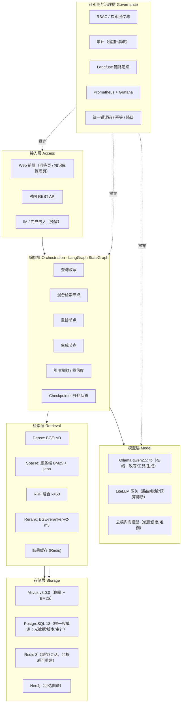

# 企业级知识库 RAG Agent · 技术方案与 MVP 设计（V1.0.11）

> **基准行业**：数字技术服务 / IT 服务与数字化运营（面向多行业的咨询、解决方案与交付服务）。
> **文档用途**：在**系统设计与方案定型阶段**，为个人自研项目给出可对外展示的技术方案全景、五维选型决策、可行性验证门禁（Gate 0）与 MVP 交付定义。
> **口径声明**：本项目处于**系统设计与方案定型阶段**，本文内**所有量化数字均为「设计目标 / 验收门禁」**，**非实测达成值、非上线数据**；任何指标一律不得解读为「已实现 / 已上线 / 实测达成」。文中凡出现具体数值，均以「设计目标」「验收门禁」「目标值」等前缀或上下文明确其性质。
> **执行主体**：个人独立设计与开发。
> **日期**：2026-10-09。
> **与 V1.1 的关系**：本文以《企业级知识库 RAG Agent · 项目定义（数字技术服务企业版 V1.1）》为**唯一基准**，是其第十节「技术方案概览」与第十一节「关键能力设计」的**工程化展开与 MVP 定型**；凡本文与 V1.1 冲突，以 V1.1 口径为准。约束继承 V1.1 第八节（数据不出域、行业/项目/密级隔离、单机部署、GPU 显存 8GB 硬瓶颈、本地优先云端兜底、Windows 11 + WSL2 + Docker Desktop、合规对标 CMMI/ISO/CCRC/ITSS）。
> **版本**：V1.0.11（M4 gold 修订执行版；**不动任何阈值**）。按第二人逐行结论收紧 q-008 / q-054 / q-057 三题的 `gold_keywords`：strict gold **100 → 90**、section gold **164 → 150**，删掉的 14 块**逐条等于第二人判否的行**，未凭机械规则多删一块；题干与题量（70）不变，改前实测另存 `var/gate0/pre_goldfix/`。重跑基线：section Recall@5 **0.822 → 0.8251**、strict **0.965 → 0.9658**、Hit@5 **0.9828 不变**（无回归，改善幅度在 n=58 噪声内）。**两条没自行做的**：q-056 机械补词会删掉第二人判「相关」的块 → 留待人工裁决；`m2_eval` 门禁把 **section** 读数喂进 `Recall@5≥0.85` 且缺 Hit@5 检查（与 V1.0.3 DoD 不符）→ 修它会立刻把「不通过」翻成「通过」，属门禁判定变更，**本轮不动**。详见文末 V1.0.11。）
> **上一版**：V1.0.10（M4 双人标注全量收口版；**不动任何阈值**）。终版读数 vs strict **0.8066** / vs section **0.5595**（差值 CI 不含 0），section 注水在全量上复现；两项评测集结构裁决落地——**敏感/拒答题退出相关性测量**（含敏感 0.8288 与剔除敏感 0.8562 并列报，对外只用前者；**跨文档题不得为抬数剔除**）、**3 道集合型题待拆**（q-053/q-055/q-058，与 gold 修订同批执行）；并**作废 V1.0.9 里两处 25 题外推**：gold 净变化实为删 14 / 加 2 确证（非「+2 −2」），「拆题是空集」不成立。详见文末 V1.0.10。）
> **上一版**：V1.0.9（（本行末两处结论已被 V1.0.10 作废）M4 评测集判据裁决版；**不动任何阈值**）。补上此前文档没定义的一件事：**双人标注逐块判据到底是什么**。裁决结果 = 一块须能**独立答全该题全部内容**（另两条细则：题面点名主体时别的项目/行业的同名章节不算；描述型块不算）。依据是首轮 25 题 / 210 行实测的 9 行真分歧——其中 **4 行不是人不一致，是判据没写清**。同版记录两条反面诚实：① 该口径下 Kappa 由 0.8321 升到 0.9014，但**双正例 27→27 一个没多**，抬升全部来自负例变多，不得读成「两人更合」（与复合分的零方差标签同属一类陷阱）；② 「答不全就拆题」这一支经逐题核对在本语料上是**空集**，故评测集题数不变、不因此重跑基线。gold 待改量随之从 +7 收敛到 **+2 −2**。详见文末 V1.0.9 与《项目定义》V1.8。）
> **上一版**：V1.0.8（M4 交付层落地版；**不动任何门禁阈值**，做三件事：① 补写此前**完全没写进契约的鉴权面**（7.2.1 身份头约定，含「取值必须百分号编码」——真浏览器实测直接发中文头会拒发整个请求）；② 新增两个读接口 `POST /api/v1/chunks/batch`（引用片段正文，与检索层**同口径**过滤、只返回生效版本）与 `GET /api/v1/audit`（限管理角色）；③ ADR 表按已实测证据改判 ADR-02/03/06 并补「依据」列，新增 ADR-11 前端形态（Vite+React，此前正文完全未提）、**ADR-12 记录「API 未容器化」这条对方案的明示偏离（待裁决）**。① 的「流式首 token < 1.2s」**仍按未达标·待裁决处理**，本版任何数字不作该门禁达标依据。详见文末 V1.0.8。）
> **上一版**：V1.0.7（M4 token 级流式落地版；在 V1.0.6 基础上**不动任何门禁阈值**，做两件事：① 流式契约由阶段级升级为 token 级（`retrieval` → `delta`* → `answer`，delta 带 provisional、answer 带可观测撤回）；② **作废一条被实测证否的判断**——「token 级流式与『只输出 JSON』结构化门禁互斥、须改两趟」不成立，一次 JSON 生成即可流。① 的 1.2s 首 token 门禁按可见内容口径实测达不到（p50 1642.7ms），如实记录、**未改门禁**。详见文末 V1.0.7。）
> **上一版**：V1.0.6（M3-04 置信度口径裁决版；在 V1.0.5 基础上**不动任何门禁阈值**，只做两件实测否证后的收回：① 复合分不再称「校准概率」，改标为规则分并自带性质声明；② 温度本轮不启用（Gate 0 的 6.655 拟合自零方差标签），并统一 API 与探针的温度来源——此前两套温度导致报出的「answer 42」描述的是一套从未上线的配置。详见文末 V1.0.6。）
> **上一版**：V1.0.5（M3-05 编排落地版；在 V1.0.4 基础上**不动任何门禁口径**，只把在线链路的实际形态、多轮状态的存放位置与端点契约写实：LangGraph 状态机 7 出口、敏感闸前置、Checkpointer 本轮不接、流式为阶段级非 token 级。行为等价性由 17 场景差分回归网证明。详见文末 V1.0.5。历史版本口径均在对应位置保留对照，不抹除。）
> **上一版**：V1.0.4（M3 证据复核更正版；在 V1.0.3 基础上**不新增门禁口径，只撤回一条错误归因**：Gate 0 ⑤ 的「引用落 gold 仅 23.5%」系指标误读，实测引用落点 100%，真问题是 39 行空结论被判成功答案。详见文末 V1.0.4。历史版本口径均在对应位置保留对照，不抹除。）

---

## 一、摘要与阅读指引

### 1.1 一页结论

**定位**：面向**数字技术服务企业内部**的**知识服务引擎**（不做对外多租户 SaaS），把「咨询—实施—运维」全链路沉淀的项目与行业知识，转化为**可追问、可溯源、可评估**的 RAG 知识服务，核心价值口径为"成效交付"——以交付知识复用率与自助解答率度量（设计目标）。

**核心链路**：

在线问答：`自然语言提问 → 查询改写 → 混合检索(Dense+BM25) → RRF 融合 → 重排 Top-5 → 生成 → 引用强制校验 → 结构化答案 + 置信度 + 来源 → 多轮追问`
离线构建：`文档上传 → 准入审核 → MinerU 解析 → Parent-Child 分块 → 元数据/版本标注 → 多存储写入 → Outbox 对账`

**技术主线**：FastAPI（后端）+ Milvus v3.0.0（向量 + 服务端 BM25）+ PostgreSQL 18（唯一权威源）+ Redis 8（运行态缓存/会话）+ BGE-M3（稠密）+ BGE-reranker-v2-m3（重排）+ LangGraph StateGraph（确定性编排）+ Ollama qwen2.5:7b（本地在线单模型）+ LiteLLM 网关（云端兜底）。

**三句结论性判断**：

1. **先验证、后开发**：本项目最大不确定性集中在 **8GB 显存硬瓶颈下的三模型共存** 与 **中文稀疏检索有效性**，因此将**可行性验证 Gate 0** 前置为里程碑 M0，**Gate 0 不通过则冻结主体开发并走回退分支**。
2. **确定性优先，而非能力堆叠**：在线链路采用 **Workflow 式确定性编排（LangGraph StateGraph）**，Function Calling 仅在**工具白名单**内使用；不做开放式自治 Agent，以保障可复现、可评估、可降级。
3. **可信度是一等公民**：**引用强制（无来源不出结论）+ 复合置信度 + 低置信度降级 + 转人工** 是本项目与通用问答的分水岭，也是合规（CMMI/ISO/CCRC/ITSS）落地抓手。

### 1.2 阅读指引

| 读者关注点 | 建议阅读章节 |
|---|---|
| 快速了解项目定位与结论 | 第 1 章 |
| 判断方案是否可行、风险多大 | 第 2、3 章（设计原则 + Gate 0） |
| 评审架构与技术选型是否合理 | 第 4、5 章（总览 + 五维选型） |
| 评审工程实现细节 | 第 6、7 章（关键技术 + 数据/接口契约） |
| 关心交付范围、工期与验收 | 第 8 章（MVP 定义） |
| 关心风险与决策过程 | 第 9、10 章（风险登记册 + ADR） |
| 需要术语、版本锁定与映射 | 第 11 章（附录） |

---

## 二、设计原则与总体目标

### 2.1 架构设计原则

| 原则 | 含义 | 落地机制 |
|---|---|---|
| **确定性优先** | 在线主链路行为可预测、可复现、可回归 | LangGraph StateGraph 固化为有限状态机；每步类型化（Pydantic）；避免开放式自主循环 |
| **本地优先** | 数据不出域，能力默认本地闭环，云端仅兜底 | Ollama 本地模型为主；LiteLLM 网关在低置信度时才路由云端，设 token 预算熔断 |
| **可溯源** | 每条结论可回溯到原文片段 | 引用强制 + 分块级来源标注（文档/章节/页码/片段 ID） |
| **可评估** | 关键环节有量化门禁，可离线回归 | RAGAS + 自建评测集 + 消融对照 + 版本回归 |
| **可降级** | 任一环节失败不返回错误答案，而是显式降级 | 检索超时降纯关键词；生成失败降"仅片段+标注"；低置信度降级"初步判断" |
| **最小权限** | "搜得到"的前提是"有权限看" | RBAC 在**检索层**做过滤，而非答案层裁剪 |
| **单一权威源** | 消除多存储静默不一致 | PostgreSQL 为元数据/版本/审计唯一权威源，向量索引可重建 |
| **审计不可篡改** | 全操作可追溯、不可删改 | 审计追加表 + 禁改触发器 |

### 2.2 总体目标（设计目标 / 验收门禁口径）

| 维度 | 目标（设计目标 / 验收门禁） |
|---|---|
| 检索质量 | **V1.0.3 修订口径**：主判定 **Hit@5 ≥ 95%** + **strict gold Recall@5 ≥ 85%** + MRR ≥ 0.75；section gold Recall@5 降为**报告值**（不设门禁），且任何 Recall 类数字必须同时给出样本量 n 与 95% 置信区间。原口径「Recall@5 ≥ 85%」未写明按哪套 gold 判定——section 级 gold 把相关章节内**所有**子块都算 gold，一道 gold=13 的题 Recall@5 理论上限只有 5/13，该口径测的其实是章节大小而不是检索能力（依据见文末 V1.0.3） |
| 生成可信 | 引用正确率 ≥ 90%；Faithfulness 报告值（目标 ≥ 90%，非阻塞判定）；幻觉率 ≤ 10%；Answer Relevance 报告值（非阻塞） |
| 校准与结构化 | ECE ≤ 0.10；结构化输出首次成功率 ≥ 90% |
| 延迟 | P95 检索延迟 < 800ms；**P95 完整答案（256 token 预算）< 6s**；流式首 token < 1.2s（**M4 已补测：按可见内容口径达不到**。token 级流式已实现并覆盖 **54/58 = 93.1%**（未覆盖的 4 题全是合法拒答，按「答出来的题」算是 54/54 = 100%）；首个可见内容 p50 **1642.7ms** / p95 1960.4ms，仅 1.85% 低于 1.2s。信封首字符 p50 849ms 但那只是 `{`，**不拿来充数**。结论级撤回 0/54、条目级丢失 0。前端实际可渲染的进度信号是「首个事件（含检索骨架）p50 440ms」。**门禁本身未改**——改它要走 3.4 回退分支，怎么处理见 `reports/m4/M4_流式交付实测.md` 第六节）——本地命中路径口径。原口径「P95 端到端 < 3s」经 Gate 0 ① 实测判定在 8GB 单卡 + 本地 7B 路径上不可达（256 token 档实测 P95 4.4s），已于 V1.0.2 修订 |
| 业务 | 自助解答率 ≥ 60%；重复性提问占比下降 ≥ 30%；新人上手周期缩短 ≥ 30% |
| 成本 | 云端预算熔断、无固定云开销；缓存命中率作为报告值监控 |

> 说明：以上为**验收门禁值（设计目标）**，项目当前处于方案定型阶段，尚无实测达成数据。

### 2.3 范围边界（继承 V1.1）

- **做**：企业内部知识服务、面向客户交付场景的底层检索引擎（同源可嵌）。
- **不做**：对外多租户 SaaS、业务决策/自动执行动作、模型全参训练/微调、移动端原生 App、超长上下文硬扛、自建基础大模型。

---

## 三、可行性验证（Gate 0）

### 3.1 为什么需要 Gate 0

本项目最大工程不确定性并非"能否做出 RAG"，而是三件"生死攸关"的事：**8GB 显存能否支撑嵌入+重排+7B 生成**、**Milvus 服务端 BM25 的中文有效性**、**多存储与单机本地化的一致性/合规可落地性**。三者任一不成立，将动摇整体方案。因此采用**先可行性再主体开发**的次序：**M0 = Gate 0**，为**阻塞门禁**。

### 3.2 Gate 0 验证项（逐项门禁表）

| # | 验证对象 | 验证方法 | 判定门禁指标 | 通过标准（验收门禁） | 验证出口 |
|---|---|---|---|---|---|
| ① | **8GB 显存下嵌入/重排与本地生成模型的分时/降级调度可行性** | 单机跑通"分段驻留"压测：嵌入(BGE-M3)与重排(BGE-reranker-v2-m3)按需加载/释放，**本地 7B 生成模型常驻**；构造长短 query 混合流量，观测显存峰值、OOM 次数、冷启切换耗时 | 显存峰值、OOM 次数、模型切换耗时、单位问答耗时 | V1.0.2 修订口径（依据 Gate 0 ① 实测）：全流程**零 OOM**；**嵌入与重排可与 7B 生成模型共存驻留**（不越界、无 OOM）；**P95 检索 < 800ms**；**P95 完整答案（256 token）< 6s**；流式首 token < 1.2s 待 M4 补测。原口径要求「嵌入、重排按需加载/释放，与生成分时互斥」+「P95 端到端 < 3s」——实测：per-query 互斥释放的冷启为 4.6–9.0s/次，P95 端到端劣化到 14.3s（约为共存策略的 3.3 倍），3s 门禁不可达，故改为「共存常驻 + 空闲超时释放」并重定延迟门禁 | 产出《显存调度验证报告》+ 分时调度策略参数 |
| ② | **Milvus v3.0.0 服务端 BM25 + jieba 中文分析器可用性与中文检索有效性** | 配置 `FunctionType.BM25` + jieba analyzer，灌入中文评测集；对比"默认分析器 vs jieba"的 BM25 命中；对术语/编号/方案名类 query 做人工抽检 | BM25 相对默认分析器召回增益、中文检索 Top-K 命中率 | jieba 生效且 **BM25 相对默认分析器有明确正增益**（非≈0）；术语/编号类 query 明显改善 | 产出《中文稀疏检索验证报告》+ analyzer 配置基线 |
| ③ | **混合检索相对单一稠密的增益（Dense vs Sparse vs 混合）** | 在自建评测集上做**消融对照**：Dense-only / Sparse-only / Dense+Sparse+RRF（k=60）+Rerank 三组，测量 Recall@5、MRR | Recall@5、MRR 增益归因 | 混合检索相对单一稠密**Recall@5 提升可归因、可复现**，且混合方案 **Recall@5 ≥ 85%（设计目标）** 具备达成路径 | 产出《检索消融对照报告》，锁定默认检索参数。**V1.0.3 口径补注**：本项当时的 0.822 是按 section 级 gold 出的，未同时报 strict 口径与置信区间；M2 复测同一配置为 section 0.822 / **strict 0.965 / Hit@5 0.9828**，n=58 时 Recall@5 的 95% CI 宽 0.13。历史判定「有条件通过」不改，但读数须按 2.2 节的双口径理解 |
| ④ | **多存储一致性（Outbox + 每日对账）工程可行性** | 模拟写入元数据库后向量写入失败/部分失败；验证 Outbox 补偿队列与每日对账能发现并修复差异 | 差异发现率、补偿成功率、对账耗时 | 人为注入的不一致能被**发现并修复**；不出现"静默缺数据" | 产出《多存储一致性验证报告》+ Outbox/对账作业骨架 |
| ⑤ | **引用强制与置信度校准（温度缩放 + ECE）可信性** | 在标注校准集上运行温度缩放；测 ECE；对"检索失败/无来源"场景验证强制拒答与降级 | ECE、引用强制命中率、降级触发正确率 | V1.0.2 修订口径（走方案 3.4 回退分支⑤）：**无来源必不输出结论**（零引用结论数 = 0）；**无依据必拒答**；**敏感证据（密级 3）与低置信必转人工**；**结构化输出首次成功率 ≥ 90%**。连续 ECE 由硬门禁降为**报告值**继续跟踪（原口径「ECE ≤ 0.10 具备达成路径」保留为跟踪目标） | 产出《置信度校准验证报告》+ 校准参数 |
| ⑥ | **单机 Docker Compose 全组件本地化与数据不出域部署可行性** | 在 Windows 11 + WSL2 + Docker Desktop 下一键起全组件（Milvus / PostgreSQL / Redis / 可选 Neo4j / 应用 / Nginx）；断网运行；校验无外呼 | 一键启动成功率、断网可用性、外呼检测 | 全组件**一键启动可用**；断网下核心链路可运行；**确认无数据出域外呼** | 产出《单机本地化部署报告》+ docker-compose 基线 |

### 3.3 Gate 0 判定规则

- **必备项（阻塞）**：①、②、⑥ —— 任一不通过，判 Gate 0 **不通过**，**冻结主体开发**。
- **非必备项**：③、④、⑤ —— 允许"具备达成路径"为通过，但需有明确修复计划。
- **整体通过**：6 项中 **≥ 5 项通过**，且**三项必备项全部通过**。
- **判定时点**：Gate 0 结论出具后，方进入 M1 主体开发；五维选型（第 5 章）的最终决策均发生在 **Gate 0 之后**。

### 3.4 不通过时的回退分支

| 未通过项 | 回退分支 |
|---|---|
| ① 显存调度 | 降级路线：嵌入/重排改 **CPU 分时** 或 **更小嵌入模型**；生成改 **量化 4-bit / 更小 7B**；必要时云端兜底承载重排 |
| ② 中文 BM25 | 回退到 **应用侧 BM25（如 rank_bm25/Elasticsearch 旁路）** 或升级 Milvus 版本重测；jieba 失效则评估其他中文分析器 |
| ③ 混合增益不足 | 保底保留 Dense + Rerank 两段式；BM25 作为可选增强；复查分块与查询改写 |
| ④ 一致性不足 | 收敛为"**单一权威源 + 可重建索引**"的最小姿态，暂缓图谱等非权威存储 |
| ⑤ 校准不可行 | 退化为**规则化置信度分档**（高/中/低）替代连续 ECE，强化强制拒答 |
| ⑥ 本地化部署不可行 | 缩小到**最小核心组件**（Milvus+PostgreSQL+Redis+应用）先行，Nginx/图谱后置 |

---

## 四、技术方案总览

### 4.1 分层架构图



### 4.2 端到端数据流

**（A）在线问答链路**（本地命中路径，目标 P95 端到端 < 3s）

```
用户提问(+角色/部门/项目/权限上下文)
   │
   ▼
[接入层] 鉴权 → RBAC 上下文注入 → 幂等键校验
   │
   ▼
[编排层] 查询改写(指代消解/口语化→检索友好)  ← 历史摘要(Checkpointer)
   │
   ▼
[检索层] Dense(BGE-M3) ‖ Sparse(BM25+jieba)  → RRF(k=60) → Rerank 至 Top-5
   │        (Redis 结果缓存命中则短路)         [检索层做权限过滤]
   ▼
[模型层] 本地单模型 qwen2.5:7b（改写/工具/生成）；低置信度/难例 → 云端兜底(预算熔断)
   │
   ▼
[编排层] 引用强制校验(无来源不出结论) → 复合置信度 → 低置信度降级/转人工
   │
   ▼
[接入层] 流式返回：结论 + 要点 + 引用(文档/章节/页码/片段) + 置信度 + 免责提示
   │
   ▼
[治理层] 全操作审计(追加) + Langfuse 链路 + Prometheus 指标
```

**（B）离线知识构建链路**

```
项目结项 / 文档上传
   │
   ▼
[准入审核] 格式校验 → 重复检测 → 来源可信度分级
   │
   ▼
[MinerU 解析] PDF/Word/表格 → 结构化文本
   │
   ▼
[Parent-Child 分块] 子块(精准检索) + 父块(上下文补全)
   │
   ▼
[元数据/版本标注] 行业/客户/项目/来源/章节/密级/状态 → 写入 PostgreSQL(权威源)
   │
   ▼
[多存储写入] Outbox 事件 → 异步写 Milvus(向量) → 可选 Neo4j(关系)
   │
   ▼
[每日对账] 比对权威源与索引差异 → 差异入补偿队列 → 修复
```

---

## 五、技术方案五维（Gate 0 后决策）

> **统一说明**：本章五个维度的最终选型，其**决策时点均在可行性验证 Gate 0 之后**——即先以 Gate 0 收敛技术不确定性，再据验证结论定选型。每节给出「候选项对比 → 推荐路径 → 决策依据 → 决策时点」。

### 5.1 维度一：模型选型方案

**候选对比**

| 方案 | 代表形态 | 优点 | 缺点 | 适配本项目 |
|---|---|---|---|---|
| **闭源 API 为主** | 云端大模型直接调用 | 能力强、免运维、上线快 | 数据出域、持续成本、无本地可控性 | ✗ 违反数据不出域与预算约束 |
| **开源模型为主** | 本地 7B/嵌入/重排 | 数据不出域、零边际成本、可控 | 能力弱于顶级闭源、受 8GB 显存约束 | ◐ 符合约束但需调度 |
| **混合（本地优先 + 云端兜底）** | 本地开源为主 + 网关路由 | 兼顾合规成本与能力上限 | 需网关与预算治理 | ✓ **推荐** |

**推荐路径**：**混合模式（本地优先、云端兜底）**——生成层为**本地单模型 `qwen2.5:7b`**，仅低置信度/难例经 **LiteLLM 网关** 走**云端兜底**。

- 本地嵌入：**BGE-M3**（稠密向量）；本地重排：**BGE-reranker-v2-m3**。
- **本地生成单模型**：Ollama `qwen2.5:7b` **单模型**承担查询改写、工具调用、JSON Schema 约束与答案生成（在线主路径，**单模型常驻、无模型切换**）。
- **原"本地双模型分工"方案已否决**：8GB 单卡无法同时常驻两个 7B，模型切换会击穿 P95 端到端 <3s，且二者同属 Qwen2.5 系底座、能力高度重叠，分工收益趋近于零。
- 统一走 **LiteLLM 网关**；仅在**低置信度 / 本地不可用**时路由**云端兜底**，并施以 **token 预算熔断 + 限流**。

**决策依据**：① 数据不出域（V1.1 第八节）要求默认本地闭环；② 8GB 显存硬瓶颈要求本地模型体积受控（7B 级）；③ 无固定云开销要求云端只作兜底；④ 单模型常驻可消除模型切换、保障 P95 端到端 <3s；本地双 7B 分工在 8GB 单卡不可行且与单模型能力重叠，故不采纳。

**决策时点**：**Gate 0 之后**——依据 ①（显存调度）与 ⑤（校准）验证结论锁定具体量化版本与云端兜底阈值。

### 5.2 维度二：架构编排方案

**选型矩阵**

| 范式 | 能力上限 | 确定性/可复现 | 可控性 | 幻觉风险 | 本项目适用性 |
|---|---|---|---|---|---|
| **Prompt** | 低 | 高 | 高 | 高（无依据） | 仅作基础范式，不足 |
| **RAG** | 中 | 高 | 高 | 低（有依据） | **核心必需** |
| **Function Calling** | 中 | 中 | 中 | 中 | 工具白名单内使用 |
| **Agent（自治）** | 高 | 低 | 低 | 高 | ✗ 不采用开放式自治 |
| **Workflow** | 中高 | **高** | **高** | 低 | **核心编排范式** |

**推荐组合**：**Workflow（主）+ RAG（核心能力）+ 工具白名单 Function Calling（受控增强）**

- 采用 **LangGraph StateGraph** 构建**类型化（Pydantic）确定性工作流**：`查询改写 → 混合检索 → 重排 → 生成 → 引用校验`。
- 以 **Checkpointer** 支撑**多轮状态持久化与中断-恢复**。
- **Function Calling 仅在工具白名单内**（如知识管理查询、元数据检索），不开放任意工具，避免不可控副作用。
- **不采用开放式自治 Agent**：与"确定性优先"原则一致。

**决策依据**：① 企业知识服务要求**可复现、可评估、可审计**，自治 Agent 难以满足；② V1.1 第十节明确 LangGraph StateGraph 编排；③ Workflow 便于逐节点埋点做消融与门禁。

**决策时点**：**Gate 0 之后**——依据 ③（检索消融）与④（一致性）结论固化节点与状态定义。

### 5.3 维度三：数据层方案

**候选对比**

| 子层 | 候选 | 推荐 | 理由 |
|---|---|---|---|
| **向量库** | Milvus / FAISS / pgvector | **Milvus v3.0.0** | 支持**服务端 BM25（`FunctionType.BM25`）+ jieba**，天然支撑混合检索；单机容器化友好 |
| **数据库** | PostgreSQL / MySQL | **PostgreSQL 18** | **唯一权威源**（元数据/版本/审计）；追加表 + 禁改触发器便于合规 |
| **缓存** | Redis / 内存 | **Redis 8** | 运行态缓存与会话；**非权威、可重建**，TTL 可驱逐 |
| **图谱** | Neo4j / 无 | **Neo4j（可选）** | 实体/流程/方案关联增强；非权威，可选后置 |
| **日志/追踪** | 文件日志 / Langfuse | **结构化日志 + Langfuse** | 链路追踪与可观测 |

**存储归属原则**：向量索引（Milvus）、元数据与版本（PostgreSQL，唯一权威源）、关系图谱（可选）、运行态缓存与会话（Redis，非权威可重建）。**向量索引可由权威源重建**，消除多存储静默不一致。

**推荐路径**：**Milvus v3.0.0（向量 + 服务端 BM25）+ PostgreSQL 18（唯一权威源）+ Redis 8（非权威缓存/会话）+ Neo4j（可选图谱）+ 结构化日志 + Langfuse**，与 V1.1 第十节存储归属原则一致。

**决策依据**：① 混合检索依赖服务端稀疏能力；② 合规要求审计权威且不可篡改；③ 8GB 单机要求组件轻量可控；④ 图谱为增强项，避免范围膨胀（V1.1 Won't）。

**决策时点**：**Gate 0 之后**——依据 ②、③、④ 验证结论锁定 Milvus 版本与分析器配置、对账策略。

### 5.4 维度四：工程层方案

**候选对比**

| 子层 | 主要候选 | 取舍要点 | 适配本项目 |
|---|---|---|---|
| **后端** | FastAPI / Flask / Django | FastAPI 原生异步、Pydantic 类型化、自动 OpenAPI，最契合流式与契约诉求 | ✓ **FastAPI** |
| **前端** | Web 应用 / 移动端原生 App / 桌面端 | Web 覆盖企业内多角色、开发交付成本最低；原生 App 属 V1.1 Won't | ✓ **Web 应用** |
| **评测** | RAGAS + 自建集 / 纯人工抽检 / 公开评测集 | 无公开评测集 → 自建（双人标注 + Cohen's Kappa）+ RAGAS 自动化回归 | ✓ **RAGAS + 自建集** |
| **监控** | Langfuse + Prometheus/Grafana / 自建日志 | 链路追踪与指标看板开箱即用，避免自建可观测的成本 | ✓ **Langfuse + Prometheus/Grafana** |
| **权限** | RBAC + 职责分离 / ACL / 不做隔离 | 部门/项目/客户/密级多维隔离，检索层过滤满足合规审计 | ✓ **RBAC + 职责分离** |

**推荐路径**：**FastAPI（后端）+ Web 前端 + RAGAS 自建评测 + Langfuse/Prometheus/Grafana 可观测 + RBAC 职责分离**，全量对齐 V1.1 第十节技术栈基线。

**推荐落地明细**

| 子层 | 推荐 | 关键点 |
|---|---|---|
| **后端** | **FastAPI** | 异步高吞吐、Pydantic 类型化、OpenAPI 契约 |
| **前端** | **Web 前端**（问答页 + 知识库管理页） | 流式对话、引用高亮、追问建议；Web 优先（不做原生 App） |
| **评测** | **RAGAS + 自建评测集** | 无公开评测集 → 自建（双人标注 + Cohen's Kappa）；版本回归 |
| **监控** | **Langfuse + Prometheus + Grafana** | 链路追踪 + 指标看板 |
| **权限** | **RBAC + 职责分离** | 部门/项目/客户/密级；**检索层过滤**；职责分离避免权限集中 |

**决策依据**：① V1.1 第十节技术栈基线；② 合规要求审计与职责分离；③ 自建评测集是门禁落地前提；④ 可观测是"可评估"原则的支撑。

**决策时点**：**Gate 0 之后**——前端形态随上线方式（5.5）联动定稿，评测/监控基线随 ③⑤ 验证结论固化。

### 5.5 维度五：上线方式方案

**候选对比**

| 方式 | 覆盖用户 | 集成成本 | 体验上限 | 合规可控 | 本项目适配 |
|---|---|---|---|---|---|
| **内部工具** | 有限 | 低 | 低 | 高 | ◐ 可作初期形态 |
| **对内 API** | 系统集成方 | 中 | 中 | 高 | ✓ 必需（同源可嵌） |
| **插件（IM/门户）** | 广 | 高 | 中 | 中 | ◐ 预留、非 MVP |
| **Web 应用** | 广（企业内） | 中 | **高** | 高 | ✓ **推荐主形态** |

**推荐路径**：**内网 Web 应用（主）+ 对内 REST API（辅）**

- **主形态**：内网 **Web 应用**（问答页 + 知识库管理页），承接主用户（交付工程师/FDE、售前、PM、新人）。
- **辅形态**：**对内 REST/流式 API**，供既有 ChatBot / 智能客服 / 企业知识管理**同源嵌入**（V1.1 第十二节）。
- **预留**：IM / 门户**插件**集成，非 MVP 范围。
- **明确不做**：**对外多租户 SaaS**。

**决策依据**：① 服务企业内部，Web 应用即可覆盖主要角色；② 对内 API 满足"作为底层检索引擎"的复用诉求；③ 插件集成成本高，缓做；④ 对外 SaaS 属明确非目标。

**决策时点**：**Gate 0 之后**——依据 ⑥（单机本地化）确认内网部署形态可行后定稿。

---

## 六、关键技术设计

> 本章将 V1.1 第十一节深化到可实施粒度。

### 6.1 知识库构建与文档解析

| 环节 | 设计要点 |
|---|---|
| **准入流程** | 格式校验 → 重复检测（内容指纹）→ 来源可信度分级；未通过不入库 |
| **解析** | **MinerU** 解析 PDF / Word / 表格，产出结构化文本与版面信息 |
| **分块** | **Parent-Child**：**子块**用于精准检索，**父块**补全上下文，兼顾精度与完整性 |
| **元数据标注** | 行业 / 客户 / 项目 / 来源 / 章节 / 密级 / 状态 → 支撑跨行业隔离、跨项目复用、版本回滚 |
| **多存储写入** | 权威源（PostgreSQL）确认后经 **Outbox** 异步写 Milvus / 可选 Neo4j |

### 6.2 混合检索与检索质量优化

- **双路检索**：**Dense（BGE-M3）** + **Sparse（服务端 BM25 + jieba 中文 analyzer）**，解决单一稠密检索对**术语、编号、方案名**召回不全。
  - **V1.0.2 配置形态修正（Gate 0 ② 实测）**：Milvus v3.0.0 服务端**拒绝** `analyzer_params={"type": "jieba"}`（`unknown build-in analyzer type: jieba`，tantivy `tokenizer.h`）。可用形态是 **`analyzer_params={"tokenizer": "jieba"}`**；另有内置 **`{"type": "chinese"}`** 可作备选。默认（仅 `enable_analyzer=true`、不给 params）对中文查询近乎无效——实测 Recall@5 0.399 对 jieba 0.761（Δ+0.362），本文「默认分析器对中文近乎无效」的判断已被实测坐实。
- **融合与重排**：**RRF（k=60）** 融合 → **BGE-reranker-v2-m3** 重排至 **Top-5**。
- **查询改写**：口语化 / 多轮指代 → 检索友好 query。
- **缓存**：检索结果 **Redis** 按 hash 缓存，TTL 可驱逐。
- **消融对照**：Dense / Sparse / 混合三组对照，使"效果提升"**可归因、可复现**。

### 6.3 Agent 编排状态机

```
[START] → 查询改写 → 混合检索 → 重排 → 生成 → 引用校验 → [END]
              ▲                              │
              └──────── 多轮追问（Checkpointer 状态恢复）──────┘
```

**V1.0.5 落地形态**（原草图保留在上，作为口径对照；差异与理由见文末 V1.0.5）：

```
START → sensitive_gate → rewrite → retrieve → retrieval_gate → generate → enforce → confidence → END
            └ gated ────────┴─ gated ────────────┴─ gated ────────────────────────────┘
```

- **类型化状态**：V1.0.5 裁决改用 `TypedDict(total=False)` 而非 Pydantic——状态要携带
  `RetrievalResult` / `AccessContext` 等运行时对象，且「节点只返回要更新的键」与 TypedDict 的
  增量合并语义同构；Pydantic 需开 `arbitrary_types_allowed` 并在每个节点增量上重校验。
  节点仍纯函数化（只读 state、只返回更新），便于单测与回归。
- **多轮状态**：V1.0.5 裁决**本轮不接 Checkpointer**，上文由 PostgreSQL `session_turn` 提供
  （与「PG 为唯一权威源、其余存储皆可丢」一致；Checkpointer 会把同一份会话状态存两处）。
  代价明确：**无中断-恢复**，链路中途失败只能整条重来。待人工复核闭环需要断点续跑时再接，
  且届时要落到同一张权威表而不是另一套表。
- **降级分支**：检索不足 → 拒答（`refuse`）；生成失败 / 输出不可解析 / 结论为空 → `degraded` 并转人工；
  敏感命中 / 低置信 / 强证据却声明无依据 / 引用落在密级 3 → `escalate` 转人工。
  7 个出口在图上以 `gated` 驱动，可从拓扑直接数出，不靠读散落 return 确认。

### 6.4 引用强制与置信度

| 机制 | 设计 |
|---|---|
| **引用强制** | 每条结论必须携带来源（文档/章节/页码/片段 ID）；**无来源不出结论** |
| **复合置信度** | 检索分数 + 生成自评 + 引用一致性 → 复合分 |
| **温度缩放** | 对分类/判别概率做温度缩放，使 **ECE ≤ 0.10（设计目标）** |
| **低置信度降级** | 显式标注"初步判断"，不自动出正式结论；触发转人工 |

**V1.0.6 落地裁决**（上表为设计草图，保留对照；下列为本版实际口径）：

| 机制 | V1.0.6 口径 |
|---|---|
| 引用强制 | 不变。无有效引用的结论一律整条降级，是确定性规则而非提示词请求 |
| **复合分数（不再称「置信度」）** | 仍由 `0.45×检索分 + 0.35×引用一致性 + 0.20×模型自评` 组成，但**对外明确标注 `score_basis=rule_composite_not_probability`**——它是规则分，不是「答案正确的概率」。M3-04a 实测：三个成分里 `citation_consistency` 恒为 1.0、`self_assessed` 仅取 {0.0, 0.9} 且均值 0.034、`retrieval` 已饱和（均值 0.8911，79% ≥ 0.9），合成分 **93% 是常数偏移**；对唯一有方差的标签（结论是否含齐 reference 全部数字）AUC = **0.346**（bootstrap 95% CI 0.194–0.512），即**无信号、方向偏反** |
| **温度缩放：本轮不启用（T=1.0）** | Gate 0 ⑤ 那次拟合用的标签是「任一引用落 gold」，在可判集上 **53/53 恒为 1**——零方差标签上 NLL 的最优解只能是 T→∞（把一切压向基率），那是**抹平不是校准**。`fit_temperature` 已加零方差拒绝分支（返回恒等并带 `refused`）。服务路径改读 M3 自有的 `confidence_calibration.json`，**不回落**到 Gate 0 那份 6.655（该文件作为历史证据原样保留） |
| **温度必须单一来源** | API 与所有离线探针共用 `load_calibration_temperature()`。此前 API 读 T=6.655、探针用 1.0，导致报出去的「answer 42 / tentative 11」描述的是一套**从未上线过的配置**；而 6.655 下 `calibrated` 可达上界仅 0.6388 < `answer` 门槛 0.75，即 `answer` 状态对外永不可达。现统一为 1.0 后 `answer` 可达，测的与服务的是同一套 |
| **低置信度降级** | 不变，仍按 `composite` 与 `confidence_low/high` 分档。但要写清：分档本身是**策略**（阈值决定谁转人工），不代表分数有预测力；ECE 继续作为**报告值**跟踪（V1.0.2 起已非门禁） |
| **恢复「概率」口径的条件** | 出现**有方差且真正在意的标签**（例如双人标注的 `answer_correct`）时，才重新拟合并重新主张校准。在此之前不得对外称「校准概率」 |

**顺带记录一条正面事实**：`number_groundedness`（结论中的数字有多少真出现在被引用证据正文里）
在 44/44 行上为 1.0 —— **没有一个数字是无中生有**。这批答案的缺陷是**答得不全**，不是**瞎编**。
把它作为可对外报出的**事实项**（可核对），比把它折算成一个概率更诚实。

### 6.5 可靠性与一致性

| 机制 | 设计 |
|---|---|
| **Outbox** | 权威源写入后异步写向量库，失败入补偿队列 |
| **每日对账** | 比对权威源与索引差异，修复"静默缺数据" |
| **降级** | 检索超时→纯关键词；生成失败→片段+标注；低置信度→初步判断 |
| **显存驻留** | V1.0.2 修正（Gate 0 ① 实测）：8GB 单卡采用「**嵌入 + 重排与 7B 生成共存常驻，空闲超时释放**」，而非原文的 per-query 按需加载/释放。实测共存峰值 8098/8188 MiB（零 OOM、无越界采样），余量仅约 90 MiB——因此必须锁死嵌入批大小与生成上下文长度；互斥释放档冷启 4.6–9.0s/次、P95 端到端 14.3s，不可用于交互链路；CPU 兜底档 P95 125.8s，仅作不可用时的最后退路 |
| **契约** | 统一错误码 / 超时 / 重试 / 幂等 |
| **编排** | Docker Compose healthcheck / 资源限制 / 命名卷；备份与恢复 |

### 6.6 安全与合规

- **四道防线**：① 数据接入层本地闭环；② Agent 层工具白名单 + 输入净化；③ 答案层引用强制 + 降级显式化；④ 知识层准入审核 + 来源分级。
- **RBAC 检索层过滤**：按部门/项目/客户/密级过滤，确保"搜得到"的前提是"有权限看"。
- **审计追加禁改**：查询/追问/引用/知识变更全量追加，禁改触发器保护。
- **投毒与注入防护**：知识准入 + 输入净化 + 工具白名单，防知识库投毒与 Prompt 注入。

---

## 七、数据模型与接口契约

### 7.1 核心表 / 集合

| 存储 | 实体 | 关键字段（示意） |
|---|---|---|
| **PostgreSQL** | 文档元数据 `document` | id, title, industry, customer, project, source_level, security_level, status, created_at |
| **PostgreSQL** | 文档版本 `document_version` | id, doc_id, version, chunk_scheme, checksum, effective_at |
| **PostgreSQL** | 分块 `chunk` | id, version_id, parent_id, content_ref, page, section, order_no |
| **PostgreSQL** | 会话 `session` | id, user_id, role_ctx, created_at, updated_at |
| **PostgreSQL** | 审计 `audit_log` | id(追加), actor, action, target, trace_id, ts（禁改触发器） |
| **PostgreSQL** | Outbox `outbox_event` | id, aggregate, payload, status, retry_count |
| **Milvus** | Collection `kb_chunks` | 向量 + 稀疏字段（BM25）+ 标量字段（industry/project/security_level 等用于过滤） |
| **Redis** | 缓存/会话 Key | query hash → 结果；session state；TTL 可驱逐 |
| **Neo4j（可选）** | 图谱节点/关系 | 方案/组件/流程实体与关联 |

### 7.2 主要 API 契约（示意）

| 方法 | 路径 | 说明 | 关键请求/响应 |
|---|---|---|---|
| POST | `/api/v1/qa/ask` | 单轮问答 | req: question, role_ctx, idempotency_key；resp: answer, citations[], confidence, trace_id |
| POST | `/api/v1/qa/ask/stream` | 流式问答（SSE/Socket.IO） | 同上，增量推送 token + 引用高亮 |
| POST | `/api/v1/qa/followup` | 多轮追问 | req: session_id, question；基于 Checkpointer 恢复状态 |

**V1.0.5 落地对照**（原三行路径为设计草图，实际契约如下）：

| 方法 | 实际路径 | 与草图的差异 |
|---|---|---|
| POST | `/api/v1/answers` | 对应 `/qa/ask`，`question` + `session_id` + `Idempotency-Key` + `rewrite` 开关。响应即草图所列 `answer / citations / confidence / trace_id`，另加 `session_id / turn_no / new_session` |
| POST | `/api/v1/answers/stream` | 对应 `/qa/ask/stream`，**V1.0.7 起为 token 级 SSE**：`retrieval` → `delta`* → `answer`（异常以 `error` 收尾；`answer` 恰好一次且为最后事件）。`delta` 带 `provisional: true`，**前端必须用未完成态渲染**；`answer` 带 `provisional_retracted` / `provisional_lost` 可观测撤回。未闭合 JSON 由 `kee.qa.stream_json` 按路径读已成形字段，**不需要改成两趟**，故与 ⑤「只输出 JSON」的结构化门禁不冲突（草图与 V1.0.5 曾判为互斥，实测证否）。`token_stream=false` 退回阶段级，是对照开关 |
| POST | `/api/v1/chunks/batch` | **M4 新增**。按 id 批量取引用片段正文（前端展示「文档/章节/页码/片段」用）。`ids` 上限 50；**过滤口径与检索层一致**（密级/行业/项目），且只返回**生效版本**的内容；越权与不存在的 id 合并进 `hidden`，不区分——区分本身就是信息泄露。每次读取落一条 `chunks_read` 审计 |
| GET | `/api/v1/audit` | **M4 新增**。审计读接口，限 `knowledge_owner` / `system_admin`（其余角色拿到 E403 原文）。按 `id` 倒序分页（`ts` 有并列，按它排会翻页重漏）。只有读路径：`audit_log` 的 UPDATE/DELETE 由触发器一律拒绝 |
| — | （未开端点） | 草图的 `/qa/followup` **不单独开**：`POST /api/v1/answers` 带 `session_id` 即追问，上文从 `session_turn` 读。单开端点会让同一条链路有两个入口、两套审计，而多轮与单轮走的图是同一张 |
| POST | `/api/v1/documents/upload` | 文档上传 | req: file, meta(industry/project/security_level)；resp: doc_id, admission_status |
| GET | `/api/v1/documents` | 知识管理查询 | 分页 + 权限过滤 |
| POST | `/api/v1/documents/{id}/review` | 答案/文档复核 | pass/reject → 版本升版 |

### 7.2.1 身份头约定（M4 实测补写）

草图与本节此前**只字未提鉴权面**，而它是契约的一部分，所以按实现补写：

| 头 | 含义 | 约定 |
|---|---|---|
| `X-Kee-Role` | 角色，**必填** | 缺失一律 `E401`。角色集合见 `kee/retrieval/rbac.py` 的 `ROLE_MAX_LEVEL`（7 个角色） |
| `X-Kee-Actor` | 审计里的操作者 | 缺省回落到 role；**必须显式送**，否则多人共用一个角色时审计分不出人 |
| `X-Kee-Industries` / `X-Kee-Projects` | 检索范围 | 逗号分隔；`knowledge_owner` / `system_admin` 不受这两维约束 |

**取值必须百分号编码**（`encodeURIComponent` ↔ 服务端 `unquote`）。这不是风格：HTTP 头只允许
latin-1 字节，而本语料的行业取值就是中文（金融/能源/化工）。M4 浏览器实测——直接发中文头时
`fetch` 当场抛 `String contains non ISO-8859-1 code point`，**整个请求发不出去**；
`httpx` 侧同样在编码前报 `UnicodeEncodeError`。所以编码是契约，不是实现细节，
漏掉任何一端都会得到「界面点了行业筛选就白屏」这种最难查的故障。

**权限的强制点在检索层**（`build_filter_expr` 把密级/行业/项目收敛进 Milvus 过滤表达式），
不在前端、也不在答案生成之后裁剪。界面上的角色表只用于呈现可选项。
DoD 第 7 项「RBAC 检索层过滤」判的是这件事。

> **待裁决（M4 登记）**：`reports/m1/M1_验证记录.md` 第 103 行已写明这套身份是**请求头占位、可伪造**，
> 「内网 Demo 可接受，生产必须换真实身份源」。**换成什么身份源（OIDC / LDAP / 网关签发 JWT）文档至今未定**，
> 且文档对过滤维度有三种不一致表述（部门/项目/客户/密级 ↔ 部门/项目/密级 ↔ 行业/项目/密级），
> 实现按第三种（行业/项目/密级）。统一表述需一次裁决，不属于我能自行收敛的范围。

### 7.3 统一错误码 / 超时 / 重试 / 幂等契约

| 项 | 约定 |
|---|---|
| **错误码** | 分级：`E4xx` 客户端、`E5xx` 服务端、`E9xx` 依赖（检索/模型/存储）；结构含 code/message/trace_id/retryable |
| **超时** | 检索、重排、生成分设超时；超时触发降级分支 |
| **重试** | 仅对 `retryable=true` 的幂等操作做**指数退避**；生成不盲目重试 |
| **幂等** | 写操作以 `idempotency_key` 保证幂等，防重复上传/重复提问副作用 |

---

## 八、MVP 定义

### 8.1 MVP 范围

**Must（必须端到端闭环，映射 V1.1 第九节 9 条）**

| # | Must 能力 | 对应 V1.1 |
|---|---|---|
| 1 | 文档上传 → 准入审核 → 解析分块 → 多存储落库 | 9-① |
| 2 | 混合检索（Dense+BM25+RRF+Rerank）返回带来源证据集（Hit@5 ≥ 95% 且 strict gold Recall@5 ≥ 85%，V1.0.3 口径） | 9-② |
| 3 | Agent 编排（LangGraph）生成答案 + 要点 + 置信度 | 9-③ |
| 4 | 引用强制：每条结论均有出处，无来源不出结论 | 9-④ |
| 5 | 低置信度路由：显式标注"初步判断" | 9-⑤ |
| 6 | 敏感/低置信度问题转人工复核（确定性规则） | 9-⑥ |
| 7 | 会话式多轮追问（流式推送） | 9-⑦ |
| 8 | 基础 RBAC（部门/项目/密级隔离）+ 全操作审计 | 9-⑧ |
| 9 | Web 前端：问答页 + 知识库管理页可用 | 9-⑨ |

**Should（增强，非阻塞）**：Neo4j 图谱增强；IM/门户插件；云端兜底精细化路由；答案反馈闭环。

**Won't（明确不做）**：对外多租户 SaaS；业务决策/自动执行；模型全参训练/微调；移动端原生 App；超长上下文硬扛；自建基础大模型。

### 8.2 MVP 里程碑

| 里程碑 | 目标 | 交付物 | 依赖 | 预估工期（工作日） |
|---|---|---|---|---|
| **M0 = Gate 0** | 可行性验证 6 项门禁 | 《Gate 0 验证报告》+ 回退决策 | 无 | 8–12 |
| **M1** | 知识构建链路 + 存储骨架 | 准入/解析/分块/多存储 + Outbox/对账骨架 | M0 通过 | 12–18 |
| **M2** | 混合检索 + 评测基线 | 检索链路 + 自建评测集 + 消融报告 | M1 | 10–15 |
| **M3** | 编排 + 引用 + 置信度 | LangGraph 工作流 + 引用强制 + 校准 | M2 | 12–18 |
| **M4** | 前端 + RBAC + 审计 + Demo | Web 页面 + 权限 + 审计 + Docker Compose 一键 Demo | M3 | 12–18 |
| **M5** | 验收与定型 | DoD 核对 + 版本锁定清单 + 风险登记册定稿 | M4 | 5–8 |

> **总计划次序**：**先可行性（M0）→ 再主体开发（M1–M4）→ 后验收（M5）**。Gate 0 不通过则冻结 M1 起的主体开发。

### 8.3 MVP 验收标准（DoD）

| # | 验收项 | 判定标准 | 映射 V1.1 |
|---|---|---|---|
| 1 | Must 链端到端可演示 | 9 条 Must 全链路可跑通 | 第九节停止条件① |
| 2 | 检索质量 | **V1.0.3 修订口径**：Hit@5 ≥ 95% 且 strict gold Recall@5 ≥ 85% 且 MRR ≥ 0.75 为达标；section gold Recall@5 作报告值随附（须给 n 与 95% CI）。原口径「Recall@5 ≥ 85%；MRR ≥ 0.75」见 2.2 节的 gold 口径说明 | 第六节技术指标 |
| 3 | 引用可信 | 引用正确率 ≥ 90%；幻觉率 ≤ 10%（Faithfulness 为报告值，目标 ≥ 90%，非阻塞判定） | 第六节 |
| 4 | 校准与结构化 | ECE ≤ 0.10；结构化输出首次成功率 ≥ 90% | 第六节 |
| 5 | 延迟 | P95 检索 < 800ms；P95 端到端 < 3s（本地命中路径） | 第六节 |
| 6 | 业务 | 自助解答率 ≥ 60%；重复性提问占比下降 ≥ 30%；新人上手周期缩短 ≥ 30% | 第六节 |
| 7 | 合规 | 数据不出域；RBAC 检索层过滤；审计追加禁改 | 第八节约束 |
| 8 | 交付物 | 版本锁定清单 + 风险登记册定稿 | 第九节停止条件③ |

### 8.4 停止条件（沿用 V1.1）

① **Must 链端到端可演示**；② **≥ 3 项量化指标达标**（`Hit@5 ≥ 95% + strict gold Recall@5 ≥ 85%` + `P95 检索 < 800ms` + 结构化输出首次成功率 ≥ 90%，检索项为 V1.0.3 口径）；③ **版本锁定清单 + 风险登记册定稿**。

---

## 九、风险登记册

| 风险 | 类别 | 影响 | 概率 | 等级 | 缓解措施 | 触发信号 |
|---|---|---|---|---|---|---|
| 8GB 显存不足导致三模型无法协同 | 算力 | 高 | 高 | **高** | Gate 0 ① 前置验证；分时调度/量化/CPU 降级；云端兜底 | OOM、切换超时、P95 超标 |
| jieba 中文分析器失效致 BM25 收益≈0 | 检索 | 高 | 中 | **高** | Gate 0 ② 验证；应用侧 BM25 旁路；分词人工抽检 | BM25 增益≈0、术语类召回差 |
| 混合检索相对稠密无增益 | 检索 | 中 | 中 | 中 | Gate 0 ③ 消融；保底 Dense+Rerank | 三组对照 Recall@5 无差异 |
| 多存储静默不一致 | 一致性 | 高 | 中 | **高** | Outbox + 每日对账；索引可重建 | 对账出现差异、缺数据 |
| 置信度校准不可行（ECE 不达标） | 可信 | 中 | 中 | 中 | 温度缩放 + 规则分档退路 | 校准集 ECE 偏高 |
| └ **状态更新（V1.0.7）：已发生** | 可信 | 中 | — | **已发生** | M3-04a 实测所有 gold 层级标签在本语料零方差、复合分 93% 是常数、对唯一有方差标签 AUC=0.346。处置：置信度**降为规则分、不再称概率**（V1.0.6），温度缩放本轮不启用（V1.0.6） | 敞口未关闭：真正缺的是**有方差的正确性标签**（待双人标注），不是算法 |
| └ **状态更新（2026-10-11，双人标注首轮 25 题）：敞口仍未关闭** | 可信 | 中 | — | **未关闭** | 本轮工单测的是**块级相关性**（修的是评测集的 gold），**不是 `answer_correct`**——校准还需要一次**每题一行**的正确性标注（53 行，源 `m3_confidence_probe.json` 的 conclusion + cited_ids，且**不得把 reference 显示给标注人**）。顺带得到的：strict 口径被**看不到第一人标签**的第二人独立复现，Kappa **0.8321**（按题聚类 CI 0.7129–0.9574），section 口径仅 **0.5547**（CI 0.4517–0.6598），差值 0.2804（CI 0.1986–0.3685，2000/2000 次重采样同号）→ **V1.0.3 把 section 降为报告值这一步由外部人证成了** | 见 `reports/m4/M4_双人标注一致性.md` |
| **评测集 gold 自身有缺陷 → 检索门禁读数失真** | 评测 | 高 | **已量到·全量** | **中** | 双人标注全量完成（63 题 / 547 行；判据=一块须独立答全，V1.0.9）；改 gold 走三件套（改条款 + 记裁决 + 留改前实测），与「拆 3 道集合型题」**合并成一次改动、一次重跑**，另存不覆盖 `m2_eval.json` | **全量：strict gold 需删 14 块 / 加 2 块确证**——删因两类：跨文档题收了「提到方法但没列全」的块（q-054×5、q-056×4、q-057×3，第二人对）；跨项目扩收（q-008×2，**检索到错误行业文档也算命中，假绿方向**）。加：q-012#3、q-014#2（q-030、q-044 待读全文再定）。另 3 道题**在乙口径下无任何单块能答全**（q-053/q-055/q-058）→ 拆题裁决 |
| └ **状态更新（2026-10-12，V1.0.11）：「删」这半已执行，「加」与「拆」未动** | 评测 | 高 | 中 | **部分处置** | q-008 / q-054 / q-057 按第二人逐行结论补限定词，strict gold 100→90、section 164→150，删除量与其判否行逐条对齐；改前实测另存 `var/gate0/pre_goldfix/`，题量仍 70。重跑 section 0.822→0.8251、strict 0.965→0.9658、Hit@5 0.9828 不变——**Δ 在 n=58 噪声内，这是尺子变准不是检索变好**。q-056 未动：机械补词与第二人结论相反，以人为准。q-012 / q-014 加块与 q-053 / q-055 / q-058 拆题**要新题干 + 新人工标注**，未并入本次 | 门禁判定另有一条待裁决：`m2_eval` 用 **section** 读数判 `Recall@5≥0.85` 且不查 Hit@5，与 V1.0.3 DoD 不符；按 DoD 口径（strict 0.9658 / Hit@5 0.9828）实为通过，**修它会当场翻转判定，故只登记不擅动** |
| 流式「首 token < 1.2s」在本地 7B 路径上达不到 | 体验 | 中 | 中 | 中 | M4 补测。**V1.0.7 实测：按可见内容口径 p50 1642.7ms，仅 1.85% 达标**（信封首字符 849ms 但那只是 `{`，不作达标依据）。用户可感知的进度信号实为「首个事件含检索骨架 p50 440ms」 | 首个可见内容 > 1.2s 的占比过高 |
| └ **处置：暂缓（用户 2026-10-11 决定）** | 体验 | 中 | — | **待裁决** | 门禁值未改；口径留到 M5 验收前一起判：改判据为「首事件（含骨架）」或降为报告值。**定下来之前，任何对外材料都不得声称该门禁达标** | 见 `reports/m4/M4_流式交付实测.md` 第六节 |
| 数据出域/合规风险 | 合规 | 极高 | 低 | **高** | 全组件本地化、断网运行、外呼检测、审计禁改 | 检测到外呼、审计被改 |
| 知识库投毒 / Prompt 注入 | 安全 | 高 | 中 | **高** | 准入审核 + 来源分级 + 输入净化 + 工具白名单 | 异常来源入网、越权指令 |
| 范围膨胀（滑向自治 Agent/SaaS） | 范围 | 中 | 中 | 中 | 严守 Won't 清单；Workflow 优先 | 需求溢出 Must 边界 |
| 个人独立开发进度风险 | 资源 | 中 | 中 | 中 | 里程碑可判定出口；不设无限期 | 里程碑延期超阈值 |
| 云端兜底成本失控 | 成本 | 中 | 低 | 中 | token 预算熔断 + 限流 + 本地优先 | 预算触顶告警 |

---

## 十、技术选型决策记录（ADR 摘要）

| # | 决策 | 状态 | 背景 | 备选 | 结论 | 影响 | 依据（可复跑的证据） |
|---|---|---|---|---|---|---|---|
| ADR-01 | 模型选型采用混合模式 | 提议（待 Gate 0） | 数据不出域 + 8GB 显存 + 预算约束 | 闭源 API / 纯开源 / 混合 | 本地单模型 + 云端兜底 | 需 LiteLLM 网关与预算熔断；已否决本地双模型分工 | 状态留待用户裁决。已实测的部分：`var/gate0/g01_vram_scheduler.json`（云端兜底开关恒 `false`） |
| ADR-02 | 编排采用 Workflow（LangGraph StateGraph） | **已定（M3 落地）** | 需确定性、可评估、可审计 | Prompt/RAG/FC/Agent/Workflow | Workflow + RAG + FC 白名单 | 固化为状态机，逐节点埋点 | `src/kee/qa/graph.py` 7 出口状态机；等价性由 `scripts/m3_graph_equivalence.py` 18 场景差分（按 sha 钉住旧实现当 oracle）+ `m3_graph_ab_live.py` 真机 12/12 证明；`reports/m3/M3_编排引用与置信度.md` |
| ADR-03 | 向量库选 Milvus v3.0.0 | **已定（② 支撑；③ 增益结论已降级）** | 需服务端 BM25 + 中文分析器 | Milvus/FAISS/pgvector | Milvus | 依赖其 BM25/jieba 可用性 | ② 实测服务端 BM25 + jieba 中文有效：`var/gate0/g02_chinese_bm25.json`。③「混合优于单一稠密」在 dev 半区仅 +0.004、落在 n=24 噪声地板内，**已从「实测确认」降级为待更大评测集复核**：`var/gate0/g03_ablation.json`、`reports/m2/M2_检索评测基线.md` |
| ADR-04 | PostgreSQL 18 为唯一权威源 | 已定 | 需审计权威、版本可回滚 | PostgreSQL/MySQL | PostgreSQL | 索引可由权威源重建 | `src/kee/db/pg.py`；④ 对账一致：`var/gate0/g04_consistency.json`。M4 的引用片段读取也走权威源并按检索层口径过滤：`POST /api/v1/chunks/batch` |
| ADR-05 | Redis 8 仅作非权威缓存/会话 | 已定 | 缓存可重建 | Redis/内存 | Redis | TTL 可驱逐，不作权威 | `kee/retrieval/cache.py`；会话轮次以 PG `session_turn` 为唯一来源（LangGraph Checkpointer 本轮不接） |
| ADR-06 | 重排选 BGE-reranker-v2-m3 | **已定（① + M2 支撑）** | 需重排提质且受显存约束 | 多种 cross-encoder | BGE-reranker-v2-m3 | 与嵌入分时调度 | ① 实测嵌入+重排可与 7B **共存常驻**、零 OOM：`var/gate0/g01_vram_scheduler.json`（原「分时互斥」口径已由 V1.0.2 修订）；M2 基线含 rerank Top-5：`var/gate0/m2_eval.json` |
| ADR-07 | 上线主形态为内网 Web 应用 + 对内 API | 提议（待 Gate 0⑥） | 服务企业内、同源可嵌 | 内部工具/API/插件/Web | Web 应用 + 对内 API | 插件后置，不做 SaaS | 状态留待用户裁决。⑥ 本地化与无外呼：`var/gate0/g06_localization.json` |
| ADR-08 | 引用强制 + 置信度校准为一等约束 | 已定 | 合规与可信要求 | 可选/强制 | 强制 | 无来源不出结论 | ⑤ 四条机制达标：`var/gate0/m3_refusal_guard.json`。**但「校准」那一半已被实测否证**：复合分无预测力，降为规则分对外（`score_basis=rule_composite_not_probability`），ECE 敞口未关闭：`var/gate0/m3_confidence_probe.json`、`reports/m4/M4_双人标注一致性.md` 第六节 |
| ADR-09 | 自建评测集（双人标注 + Kappa） | **已定（判据 + 测量面 + 拆题均已裁决）** | 无公开评测集 | 公开集/自建 | 自建 | 门禁落地前提 | **全量 63 题 / 547 行**：vs strict **0.8066**（CI .7209–.8948）/ vs section **0.5595**（CI .4956–.6307），差值 0.2473（2000/2000 重采样同号）→ section 注水由独立第二人全量复现。判据：一块须能独立答全该题全部内容（V1.0.9）。测量面：**敏感/拒答题退出相关性、只测路由**，含敏感 0.8288 与剔除敏感 0.8562 并列报、对外用前者；**跨文档题不得剔除**（斜坡护栏）。结构改动：**拆 3 道集合型题**（q-053/q-055/q-058，执行待存储栈恢复）。**V1.0.11 更新**：gold「删」这半已执行（q-008/q-054/q-057 补限定词，strict 100→90、section 164→150，逐条对齐第二人判否行；q-056 因机械补词与第二人结论相反**未动**；「加块」与「拆题」要新题干+新人工标注，未并入）；改前实测存 `var/gate0/pre_goldfix/`；重跑 section 0.822→0.8251 / strict 0.965→0.9658 / Hit@5 0.9828 不变，**Δ 在噪声内，不得写成检索质量提升**。修 gold 后 Kappa 升到 vs strict 0.8634 / 乙 0.8875，**含自我确认成分，非独立证据**（`m4_kappa.py` 已改为按当前 `qrels.jsonl` 重推并盖 `gold_version`）。工具：`scripts/m4_kappa.py`（读数+警告随产物走）、`m4_gold_diff.py`（逐行 gold 清单）、`m4_split_candidates.py`（候选面）、`m4_criterion_kappa.py`（口径影响）|
| ADR-10 | 图谱 Neo4j 为可选增强 | 提议 | 关系增强 vs 范围膨胀 | Neo4j/无 | 可选、后置 | 非权威、非阻塞 | 未实施，也无 M4 依赖 |
| ADR-11 | 前端形态 = **Vite + React + TypeScript 独立工程** | 已定（用户 2026-10-11 选定） | M4 要 Web 页面 + 权限 + 审计界面 | 零构建服务端渲染 + SSE / 独立前端 | 独立前端（用户否掉了推荐的零构建方案） | 要养 node 构建链、静态托管与同源反代；**方案正文此前完全未提这个选型**，本节是补记 | `frontend/`（Vite 8.3.4 + React 19.3 + TS，无 UI 框架、无路由库）；`npm run build` 产出 `dist`（245KB / gzip 78KB）；`infra/nginx.m4.conf` 同源反代 |
| ADR-12 | 一键 Demo 的容器边界：**存储 + 前端进容器，API 留在宿主** | **偏离方案·待裁决** | 方案把「应用与 Nginx 容器化」列入 M4 | 全容器化 / 部分容器化 | 部分容器化（本版） | `pyproject` 刻意不声明 torch/transformers——它们由本机 `D:\\py312-torch` 的 CUDA 环境经 .pth 挂载提供，容器化要么拉 GB 级轮子（违反本机「大件不重复下载」）、要么在容器里再要一份 CUDA 运行时 | `infra/docker-compose.m4.yml` 顶部注释写明偏离；`scripts/serve_api.py` 为宿主入口；实测：经 Nginx 的 SSE 不被缓冲（12 事件分散到达），`up -d` 对已运行存储栈是 no-op（不重建） |

---

## 十一、附录

### 11.1 术语表

| 术语 | 含义 |
|---|---|
| **RAG** | 检索增强生成 |
| **Dense / Sparse** | 稠密向量检索 / 稀疏（关键词）检索 |
| **RRF** | Reciprocal Rank Fusion，倒数排名融合（k=60） |
| **Rerank** | 交叉编码器重排 |
| **Parent-Child 分块** | 子块检索、父块补全上下文的双层分块 |
| **Outbox** | 事务性发件箱模式，保障多存储最终一致 |
| **ECE** | Expected Calibration Error，期望校准误差 |
| **RBAC** | 基于角色的访问控制 |
| **FDE** | 前向部署工程师 |
| **DoD** | Definition of Done，完成定义 |

### 11.2 版本锁定清单（拟定，Gate 0 后确认）

| 组件 | 锁定版本 | 锁定状态 |
|---|---|---|
| 向量库 Milvus | v3.0.0（服务端实测 3.0.0，standalone + etcd v3.5.25 + minio） | **已确认（Gate 0 ②⑥）** |
| pymilvus 客户端 | 3.0.2 | **已确认** |
| 元数据库 PostgreSQL | 18（镜像 postgres:18，服务端实测 18.6） | **已确认** |
| 缓存 Redis | 8（服务端实测 8.10.1，maxmemory 512mb / allkeys-lru） | **已确认** |
| 嵌入模型 BGE-M3 | BAAI--bge-m3 本地权重（XLMRobertaModel，hidden 1024 / 24 层，CLS pooling + L2，fp16 驻留约 1.1 GiB） | **已确认（Gate 0 ①）** |
| 重排模型 BGE-reranker-v2-m3 | BAAI--bge-reranker-v2-m3 本地权重（XLMRobertaForSequenceClassification，sigmoid(logit)，fp16 约 1.1 GiB） | **已确认（Gate 0 ①）** |
| 生成模型（本地在线单模型） | Ollama `qwen2.5:7b`（Q4_K_M，4748 MiB 满显存常驻，ctx 4096，约 43–47 tok/s） | **已确认（Gate 0 ①）** |
| 推理框架 | torch 2.14.0+cu130 / transformers 5.19.0 / CPython 3.12.8（venv 内经 .pth 挂载本机 CUDA 底座） | **已确认** |
| 中文分析器 | `analyzer_params={"tokenizer": "jieba"}`（备选 `{"type": "chinese"}`） | **已确认（Gate 0 ②）** |
| 云端兜底模型 | 经 LiteLLM 路由，具体模型待定 | 待定（Gate 0 期间恒关，数据不出域验证要求） |
| 编排框架 LangGraph | `langgraph 1.2.14` + `langchain-core 1.6.9`（`pyproject` 钉 `>=1.2,<2`；依赖树全为新增，底座零改动） | **已确认（M3-05 状态机落地）** |
| Checkpointer | `langgraph-checkpoint-postgres 3.1.2` 已安装、**当前未使用** | **V1.0.5 裁决：本轮不接**，多轮状态以 PG `session_turn` 为唯一权威源；摘除依赖声明待裁决（见文末 V1.0.5） |
| 网关 LiteLLM | 待锁定 | 待定（M3/M4 引入） |

### 11.3 与 V1.1 的映射对照表

| V1.1 章节 | 本文对应 | 说明 |
|---|---|---|
| 第一节 基准行业 | 文档头 / 第 2.3 节 | 行业化泛称，内容纯净 |
| 第三节 目标用户 | 第 5.5 节 | 上线方式覆盖角色 |
| 第四节 核心场景 | 第 4.2 节 | 在线/离线/治理三链路 |
| 第六节 成功指标 | 第 2.2 / 8.3 节 | 口径一致，标注设计目标 |
| 第七节 非目标 | 第 2.3 / 8.1 节 | Won't 清单 |
| 第八节 约束 | 文档头 / 第 3 章 | Gate 0 与部署约束 |
| 第九节 MVP 范围 | 第 8 章 | Must 9 条映射 |
| 第十节 技术方案概览 | 第 4、5 章 | 五维展开 |
| 第十一节 关键能力 | 第 6 章 | 深化到实施粒度 |
| 第十三节 设计取舍 | 第 11.4 节 | 复盘要点 |

### 11.4 设计取舍与复盘要点

- **取舍**：为保障在线体验，牺牲部分召回换取低延迟；召回不足时宁可走 fallback 澄清，也不给出无依据答案。
- **模型方案取舍**：曾设计本地双模型分工（qwen2.5:7b + deepseek-r1:7b），因 8GB 显存无法共存、模型切换击穿时延、底座同源能力重叠，改为**本地单模型 + 云端兜底**。
- **典型迭代**：中文分词器失效（BM25 收益≈0）→ 强制 jieba + 分词人工抽检；长文档召回不全 → 章节级切分 + 查询扩展；多存储不一致 → Outbox + 每日对账。
- **规模化的下一步**：知识量扩大时索引分层/分片扩展，评测集同步扩容，接入在线反馈形成持续评估闭环。
- **为什么自研而非现成平台**：通用平台适合快速验证业务流程，自研更适合展示**底层检索可控性、可评估性与工程化能力**。
- **Gate 0 复盘锚点**：任何后续方案调整，须回看 Gate 0 六项验证结论，避免"验证结论与实现脱节"。

---

> **一句话总结**：面向**数字技术服务企业**的知识服务引擎，以 **Gate 0 前置可行性**为纪律、以 **Workflow 确定性编排 + 混合检索 + 引用强制**为骨架，把"咨询—实施—运维"沉淀的项目与行业知识，做成**可追问、可溯源、可评估**且**每条结论可溯源**的 RAG 知识服务；文中全部量化数字均为**设计目标 / 验收门禁**，非实测或上线数据。

---

## 十二、修订记录

### V1.0.11（2026-10-12，gold 修订执行版）

**不动任何阈值。** 执行 V1.0.10 挂起的 gold 修订，按「三件套」走：改条款 + 记裁决 + 留改前实测。

**一、改的是尺子上的哪一格。** 评测集规格里本来就写着：gold_keywords 在语料中**命中面过宽（超过 3 个段落）
即按缺陷登记并改写**（`src/kee/eval/eval_data.py` 口径段）。三条超宽的题因此有明确的修订依据，
但收窄的**词**必须由第二人独立确认在块内，不能机械挑一个出现频率最高的词：

| 题 | 补的限定词 | strict gold | section gold | 与第二人判否行对照 |
|---|---|---|---|---|
| q-008 | `清算链路` | 3 → 1 | 5 → 2 | 删 2，等于其判否数 |
| q-054 | `现状诊断`、`成效固化` | 11 → 6 | 13 → 6 | 删 5，等于其判否数 |
| q-057 | `环境隔离`、`审计追溯` | 5 → 2 | 6 → 2 | 删 3，等于其判否数 |

合计 strict **100 → 90**、section **164 → 150**。题干、题量（70）、类别分布均未动。

**二、没做的两件事，理由写在这里而不是留在对话里。**
1. **q-056 不动**：它的 4 行分歧同样是「提到方法但没列全」，但按同一机械口径补词会把
   第二人判为**相关**的块一起删掉——补的词只能选在语料里唯一化的串，而那个串不在他认可的块内。
   这时「按规则收窄」和「按第二人结论收窄」相反，**以人结论为准，规则让步**，留待人工裁决。
2. **`m2_eval` 的门禁判定不修**：它把 **section** 口径的 Recall@5 喂进 `GATE_RECALL_AT_5 = 0.85`，
   且 `gates` 里**没有 Hit@5 检查**——与 V1.0.3 DoD 写的「Hit@5 ≥ 95% + strict Recall@5 ≥ 85%」不符。
   按 DoD 口径本机数据其实是**通过**的（strict 0.9658 / Hit@5 0.9828），修这一行会当场把「不通过」翻成「通过」，
   那是**门禁判定变更**，不是缺陷修复，故只登记不擅动。
3. **q-054 修完仍 6 块 > 3**：再窄就要删第二人确认相关的块。规则的「>3」在本语料上是**下界受标注约束**，
   不是可无限收窄的自由参数——如实留着，不假装达标。

**三、改前实测留存（三件套第三件）。** `var/gate0/pre_goldfix/` 存了改前的
`qrels.jsonl`、`eval_set.json`、`m2_eval.json`、`kappa_a2.json` 与标注 CSV，**不覆盖**；
现网 `m2_eval.json` 为重跑结果。

**四、重跑读数与「这不算改善」的判断。** section Recall@5 **0.822 → 0.8251**（Δ +0.0031）、
strict **0.965 → 0.9658**、Hit@5 **0.9828 不变**、P95 检索 346.8ms、门禁仍**不通过**（同一个未修的判定）。
n=58 时 Recall@5 的 95% CI 宽约 0.13，**+0.0031 完全在噪声内**——gold 修订的收益是**尺子更准**，
不是指标变好，任何材料都不得把它写成检索质量提升。

**五、修 gold 之后的一致性读数不是独立证据。** `scripts/m4_kappa.py` 此前拿**冻结快照**
`annotations_a2_key.json` 里的 gold 标签打分，改尺子后它算的还是旧尺子；已改为按**当前 `qrels.jsonl`**
重推 gold 归属，并在产物里盖 `gold_version`。修后读数：vs section **0.6112**、vs strict **0.8634**、
乙口径 **0.8875**——**这份升高里含「我把尺子改成更接近第二人判断」这一操作**，
不能读成两人更合，也不能与修前的 0.8066 直接并列比较。

工具：`scripts/m4_gold_diff.py`（逐行 gold 清单）、`scripts/m4_gold_defects.py`（超宽题）、
`scripts/m2_eval.py`（基线重跑，本版本未改其代码）。

### V1.0.10（2026-10-12，双人标注全量收口版）

**不动任何阈值**，只把 V1.0.9 那批裁决在全量数据上校正，并落两项评测集结构决定。详表见《项目定义》V1.9 与
`reports/m4/M4_双人标注一致性.md` 第十节；此处只记对本文件口径有影响的部分：

1. **终版读数替换 V1.0.9 的首轮数**：vs strict **0.8066**（CI .7209–.8948）、vs section **0.5595**（CI .4956–.6307）、
   差值 0.2473（CI .1889–.3106，2000/2000 同号）。section 注水在全量上复现（164 条正例中 79 条被否、61 条 strict 也不认），
   **V1.0.3 把 section 降为报告值**这一步的证据基础由此更牢。
2. **敏感/拒答题退出相关性测量**（只按 ⑤ 路由正确性判）。两份读数并列、对外只用含敏感那份；
   **明确禁止为抬数剔除跨文档题**——斜坡是 0.8066 → 0.8288 → 0.8562 → 再剔更高，剔除理由必须结构性。
3. **3 道集合型题待拆**（q-053 / q-055 / q-058，另 q-054 第二问同属），与 gold 修订**合并为一次改动、一次重跑**。
4. **作废 V1.0.9 的两处 25 题外推**：「gold 净 +2 −2」实为**删 14 / 加 2 确证**；「拆题是空集」**作废**
   （检测器找的是 ≥2 个疑问标记，而集合型题常只有一个问号）。`kappa_a2.json` 里那句错话已就地改为**带日期的作废标注**——
   错误写进证据文件比写进正文更危险，因为它会被当成机器算出来的事实引用。

### V1.0.9（2026-10-12，M4 评测集判据裁决版）

**不动任何阈值。** 这一版只补一个需求空缺并记两条反面诚实。

**补的空缺：双人标注到底在判什么。** V1.1 起就写着「自建评测集（双人标注 + Cohen's Kappa）」，
但**没有任何一处定义过逐块判据**。首轮 25 题 / 210 行做完后，9 行真分歧里有 **4 行不是人不一致，
而是判据没写清**——我的工单让第二人判「这块正文里是否直接含有能回答该问题的内容」，
而一道题有两问时这句话有两个读法。

**裁决（用户选定）**：一块要算相关，**必须能独立答全该题的全部内容**。附带两条：
题面点名主体时别的项目/行业同名章节不算；**描述型块**（部署几台、达成率多少）不算，
除非正文里有带强制性的句子正面回答该问。**为什么选它而不是「答到任一问就算」**：
后者会让**只检到一半的检索也拿满 recall**——对一个立身之本是「答不出就拒」的知识服务，
这是更坏方向的错。工具与读数：`scripts/m4_kappa.py`（甲/乙并排 + 警告）、
`scripts/m4_criterion_kappa.py`（口径影响）、`scripts/m4_split_candidates.py`（拆题核对）。

**反面诚实一：口径抬高的那份一致性不是「两人更合」。** Kappa 0.8321 → 0.9014，
但**双正例 27 → 27 一个没多**、双负例 174 → 178——抬幅全部来自负例变多。
这与 M3-04 复合分踩的零方差标签是同一类陷阱：**可判定的方差变小，一致率自然变高**。
两个读数现在都写进 `var/gate0/kappa_a2.json`，警告文案随产物走，不只留在对话里。

**反面诚实二：我上一版说重了一处。** 曾写「若采答全口径，q-025 会**无 gold 可判**」。
逐题核对后该题金块确实承载了参考要点（GB 50058-2014 + 签发前置条件），属**边界情形**而非不可判。

**因此「拆题」这一支是空集**：8 道事实型两问题的金块都含全部答点 token，　**［已被 V1.0.10 作废：见该版第 4 条］**
3 道（q-059/067/070）是 `refuse/escalate`——其参考答案是处置政策，本就不由金块承载，
按覆盖度判它们「撑不起」是把题型判成了缺陷。**评测集题数不变（70），不因此重跑检索基线。**

**净影响**：gold 待改量从按另一口径估算的 **+7 收敛到 +2 −2**　**［已被 V1.0.10 作废：见该版第 4 条］**
（+2 = 真漏标 q-014、q-012；−2 = q-008 跨行业扩收，**假绿方向、必改**）。
剩余 38 题 / 337 行**继续填同一张表**（题面未变），已填 210 行的改判是机械的（4 行部分回答 → 0），不需人工重标。

**同版修掉的一个数据安全隐患**：`scripts/m4_build_annotation_sheet.py` 原本无条件覆盖工单 CSV，
**再跑一次就会把已填的人工标注整表刷回 TODO**。现在默认拒绝覆盖，`--force` 才重建且先自动备份；
三种状态（已填拦截 / 全 TODO 放行 / force 备份后放行）均已实测。

### V1.0.8（2026-10-11，M4 交付层落地版）

**改了什么**（不动任何阈值，只补契约空白 + 按实测改判选型 + 登记一条偏离）：

1. **补写鉴权面（7.2.1）**。此前草图与正文**对身份头只字未提**，而它是契约的一部分：
   `X-Kee-Role`（必填，缺失 `E401`）/ `X-Kee-Actor` / `X-Kee-Industries` / `X-Kee-Projects`。
   新增一条由实测逼出来的约定：**取值必须百分号编码**（前端 `encodeURIComponent` ↔ 服务端 `unquote`）。
   原因是 HTTP 头只允许 latin-1，而本语料行业取值就是中文——真浏览器实测直接发中文头时报
   `String contains non ISO-8859-1 code point`、整个请求发不出去，`httpx` 侧报 `UnicodeEncodeError`。
   同时把「**强制点在检索层，不在前端、也不在答案生成后裁剪**」写死成条款，并登记两处未决：
   身份源（生产换什么）文档至今未定；**过滤维度文档有三种不一致表述**（部门/项目/客户/密级 ↔
   部门/项目/密级 ↔ 行业/项目/密级），实现按第三种，统一表述需一次裁决。
2. **新增两个读接口**：`POST /api/v1/chunks/batch`（引用片段正文；ids 上限 50；与检索层同口径过滤；
   只返回生效版本；越权与不存在合并进 `hidden` 不做区分；每次读取落 `chunks_read` 审计）与
   `GET /api/v1/audit`（限 `knowledge_owner`/`system_admin`；按 `id` 倒序分页，因为 `ts` 有并列会翻页重漏；
   只有读路径——`audit_log` 的 UPDATE/DELETE 由触发器一律拒绝）。
3. **ADR 表加「依据」列**，并按已实测证据改判：ADR-02 编排 → **已定（M3 落地）**（18 场景差分等价 + 真机 A/B 12/12）；
   ADR-03 Milvus → **已定**，但**同时如实写明 ③ 的「混合优于稠密」已从实测确认降级为待更大评测集复核**；
   ADR-06 重排 → **已定（① 共存驻留实测 + M2 基线）**。ADR-01 / ADR-07 的状态**留给用户裁决，未改**。
   ADR-08 补一条：引用强制达标，但「校准」那一半已被否证、⑤ 的 ECE 敞口未关闭。
4. **新增 ADR-11 前端形态** = Vite + React + TS 独立工程（用户选定，否掉零构建方案）——
   此前**方案正文完全没提这个选型**，实现已落地而决策没入账，本版补记。
5. **新增 ADR-12：一键 Demo 的容器边界 = 明示偏离**。方案把「应用与 Nginx 容器化」列入 M4，
   本轮只做到**存储 + 前端进容器、API 仍在宿主**：`pyproject` 刻意不声明 torch/transformers
   （由本机 CUDA 环境经 .pth 挂载、用宿主 8GiB 显存），容器化要么拉 GB 级轮子、要么在容器里再要一份 CUDA 运行时。
   同节另记：**⑥ 的真断网 + 无外呼未重跑**（`g06 --from-scratch` 会连数据卷一起抹），
   本轮只有结构性证据（Nginx 单一 upstream、前端全走同源相对路径），**不等于断网实测通过**。

**没做的事**：① 的 1.2s 首 token 门禁**仍未达标**（本轮经 Nginx 实测首个可见 delta 934ms / 1477ms 两轮，
分型读数 p50 1642.7ms / 1.85% 达标），处置仍是待裁决；知识库的**写路径**（复核→升版→回滚→对账）
没在真库实跑过（会改语料状态）；视觉像素级验证未做（本机截图通道不可用，只有 DOM 结构与文本级验证）。
详见 `reports/m4/M4_前端与一键Demo.md` 与 `docs/前端流式渲染契约.md`。

### V1.0.7（2026-10-11，M4 token 级流式落地版）

修订依据：`scripts/m4_stream_probe.py` 真机实测（证据 `var/gate0/m4_stream_probe.json`，
推导 `reports/m4/M4_流式交付实测.md`）。裁决人：执行者本人。
**本版不动任何门禁阈值**，做两件事：把 token 级流式落地，并撤回一条被实测证否的「互斥」判断。

| # | 位置 | 原口径（V1.0.5 / V1.0.6） | 修订后口径 | 实测依据 |
|---|---|---|---|---|
| 1 | 7.2 与 V1.0.5 修订表第 5 行 | 「token 级流式与⑤『只输出 JSON』**互斥**，要做须改两趟（先流式自由文本、再结构化），会牺牲结构化门禁，列为待裁决」 | **互斥判断作废**：一次 JSON 模式生成即可流式——从未闭合的信封里按**路径**读出已成形字段（`kee.qa.stream_json`）。结构化门禁不受影响，也不需要两趟 | 58 题流式跑通，信封有效性与非流式同源（同一个 generate 节点）；流式/非流式最终响应 **10/10 结构一致**；单测 157 项 |
| 2 | 7.2 事件契约 | 阶段级：`retrieval` → `answer` | token 级：`retrieval` → `delta`* → `answer`。`delta` 必带 `provisional: true`；`answer` 带 `provisional_retracted` / `provisional_lost` / `provisional_lost_samples`；`answer` **恰好一次**且为最后事件 | `verify_m3.py` 第 8 步按此断言（该断言在开发过程中当场抓到过一次 answer 重复发送） |
| 3 | 2.2 延迟行的「流式首 token < 1.2s」 | 待 M4 补测 | **补测完成，按可见内容口径达不到**：首个可见内容 p50 1642.7ms / p95 1960.4ms，仅 1.85% 达标。信封首字符 p50 849ms（92.6% 达标）但那只是 `{`，**不得充当达标依据** | `m4_stream_probe.json` 的 `first_visible_ms` 与 `first_token_ms`（后者自带 warning 字段） |
| 4 | 2.2（新增事实项） | 无 | 流式覆盖率 **54/58 = 93.1%**；未覆盖的 4 题全为合法 `refuse`，故按「答出来的题」算是 **54/54 = 100%** | 同上 |
| 5 | 6.4 引用强制（补一条次序约束） | 未规定流式与校验的先后 | **引用强制必然晚于流式**，所以流出的文字一律标 provisional；撤回必须被量出来而不是假设不存在 | 结论级撤回 0/54、条目级丢失 0——但两者都有具体原因（本语料 `points_dropped_total=0`），**不构成安全保证**，故字段常驻持续量 |

**为什么值得单独开一版**：第 1 项是一条被写进需求、并据此排过工期的**技术判断**（「要做流式必须牺牲结构化门禁」）。
它不成立。不显式作废，M4 会照它去做两趟生成——那会真的把结构化门禁弄坏，只为了避免一个不存在的问题。

**阈值一个没动**：① 的 1.2s 仍是原值（达不到这件事如实记录，怎么处理是待裁决项，不是本版决定）；
② 的检索门禁、⑤ 四机制、ECE 报告值口径全部原样。

**本版仍敞着**：本地 7B 的 prompt eval 就在秒级，1.2s 在「可见首字」口径下达不到；
要么改口径（按含检索骨架的首事件 p50 440ms 判），要么降为报告值——**需走 3.4 回退分支，是裁决不是实现**。

---

### V1.0.6（2026-10-11，M3-04 置信度口径裁决版）

修订依据：M3-04a 诊断（`scripts/m3_confidence_probe.py`，证据 `var/gate0/m3_confidence_probe.json`，
推导见 `reports/m3/M3_编排引用与置信度.md` 第七节）。裁决人：执行者本人。
**本版不动任何门禁阈值**，改的是「对外声称的是什么」——把没有证据支撑的概率声称收回，
并消灭一处让报出的数字与服务的系统不是同一套的配置分叉。

| # | 位置 | 原口径 | 修订后口径 | 实测依据 |
|---|---|---|---|---|
| 1 | 6.4「复合置信度」 | 复合分作为**置信度**（隐含「答案正确的概率」） | 改称**复合规则分**，响应内自带 `score_basis=rule_composite_not_probability`；不得对外称概率 | 对唯一有方差的标签（结论含齐 ref 全部数字，21/44 正类）composite AUC=**0.346**，95% CI (0.194, 0.512)，96.5% bootstrap 重采样低于 0.5；公式 93% 为常数偏移（`citation_consistency` 恒 1.0 占 0.35、`self_assessed` 仅 {0.0,0.9} 均值 0.034 占 0.20、`retrieval` 饱和占 0.45） |
| 2 | 6.4「温度缩放」+ 十一节 Gate 0 落盘 | 温度缩放使 ECE ≤ 0.10（V1.0.2 起 ECE 已降为报告值）；服务参数取 `var/gate0/calibration.json` 的 T=6.655 | **本轮不启用缩放（T=1.0）**。`fit_temperature` 对零方差标签**拒绝拟合**（返回恒等 + `refused`）；服务路径改读 M3 自有 `confidence_calibration.json`，**不回落**到 Gate 0 那份（后者作为历史证据原样保留） | Gate 0 那次拟合的标签「任一引用落 gold」在可判集上 **53/53 恒为 1**；零方差上 NLL 单调解为 T→∞（全体输出基率），网格上界 5.0 被三轮细化推到 6.655 即此证据。临时删除守卫后测试复现出 `T=0.05` 退化值 |
| 3 | 6.4 / 9 节 API 契约 | 未规定温度的来源一致性 | **温度单一来源**：API 与所有离线探针共用 `load_calibration_temperature()`，配 8 项一致性单测（其中 4 项经反向验证：退回旧读取源即失败） | API 读 6.655、探针用 1.0 时，同一批 58 行的状态分布是 `answer 42/tentative 11` vs **`answer 0/tentative 53`**；6.655 下 `calibrated` 可达上界 **0.6388 < 门槛 0.75**，即 `answer` 状态对外**从未出现过**。此前报出的分布描述的是一套从未上线的配置 |
| 4 | 6.4 | （无此机制） | 新增可核对事实项 `number_groundedness` 入报告口径 | **44/44 行为 1.0**：结论中的数字全部见于被引证据，**零编造**。故这批答案的缺陷是「答得不全」而非「瞎编」——报事实比折成概率诚实 |
| 5 | 9/12 节 ECE 口径 | 报告值（V1.0.2 起） | **不变**，继续跟踪；恢复「概率」口径的前置条件是出现有方差且真正在意的标签（如双标 `answer_correct`） | 所有 gold 层级标签在本语料零方差：L1、L2 均 53/53 全 1，条目级 L3 为 52/53=1.0 |

**为什么值得单独开一版**：第 3 项不是口径松紧问题，而是**此前报出的数字与服务出去的系统不是同一个东西**。
若不升版记录，后续任何一次对照都会拿「answer 42」去核对一个实际从没产生过 `answer` 的服务。
第 1、2 项则是把「校准概率」这一声称收回——它是 Must 级设计里被实测否证的部分，
留着不改，对外展示时就是在卖一个没有证据的能力。

**阈值一个都没动**：`confidence_low=0.45 / confidence_high=0.75`、⑤ 的四条机制、ECE 报告值口径全部原样。

---

### V1.0.5（2026-10-10，M3-05 编排落地版）

修订依据：在线链路已由 LangGraph 状态机承载（`src/kee/qa/graph.py`），行为等价性由差分回归网证明
（`scripts/m3_graph_equivalence.py`，17 个出口场景 vs 重构前实现，字段级差异 0；单测 121 项）。
**本版改的是编排形态与多轮状态的存放位置，不动任何门禁口径。** 裁决人：执行者本人。

| # | 位置 | 原口径（V1.0） | 修订后口径（V1.0.5） | 依据 |
|---|---|---|---|---|
| 1 | 6.3 拓扑草图 | `[START] → 查询改写 → 混合检索 → 重排 → 生成 → 引用校验 → [END]`，无敏感闸 | `START → sensitive_gate → rewrite → retrieve → retrieval_gate → generate → enforce → confidence → END`，7 个出口由 `gated` 驱动。三处差异：① 敏感闸**前置**（原实现先检索再判敏感，被拦的问题白付一次检索+嵌入；RBAC 已在检索层过滤，故这是顺序缺陷而非泄漏）；② **重排不单独成节点**（它在检索器内部与 RRF 一体完成，拆开会变成两处状态传递、只增加漂移面）；③ 「检索不足」与「答案不成立」分成两道门（`retrieval_gate` / `enforce`），因为它们的出口状态与是否转人工不同 | 图上出口逐一枚举 + `m3_graph_equivalence.py` 的 17 场景矩阵 |
| 2 | 6.3 / V1.1 第十节「StateGraph + Checkpointer」 | 多轮状态与中断-恢复由 Checkpointer 支撑 | **本轮不接 Checkpointer**，多轮上文的权威源是 PostgreSQL `session_turn`。理由：本文自己定「PG 为唯一权威源、其余存储皆可从权威源重建」，Checkpointer 会把同一份会话状态存到两处且落的不是那张表，漂移时没有可信答案；而 Checkpointer 的独有价值是**中断-恢复**，中断点（人工复核闭环）尚未实现，接了没有消费者。**代价写明：链路中途失败只能整条重来。** `langgraph-checkpoint-postgres 3.1.2` 当前已安装未使用，是否摘除依赖声明待裁决——「版本锁定清单」是 M6 交付物，留一条无人使用的依赖会让它不准 | 11.2 表已同步；M3 报告第八节 |
| 3 | 6.3「类型化状态：Pydantic 定义 State」 | Pydantic | `TypedDict(total=False)`。状态要携带 `RetrievalResult` / `AccessContext` 这类运行时对象，Pydantic 须开 `arbitrary_types_allowed` 且每个节点增量都重校验一遍；而「节点只返回要更新的键」这条纪律与 TypedDict 的增量合并语义本来就是同一件事 | `graph.py:QAState` |
| 4 | 7.2 端点草图 `/qa/ask`、`/qa/ask/stream`、`/qa/followup` | 三个端点，followup 基于 Checkpointer 恢复 | 实际是 `POST /api/v1/answers` + `POST /api/v1/answers/stream` + `GET /api/v1/sessions/{id}`；**followup 不单开端点**——带 `session_id` 即追问，上文从 `session_turn` 读。单开会让同一条链路有两个入口、两套审计，而多轮与单轮跑的是同一张图 | `api/app.py`；M3 报告第六节 |
| 5 | 7.2「流式：增量推送 token + 引用高亮」 | token 级流式 | **阶段级 SSE**（`retrieval` → `answer`，异常以 `error` 事件收尾）。结构化门禁要求「只输出 JSON」，而未闭合的 JSON 片段前端无法渲染，两条要求互斥。改 token 级须走两趟（先流式自由文本、再结构化），会牺牲结构化门禁，**列为待裁决**。2.2 节「流式首 token < 1.2s（待 M4 补测）」口径不变 | M3 报告第六节；`api/app.py` 端点文档 |
| 6 | 11.2 版本锁定「编排框架 LangGraph：待锁定」 | 待定 | **已确认**：`langgraph 1.2.14` + `langchain-core 1.6.9`（钉 `>=1.2,<2`）。依赖树全为新增、无升级无卸载，Gate 0 ① 建立的 8GB 显存调度基线未被触及 | M3 报告第一节 |

**为什么值得单独开一版**：②③④ 都是「方案写的和代码做的不是同一个东西」。留着不改，M6 的版本锁定清单
和 Must 链验收会照着一份没实现的草图去核，而这些偏差单靠读代码看不出是决定还是失误。
本版的判据是差分回归而非「单测过了」：189 行控制流搬家最常见的事故是某个出口的返回形状少一个字段，
那恰好是单测覆盖不到的地方（详见 M3 报告第八节所列被抓到的 3 处）。

**本版的真机验证结果**（服务在线后补跑，全部可复跑）：

| 项 | 结果 |
|---|---|
| 三项守门数字 | 答案完成率 **53/58 = 91% 分毫不差**（状态分布 42/11/1/4、需人工 13、可判校准集 53、行级引用落 gold 53/53 全部逐字段一致）；⑤ 转人工 **5/5**；端到端 **11 步全绿** |
| 是否改坏个别题 | `scripts/m3_graph_ab_live.py` 同机同模型 A/B（缓存全关、12 道守门题各跑两遍）：**12/12 一致，真回归 0**。其中 q-061 两边都是 `escalate`/8 字结论，属**重构前就存在**的 ⑤ 未闭环项（即「无依据必拒 6/7」的那个 1），不是编排带来的 |
| 多轮指代消解 | 机制成立：追问「那个的遥测数据上送覆盖哪些测点？」在有历史会话里被补全成「配电自动化终端的遥测数据上送覆盖哪些测点？」并进检索，对外 `question` 保持原话。收益分两层报（`scripts/m3_multiturn_probe.py`，按评测集顺序机械构造 14 道、不剔除帮倒忙样本）：**答案层面净收益 0**（构造保留谓语区分度，本就测不出），**检索层面救回 1 道 / 丢掉 0 道**（q-003 无上文检索塌到 0.0391，补全后升到 0.9697，最终因密级正确地不给结论）。同时观测到改写器自身有抖动（两跑消解率 14/14 与 13/14） |

**顺带更正一条口径**：此前报告写的「拒答/转人工类 12 题真泄漏 0/12」把 refuse 类与 escalate 类合成一把尺。
分开口径后真实读数是 **refuse 类 6/7、escalate 类 5/5 转人工**；按旧尺子反而会把 q-070
（语料确有答案、用户有权限、引用密级 3 且已转人工）报成泄漏。
两个口径守的是同一件事但报数不同，**必须写明用的是哪一个**。判据见 `scripts/m3_refusal_guard.py`。

**仍未覆盖（不当作已完成）**：多轮收益样本仅 14 道且构造偏易（只删主题词、保留谓语），
真实追问更短更省略，收益结构可能不同；延迟 p50 有 +4.8% 的观测差，
但单次运行不构成判定依据，要判须同配置连跑多次取分布，本轮未做。

---

### V1.0.4（2026-10-10，M3 证据复核更正版）

更正依据：对已入库的原始证据 `var/gate0/g05_citation_calibration.json` 逐行重算（推导见 `reports/m3/M3_编排引用与置信度.md` 第二节）。本版**不新增门禁口径，只撤回一条错误的归因**。

| # | 位置 | V1.0.2/V1.0.3 原文（有误） | 更正后 | 实测依据 |
|---|---|---|---|---|
| 1 | 十二节 V1.0.2 第 4 行；遗留跟踪项 | 「引用落 gold 仅 **23.5%**，检索 hit@5 已达 98%」→ 据此把「引用落点对齐（23.5% → ≥90%）」列为 M3 头号任务 | **引用落点实测 100%（51/51 行级；条目级 ≥87.9% 为下界）**。23.53% 是 `answerable_hit_gold`，其标签是「status 合格 **且 conclusion 非空** 且落 gold」三项合取，缺口全部来自 **39 行有要点、有出处但 `conclusion` 为空** 却被判 `status=answer` 的输出。「引用落点对齐」跟踪项**作废**，替换为 **M3-01b 答案结构契约校验**：`status=answer` 必须满足 conclusion 非空且至少一条要点，违反即降级 `degraded` 并转人工，不得以 `answer` 返回 | `g05_citation_calibration.py:41` 的标签定义；51 个可判行重算：`citation_hits_gold` 全为 1，`correct` 仅 12；`citation_enforcement.answers_without_citation=0`、`points_dropped_total=0`；`answer.py` 自 g05 运行后无提交，代码同一性已核 |
| 2 | 十二节 V1.0.2 第 4 行 ECE 归因 | 「ECE 0.374 根因是置信度主项取检索分而判定标签是**引用落点**」 | 方向仍成立但归因文字错：标签 `correct` 实际测的是**答案完整率**（含「有没有结论」），不是引用可信度。M3 重定置信度成分时须按此理解，否则会照错的因果去改 | 同上 |

**为什么值得单独开一版**：这条 23.5% 已经从 Gate 0 报告渗到需求修订记录、再渗到 M3 的任务分解里，成了「M3 要补 66 个百分点的引用缺口」。若不显式撤回，M3 会照一个不存在的缺口去优化，而真正该拦的「空结论被当成功答案返回」反而没人管。原口径文字保留在 V1.0.2 行内不抹除。

---

### V1.0.3（2026-10-10，M2 检索评测基线裁决版）

修订依据：M2 评测基线在本机真机跑通（`scripts/m2_eval.py` / `m2_table_probe.py` / `m2_rewrite_probe.py`，证据 `var/gate0/m2_eval.json`、`m2_table_probe.json`、`m2_rewrite_probe.json`，报告 `reports/m2/M2_检索评测基线.md`）。裁决人：执行者本人。

| # | 位置 | 原口径（V1.0.2） | 修订后口径（V1.0.3） | 实测依据 |
|---|---|---|---|---|
| 1 | 2.2 / 8.1 Must#2 / 8.3 DoD#2 / 8.4 停止条件 | 检索质量 = `Recall@5 ≥ 85%；MRR ≥ 0.75`（未指明 gold 口径） | **Hit@5 ≥ 95%** 且 **strict gold Recall@5 ≥ 85%** 且 MRR ≥ 0.75 为达标；section gold Recall@5 降为报告值；Recall 类数字必须附 n 与 95% CI | 同一批运行、同一套候选：section gold Recall@5 **0.822**、strict gold Recall@5 **0.965**、Hit@5 **0.9828**、MRR 0.9828（n=58）。逐题拆解：6 道 gold>5 的题 **Hit@5=1.0**（gold=13 的题 Recall@5 理论上限只有 5/13），真零召回仅 1 题；全体 Recall@5 的理论上限 0.9608。即原口径把「章节有多大」混进了「检索准不准」，属**需求歧义**而非实现缺陷。抽查 `q-003`/`q-013` 均 TOP1 以 0.97/0.95 命中 gold 却因同级子块未进 Top-5 被记 0.5 |
| 2 | 3.2① / 6.1 在线链路「查询改写」 | 链路含查询改写，但未定其延迟预算与启用条件 | 改写**默认关闭**；仅在多轮追问/字面查询不自足时启用（启发式触发），且**改写耗时不计入 P95 检索 < 800ms 门禁**、须单列报告 | 70 题实测：启发式触发率 **27.1%**；单次改写 **P50 625ms / P95 843ms**（模型常驻、已扣冷启），即**单这一步就吃满 800ms 检索预算**。改写有方向性增益（dev strict Recall@5 0.9356→0.9773）但幅度在 n=24 的噪声地板内，代价已测清而收益未证 |
| 3 | 6.1 表格解析 | 「表格按行列结构还原」——未规定检索单元粒度 | 结构保留在**父块**（整张表 Markdown）；**检索单元为行级「列名=值」**；表格行块**沿用融合名次、不受重排排序影响**（重排分仍同量纲返回） | 12 道单元格级问题、5 份表格文档实测 Hit@5 演进：整表一块 **0.667（Top1 命中 gold 率 0.0）** → 表头+一行 0.750 → 行级 key=value 0.833 → **行级 + 名次豁免 1.0**（MRR 0.861、P95 300ms）。机制：同表各行重排分只差 1e-3（正确行 0.9976 vs 隔壁行 0.9971），用它排序等于用噪声；而 BM25/RRF 靠行内术语可分（关重排时正确行实测第 1） |

**未修订而由实测确认成立的判断**：① 「向量索引可由权威源重建」再次成立，且重建 333 块**正文零漂移**（按 版本+章节号+块序 对齐逐块比 SHA1）、gold 映射 70 题零漂移；② 「混合检索相对单一稠密有增益」在 dev 半区仅 +0.004，**该判断在当前样本量下无法与噪声区分**，M3 若要继续主张需扩评测集；③ 新增运营事实：全量重建 274.5s 中嵌入只占 1.91s，其余在权威源写入与索引派发——**重建的时间成本在存储侧不在 GPU 侧**，M4 一键 Demo 的等待时长要按这个数排。

**本版本明确不放宽的部分**：门禁项数与阈值数值未下调，只是把「Recall@5 ≥ 85%」这条**写清了它到底测什么**；section 口径的 0.822 仍如实随附，读者可据此判断「按原口径未达标」。

---

### V1.0.2（2026-10-09，Gate 0 实测裁决版）

修订依据：M0=Gate 0 六项在本机真机跑通（RTX 4060 Laptop 8GiB / Windows 11 + WSL2 + Docker Desktop 29.6.2 / Milvus v3.0.0 / pymilvus 3.0.2），证据见 `reports/gate0/`（六份单项报告 + `GATE0_验证报告.md`）与 `var/gate0/`（原始 JSON）。裁决人：执行者本人。

| # | 位置 | 原口径（V1.0.1） | 修订后口径（V1.0.2） | 实测依据 |
|---|---|---|---|---|
| 1 | 6.2 / 11.2 | 服务端 BM25 + `analyzer_params={"type":"jieba"}` | `analyzer_params={"tokenizer":"jieba"}`；备选 `{"type":"chinese"}`；默认分析器不作可用项 | Milvus v3.0.0 直接拒绝 `{"type":"jieba"}`；默认分析器中文 Recall@5 0.399 vs jieba 0.761（Δ+0.362，术语 +0.459 / 编号 +0.264） |
| 2 | 2.2 / 8.3 延迟 | P95 端到端 < 3s（本地命中路径） | P95 检索 < 800ms + **P95 完整答案（256 token）< 6s**；流式首 token < 1.2s 待 M4 补测 | 检索 P95 **314ms**（门禁 800ms，达标）；256 token 完整答案档按合并样本（n=12）P95 **5990ms**，距 6s 仅 10ms——**临界通过，不得当「延迟已达标」引用**，M2 需 ≥50 样本复测并设 P95 告警；96 token 短答案档 P95 **2477ms**，即原 < 3s 口径在**短答案档仍可达**，不可达的只是 256 token 完整结构化答案档；CPU 兜底档 P95 135s |
| 3 | 3.2① / 6.5 | 嵌入、重排**按需加载/释放**，与生成**分时互斥** | **共存常驻 + 空闲超时释放**；互斥释放仅作降级备选，CPU 档为最后退路 | 互斥释放档冷启 4.6–9.0s/次、P95 端到端 14.3s；共存档零 OOM、峰值 8098/8188 MiB、P95 4.4s；CPU 档 P95 125.8s |
| 4 | 3.2⑤ / 6.4 | ECE ≤ 0.10 为门禁 | 按 3.4 回退分支⑤：**规则化高/中/低分档 + 强制拒答 + 密级转人工 + 结构化首次成功率 ≥ 90%** 为门禁；连续 ECE 降为报告值 | 机制层三项达标：**零引用结论 0 条**、**无答案必拒 7/7**、**结构化首次成功 96.7%**；第四项**敏感必转人工 4/5 未闭环** → ⑤ 按修订口径仍判**不通过**（非必备项，不阻塞放行）。漏转那条的形态是「该答不答」：检索分 0.97 的强证据下模型仍声明无依据并拒答，属控制偏差而非幻觉，M3 需补「强证据却声明无依据 → 转人工复核」的反向兜底。ECE 校准后 0.374（T\\*=6.655）作报告值，根因是置信度主项取检索分而判定标签是引用落点（引用落 gold 仅 23.5%，检索 hit@5 已达 98%）〔**此归因已由 V1.0.4 更正：引用落点实测 100%，23.5% 系含「结论非空」条件的复合标签**〕 |

**未修订而由实测确认成立的判断**：① 本地双 7B 不可共存（Ollama 会 LRU 掉另一个），V1.0.1 否决双模型分工正确；② 「默认分析器对中文近乎无效」成立；③ 「向量索引可由权威源重建」成立——重建 193 个子块索引实测 3.65–4.09s 且**不需要 GPU**；④ 混合检索相对单一稠密有可归因增益（ΔRecall@5 +0.060、MRR 0.861→0.983、排序可复现）。

**遗留跟踪项（不在本轮判定内，须在 M2/M3 关闭）**：~~引用落点对齐（23.5% → 目标 ≥90%）~~
**〔V1.0.4 作废：引用落点实测 100%，该项系指标误读，替换为「答案结构契约校验（空结论不得判成功）」〕**、
置信度成分重定、双人标注 Kappa（第二人复核表待填）、RAGAS 指标、真实语料下的绝对值。

### V1.0.1（2026-10-09，方案定型版）

模型方案由「本地双模型分工（qwen2.5:7b + deepseek-r1:7b）」改为「本地单模型 qwen2.5:7b + 云端兜底」，理由：8GB 单卡无法同时常驻两个 7B，模型切换击穿 P95 端到端 < 3s，且二者同属 Qwen2.5 系底座、能力高度重叠。