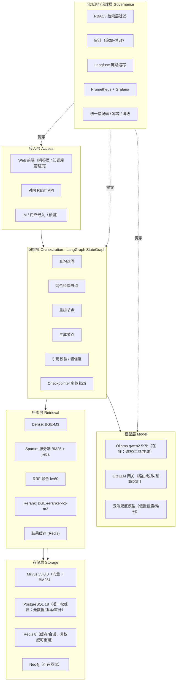

# 企业级知识库 RAG Agent · 技术方案与 MVP 设计（V1.0.1）

> **基准行业**：数字技术服务 / IT 服务与数字化运营（面向多行业的咨询、解决方案与交付服务）。
> **文档用途**：在**系统设计与方案定型阶段**，为个人自研项目给出可对外展示的技术方案全景、五维选型决策、可行性验证门禁（Gate 0）与 MVP 交付定义。
> **口径声明**：本项目处于**系统设计与方案定型阶段**，本文内**所有量化数字均为「设计目标 / 验收门禁」**，**非实测达成值、非上线数据**；任何指标一律不得解读为「已实现 / 已上线 / 实测达成」。文中凡出现具体数值，均以「设计目标」「验收门禁」「目标值」等前缀或上下文明确其性质。
> **执行主体**：个人独立设计与开发。
> **日期**：2026-10-09。
> **与 V1.1 的关系**：本文以《企业级知识库 RAG Agent · 项目定义（数字技术服务企业版 V1.1）》为**唯一基准**，是其第十节「技术方案概览」与第十一节「关键能力设计」的**工程化展开与 MVP 定型**；凡本文与 V1.1 冲突，以 V1.1 口径为准。约束继承 V1.1 第八节（数据不出域、行业/项目/密级隔离、单机部署、GPU 显存 8GB 硬瓶颈、本地优先云端兜底、Windows 11 + WSL2 + Docker Desktop、合规对标 CMMI/ISO/CCRC/ITSS）。
> **版本**：V1.0.2（Gate 0 实测裁决版；在 V1.0.1「本地单模型 qwen2.5:7b + 云端兜底」基础上，按 2026-10-09 Gate 0 真机实测与执行者裁决修订四处：① 中文分析器参数形态、② 延迟门禁口径、③ 显存驻留策略口径、④ 置信度门禁改走回退分支⑤。详见文末「修订记录」。V1.0.1 原文口径在对应位置以「原口径」保留对照，不抹除。）

---

## 一、摘要与阅读指引

### 1.1 一页结论

**定位**：面向**数字技术服务企业内部**的**知识服务引擎**（不做对外多租户 SaaS），把「咨询—实施—运维」全链路沉淀的项目与行业知识，转化为**可追问、可溯源、可评估**的 RAG 知识服务，核心价值口径为"成效交付"——以交付知识复用率与自助解答率度量（设计目标）。

**核心链路**：

在线问答：`自然语言提问 → 查询改写 → 混合检索(Dense+BM25) → RRF 融合 → 重排 Top-5 → 生成 → 引用强制校验 → 结构化答案 + 置信度 + 来源 → 多轮追问`
离线构建：`文档上传 → 准入审核 → MinerU 解析 → Parent-Child 分块 → 元数据/版本标注 → 多存储写入 → Outbox 对账`

**技术主线**：FastAPI（后端）+ Milvus v3.0.0（向量 + 服务端 BM25）+ PostgreSQL 18（唯一权威源）+ Redis 8（运行态缓存/会话）+ BGE-M3（稠密）+ BGE-reranker-v2-m3（重排）+ LangGraph StateGraph（确定性编排）+ Ollama qwen2.5:7b（本地在线单模型）+ LiteLLM 网关（云端兜底）。

**三句结论性判断**：

1. **先验证、后开发**：本项目最大不确定性集中在 **8GB 显存硬瓶颈下的三模型共存** 与 **中文稀疏检索有效性**，因此将**可行性验证 Gate 0** 前置为里程碑 M0，**Gate 0 不通过则冻结主体开发并走回退分支**。
2. **确定性优先，而非能力堆叠**：在线链路采用 **Workflow 式确定性编排（LangGraph StateGraph）**，Function Calling 仅在**工具白名单**内使用；不做开放式自治 Agent，以保障可复现、可评估、可降级。
3. **可信度是一等公民**：**引用强制（无来源不出结论）+ 复合置信度 + 低置信度降级 + 转人工** 是本项目与通用问答的分水岭，也是合规（CMMI/ISO/CCRC/ITSS）落地抓手。

### 1.2 阅读指引

| 读者关注点 | 建议阅读章节 |
|---|---|
| 快速了解项目定位与结论 | 第 1 章 |
| 判断方案是否可行、风险多大 | 第 2、3 章（设计原则 + Gate 0） |
| 评审架构与技术选型是否合理 | 第 4、5 章（总览 + 五维选型） |
| 评审工程实现细节 | 第 6、7 章（关键技术 + 数据/接口契约） |
| 关心交付范围、工期与验收 | 第 8 章（MVP 定义） |
| 关心风险与决策过程 | 第 9、10 章（风险登记册 + ADR） |
| 需要术语、版本锁定与映射 | 第 11 章（附录） |

---

## 二、设计原则与总体目标

### 2.1 架构设计原则

| 原则 | 含义 | 落地机制 |
|---|---|---|
| **确定性优先** | 在线主链路行为可预测、可复现、可回归 | LangGraph StateGraph 固化为有限状态机；每步类型化（Pydantic）；避免开放式自主循环 |
| **本地优先** | 数据不出域，能力默认本地闭环，云端仅兜底 | Ollama 本地模型为主；LiteLLM 网关在低置信度时才路由云端，设 token 预算熔断 |
| **可溯源** | 每条结论可回溯到原文片段 | 引用强制 + 分块级来源标注（文档/章节/页码/片段 ID） |
| **可评估** | 关键环节有量化门禁，可离线回归 | RAGAS + 自建评测集 + 消融对照 + 版本回归 |
| **可降级** | 任一环节失败不返回错误答案，而是显式降级 | 检索超时降纯关键词；生成失败降"仅片段+标注"；低置信度降级"初步判断" |
| **最小权限** | "搜得到"的前提是"有权限看" | RBAC 在**检索层**做过滤，而非答案层裁剪 |
| **单一权威源** | 消除多存储静默不一致 | PostgreSQL 为元数据/版本/审计唯一权威源，向量索引可重建 |
| **审计不可篡改** | 全操作可追溯、不可删改 | 审计追加表 + 禁改触发器 |

### 2.2 总体目标（设计目标 / 验收门禁口径）

| 维度 | 目标（设计目标 / 验收门禁） |
|---|---|
| 检索质量 | Recall@5 ≥ 85%；MRR ≥ 0.75 |
| 生成可信 | 引用正确率 ≥ 90%；Faithfulness 报告值（目标 ≥ 90%，非阻塞判定）；幻觉率 ≤ 10%；Answer Relevance 报告值（非阻塞） |
| 校准与结构化 | ECE ≤ 0.10；结构化输出首次成功率 ≥ 90% |
| 延迟 | P95 检索延迟 < 800ms；**P95 完整答案（256 token 预算）< 6s**；流式首 token < 1.2s（待 M4 流式实现后补测）——本地命中路径口径。原口径「P95 端到端 < 3s」经 Gate 0 ① 实测判定在 8GB 单卡 + 本地 7B 路径上不可达（256 token 档实测 P95 4.4s），已于 V1.0.2 修订 |
| 业务 | 自助解答率 ≥ 60%；重复性提问占比下降 ≥ 30%；新人上手周期缩短 ≥ 30% |
| 成本 | 云端预算熔断、无固定云开销；缓存命中率作为报告值监控 |

> 说明：以上为**验收门禁值（设计目标）**，项目当前处于方案定型阶段，尚无实测达成数据。

### 2.3 范围边界（继承 V1.1）

- **做**：企业内部知识服务、面向客户交付场景的底层检索引擎（同源可嵌）。
- **不做**：对外多租户 SaaS、业务决策/自动执行动作、模型全参训练/微调、移动端原生 App、超长上下文硬扛、自建基础大模型。

---

## 三、可行性验证（Gate 0）

### 3.1 为什么需要 Gate 0

本项目最大工程不确定性并非"能否做出 RAG"，而是三件"生死攸关"的事：**8GB 显存能否支撑嵌入+重排+7B 生成**、**Milvus 服务端 BM25 的中文有效性**、**多存储与单机本地化的一致性/合规可落地性**。三者任一不成立，将动摇整体方案。因此采用**先可行性再主体开发**的次序：**M0 = Gate 0**，为**阻塞门禁**。

### 3.2 Gate 0 验证项（逐项门禁表）

| # | 验证对象 | 验证方法 | 判定门禁指标 | 通过标准（验收门禁） | 验证出口 |
|---|---|---|---|---|---|
| ① | **8GB 显存下嵌入/重排与本地生成模型的分时/降级调度可行性** | 单机跑通"分段驻留"压测：嵌入(BGE-M3)与重排(BGE-reranker-v2-m3)按需加载/释放，**本地 7B 生成模型常驻**；构造长短 query 混合流量，观测显存峰值、OOM 次数、冷启切换耗时 | 显存峰值、OOM 次数、模型切换耗时、单位问答耗时 | V1.0.2 修订口径（依据 Gate 0 ① 实测）：全流程**零 OOM**；**嵌入与重排可与 7B 生成模型共存驻留**（不越界、无 OOM）；**P95 检索 < 800ms**；**P95 完整答案（256 token）< 6s**；流式首 token < 1.2s 待 M4 补测。原口径要求「嵌入、重排按需加载/释放，与生成分时互斥」+「P95 端到端 < 3s」——实测：per-query 互斥释放的冷启为 4.6–9.0s/次，P95 端到端劣化到 14.3s（约为共存策略的 3.3 倍），3s 门禁不可达，故改为「共存常驻 + 空闲超时释放」并重定延迟门禁 | 产出《显存调度验证报告》+ 分时调度策略参数 |
| ② | **Milvus v3.0.0 服务端 BM25 + jieba 中文分析器可用性与中文检索有效性** | 配置 `FunctionType.BM25` + jieba analyzer，灌入中文评测集；对比"默认分析器 vs jieba"的 BM25 命中；对术语/编号/方案名类 query 做人工抽检 | BM25 相对默认分析器召回增益、中文检索 Top-K 命中率 | jieba 生效且 **BM25 相对默认分析器有明确正增益**（非≈0）；术语/编号类 query 明显改善 | 产出《中文稀疏检索验证报告》+ analyzer 配置基线 |
| ③ | **混合检索相对单一稠密的增益（Dense vs Sparse vs 混合）** | 在自建评测集上做**消融对照**：Dense-only / Sparse-only / Dense+Sparse+RRF（k=60）+Rerank 三组，测量 Recall@5、MRR | Recall@5、MRR 增益归因 | 混合检索相对单一稠密**Recall@5 提升可归因、可复现**，且混合方案 **Recall@5 ≥ 85%（设计目标）** 具备达成路径 | 产出《检索消融对照报告》，锁定默认检索参数 |
| ④ | **多存储一致性（Outbox + 每日对账）工程可行性** | 模拟写入元数据库后向量写入失败/部分失败；验证 Outbox 补偿队列与每日对账能发现并修复差异 | 差异发现率、补偿成功率、对账耗时 | 人为注入的不一致能被**发现并修复**；不出现"静默缺数据" | 产出《多存储一致性验证报告》+ Outbox/对账作业骨架 |
| ⑤ | **引用强制与置信度校准（温度缩放 + ECE）可信性** | 在标注校准集上运行温度缩放；测 ECE；对"检索失败/无来源"场景验证强制拒答与降级 | ECE、引用强制命中率、降级触发正确率 | V1.0.2 修订口径（走方案 3.4 回退分支⑤）：**无来源必不输出结论**（零引用结论数 = 0）；**无依据必拒答**；**敏感证据（密级 3）与低置信必转人工**；**结构化输出首次成功率 ≥ 90%**。连续 ECE 由硬门禁降为**报告值**继续跟踪（原口径「ECE ≤ 0.10 具备达成路径」保留为跟踪目标） | 产出《置信度校准验证报告》+ 校准参数 |
| ⑥ | **单机 Docker Compose 全组件本地化与数据不出域部署可行性** | 在 Windows 11 + WSL2 + Docker Desktop 下一键起全组件（Milvus / PostgreSQL / Redis / 可选 Neo4j / 应用 / Nginx）；断网运行；校验无外呼 | 一键启动成功率、断网可用性、外呼检测 | 全组件**一键启动可用**；断网下核心链路可运行；**确认无数据出域外呼** | 产出《单机本地化部署报告》+ docker-compose 基线 |

### 3.3 Gate 0 判定规则

- **必备项（阻塞）**：①、②、⑥ —— 任一不通过，判 Gate 0 **不通过**，**冻结主体开发**。
- **非必备项**：③、④、⑤ —— 允许"具备达成路径"为通过，但需有明确修复计划。
- **整体通过**：6 项中 **≥ 5 项通过**，且**三项必备项全部通过**。
- **判定时点**：Gate 0 结论出具后，方进入 M1 主体开发；五维选型（第 5 章）的最终决策均发生在 **Gate 0 之后**。

### 3.4 不通过时的回退分支

| 未通过项 | 回退分支 |
|---|---|
| ① 显存调度 | 降级路线：嵌入/重排改 **CPU 分时** 或 **更小嵌入模型**；生成改 **量化 4-bit / 更小 7B**；必要时云端兜底承载重排 |
| ② 中文 BM25 | 回退到 **应用侧 BM25（如 rank_bm25/Elasticsearch 旁路）** 或升级 Milvus 版本重测；jieba 失效则评估其他中文分析器 |
| ③ 混合增益不足 | 保底保留 Dense + Rerank 两段式；BM25 作为可选增强；复查分块与查询改写 |
| ④ 一致性不足 | 收敛为"**单一权威源 + 可重建索引**"的最小姿态，暂缓图谱等非权威存储 |
| ⑤ 校准不可行 | 退化为**规则化置信度分档**（高/中/低）替代连续 ECE，强化强制拒答 |
| ⑥ 本地化部署不可行 | 缩小到**最小核心组件**（Milvus+PostgreSQL+Redis+应用）先行，Nginx/图谱后置 |

---

## 四、技术方案总览

### 4.1 分层架构图



### 4.2 端到端数据流

**（A）在线问答链路**（本地命中路径，目标 P95 端到端 < 3s）

```
用户提问(+角色/部门/项目/权限上下文)
   │
   ▼
[接入层] 鉴权 → RBAC 上下文注入 → 幂等键校验
   │
   ▼
[编排层] 查询改写(指代消解/口语化→检索友好)  ← 历史摘要(Checkpointer)
   │
   ▼
[检索层] Dense(BGE-M3) ‖ Sparse(BM25+jieba)  → RRF(k=60) → Rerank 至 Top-5
   │        (Redis 结果缓存命中则短路)         [检索层做权限过滤]
   ▼
[模型层] 本地单模型 qwen2.5:7b（改写/工具/生成）；低置信度/难例 → 云端兜底(预算熔断)
   │
   ▼
[编排层] 引用强制校验(无来源不出结论) → 复合置信度 → 低置信度降级/转人工
   │
   ▼
[接入层] 流式返回：结论 + 要点 + 引用(文档/章节/页码/片段) + 置信度 + 免责提示
   │
   ▼
[治理层] 全操作审计(追加) + Langfuse 链路 + Prometheus 指标
```

**（B）离线知识构建链路**

```
项目结项 / 文档上传
   │
   ▼
[准入审核] 格式校验 → 重复检测 → 来源可信度分级
   │
   ▼
[MinerU 解析] PDF/Word/表格 → 结构化文本
   │
   ▼
[Parent-Child 分块] 子块(精准检索) + 父块(上下文补全)
   │
   ▼
[元数据/版本标注] 行业/客户/项目/来源/章节/密级/状态 → 写入 PostgreSQL(权威源)
   │
   ▼
[多存储写入] Outbox 事件 → 异步写 Milvus(向量) → 可选 Neo4j(关系)
   │
   ▼
[每日对账] 比对权威源与索引差异 → 差异入补偿队列 → 修复
```

---

## 五、技术方案五维（Gate 0 后决策）

> **统一说明**：本章五个维度的最终选型，其**决策时点均在可行性验证 Gate 0 之后**——即先以 Gate 0 收敛技术不确定性，再据验证结论定选型。每节给出「候选项对比 → 推荐路径 → 决策依据 → 决策时点」。

### 5.1 维度一：模型选型方案

**候选对比**

| 方案 | 代表形态 | 优点 | 缺点 | 适配本项目 |
|---|---|---|---|---|
| **闭源 API 为主** | 云端大模型直接调用 | 能力强、免运维、上线快 | 数据出域、持续成本、无本地可控性 | ✗ 违反数据不出域与预算约束 |
| **开源模型为主** | 本地 7B/嵌入/重排 | 数据不出域、零边际成本、可控 | 能力弱于顶级闭源、受 8GB 显存约束 | ◐ 符合约束但需调度 |
| **混合（本地优先 + 云端兜底）** | 本地开源为主 + 网关路由 | 兼顾合规成本与能力上限 | 需网关与预算治理 | ✓ **推荐** |

**推荐路径**：**混合模式（本地优先、云端兜底）**——生成层为**本地单模型 `qwen2.5:7b`**，仅低置信度/难例经 **LiteLLM 网关** 走**云端兜底**。

- 本地嵌入：**BGE-M3**（稠密向量）；本地重排：**BGE-reranker-v2-m3**。
- **本地生成单模型**：Ollama `qwen2.5:7b` **单模型**承担查询改写、工具调用、JSON Schema 约束与答案生成（在线主路径，**单模型常驻、无模型切换**）。
- **原"本地双模型分工"方案已否决**：8GB 单卡无法同时常驻两个 7B，模型切换会击穿 P95 端到端 <3s，且二者同属 Qwen2.5 系底座、能力高度重叠，分工收益趋近于零。
- 统一走 **LiteLLM 网关**；仅在**低置信度 / 本地不可用**时路由**云端兜底**，并施以 **token 预算熔断 + 限流**。

**决策依据**：① 数据不出域（V1.1 第八节）要求默认本地闭环；② 8GB 显存硬瓶颈要求本地模型体积受控（7B 级）；③ 无固定云开销要求云端只作兜底；④ 单模型常驻可消除模型切换、保障 P95 端到端 <3s；本地双 7B 分工在 8GB 单卡不可行且与单模型能力重叠，故不采纳。

**决策时点**：**Gate 0 之后**——依据 ①（显存调度）与 ⑤（校准）验证结论锁定具体量化版本与云端兜底阈值。

### 5.2 维度二：架构编排方案

**选型矩阵**

| 范式 | 能力上限 | 确定性/可复现 | 可控性 | 幻觉风险 | 本项目适用性 |
|---|---|---|---|---|---|
| **Prompt** | 低 | 高 | 高 | 高（无依据） | 仅作基础范式，不足 |
| **RAG** | 中 | 高 | 高 | 低（有依据） | **核心必需** |
| **Function Calling** | 中 | 中 | 中 | 中 | 工具白名单内使用 |
| **Agent（自治）** | 高 | 低 | 低 | 高 | ✗ 不采用开放式自治 |
| **Workflow** | 中高 | **高** | **高** | 低 | **核心编排范式** |

**推荐组合**：**Workflow（主）+ RAG（核心能力）+ 工具白名单 Function Calling（受控增强）**

- 采用 **LangGraph StateGraph** 构建**类型化（Pydantic）确定性工作流**：`查询改写 → 混合检索 → 重排 → 生成 → 引用校验`。
- 以 **Checkpointer** 支撑**多轮状态持久化与中断-恢复**。
- **Function Calling 仅在工具白名单内**（如知识管理查询、元数据检索），不开放任意工具，避免不可控副作用。
- **不采用开放式自治 Agent**：与"确定性优先"原则一致。

**决策依据**：① 企业知识服务要求**可复现、可评估、可审计**，自治 Agent 难以满足；② V1.1 第十节明确 LangGraph StateGraph 编排；③ Workflow 便于逐节点埋点做消融与门禁。

**决策时点**：**Gate 0 之后**——依据 ③（检索消融）与④（一致性）结论固化节点与状态定义。

### 5.3 维度三：数据层方案

**候选对比**

| 子层 | 候选 | 推荐 | 理由 |
|---|---|---|---|
| **向量库** | Milvus / FAISS / pgvector | **Milvus v3.0.0** | 支持**服务端 BM25（`FunctionType.BM25`）+ jieba**，天然支撑混合检索；单机容器化友好 |
| **数据库** | PostgreSQL / MySQL | **PostgreSQL 18** | **唯一权威源**（元数据/版本/审计）；追加表 + 禁改触发器便于合规 |
| **缓存** | Redis / 内存 | **Redis 8** | 运行态缓存与会话；**非权威、可重建**，TTL 可驱逐 |
| **图谱** | Neo4j / 无 | **Neo4j（可选）** | 实体/流程/方案关联增强；非权威，可选后置 |
| **日志/追踪** | 文件日志 / Langfuse | **结构化日志 + Langfuse** | 链路追踪与可观测 |

**存储归属原则**：向量索引（Milvus）、元数据与版本（PostgreSQL，唯一权威源）、关系图谱（可选）、运行态缓存与会话（Redis，非权威可重建）。**向量索引可由权威源重建**，消除多存储静默不一致。

**推荐路径**：**Milvus v3.0.0（向量 + 服务端 BM25）+ PostgreSQL 18（唯一权威源）+ Redis 8（非权威缓存/会话）+ Neo4j（可选图谱）+ 结构化日志 + Langfuse**，与 V1.1 第十节存储归属原则一致。

**决策依据**：① 混合检索依赖服务端稀疏能力；② 合规要求审计权威且不可篡改；③ 8GB 单机要求组件轻量可控；④ 图谱为增强项，避免范围膨胀（V1.1 Won't）。

**决策时点**：**Gate 0 之后**——依据 ②、③、④ 验证结论锁定 Milvus 版本与分析器配置、对账策略。

### 5.4 维度四：工程层方案

**候选对比**

| 子层 | 主要候选 | 取舍要点 | 适配本项目 |
|---|---|---|---|
| **后端** | FastAPI / Flask / Django | FastAPI 原生异步、Pydantic 类型化、自动 OpenAPI，最契合流式与契约诉求 | ✓ **FastAPI** |
| **前端** | Web 应用 / 移动端原生 App / 桌面端 | Web 覆盖企业内多角色、开发交付成本最低；原生 App 属 V1.1 Won't | ✓ **Web 应用** |
| **评测** | RAGAS + 自建集 / 纯人工抽检 / 公开评测集 | 无公开评测集 → 自建（双人标注 + Cohen's Kappa）+ RAGAS 自动化回归 | ✓ **RAGAS + 自建集** |
| **监控** | Langfuse + Prometheus/Grafana / 自建日志 | 链路追踪与指标看板开箱即用，避免自建可观测的成本 | ✓ **Langfuse + Prometheus/Grafana** |
| **权限** | RBAC + 职责分离 / ACL / 不做隔离 | 部门/项目/客户/密级多维隔离，检索层过滤满足合规审计 | ✓ **RBAC + 职责分离** |

**推荐路径**：**FastAPI（后端）+ Web 前端 + RAGAS 自建评测 + Langfuse/Prometheus/Grafana 可观测 + RBAC 职责分离**，全量对齐 V1.1 第十节技术栈基线。

**推荐落地明细**

| 子层 | 推荐 | 关键点 |
|---|---|---|
| **后端** | **FastAPI** | 异步高吞吐、Pydantic 类型化、OpenAPI 契约 |
| **前端** | **Web 前端**（问答页 + 知识库管理页） | 流式对话、引用高亮、追问建议；Web 优先（不做原生 App） |
| **评测** | **RAGAS + 自建评测集** | 无公开评测集 → 自建（双人标注 + Cohen's Kappa）；版本回归 |
| **监控** | **Langfuse + Prometheus + Grafana** | 链路追踪 + 指标看板 |
| **权限** | **RBAC + 职责分离** | 部门/项目/客户/密级；**检索层过滤**；职责分离避免权限集中 |

**决策依据**：① V1.1 第十节技术栈基线；② 合规要求审计与职责分离；③ 自建评测集是门禁落地前提；④ 可观测是"可评估"原则的支撑。

**决策时点**：**Gate 0 之后**——前端形态随上线方式（5.5）联动定稿，评测/监控基线随 ③⑤ 验证结论固化。

### 5.5 维度五：上线方式方案

**候选对比**

| 方式 | 覆盖用户 | 集成成本 | 体验上限 | 合规可控 | 本项目适配 |
|---|---|---|---|---|---|
| **内部工具** | 有限 | 低 | 低 | 高 | ◐ 可作初期形态 |
| **对内 API** | 系统集成方 | 中 | 中 | 高 | ✓ 必需（同源可嵌） |
| **插件（IM/门户）** | 广 | 高 | 中 | 中 | ◐ 预留、非 MVP |
| **Web 应用** | 广（企业内） | 中 | **高** | 高 | ✓ **推荐主形态** |

**推荐路径**：**内网 Web 应用（主）+ 对内 REST API（辅）**

- **主形态**：内网 **Web 应用**（问答页 + 知识库管理页），承接主用户（交付工程师/FDE、售前、PM、新人）。
- **辅形态**：**对内 REST/流式 API**，供既有 ChatBot / 智能客服 / 企业知识管理**同源嵌入**（V1.1 第十二节）。
- **预留**：IM / 门户**插件**集成，非 MVP 范围。
- **明确不做**：**对外多租户 SaaS**。

**决策依据**：① 服务企业内部，Web 应用即可覆盖主要角色；② 对内 API 满足"作为底层检索引擎"的复用诉求；③ 插件集成成本高，缓做；④ 对外 SaaS 属明确非目标。

**决策时点**：**Gate 0 之后**——依据 ⑥（单机本地化）确认内网部署形态可行后定稿。

---

## 六、关键技术设计

> 本章将 V1.1 第十一节深化到可实施粒度。

### 6.1 知识库构建与文档解析

| 环节 | 设计要点 |
|---|---|
| **准入流程** | 格式校验 → 重复检测（内容指纹）→ 来源可信度分级；未通过不入库 |
| **解析** | **MinerU** 解析 PDF / Word / 表格，产出结构化文本与版面信息 |
| **分块** | **Parent-Child**：**子块**用于精准检索，**父块**补全上下文，兼顾精度与完整性 |
| **元数据标注** | 行业 / 客户 / 项目 / 来源 / 章节 / 密级 / 状态 → 支撑跨行业隔离、跨项目复用、版本回滚 |
| **多存储写入** | 权威源（PostgreSQL）确认后经 **Outbox** 异步写 Milvus / 可选 Neo4j |

### 6.2 混合检索与检索质量优化

- **双路检索**：**Dense（BGE-M3）** + **Sparse（服务端 BM25 + jieba 中文 analyzer）**，解决单一稠密检索对**术语、编号、方案名**召回不全。
  - **V1.0.2 配置形态修正（Gate 0 ② 实测）**：Milvus v3.0.0 服务端**拒绝** `analyzer_params={"type": "jieba"}`（`unknown build-in analyzer type: jieba`，tantivy `tokenizer.h`）。可用形态是 **`analyzer_params={"tokenizer": "jieba"}`**；另有内置 **`{"type": "chinese"}`** 可作备选。默认（仅 `enable_analyzer=true`、不给 params）对中文查询近乎无效——实测 Recall@5 0.399 对 jieba 0.761（Δ+0.362），本文「默认分析器对中文近乎无效」的判断已被实测坐实。
- **融合与重排**：**RRF（k=60）** 融合 → **BGE-reranker-v2-m3** 重排至 **Top-5**。
- **查询改写**：口语化 / 多轮指代 → 检索友好 query。
- **缓存**：检索结果 **Redis** 按 hash 缓存，TTL 可驱逐。
- **消融对照**：Dense / Sparse / 混合三组对照，使"效果提升"**可归因、可复现**。

### 6.3 Agent 编排状态机

```
[START] → 查询改写 → 混合检索 → 重排 → 生成 → 引用校验 → [END]
              ▲                              │
              └──────── 多轮追问（Checkpointer 状态恢复）──────┘
```

- **类型化状态**：Pydantic 定义 State；节点纯函数化，便于单测与回归。
- **Checkpointer**：多轮状态持久化 + 中断-恢复。
- **降级分支**：检索失败 → 澄清追问或明确"未找到依据"；生成失败 → 仅返回片段 + 标注。

### 6.4 引用强制与置信度

| 机制 | 设计 |
|---|---|
| **引用强制** | 每条结论必须携带来源（文档/章节/页码/片段 ID）；**无来源不出结论** |
| **复合置信度** | 检索分数 + 生成自评 + 引用一致性 → 复合分 |
| **温度缩放** | 对分类/判别概率做温度缩放，使 **ECE ≤ 0.10（设计目标）** |
| **低置信度降级** | 显式标注"初步判断"，不自动出正式结论；触发转人工 |

### 6.5 可靠性与一致性

| 机制 | 设计 |
|---|---|
| **Outbox** | 权威源写入后异步写向量库，失败入补偿队列 |
| **每日对账** | 比对权威源与索引差异，修复"静默缺数据" |
| **降级** | 检索超时→纯关键词；生成失败→片段+标注；低置信度→初步判断 |
| **显存驻留** | V1.0.2 修正（Gate 0 ① 实测）：8GB 单卡采用「**嵌入 + 重排与 7B 生成共存常驻，空闲超时释放**」，而非原文的 per-query 按需加载/释放。实测共存峰值 8098/8188 MiB（零 OOM、无越界采样），余量仅约 90 MiB——因此必须锁死嵌入批大小与生成上下文长度；互斥释放档冷启 4.6–9.0s/次、P95 端到端 14.3s，不可用于交互链路；CPU 兜底档 P95 125.8s，仅作不可用时的最后退路 |
| **契约** | 统一错误码 / 超时 / 重试 / 幂等 |
| **编排** | Docker Compose healthcheck / 资源限制 / 命名卷；备份与恢复 |

### 6.6 安全与合规

- **四道防线**：① 数据接入层本地闭环；② Agent 层工具白名单 + 输入净化；③ 答案层引用强制 + 降级显式化；④ 知识层准入审核 + 来源分级。
- **RBAC 检索层过滤**：按部门/项目/客户/密级过滤，确保"搜得到"的前提是"有权限看"。
- **审计追加禁改**：查询/追问/引用/知识变更全量追加，禁改触发器保护。
- **投毒与注入防护**：知识准入 + 输入净化 + 工具白名单，防知识库投毒与 Prompt 注入。

---

## 七、数据模型与接口契约

### 7.1 核心表 / 集合

| 存储 | 实体 | 关键字段（示意） |
|---|---|---|
| **PostgreSQL** | 文档元数据 `document` | id, title, industry, customer, project, source_level, security_level, status, created_at |
| **PostgreSQL** | 文档版本 `document_version` | id, doc_id, version, chunk_scheme, checksum, effective_at |
| **PostgreSQL** | 分块 `chunk` | id, version_id, parent_id, content_ref, page, section, order_no |
| **PostgreSQL** | 会话 `session` | id, user_id, role_ctx, created_at, updated_at |
| **PostgreSQL** | 审计 `audit_log` | id(追加), actor, action, target, trace_id, ts（禁改触发器） |
| **PostgreSQL** | Outbox `outbox_event` | id, aggregate, payload, status, retry_count |
| **Milvus** | Collection `kb_chunks` | 向量 + 稀疏字段（BM25）+ 标量字段（industry/project/security_level 等用于过滤） |
| **Redis** | 缓存/会话 Key | query hash → 结果；session state；TTL 可驱逐 |
| **Neo4j（可选）** | 图谱节点/关系 | 方案/组件/流程实体与关联 |

### 7.2 主要 API 契约（示意）

| 方法 | 路径 | 说明 | 关键请求/响应 |
|---|---|---|---|
| POST | `/api/v1/qa/ask` | 单轮问答 | req: question, role_ctx, idempotency_key；resp: answer, citations[], confidence, trace_id |
| POST | `/api/v1/qa/ask/stream` | 流式问答（SSE/Socket.IO） | 同上，增量推送 token + 引用高亮 |
| POST | `/api/v1/qa/followup` | 多轮追问 | req: session_id, question；基于 Checkpointer 恢复状态 |
| POST | `/api/v1/documents/upload` | 文档上传 | req: file, meta(industry/project/security_level)；resp: doc_id, admission_status |
| GET | `/api/v1/documents` | 知识管理查询 | 分页 + 权限过滤 |
| POST | `/api/v1/documents/{id}/review` | 答案/文档复核 | pass/reject → 版本升版 |

### 7.3 统一错误码 / 超时 / 重试 / 幂等契约

| 项 | 约定 |
|---|---|
| **错误码** | 分级：`E4xx` 客户端、`E5xx` 服务端、`E9xx` 依赖（检索/模型/存储）；结构含 code/message/trace_id/retryable |
| **超时** | 检索、重排、生成分设超时；超时触发降级分支 |
| **重试** | 仅对 `retryable=true` 的幂等操作做**指数退避**；生成不盲目重试 |
| **幂等** | 写操作以 `idempotency_key` 保证幂等，防重复上传/重复提问副作用 |

---

## 八、MVP 定义

### 8.1 MVP 范围

**Must（必须端到端闭环，映射 V1.1 第九节 9 条）**

| # | Must 能力 | 对应 V1.1 |
|---|---|---|
| 1 | 文档上传 → 准入审核 → 解析分块 → 多存储落库 | 9-① |
| 2 | 混合检索（Dense+BM25+RRF+Rerank）返回带来源证据集（Recall@5 ≥ 85% 设计目标） | 9-② |
| 3 | Agent 编排（LangGraph）生成答案 + 要点 + 置信度 | 9-③ |
| 4 | 引用强制：每条结论均有出处，无来源不出结论 | 9-④ |
| 5 | 低置信度路由：显式标注"初步判断" | 9-⑤ |
| 6 | 敏感/低置信度问题转人工复核（确定性规则） | 9-⑥ |
| 7 | 会话式多轮追问（流式推送） | 9-⑦ |
| 8 | 基础 RBAC（部门/项目/密级隔离）+ 全操作审计 | 9-⑧ |
| 9 | Web 前端：问答页 + 知识库管理页可用 | 9-⑨ |

**Should（增强，非阻塞）**：Neo4j 图谱增强；IM/门户插件；云端兜底精细化路由；答案反馈闭环。

**Won't（明确不做）**：对外多租户 SaaS；业务决策/自动执行；模型全参训练/微调；移动端原生 App；超长上下文硬扛；自建基础大模型。

### 8.2 MVP 里程碑

| 里程碑 | 目标 | 交付物 | 依赖 | 预估工期（工作日） |
|---|---|---|---|---|
| **M0 = Gate 0** | 可行性验证 6 项门禁 | 《Gate 0 验证报告》+ 回退决策 | 无 | 8–12 |
| **M1** | 知识构建链路 + 存储骨架 | 准入/解析/分块/多存储 + Outbox/对账骨架 | M0 通过 | 12–18 |
| **M2** | 混合检索 + 评测基线 | 检索链路 + 自建评测集 + 消融报告 | M1 | 10–15 |
| **M3** | 编排 + 引用 + 置信度 | LangGraph 工作流 + 引用强制 + 校准 | M2 | 12–18 |
| **M4** | 前端 + RBAC + 审计 + Demo | Web 页面 + 权限 + 审计 + Docker Compose 一键 Demo | M3 | 12–18 |
| **M5** | 验收与定型 | DoD 核对 + 版本锁定清单 + 风险登记册定稿 | M4 | 5–8 |

> **总计划次序**：**先可行性（M0）→ 再主体开发（M1–M4）→ 后验收（M5）**。Gate 0 不通过则冻结 M1 起的主体开发。

### 8.3 MVP 验收标准（DoD）

| # | 验收项 | 判定标准 | 映射 V1.1 |
|---|---|---|---|
| 1 | Must 链端到端可演示 | 9 条 Must 全链路可跑通 | 第九节停止条件① |
| 2 | 检索质量 | Recall@5 ≥ 85%；MRR ≥ 0.75 | 第六节技术指标 |
| 3 | 引用可信 | 引用正确率 ≥ 90%；幻觉率 ≤ 10%（Faithfulness 为报告值，目标 ≥ 90%，非阻塞判定） | 第六节 |
| 4 | 校准与结构化 | ECE ≤ 0.10；结构化输出首次成功率 ≥ 90% | 第六节 |
| 5 | 延迟 | P95 检索 < 800ms；P95 端到端 < 3s（本地命中路径） | 第六节 |
| 6 | 业务 | 自助解答率 ≥ 60%；重复性提问占比下降 ≥ 30%；新人上手周期缩短 ≥ 30% | 第六节 |
| 7 | 合规 | 数据不出域；RBAC 检索层过滤；审计追加禁改 | 第八节约束 |
| 8 | 交付物 | 版本锁定清单 + 风险登记册定稿 | 第九节停止条件③ |

### 8.4 停止条件（沿用 V1.1）

① **Must 链端到端可演示**；② **≥ 3 项量化指标达标**（`Recall@5 ≥ 85%` + `P95 检索 < 800ms` + 结构化输出首次成功率 ≥ 90%）；③ **版本锁定清单 + 风险登记册定稿**。

---

## 九、风险登记册

| 风险 | 类别 | 影响 | 概率 | 等级 | 缓解措施 | 触发信号 |
|---|---|---|---|---|---|---|
| 8GB 显存不足导致三模型无法协同 | 算力 | 高 | 高 | **高** | Gate 0 ① 前置验证；分时调度/量化/CPU 降级；云端兜底 | OOM、切换超时、P95 超标 |
| jieba 中文分析器失效致 BM25 收益≈0 | 检索 | 高 | 中 | **高** | Gate 0 ② 验证；应用侧 BM25 旁路；分词人工抽检 | BM25 增益≈0、术语类召回差 |
| 混合检索相对稠密无增益 | 检索 | 中 | 中 | 中 | Gate 0 ③ 消融；保底 Dense+Rerank | 三组对照 Recall@5 无差异 |
| 多存储静默不一致 | 一致性 | 高 | 中 | **高** | Outbox + 每日对账；索引可重建 | 对账出现差异、缺数据 |
| 置信度校准不可行（ECE 不达标） | 可信 | 中 | 中 | 中 | 温度缩放 + 规则分档退路 | 校准集 ECE 偏高 |
| 数据出域/合规风险 | 合规 | 极高 | 低 | **高** | 全组件本地化、断网运行、外呼检测、审计禁改 | 检测到外呼、审计被改 |
| 知识库投毒 / Prompt 注入 | 安全 | 高 | 中 | **高** | 准入审核 + 来源分级 + 输入净化 + 工具白名单 | 异常来源入网、越权指令 |
| 范围膨胀（滑向自治 Agent/SaaS） | 范围 | 中 | 中 | 中 | 严守 Won't 清单；Workflow 优先 | 需求溢出 Must 边界 |
| 个人独立开发进度风险 | 资源 | 中 | 中 | 中 | 里程碑可判定出口；不设无限期 | 里程碑延期超阈值 |
| 云端兜底成本失控 | 成本 | 中 | 低 | 中 | token 预算熔断 + 限流 + 本地优先 | 预算触顶告警 |

---

## 十、技术选型决策记录（ADR 摘要）

| # | 决策 | 状态 | 背景 | 备选 | 结论 | 影响 |
|---|---|---|---|---|---|---|
| ADR-01 | 模型选型采用混合模式 | 提议（待 Gate 0） | 数据不出域 + 8GB 显存 + 预算约束 | 闭源 API / 纯开源 / 混合 | 本地单模型 + 云端兜底 | 需 LiteLLM 网关与预算熔断；已否决本地双模型分工 |
| ADR-02 | 编排采用 Workflow（LangGraph StateGraph） | 提议（待 Gate 0） | 需确定性、可评估、可审计 | Prompt/RAG/FC/Agent/Workflow | Workflow + RAG + FC 白名单 | 固化为状态机，逐节点埋点 |
| ADR-03 | 向量库选 Milvus v3.0.0 | 提议（待 Gate 0②③） | 需服务端 BM25 + 中文分析器 | Milvus/FAISS/pgvector | Milvus | 依赖其 BM25/jieba 可用性 |
| ADR-04 | PostgreSQL 18 为唯一权威源 | 已定 | 需审计权威、版本可回滚 | PostgreSQL/MySQL | PostgreSQL | 索引可由权威源重建 |
| ADR-05 | Redis 8 仅作非权威缓存/会话 | 已定 | 缓存可重建 | Redis/内存 | Redis | TTL 可驱逐，不作权威 |
| ADR-06 | 重排选 BGE-reranker-v2-m3 | 提议（待 Gate 0①） | 需重排提质且受显存约束 | 多种 cross-encoder | BGE-reranker-v2-m3 | 与嵌入分时调度 |
| ADR-07 | 上线主形态为内网 Web 应用 + 对内 API | 提议（待 Gate 0⑥） | 服务企业内、同源可嵌 | 内部工具/API/插件/Web | Web 应用 + 对内 API | 插件后置，不做 SaaS |
| ADR-08 | 引用强制 + 置信度校准为一等约束 | 已定 | 合规与可信要求 | 可选/强制 | 强制 | 无来源不出结论 |
| ADR-09 | 自建评测集（双人标注 + Kappa） | 已定 | 无公开评测集 | 公开集/自建 | 自建 | 门禁落地前提 |
| ADR-10 | 图谱 Neo4j 为可选增强 | 提议 | 关系增强 vs 范围膨胀 | Neo4j/无 | 可选、后置 | 非权威、非阻塞 |

---

## 十一、附录

### 11.1 术语表

| 术语 | 含义 |
|---|---|
| **RAG** | 检索增强生成 |
| **Dense / Sparse** | 稠密向量检索 / 稀疏（关键词）检索 |
| **RRF** | Reciprocal Rank Fusion，倒数排名融合（k=60） |
| **Rerank** | 交叉编码器重排 |
| **Parent-Child 分块** | 子块检索、父块补全上下文的双层分块 |
| **Outbox** | 事务性发件箱模式，保障多存储最终一致 |
| **ECE** | Expected Calibration Error，期望校准误差 |
| **RBAC** | 基于角色的访问控制 |
| **FDE** | 前向部署工程师 |
| **DoD** | Definition of Done，完成定义 |

### 11.2 版本锁定清单（拟定，Gate 0 后确认）

| 组件 | 锁定版本 | 锁定状态 |
|---|---|---|
| 向量库 Milvus | v3.0.0（服务端实测 3.0.0，standalone + etcd v3.5.25 + minio） | **已确认（Gate 0 ②⑥）** |
| pymilvus 客户端 | 3.0.2 | **已确认** |
| 元数据库 PostgreSQL | 18（镜像 postgres:18，服务端实测 18.6） | **已确认** |
| 缓存 Redis | 8（服务端实测 8.10.1，maxmemory 512mb / allkeys-lru） | **已确认** |
| 嵌入模型 BGE-M3 | BAAI--bge-m3 本地权重（XLMRobertaModel，hidden 1024 / 24 层，CLS pooling + L2，fp16 驻留约 1.1 GiB） | **已确认（Gate 0 ①）** |
| 重排模型 BGE-reranker-v2-m3 | BAAI--bge-reranker-v2-m3 本地权重（XLMRobertaForSequenceClassification，sigmoid(logit)，fp16 约 1.1 GiB） | **已确认（Gate 0 ①）** |
| 生成模型（本地在线单模型） | Ollama `qwen2.5:7b`（Q4_K_M，4748 MiB 满显存常驻，ctx 4096，约 43–47 tok/s） | **已确认（Gate 0 ①）** |
| 推理框架 | torch 2.14.0+cu130 / transformers 5.19.0 / CPython 3.12.8（venv 内经 .pth 挂载本机 CUDA 底座） | **已确认** |
| 中文分析器 | `analyzer_params={"tokenizer": "jieba"}`（备选 `{"type": "chinese"}`） | **已确认（Gate 0 ②）** |
| 云端兜底模型 | 经 LiteLLM 路由，具体模型待定 | 待定（Gate 0 期间恒关，数据不出域验证要求） |
| 编排框架 LangGraph | 待锁定 | 待定（Gate 0 未引入；本轮用确定性函数式流水线验证，M3 引入后锁定） |
| 网关 LiteLLM | 待锁定 | 待定（M3/M4 引入） |

### 11.3 与 V1.1 的映射对照表

| V1.1 章节 | 本文对应 | 说明 |
|---|---|---|
| 第一节 基准行业 | 文档头 / 第 2.3 节 | 行业化泛称，内容纯净 |
| 第三节 目标用户 | 第 5.5 节 | 上线方式覆盖角色 |
| 第四节 核心场景 | 第 4.2 节 | 在线/离线/治理三链路 |
| 第六节 成功指标 | 第 2.2 / 8.3 节 | 口径一致，标注设计目标 |
| 第七节 非目标 | 第 2.3 / 8.1 节 | Won't 清单 |
| 第八节 约束 | 文档头 / 第 3 章 | Gate 0 与部署约束 |
| 第九节 MVP 范围 | 第 8 章 | Must 9 条映射 |
| 第十节 技术方案概览 | 第 4、5 章 | 五维展开 |
| 第十一节 关键能力 | 第 6 章 | 深化到实施粒度 |
| 第十三节 设计取舍 | 第 11.4 节 | 复盘要点 |

### 11.4 设计取舍与复盘要点

- **取舍**：为保障在线体验，牺牲部分召回换取低延迟；召回不足时宁可走 fallback 澄清，也不给出无依据答案。
- **模型方案取舍**：曾设计本地双模型分工（qwen2.5:7b + deepseek-r1:7b），因 8GB 显存无法共存、模型切换击穿时延、底座同源能力重叠，改为**本地单模型 + 云端兜底**。
- **典型迭代**：中文分词器失效（BM25 收益≈0）→ 强制 jieba + 分词人工抽检；长文档召回不全 → 章节级切分 + 查询扩展；多存储不一致 → Outbox + 每日对账。
- **规模化的下一步**：知识量扩大时索引分层/分片扩展，评测集同步扩容，接入在线反馈形成持续评估闭环。
- **为什么自研而非现成平台**：通用平台适合快速验证业务流程，自研更适合展示**底层检索可控性、可评估性与工程化能力**。
- **Gate 0 复盘锚点**：任何后续方案调整，须回看 Gate 0 六项验证结论，避免"验证结论与实现脱节"。

---

> **一句话总结**：面向**数字技术服务企业**的知识服务引擎，以 **Gate 0 前置可行性**为纪律、以 **Workflow 确定性编排 + 混合检索 + 引用强制**为骨架，把"咨询—实施—运维"沉淀的项目与行业知识，做成**可追问、可溯源、可评估**且**每条结论可溯源**的 RAG 知识服务；文中全部量化数字均为**设计目标 / 验收门禁**，非实测或上线数据。

---

## 十二、修订记录

### V1.0.2（2026-10-09，Gate 0 实测裁决版）

修订依据：M0=Gate 0 六项在本机真机跑通（RTX 4060 Laptop 8GiB / Windows 11 + WSL2 + Docker Desktop 29.6.2 / Milvus v3.0.0 / pymilvus 3.0.2），证据见 `reports/gate0/`（六份单项报告 + `GATE0_验证报告.md`）与 `var/gate0/`（原始 JSON）。裁决人：执行者本人。

| # | 位置 | 原口径（V1.0.1） | 修订后口径（V1.0.2） | 实测依据 |
|---|---|---|---|---|
| 1 | 6.2 / 11.2 | 服务端 BM25 + `analyzer_params={"type":"jieba"}` | `analyzer_params={"tokenizer":"jieba"}`；备选 `{"type":"chinese"}`；默认分析器不作可用项 | Milvus v3.0.0 直接拒绝 `{"type":"jieba"}`；默认分析器中文 Recall@5 0.399 vs jieba 0.761（Δ+0.362，术语 +0.459 / 编号 +0.264） |
| 2 | 2.2 / 8.3 延迟 | P95 端到端 < 3s（本地命中路径） | P95 检索 < 800ms + **P95 完整答案（256 token）< 6s**；流式首 token < 1.2s 待 M4 补测 | 检索 P95 **314ms**（门禁 800ms，达标）；256 token 完整答案档按合并样本（n=12）P95 **5990ms**，距 6s 仅 10ms——**临界通过，不得当「延迟已达标」引用**，M2 需 ≥50 样本复测并设 P95 告警；96 token 短答案档 P95 **2477ms**，即原 < 3s 口径在**短答案档仍可达**，不可达的只是 256 token 完整结构化答案档；CPU 兜底档 P95 135s |
| 3 | 3.2① / 6.5 | 嵌入、重排**按需加载/释放**，与生成**分时互斥** | **共存常驻 + 空闲超时释放**；互斥释放仅作降级备选，CPU 档为最后退路 | 互斥释放档冷启 4.6–9.0s/次、P95 端到端 14.3s；共存档零 OOM、峰值 8098/8188 MiB、P95 4.4s；CPU 档 P95 125.8s |
| 4 | 3.2⑤ / 6.4 | ECE ≤ 0.10 为门禁 | 按 3.4 回退分支⑤：**规则化高/中/低分档 + 强制拒答 + 密级转人工 + 结构化首次成功率 ≥ 90%** 为门禁；连续 ECE 降为报告值 | 机制层三项达标：**零引用结论 0 条**、**无答案必拒 7/7**、**结构化首次成功 96.7%**；第四项**敏感必转人工 4/5 未闭环** → ⑤ 按修订口径仍判**不通过**（非必备项，不阻塞放行）。漏转那条的形态是「该答不答」：检索分 0.97 的强证据下模型仍声明无依据并拒答，属控制偏差而非幻觉，M3 需补「强证据却声明无依据 → 转人工复核」的反向兜底。ECE 校准后 0.374（T\\*=6.655）作报告值，根因是置信度主项取检索分而判定标签是引用落点（引用落 gold 仅 23.5%，检索 hit@5 已达 98%） |

**未修订而由实测确认成立的判断**：① 本地双 7B 不可共存（Ollama 会 LRU 掉另一个），V1.0.1 否决双模型分工正确；② 「默认分析器对中文近乎无效」成立；③ 「向量索引可由权威源重建」成立——重建 193 个子块索引实测 3.65–4.09s 且**不需要 GPU**；④ 混合检索相对单一稠密有可归因增益（ΔRecall@5 +0.060、MRR 0.861→0.983、排序可复现）。

**遗留跟踪项（不在本轮判定内，须在 M2/M3 关闭）**：引用落点对齐（23.5% → 目标 ≥90%）、置信度成分重定、双人标注 Kappa（第二人复核表待填）、RAGAS 指标、真实语料下的绝对值。

### V1.0.1（2026-10-09，方案定型版）

模型方案由「本地双模型分工（qwen2.5:7b + deepseek-r1:7b）」改为「本地单模型 qwen2.5:7b + 云端兜底」，理由：8GB 单卡无法同时常驻两个 7B，模型切换击穿 P95 端到端 < 3s，且二者同属 Qwen2.5 系底座、能力高度重叠。