# 知效引擎 KEE · 用户操作手册

> **适用版本**：内网部署版（《项目定义》V1.36 / 《技术方案》V1.0.38）。V1.36 起新增 §10「观测与巡检」，
> 给值班的人看指标、看板、日志与开关；使用方日常操作（§1–§9）不变。
> **谁来读**：交付工程师、售前架构师、项目经理、运维支持、新人，以及做知识管理与复核的知识 Owner / 系统管理员。
> **本手册的 15 张截图全部是真机采集**（Microsoft Edge 1440×900 视口，走开发代理与经 Nginx 的两条通路都验过），
> 复跑方式见附录 E。
>
> **数据与验证范围**：本仓库自带一套**自建行业文档语料**（193 块 / 24 篇，覆盖金融、能源、化工三个行业的
> 结项报告、售前方案、接口规范、运维手册、复盘记录与合规要求），用于本地验证与评测集构建。
> 手册里的问答截图都取自这套语料，展示的是**完整链路与交互行为**。
> 接入企业自有文档后，同一套门禁指标（检索质量、引用落点、延迟）需按 `scripts/` 里的作业重跑一遍——
> 界面顶部状态条上的语料数字取自 `/healthz`，换库之后会跟着变。

---

## 0. 三分钟上手

| 你要做什么 | 怎么做 |
|---|---|
| 打开系统 | 浏览器地址栏输入部署方给的内网地址（部署版形如 `http://127.0.0.1:38080/`） |
| 进去 | 用账号 + 口令登录；没有账号就点「注册」自己建一个（见 §1） |
| 问问题 | 在**页面底部**的输入框里输入，回车或点「提问」 |
| 看答案 | 答案出现在上方，一问一答成对排列；每条要点后面的 `[E1]` 可以点，右侧「引用」区会给出**文档 / 章节 / 页码 / 密级 + 片段原文** |
| 追问 | 直接在同一个会话里继续问「那个的……呢？」，系统会用多轮上文把指代补全 |
| 翻旧账 | 左侧「会话历史」栏点任意一条，整段对话（含引用与规则分）从服务端取回 |
| 找不到答案 | 系统会明确说「本轮没有可给出的结论」并标出是**拒答**还是**转人工**——这不是故障，见 §4 |

---

## 1. 登录与注册

### 1.1 登录

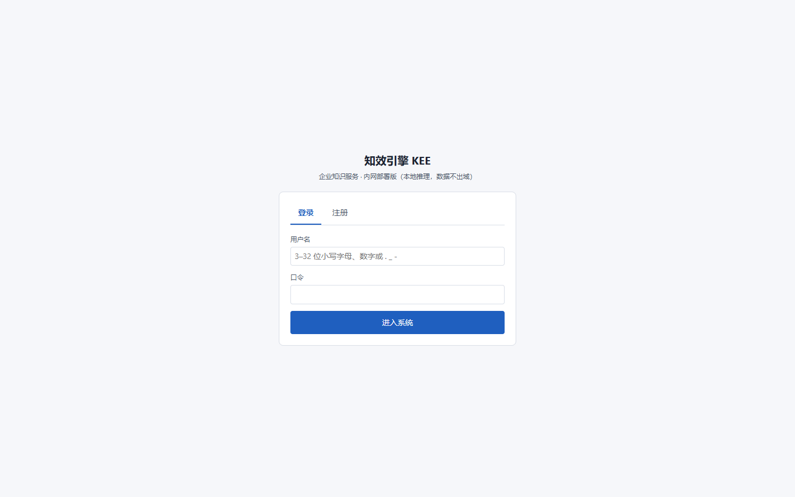

未登录时界面上**只有这一张卡**——没有问答、没有知识库、没有审计。这不是简省，是权限模型的要求：
身份必须由账号换出来，不能由界面挑一个角色。

- 用户名：3–32 位小写字母、数字或 `.` `_` `-`（要能原样放进 HTTP 头与审计记录，所以不接受中文与空格）。
- 口令：至少 10 位。
- 登录成功后令牌保存在浏览器里，默认 **12 小时**有效；关掉浏览器再打开**不需要重新登录**。
- 口令错了只会看到一句「用户名或口令不正确」——系统刻意**不区分**"账号不存在"和"口令错"，
  否则任何人都能拿这份错误提示去枚举用户名。

### 1.2 注册

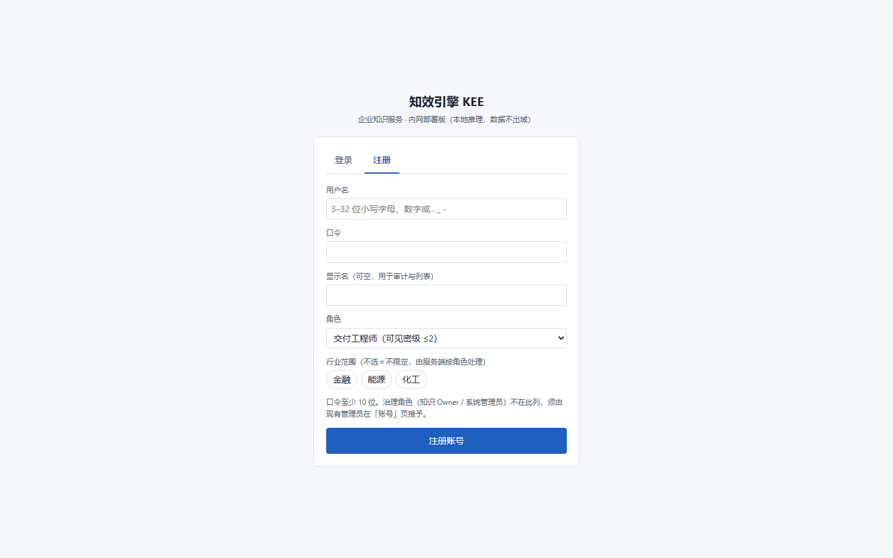

点「注册」标签即可自助建号，要填：用户名、口令、显示名（可空，会出现在审计与账号列表里）、
**角色**、部门范围。

**注册能拿到哪些角色，看上图那个下拉框：只有 5 个**——交付工程师 / 售前架构师 / 项目经理 / 运维支持 / 新人。
**知识 Owner 与系统管理员不在列表里，也不是漏了**：能自助授出治理角色就等于没有权限模型
（治理角色能读全库密级、能改复核状态）。要拿到治理角色，必须由**已有**的管理员在「账号」页授予（§8）。

注册成功后**不会自动登录**，界面上会先给一句说明——让你看清自己刚拿到的是什么范围，再进去用。

> **部署时的第一件事**：库里一个账号都没有时，**第一个注册者可以是治理角色**（否则没人当得上第一个管理员）。
> 这条引导例外意味着**首次注册必须在受控网络内完成，先到先得**。部署手册里要写死这一步。

### 1.3 登录后你会看到什么

顶部两条信息条是**判断"我现在能看见什么"的依据**，出问题先看它们：

```
账号  E2E 系统管理员 e2e-admin-01   角色 系统管理员 system_admin   部门范围 不限定   [退出登录]
可见密级上限 3 · security_level <= 3 · 过滤发生在检索层，不是前端把结果遮住。
依赖：全部就绪  milvus OK  postgres OK  语料：193 块 / 24 篇
```

- 「可见密级上限 + 过滤表达式」是**服务端算出来的**（`/api/v1/auth/me` 原样回传），不是前端自己拼的。
- 「依赖」那一行如果 milvus/postgres 显示"挂"，提问会得到明确错误而不是空答案；
  语料数字为 0 时说明索引是空的或依赖没起来——**这时候的"答不上来"与语料无关，别去改问题措辞**。

---

## 2. 提问、看答案、核对引用

### 2.1 生成过程中（三种状态之一：**未完成**）

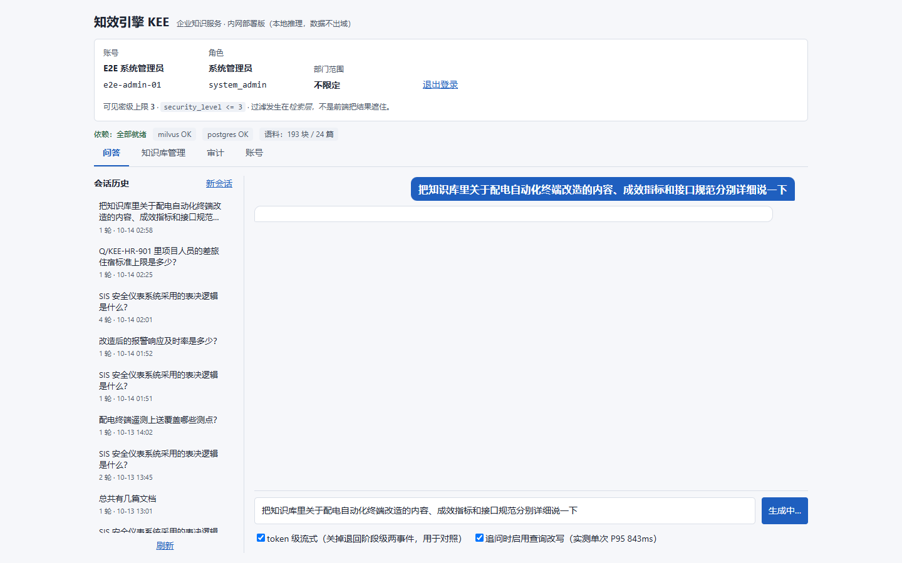

答案是一段一段推出来的（token 级流式）。上图里正在生成的那三条要点是**黄底 + 虚线左边条 + 光标**，
与最终答案（白底 + 实线蓝边）一眼可分。为什么要把"还没校验"的状态画出来：

> 系统在给出对外答案前会做**引用强制**——每条要点必须能落到具体出处，落不掉的会被丢掉。
> 所以流出来的字**有可能最后不成为答案**。真发生了，界面会保留那段文字并标「已撤回」，
> 而不是悄悄删掉（这是本系统最不该出问题的地方：静默删除会让用户以为系统从没说过那句话）。

生成中这一行也是有用的诊断信息：

```
检索 5 块 · 模式 hybrid · 实际查询「把知识库里关于配电自动化终端改造的内容、成效指标和接口规范分别详细说一下」 · 首个可见增量 2918ms
```

- `实际查询` 是**真正送进检索的那句话**。追问时它可能和你打的字不一样（多轮指代被补全了）。
- `首个可见增量` 是从你按下回车到看见第一个可读字的耗时。
- 如果这里出现「检索降级（dense_timeout>…）」，说明这一轮是**单腿检索**（稠密腿超时），
  答案照样给，但那一轮的召回质量低于常规，见 §9。

### 2.2 答案完成后

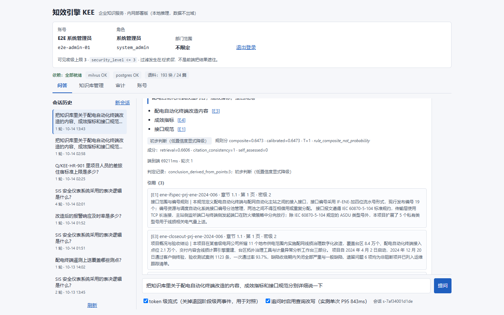

一轮 = 一条问题气泡（右）+ 一条答案气泡（左），追问不覆盖前答，历史在同一列里往上堆。
答案气泡里固定有这几块：

| 区块 | 是什么 | 你该拿它干什么 |
|---|---|---|
| **结论** | 一句话正面回答 | 先看它有没有真的回答你的问题 |
| **要点 + `[E1]`** | 支撑结论的分条依据，`[E1]` 是出处编号 | 鼠标移到右侧对应引用上，命中的要点会高亮 |
| **状态徽标** | 已作答 / 初步判断 / 未给出结论 / 已转人工 | 决定这段内容能不能直接对外用（§4） |
| **规则分** | `composite=… · calibrated=… · T=… · rule_composite_not_probability` | **它是规则打分，不是"答对的概率"**，别换算成百分比对外说 |
| **成分** | retrieval / citation_consistency / self_assessed | 想知道"为什么分数低"时看这三项 |
| **端到端 / 轮次 / 判定记录** | 耗时与走了哪些判定 | 排错用 |
| **引用（N）** | 每条出处的文档、章节、页码、密级 + 片段原文 | **对外引用前逐条点开核对**（§2.3） |
| **免责提示** | 内容由本地模型生成 | 保留它，别删 |

### 2.3 核对一条引用

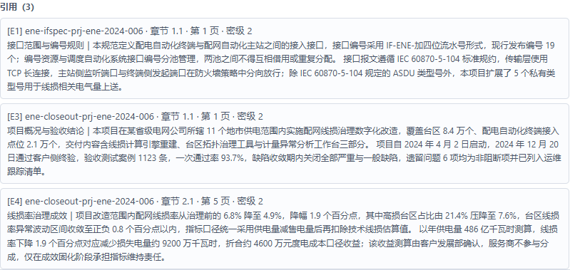

引用区里的片段原文是**第二次请求**取回来的（`POST /api/v1/chunks/batch`），并且与检索层**同一套权限过滤**。
所以三种显示要分清：

| 显示 | 含义 |
|---|---|
| 一段正文 | 该片段在你的可见范围内，且是**当前生效版本**的内容 |
| 「当前身份取不到该片段正文」 | **越权**（密级/部门/项目不在你的范围里）。系统不区分"没权限"和"不存在"——那本身就是信息泄露 |
| 「正文读取中…」 | 还在读，等一下 |
| 「正文未返回」 | 读完了但没拿到正文（少见，报给管理员） |

---

## 3. 追问、会话历史与"切模块不丢"

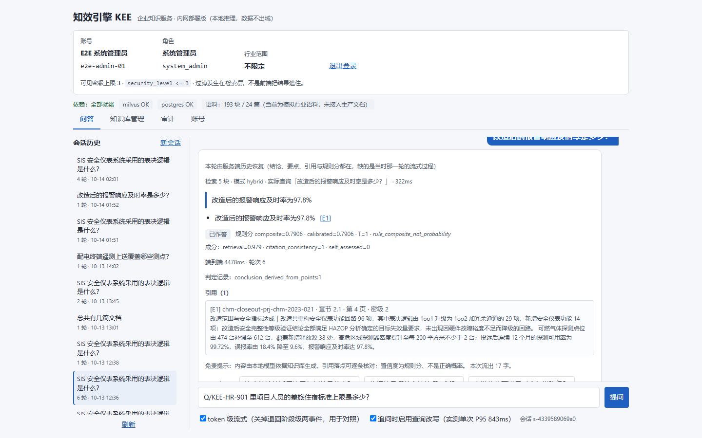

- **左侧「会话历史」栏**列出**你自己的**历史会话：标题=首轮问题，副行=轮数 + 最近时间。点一下就整段取回，
  包括要点、引用落点与规则分（不是只给你看结论）。
- 恢复出来的轮次会带一行「**本轮由服务端历史恢复**」——它缺的只是当时那一轮的流式过程，内容本身是权威源里的。
- **切换模块（问答 ↔ 知识库管理 ↔ 审计 ↔ 账号）不会丢对话**，正在生成的那一轮也不会被打断。
- **刷新页面**会自动接回你上次看的那条会话；换账号登录不会串到上一个人的对话（按用户名分别记）。
- 「新会话」= 开一条空白会话，**不删任何记录**（旧会话仍在左侧列表里）。
- 你只能看到自己的会话：治理角色也看不到别人的提问历史——能读全库密级 ≠ 能读别人问过什么。

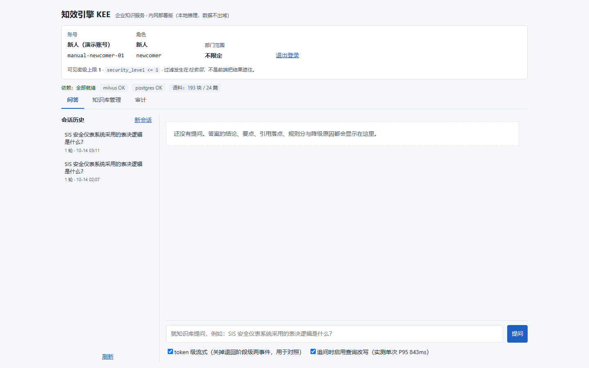

上图是同一个环境下的**新人账号**（`manual-newcomer-01`，由管理员从 `delivery_engineer` 改授为 `newcomer`）：
顶部账号条写的是「部门范围 不限定 · 可见密级上限 1」，标签栏**只有三个**——没有「账号」（那不是治理角色）；
左侧历史栏里只有**它自己问过的两条**，管理员那十几条会话一条都不出现（会话列表判的是归属，不是角色）。
全新注册、一条历史都没有时，那一栏会明说「还没有历史会话」。

**追问相关的两个开关**（输入框下方）：

| 开关 | 默认 | 代价与判断依据 |
|---|---|---|
| token 级流式 | 开 | 关掉会退回"阶段级两个事件"，用于对照；日常不用关 |
| 追问时启用查询改写 | 开 | 一次改写实测 P95 **843ms**，几乎吃满 800ms 的检索门禁预算。首轮不会触发（首轮字面查询本来就自足），只有追问才花这一趟 |

---

## 4. 系统不给结论时的三种表现（这是功能，不是故障）

### 4.1 拒答：语料里没有依据

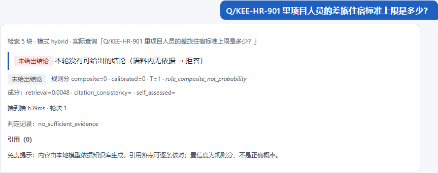

例：问 `Q/KEE-HR-901 里项目人员的差旅住宿标准上限是多少？`（这份制度不在语料里）。
系统显示「**未给出结论** · 本轮没有可给出的结论（语料内无依据 → 拒答）」，引用数 0。

**为什么宁可空着也不答**：本系统的立身规则是"无来源不出结论"。让模型凭常识编一段"看起来合理"的
差旅标准，比不答危险得多。

### 4.2 资料其实有，只是还没人复核（这句话很重要，别当成「库里没有」）

如果检索命中了资料、但这些资料所属版本**还没复核**，系统会摘掉它们再拒答。
这种情形界面写的是「**检到 N 份相关资料，但所属版本尚未复核 → 未作为答案依据；可在「知识库」页催办复核**」，
与 §4.1 那句「语料内无依据」是**两件事**：前者是流程没走完（催办就能推进），后者才是真没料。

- 判别人话：看结论区那句括号——写「尚未复核」就是这一类；写「语料内无依据」才是 §4.1。
- **这一句只报数量、不报是哪几份资料**（2026-10-22 定）：要具体清单请用「知识库」页或 `GET /api/v1/reviews/pending`。
- 需要全库口径时读 `GET /api/v1/reviews/pending`（按你的可见范围返回待复核清单与总数）。
- 答案正常给出时也可能带一句「另有 N 条相关资料因未复核被摘除」——那是在提示你：
  **这道题的证据面比看起来的窄**，别把「答得出来」读成「答得全」。

### 4.3 转人工：涉及密级 3 或敏感内容

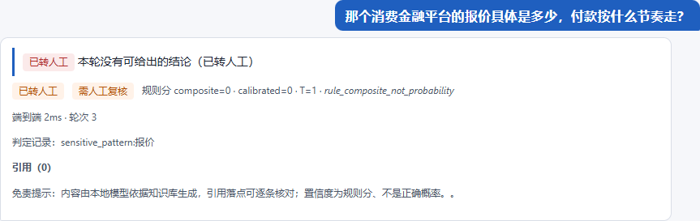

例：问 `那个消费金融平台的报价具体是多少，付款按什么节奏走？`
系统显示「**已转人工** · 需人工复核」。**转人工的判据是密级规则**（引用到的证据里含密级 3 就转），
不是关键词表——所以它不会因为你在正文里写了"价格"两个字就被拦，也不会因为换了个说法就绕过去。

### 4.4 四种状态对应的用法

| 状态徽标 | 可以怎么用 |
|---|---|
| **已作答** | 可对外，但**必须逐条核对引用**（§2.3） |
| **初步判断（低置信度显式降级）** | 内部参考；结论给了，但证据面薄，别直接贴进交付物 |
| **未给出结论（拒答）** | 分两种，界面上那句括号就是判据：**语料内无依据** → 该补文档，不是改问法；**有 N 份资料未复核** → 去「知识库」页催办，不是补文档 |
| **已转人工** | 走人工流程拿授权，系统不会替你把密级 3 的内容写出来 |

---

## 5. 权限：为什么"搜不到"经常是对的

**强制点在检索层**：`security_level / industry / project` 三个维度被拼进向量库的过滤表达式，
不是"先查出来再在前端藏起来"。所以"搜不到"有三种真实原因，界面上不互相区分：

1. 语料里确实没有；
2. 有，但**密级高于你的账号上限**；
3. 有，密级也够，但**不在你限定的部门 / 项目范围**里。

同一道题、两个账号的实测对照（都是真机截图）：

| 账号 | 角色 | 可见密级 | 问「SIS 安全仪表系统采用的表决逻辑是什么？」 |
|---|---|---|---|
| `e2e-admin-01` | 系统管理员 | 3 | **已作答**，引用 1 条（密级 2 的结项报告）→ 见 §2.2 图 |
| `manual-newcomer-01` | 新人 | 1 | **未给出结论（语料内无依据 → 拒答）**，引用 0 条 |

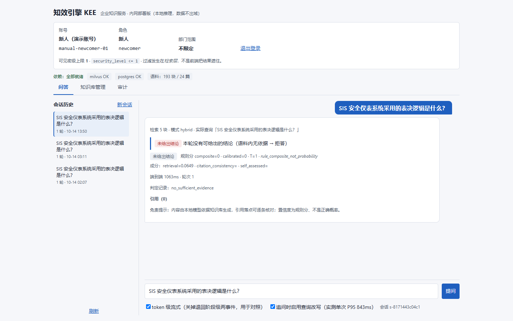

**给管理员的提醒**：新人看到"语料内无依据"是**预期行为**，不要去改问题——
正确的解释是"这块内容对他不可见"。

角色与可见密级的对应关系（强制实现见后端检索层，界面只用于呈现）：

| 角色 | 可见密级上限 | 能上传 | 能复核 |
|---|---|---|---|
| 新人 | 1 | ✗ |  |
| 交付工程师 / 售前架构师 / 运维支持 | 2 | 前两个 ✓，运维 ✗ | ✗ |
| 项目经理 | 3 | ✓ | ✗ |
| 知识 Owner / 系统管理员 | 3 | ✓ | ✓ |

---

## 6. 知识库管理

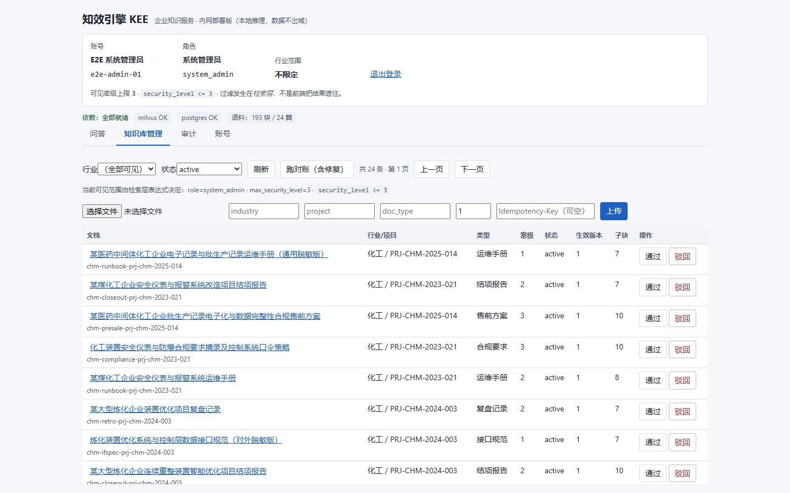

### 6.1 列表与筛选

表格列：**文档 / 部门·项目 / 类型 / 密级 / 状态 / 生效版本 / 子块 / 操作**。
工具条：部门筛选、状态筛选、刷新、**跑对账（含修复）**、分页。
列表上方那一行「当前可见范围由检索层表达式决定：role=… · max_security_level=… · security_level <= …」
是服务端回传的，**它解释了为什么你看到的条数比别人少**。

### 6.2 看一个文档

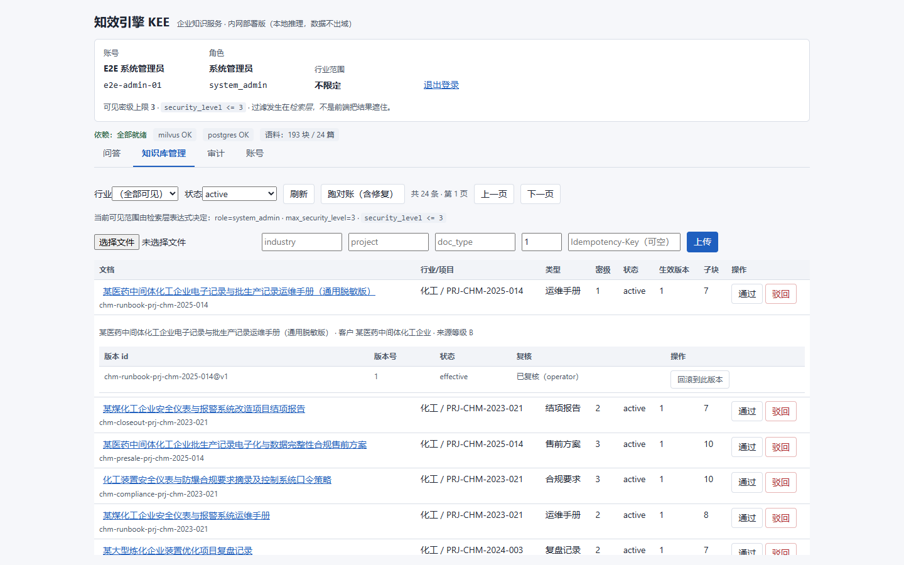

点文档标题展开详情：版本表（版本 id / 版本号 / 状态 / 复核 / 操作）+ 元数据 + 分块。
点「回滚到此版本」把生效版本切回旧版——**切换后索引会用权威源重建**（这一步不需要 GPU），
所以回滚之后答案里引用的内容会跟着变回旧版。

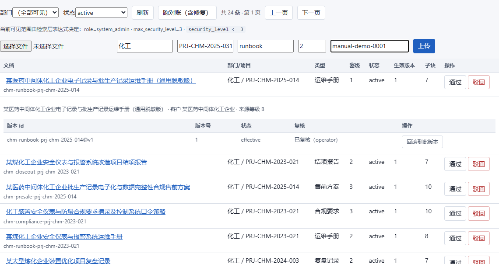

（上图是同页的上传表单填写后的样子：`化工 / PRJ-CHM-2025-031 / runbook / 密级 2 / 幂等键 manual-demo-0001`。）

### 6.3 上传一份文档

按顺序填：

| 字段 | 含义 | 注意 |
|---|---|---|
| 选择文件 | 支持 md / txt / csv / log / docx / pdf / png / jpg / jpeg / webp / gif / bmp / tif | PDF 走本地版面 + OCR + 表格结构还原；图片只做本地 OCR（保留图内文字），不做图表语义描述；比纯文本慢很多 |
| `industry` | **部门**（本项目取行业线口径：金融 / 能源 / 化工） | **决定谁能检索到它**：不在别人部门范围内就搜不到。字段名沿用 `industry` |
| `project` | 项目编号，如 `PRJ-CHM-2025-031` | 同上，项目维度收敛 |
| `doc_type` | 类型（运维手册 / 结项报告 / 售前方案 / 合规要求 / 复盘记录…） | 影响判据（规范类与交付类在证据判定上不同） |
| `security_level` | 密级 1/2/3 | **3 级会强制转人工**，别指望问答把它写出来 |
| `Idempotency-Key` | 幂等键，可空 | 网络抖动重发时防止同一份文档入库两次 |

> ⚠ **本手册的截图里表单填好了但没有点「上传」**——线上**没有删除文档的端点**，
> 传进生产语料的东西撤不回，也不会因为截图需要就多留一份脏数据。

### 6.4 复核（职责分离）

每行右侧有「通过 / 驳回」。**上传者不能复核自己上传的文档**（服务端会直接 403）。

- **通过**：给这个**版本**盖复核章（`reviewed_by / reviewed_at`）。章在版本上而不在文档上——
  否则一次复核就自动放行了以后所有版本，那正是投毒的形状。
- **驳回**：该版本转为 superseded 并**撤下索引**。

**必须理解的语义**：未复核的内容**仍可被检索到**（复核人得看得见才能复核），
但**不会被引用作答**（答案层会摘除未复核证据，摘光就走拒答）。
对外措辞只能说"未经复核的内容不会被引用作答"，**不能说"不会被检索到"**。

### 6.5 跑对账（含修复）

对账回答的是"权威源（PostgreSQL）和向量索引（Milvus）还一致吗"：
diff → Outbox 补偿 → 复检。日常运维建议按日跑。差异为 0 才算一致；
报告里出现 `missing_in_vector` / `extra_in_vector` 非零时，先跑修复再看是否归零。

---

## 7. 审计

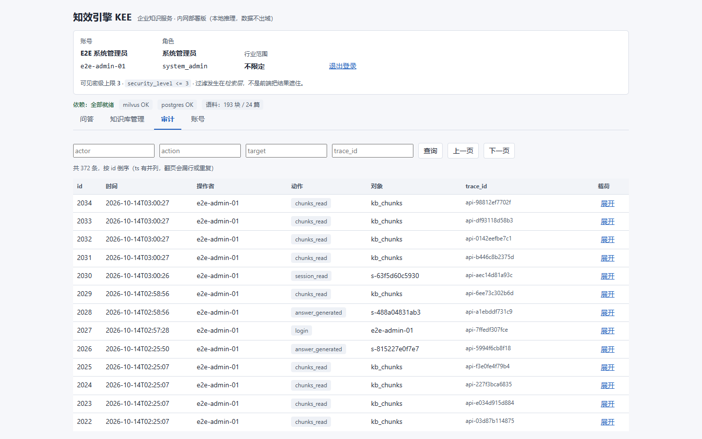

按时间倒序列出操作记录：**id / 时间 / actor / action / target / trace_id / payload**。
可按 actor、action、target、trace_id 过滤。

- 这张表是**追加表 + 禁改触发器**：任何 UPDATE / DELETE 都会被数据库拒绝。
- 常见 action 与含义：

| action | 什么时候产生 |
|---|---|
| `login` / `login_failed` / `logout` | 登录、登录失败（含口令错的每一次）、退出 |
| `user_registered` / `user_role_granted` | 注册、管理员改授角色（后者带授予人与新角色） |
| `answer_generated` | 每一次问答（含状态、引用数、置信度、是否流式） |
| `session_read` | 打开某条历史会话（**列表不记录，逐条打开才记**） |
| `chunks_read` | 每次读取引用片段正文 |
| `document_ingested` / `document_admitted` | 文档入库 / 通过机械准入 |
| `document_review_pass` / `document_review_reject` | 复核通过 / 驳回 |
| `document_rollback` | 切换生效版本（payload 里带目标版本） |
| `reconciliation_run` | 跑对账（payload 是 diff 与修复结果） |

**排查一次"这个答案是谁问的、当时看见了什么"**：从答案里的 `trace_id` 出发，
在审计页按 trace_id 过滤，能串起同一次请求的所有动作。

---

## 8. 账号与授权（仅治理角色可见）

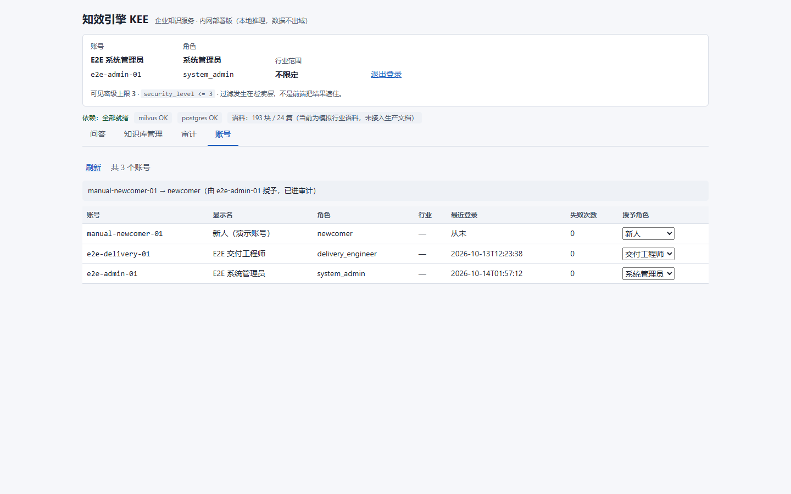

只有知识 Owner / 系统管理员能看到「账号」标签。页面列出所有账号：账号 / 显示名 / 角色 /
部门 / 最近登录 / 失败次数，最右两列是**授予角色**下拉框与**强制下线**。

- 改角色**立即生效**，但**不影响已登录会话的身份**——要对方以新权限工作，让他重新登录一次
  （或者你直接点他那一行的「强制下线」，他的令牌当场失效，下一次请求就要重新登录）。
- **强制下线**会撤销该账号的**全部**登录态（口令不动，账号仍可再登录）；这一步本身进审计
  （`user_force_logout`，payload 里是撤销了几个会话，actor 是执行的人）。
  它的存在理由很直接：账号口令泄露时，此前只能等他那枚令牌 12 小时自然过期，或者由人改数据库。
- 每一次授权都进审计（`user_role_granted`，payload 里带新角色，actor 是授予人）。
- 界面上不能删账号、不能重置口令（当前实现没有这两个端点）。**这是已知边界**，见 §9 最后一条。

**你自己点「退出登录」时**：默认会撤销**这个账号的所有会话**，不是只退当前这台机器。
在两处都登录过的人，从任何一处退出，另一处也会掉线——这是 V1.35 改的语义，
理由是本系统是内网部署，共享电脑上「退出后另一台浏览器还能用」比「在另一台机器上被要求重新登录」危险得多。
确实只想退本机时，调 `POST /api/v1/auth/logout?all_devices=false`（界面上没有这个开关）。

---

## 9. 常见问题与排错

| 现象 | 原因 | 怎么办 |
|---|---|---|
| 第一答很慢（实测见过 70s+），后面几秒就出 | 模型冷装载 | 正常。部署后先跑一次预热问答再对外用 |
| 答案那行出现「检索降级（dense_timeout>2500ms）」 | 稠密腿超时，这一轮实际是**单腿（BM25）检索** | 答案仍给出，但召回低于常规；把这轮的 trace_id 记给管理员，别当常规读数用 |
| 明明有这份文档，检索就是搜不到 | 三种可能：密级不够 / 部门·项目不在范围 / 该版本**未复核** | 看顶部「可见密级上限 + 过滤表达式」；再进知识库管理确认状态与复核列 |
| 结论里有具体数字，但不敢用 | 结论的每个数字都应能落到引用片段里 | 逐条点 `[E1]` 核对；对不上就**别用**，并把 trace_id 报给管理员（这属于要查的问题） |
| 规则分 0.79 是不是"79% 正确" | **不是**。它是规则打分（`rule_composite_not_probability`） | 对外表述只说"系统按规则给出的分"，不要换算成概率 |
| 刷新后要重新登录 | 令牌过期（默认 12h）或清了浏览器存储 | 重新登录；管理员可调 `KEE_SESSION_TTL_HOURS` |
| 在 A 机器点了退出，B 机器也掉线了 | **有意如此**（V1.35）：退出默认撤销该账号全部会话 | 只想退本机时调 `POST /api/v1/auth/logout?all_devices=false`；界面不提供这个开关 |
| 同事的口令疑似泄露，但他正登着 | 治理角色在「账号」页点他的**强制下线**，全部登录态当场撤销 | 界面上没有删号/停用入口（未实现，见 §9 边界） |
| 注册页找不到"系统管理员"选项 | 有意为之：注册不得自授治理角色 | 让现有管理员在「账号」页授予 |
| 切到知识库管理再切回来，担心对话丢了 | 不会丢；正在生成的那一轮也继续 | 真丢了就是异常，报 trace_id |
| 打不开地址 / 端口起不来 | Windows 重启后可能把 38xxx–41xxx 段保留掉（`netstat` 查不到占用者，bind 直接报权限错） | 换端口启动：`KEE_API_PORT=28000 uv run python scripts/serve_api.py`，前端 `KEE_API_ORIGIN=http://127.0.0.1:28000 npm run dev -- --port 28173` |

**还没做的（别指望它）**：账号删除与口令重置界面、单点登录（OIDC/LDAP）、把推理进程容器化、
以及「整机拔网线后的端到端可用性」验证——这些都在《M5 风险登记册》里挂着，不是遗漏。
账号侧还剩两条边界没关：`failed_count` 只计数（**不锁号也不限速**）、库里为空时首个注册者可以是治理角色
（引导例外，所以首次注册要先到先得）。
另有一份**逐项实现状态表**（图谱 / 云端兜底与预算熔断 / 答案反馈闭环 / LiteLLM / Socket.IO /
Langfuse 容器（代码已就位、待裁）/ prompt 压缩 / 企业统一身份 / 账号锁定与删除 等 16 项，
各自属 Should、后续还是裁决不做）在《项目定义》§十一 末尾，对外介绍能力边界时以那张表为准。
RAGAS 两指标与 LLM-as-Judge 已于 V1.37 落地为**自研复现装置**（不是 ragas 库；读数全部为报告值、
不进门禁），实测与口径边界见 `reports/m5/M5_RAGAS与LLM裁判实测.md`。
可观测那一组已于 V1.36 落地（指标、看板与日志，见下一节），Langfuse 的容器还没起。

---

## 10. 观测与巡检（给值班的人）

### 10.1 三个入口

| 入口 | 地址 | 看什么 |
|---|---|---|
| 依赖自检 | `http://127.0.0.1:38000/healthz` | 单点最快判断：Milvus / PostgreSQL 各报 `ok` 或挂法，193 块 / 24 篇这类规模数字也在这里 |
| 指标端点 | `http://127.0.0.1:38000/metrics` | Prometheus 文本。没有界面，`curl` 就够；标签里没有提问原文、用户名、文档 id |
| 看板 | `http://127.0.0.1:33000/d/kee-rag`（admin / 待填_KEE_GRAFANA_ADMIN_PASSWORD） | 15 个面板：延迟分位、出口闸门分布、降级原因、缓存命中、没过闸占比、错误码、流式撤回。真截图在 `docs/assets/obs/`（整页 15 块全渲染，只有 #14 Langfuse 是 No data，因为默认关） |
| 告警状态 | `http://127.0.0.1:39090/alerts` | 9 条表达式的当前状态（本机没接 Alertmanager，所以是「来看」不是「来喊」） |
| 观测面开关 | `GET /api/v1/observability/status`（治理角色） | 这台实例把哪些观测开着、Langfuse 为什么没开（原因原文） |

### 10.2 两种典型故障先看哪张图

| 现象 | 先看 | 判读 |
|---|---|---|
| 用户说「答得慢」 | 面板 6「端到端与各阶段分位数」 | `retrieval` 那几条涨上去 → 看面板 8 的降级原因（`dense_timeout` / `dense_empty` / `hybrid_single_leg`）；`generate` 涨 → 是模型侧（Ollama 是否常驻、显存是否被抢） |
| 用户说「答不上来」 | 面板 7「出口闸门分布」 | 堆在 `retrieval_gate` → 检索或语料问题（配面板 4「≤0.2 占比」）；堆在 `no_citation` / `unparseable` → 生成与契约问题；堆在 `sensitive` → 是政策拦的，不是坏了 |
| 分数看着不对劲 | 面板 8 里 `score_scale_out_of_range` | **一次即报，别等**：那说明某条腿的原始量纲漏进了下游，离线评测在这种情况下会直接拒出读数 |

### 10.3 三条读数纪律（不然会报出错的东西）

- **看板上的 P95 不是门禁那条 P95。** 看板是直方图桶上的近似值、且统计全部轮次（含冷启动那批 20–90s 的）；
  ① 那条 6s 门禁的口径是「6s + 仅作答轮次 + `first_visible`」，权威读数由 `scripts/` 下的离线探针产出。
  实测对照：看板 p95 e2e 31.5s，而门禁那条达标——两个数都对，说的是两件事。
- **指标重启归零**：计数器在进程内累计、不落库。要历史看 Prometheus（默认留 15 天），要单轮事实看 `session_turn`，
  要「谁问了什么」只有审计页/`audit_log` 能答。
- **缓存命中那一轮的降级计数恒为 0**：命中结果里本来就不带降级标记与改写来历（这是已知边界，不是统计漏了）。
  所以「降级率」这张图在命中率高的时段天然偏乐观。

### 10.4 开关与换端口

```bash
KEE_METRICS_ENABLED=false    # 关掉 /metrics（返回 404），指标层仍在计数
KEE_LOG_JSON=false           # 日志换回一行一条的人读格式（仍带 trace_id）
KEE_LOG_LEVEL=WARNING        # 只报警告以上
```

宿主 API 换端口（Windows 会随机保留一段 TCP 端口，本机就从 38000 挪到过 28000）之后必须补一条：

```bash
uv run python scripts/obs_targets.py --port 28000
```

不补的话 Prometheus 会一直抓旧端口，症状是**整块看板 No data**——和「指标层坏了」长得一样。
补完之后 20s 内自动生效，不用重启任何容器。

### 10.5 Langfuse（链路上报）默认关闭

载荷含问题与结论原文，所以它默认不开，且**目标地址必须是回环或私网**，公网地址会被代码直接拒发。
要开：先按 `infra/docker-compose.langfuse.yml` 起自托管实例（**该文件出稿但未实跑，需要先裁一次 GB 级镜像的下载**），
再在 `.env` 里补 `KEE_LANGFUSE_ENABLED=true` 与一对 pk/sk，然后重启宿主 API。
开关状态与「为什么没开」可以用 10.1 最后那个接口查，不用翻日志。

---

## 附录 A：术语

| 术语 | 意思 |
|---|---|
| **部门** | 权限维度之一，本项目取行业线口径（金融 / 能源 / 化工）；代码与存储字段名为 `industry` |
| **密级 security_level** | 1 内部 / 2 机密 / 3 绝密（3 强制转人工） |
| **生效版本** | 一个文档可有多个版本，只有生效版本的内容会被检索与引用 |
| **复核章** | 记在**版本**上的通过标记；没章的版本不进答案 |
| **引用落点** | 每条要点/引用能否对应到具体文档-章节-页码-片段 |
| **规则分 composite** | 由检索强度、引用一致性、模型自评合成的规则打分，**不是概率** |
| **拒答 / 转人工** | 前者=语料内无依据；后者=涉密级 3 或敏感，交人工处理 |
| **对账 reconciliation** | 校验权威源与向量索引是否一致，并补偿差异 |

## 附录 B：地址与入口

| 用途 | 地址（默认端口） |
|---|---|
| 部署版界面（Nginx 静态 + 同源反代） | `http://127.0.0.1:38080/` |
| 宿主 API | `http://127.0.0.1:38000`，健康检查 `/healthz` |
| 开发模式界面 | `http://127.0.0.1:38173/` |
| 接口文档 | `http://127.0.0.1:38000/docs` |

所有端口只绑 `127.0.0.1`；API 拒绝非回环绑定（数据不出域是硬约束）。

## 附录 C：界面背后的接口（给运维/对接方）

| 方法 | 路径 | 谁在用 |
|---|---|---|
| POST | `/api/v1/auth/register` · `/login` · `/logout` | 登录页 |
| GET | `/api/v1/auth/me` | 顶部账号条与可见范围 |
| GET | `/api/v1/auth/users` · POST `/users/{name}/role` · POST `/users/{name}/revoke-sessions` | 账号页（治理角色：授权 / 强制下线） |
| POST | `/api/v1/answers/stream` | 问答页（token 级 SSE：`retrieval → delta* → answer`） |
| POST | `/api/v1/chunks/batch` | 引用片段正文（与检索层同口径过滤） |
| GET | `/api/v1/sessions` · `/sessions/{id}` | 左侧会话历史（只返回自己的；详情带整包答案） |
| GET/POST | `/api/v1/documents*` · `/documents/{id}/review` · `/rollback` | 知识库管理 |
| POST | `/api/v1/reconcile/run` | 「跑对账（含修复）」 |
| GET | `/api/v1/audit` | 审计页（限治理角色） |

## 附录 D：部署前提（给装系统的人）

1. 单机内网：Docker（存储栈 + 前端容器）+ 宿主推理进程（要用本机 GPU）+ 本地大模型。
2. **存储栈起好后，先跑一次 `scripts/harden_audit_store.py`，再起 API**。
   这一步建应用角色 `kee_app`（非超级用户）并把审计表的属主交给一个 NOLOGIN 角色；
   没跑的话 `kee_app` 不存在，API 连不上库（`KEE_POSTGRES_DSN` 默认指向 `kee_app`）。
   它幂等，`--check` 只报当前权限面不写任何东西；执行需要 `--confirm=HARDEN`。
   `kee_admin`（DBA 入口）的随机口令只落 `var/pg_admin_credentials.json`，不进版本库——
   **换环境部署时这一步不能省**，否则你会把自己锁在库外面。
3. **首次注册 = 第一个管理员**，必须在受控网络内完成（§1.2 的引导例外）。
4. 云端兜底保持关闭（`cloud_fallback_enabled=false`）；核心链路不出域。
5. `KEE_ALLOW_HEADER_IDENTITY` **默认已是 `false`**：不带令牌、只发一个 `X-Kee-Role: system_admin`
   拿不到任何范围（`/healthz` 与 `/auth/me` 会如实报 `header_identity_allowed`）。
   内网工具确需这条通道时**显式**设成 `true`，别让它跟着交付物出去。
6. 接入企业自有文档后，重跑 `scripts/m2_eval.py`（检索四把门禁）、`scripts/verify_m3.py`（答案链契约）
   与 `scripts/m5_latency_clean.py`（延迟读数），用同一套作业给出新库的读数。
   ⚠ 新库要先跑 `scripts/harden_audit_store.py`，再确认 `audit_log` 上禁改触发器在位
   （`verify_m1.py` 里有一步专门验这个：以应用角色试探 `TRUNCATE` 与 `DELETE`，两条都必须被拒）。

## 附录 E：本手册的截图是怎么来的

- 浏览器：Microsoft Edge（Playwright CLI 驱动），视口 **1440×900**，全页不滚动、正文区内部滚动。
- 通路：问答走 `POST /api/v1/answers/stream`（SSE），历史/知识库/审计走各自的读接口，全部经真实 HTTP。
- 账号：`e2e-admin-01`（系统管理员）、`manual-newcomer-01`（新人，注册后由管理员改授）；
  **口令不写入任何文档**。
- 生产语料全程**只读**：上传表单只填不提交，复核/回滚按钮**未点击**（线上没有删除端点，写进去撤不回）。
- 复跑：`scripts/serve_api.py` + `frontend` 的 `npm run dev`，按 §0 的顺序走一遍即可复现同样的界面；
  界面断言在 `frontend/src/pages/*.test.tsx`（登录闸门、三态渲染、一问一答版式、会话生命周期）。
