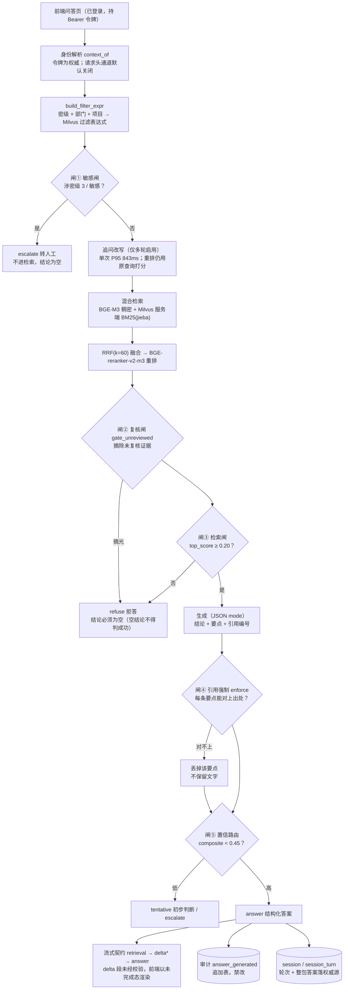
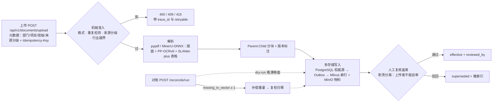
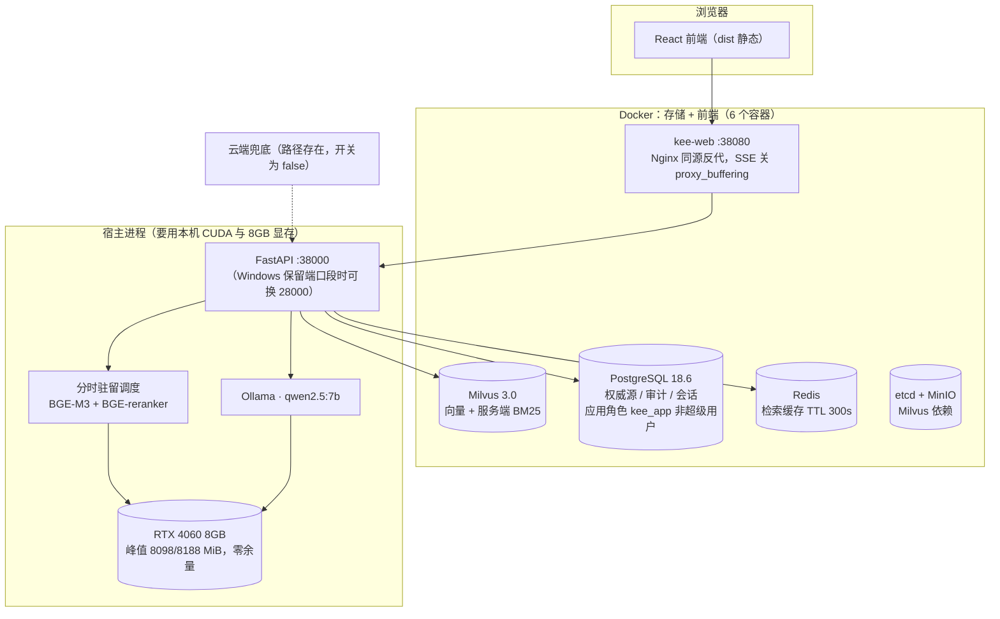

# 知效引擎 KEE · 需求主流程（从业务诉求出发的推演式主流程）

> **格式来源**：`需求主流程.md`（采购计划那一份）。本文照它的节次与编号写法走，
> 把「烟/酒安全库存」那套推演换成本项目的等价物：**证据的安全库存**。
> 与模板有一处实质分歧（第 8 节：接口要不要升级为 MCP），**保留不删**，写在第 12 节。
> **口径**：文中数字分两类——① 政策/门禁（业务方定的阈值，不是达成声明）；② 本地实测读数
> （单机、自建语料、无真实用户，不等于线上）。基准 V1.35 / V1.0.37，2026-10-15。

---

## 1. 一句话业务诉求

> 根据公司的知识资产 + 这个提问者的身份，给我一条**敢对客户说出去**的答案，
> 并把「谁问了什么、系统凭什么这么答」全程留痕。

## 2. 角色

**提问侧（主用户）**
1. 交付工程师 / FDE 前出工程师（**主用户**，在客户现场）
2. 售前 / 解决方案架构师
3. 项目经理（PM）
4. 运维 / 技术支持工程师
5. 新入职员工

**治理侧**
6. 知识资产 / 质量合规管理员（知识 Owner）
7. 系统管理员

## 3. 这个角色到底要回答什么

采购经理的问题是「我要采购什么、要采购多少」。交付工程师在现场的问题是四个：

1. 这个口径 / 参数 / 条款**到底是多少**（心跳超时阈值、遥测测点个数、RTO、表决逻辑）
2. 我**有没有权限**看它（密级 1/2/3，部门=金融/能源/化工，项目）
3. 这句话**出自哪份文件、哪一章、第几页、哪一块**（不能核对的答复，客户一问"依据呢"就崩）
4. 系统答不上时，**谁替我答**（转人工的出口在哪、要等多久）

> 第 3 问是全局枢纽。前四问里 1、2、4 任何 RAG demo 都能做个样子，
> **只有"可核对"决定这东西能不能进交付流程**。

## 4. 公司的政策（相当于「烟要保 min 20 支」）

这些不是实现细节，是业务方定的阈值——和"安全库存 20 根烟"同一性质：

| # | 政策 | 落成什么 |
|---|---|---|
| 1 | **证据的安全库存**：检到的证据不够，就不许作答 | 检索闸 `top_score ≥ 0.20`，不足 → `refuse` 且**结论必须为空** |
| 2 | **置信的安全库存**：分数低只能出"初步判断"或转人工 | `composite < 0.45` → 转人工 / 降级标注 |
| 3 | **密级隔离**：新人 ≤1、交付/售前 ≤2、PM ≤3、Owner 与管理员不限；**密级 3 强制转人工** | 过滤表达式进**检索层**，不是拿到结果再遮 |
| 4 | **部门 / 项目隔离**：金融 / 能源 / 化工各成体系 | 同上（字段名沿用 `industry`） |
| 5 | **数据不出域** | 本地推理；云端兜底 `false`（代码里有路径，开关是关的） |
| 6 | **未经人工复核的知识不进答案** | 复核章打在**版本**上；未复核**仍可被检索**（复核人要看得见才能复核）但不进答案 |
| 7 | **无来源不出结论** | 每条要点必须映射到真实证据块，映射不上**丢掉该要点**而不是保留文字 |
| 8 | **审计不可篡改** | 追加表 + 禁改触发器 + 数据库权限面（应用角色只剩 INSERT/SELECT） |
| 9 | **分数不许被当成概率** | 响应自带 `score_basis=rule_composite_not_probability` |

## 5. 主流程：架构图 + 查现状算差额

### 5.1 在线主流程（一条请求要穿过的五道闸）

节点顺序与出口全部取自 `src/kee/qa/graph.py:429-436` 与 `:134/:199/:310/:324/:347`，不是画着好看的示意图。
**五道闸**编号与第 11 节的等式一致：①敏感闸 ②复核闸 ③检索闸 ④引用强制闸 ⑤置信路由。



**这张图不画什么**（省略是刻意的，写出来免得被当成"图不全"）：
不画 `degraded` 分支（依赖故障出口，三个节点都可能进）、不画幂等重放、不画 Redis 缓存命中路径
（命中时整条检索腿短路，`retrieval_ms=0.0`，**那属于另一个被测系统**，复测延迟前必须清缓存）。

### 5.2 差额怎么算（对应「库存 8 支 ⇒ 采购 12 支」）

模板里是「库存系统查到 8 支，政策要 20 支 ⇒ 采购 12 支」。
本项目的"差额"是**这个问题需要的证据 vs 库里检得到且我有权限看的证据**：

**正例（实测，走生产入口）**
```
谁：verify-eng（delivery_engineer，密级 ≤2）
问：配电自动化终端的遥测数据上送覆盖哪些测点，一共多少个？
① 身份 → 过滤表达式  security_level <= 2
② 稠密腿(BGE-M3) + 稀疏腿(Milvus 服务端 BM25/jieba) → RRF(k=60) → BGE-reranker 重排
③ 证据存量：top_score = 0.9937   政策要求 ≥ 0.20  ⇒ 够，进生成
④ 生成(JSON mode) → 引用强制核对
结论：覆盖三相电流、三相电压、有功与无功功率及功率因数共 14 个测点
出处：ene-ifspec-prj-ene-2024-006（第 2.1 节，块 c…，密级 2）
```

**反例（同一题，换个人）**
```
谁：newcomer（密级 ≤1）
① 过滤表达式 security_level <= 1 ⇒ 那份接口规范根本检不到
③ 证据存量：无可引证据 ⇒ 触发政策 1
结论：status = refuse，**结论字数 0**（空结论不得判成功）
```

> 差额为负时系统不许自己凑——这一条就是它和"随便一个 chatbot"的分界。
> 也是为什么"拒答率"在本项目里**不是坏指标**。

### 5.3 支撑流：知识入库与治理（离线那半条链）

在线那条链能不能可信，取决于这里。**注意复核章打在「版本」上而不是「文档」上**——
章若在文档上，一次复核就自动放行以后所有版本，那正是投毒的形状。



**闸的真实位置**：`effective` 之后、`reviewed_by` 之前，内容**仍可被检索命中**（复核人必须看得见才能复核），
但**不进答案**——所以投毒的残余风险不是"入库即作答"，而是"上传到复核完那段窗口里它在检索结果中可见"。
这句话只能这么写，不能写成"入库有前闸"。

### 5.4 部署拓扑（哪些在容器、哪些必须在宿主，以及为什么）



**为什么 API 不进容器**（ADR-12 定案，代价实测过）：容器化只能带 CPU torch，
而合成一次检索 CPU+float32 = **5167ms**，门禁是 P95 检索 < 800ms ⇒ 门禁当场不可达；
`fp16` 在 CPU 上是软件模拟，比 float32 还慢 5.1 倍。
**因此「整机拔网线还能不能问答」划出承诺范围**——不是待办，是不承诺。

## 6. 明细（对应「明细：烟 12 酒 3」）

一条答案的明细形状（不是自由文本，是可核对的结构）：

```
状态            answer / tentative / refuse / escalate / degraded
结论            14 个测点……
要点            [{ 文本, 引用编号 }]
出处            [{ doc_id, section_no, page, chunk_id, evidence_id, parent_id, project, security_level, score }]
规则分          composite = 0.45·检索强度 + 0.35·引用一致性 + 0.20·模型自评
                （本轮实测：retrieval 0.9937 / 引用一致 1.0 / 自评 **0.0** → composite **0.7971**）
免责 / 口径      score_basis = rule_composite_not_probability
会话            session_id + turn_no（多轮追问的上文从这张表读）
耗时            检索 302.8ms(P95) / 端到端 4118.8ms(P95) / 首个可读字 859.2ms(P95)
```

## 7. 让系统自动（自动化到哪一步，哪一步必须是人）

模板里是「① 调对方接口直接下单 ② 让 AI 生成采购订单 PDF」。本项目的边界切在别处——**判断可以自动，责任不能自动**：

**机器自动（确定性规则，可复算）**
- 解析（pypdf / MinerU-ONNX 版面 + PP-OCRv6 + SLANet-plus 表格结构）、Parent-Child 分块、嵌入与索引
- 机械准入：格式校验 / 重复检测 / 来源分级 / 行业越界拒绝
- 混合检索、RRF、重排、密级与部门过滤
- 证据够不够（0.20）、置信高不高（0.45）、密级 3 转人工
- 引用核对（对不上就丢要点）
- 多存储一致性：Outbox + 每日对账，**发现缺数据并补偿**（实测注入 2 块缺失 → 检出 missing=2 → 修复归零）
- 审计落库、会话签发与撤销

**必须是人（系统不许代答的三件事）**
1. **人工复核盖章**——上传到复核完这段窗口里，内容可被检索但进不了答案
2. **双人标注的 B 栏**——尺子不能由造尺子的人自己签字（语料我写的、题我出的、判据我改过，我再填 B 就等于自证）
3. **答案正确性判定**——`answer_correct` 只能真人判，所以它只做报告值（0.9677），**不当门禁**

## 8. 接口要升级为 MCP 吗

模板第 34 行的主张是「写了这么多接口，要让 AI 自动识别并调用，就必须升级为 MCP」。**本项目刻意不这么做**：

1. Won't 里明写「不代替人做业务决策 / 不自动执行动作」，只回答与建议；
2. 一旦让模型自主决定"调哪个接口"，第 4 节那套证据/密级/置信判定就不再是**确定性规则**，
   而门禁必须可复算——不可复算的闸门等于没有闸门；
3. 8GB 显存里再养一层规划器不划算（7B + 嵌入 + 重排已用满 8098/8188 MiB，零余量）。

所以本项目只有**一条固定编排链路**（LangGraph 状态机，节点顺序写死），没有工具白名单、没有自主编排。

## 9. 应该怎么干出来（模拟真实企业系统：要开发的系统与接口）

```
1、文档接入系统
   POST /api/v1/documents/upload        带元数据(部门/项目/密级/来源分级) + Idempotency-Key 幂等
   GET  /api/v1/documents · /{doc_id}   列表与详情（含版本链）
2、知识构建系统（离线）
   机械准入 → 解析 → Parent-Child 分块 → 元数据/版本 → 多存储写入 → Outbox
   POST /api/v1/reconcile/run           对账（dry-run 看漂移面，repair=true 补偿）
3、检索系统
   POST /api/v1/retrieval/search        带身份过滤的检索
   POST /api/v1/chunks/batch            引用片段正文（与检索层同口径过滤；越权与不存在合并成 hidden）
4、问答编排系统（在线主链路）
   POST /api/v1/answers                 结构化答案（结论+要点+出处+规则分）
   POST /api/v1/answers/stream          token 级 SSE：retrieval → delta* → answer
5、身份与权限系统
   POST /auth/register · /login · /logout     退出默认撤销该账号全部会话
   GET  /auth/me · /auth/users
   POST /auth/users/{name}/role               治理角色须由已有管理员授予
   POST /auth/users/{name}/revoke-sessions    强制下线
6、治理与审计系统
   POST /documents/{id}/review          通过 / 驳回（职责分离：上传者不能自审）
   POST /documents/{id}/rollback        版本回滚并重建索引
   GET  /api/v1/audit                   限治理角色，按 id 倒序
7、会话系统
   GET  /api/v1/sessions · /sessions/{id}   只返回本人的；详情带整包答案（不是只有结论）
8、运行自检
   GET  /healthz                        依赖逐个报 ok/挂（挂了不许一片绿）
9、可观测系统（V1.36 补上的一块）
   GET  /metrics                        Prometheus 文本：19 个 kee_* 指标族，标签全闭合枚举（无提问原文/用户名/文档 id）
   GET  /api/v1/observability/status    观测面开关 + Langfuse 状态（含被关闭的原因原文），限治理角色
   Prometheus + Grafana                 15 面板看板 + 9 条告警表达式，全部逐条在真实例上执行过
   结构化日志                           一行一个 JSON，trace_id 与响应体 / 审计 / session_turn 同源
   Langfuse 上报                        默认关闭；载荷含问题与结论，故目标地址必须是回环/私网（公网直接拒发）
```

**底座（本机 8 个容器 + 宿主推理）**：Milvus（向量 + 服务端 BM25）、PostgreSQL（权威源 + 审计 + 会话）、
Redis（检索缓存 TTL 300s）、etcd / MinIO（Milvus 依赖）、kee-web（Nginx 静态 + 同源反代，SSE 关缓冲）、
kee-prom + kee-grafana（观测栈，复用本机已有镜像、只绑 127.0.0.1）。
Langfuse 自托管那 3 个容器**出稿未起**（要拉 GB 级镜像，等裁决）。
**推理与 API 在宿主进程**（ADR-12 定案；容器化只能带 CPU torch，实测合成一次检索 5167ms，门禁 800ms 直接不可达）。
**三个本地模型**：BGE-M3（嵌入）、BGE-reranker-v2-m3（重排）、qwen2.5:7b（生成）。

## 10. 一段完整推演（"基于公司的政策……所以……"）

> 基于公司的政策：① 交付工程师最高只能看密级 2；② 证据的安全库存是 `top_score ≥ 0.20`；
> ③ 未经人工复核的知识不进答案；④ 无来源不出结论；⑤ 分数是规则分不是概率。
>
> 系统查询到：`verify-eng` 问「配电自动化终端的遥测数据上送覆盖哪些测点，一共多少个？」，
> 在 `security_level <= 2` 的范围内检得 5 块证据，重排后最强一块 **0.9937**，高于安全库存 ⇒ **可以作答**；
> 该版本已由知识 Owner 复核盖章 ⇒ **允许进答案**；生成后逐条核对出处，2 条要点全部映射到真实块 ⇒ **不丢任何要点**。
>
> 所以给出的答案卡如下：
>
> ```
> 知效引擎 · 答复单                        trace_id: 7f3c…
> 问：配电自动化终端的遥测数据上送覆盖哪些测点，一共多少个？
> 结论：覆盖三相电流、三相电压、有功与无功功率及功率因数，共 14 个测点
> ┌ 编号  出处文件                          章节   页   密级  证据分
> │ 1     ene-ifspec-prj-ene-2024-006       2.1    3    2     0.9937
> └ 规则分 composite = 0.7971
>   = 0.45×0.9937(检索) + 0.35×1.0(引用一致) + 0.20×0.0(模型自评)
>   ※ 该分数为规则打分，不是"答案正确的概率"
> 状态：answer    会话：sess-…  第 1 轮
> 本轮实际耗时：**26.51s**（冷启动第一呼：嵌入腿超预算退化成单腿 + 7B 冷装载）
> 门禁口径是**聚合值不是本轮值**：检索 P95 302.8ms（n=68）、端到端 P95 4118.8ms（净环境、仅作答轮次）、
> 首个可读字 P95 859.2ms。**冷启动那一呼不进任何分位数**，只留档——
> 把 26.51s 和 3.1s 混成一句话，就是拿聚合数冒充个体数、或拿个体数冒充门禁。
> ```
>
> ⚠ 这一栏里最值得注意的不是 0.7971，而是**模型自评那一项是 0.0**：
> 它答对了（结论与出处都对、引用一致性 1.0），却给自己打了 0 分。
> 这正是"为什么分数不能当概率"的现场证据——三个成分里有一个是模型随口说的，
> 而它这次说的还是反的。全库人判读数也印证同一方向：mean_conf 0.7671 < accuracy 0.9677（**欠置信**）。
>
> 同一题换 `newcomer`（密级 ≤1）：检得无可引证据 ⇒ **低于安全库存** ⇒
> 所以系统**拒答**，结论栏为空、不编造，并在出口提示「语料内无依据，建议转人工」。
> 换 PM 问密级 3 的商务附件条款：即使检得到，按政策⑥ **强制转人工**，不自动出结论。

## 11. 结尾等式

模板那句是「AI = 6 个系统」。本项目更准确的说法是：

> **会答的那部分 = 3 个本地模型；敢用的那部分 = 23 个接口 + 6 个存储 + 5 道闸 + 1 把可复算的尺子。**

5 道闸（按执行顺序编号，与 5.1 的图一致）= ①敏感闸 ②复核闸 ③检索闸 ④引用强制闸 ⑤置信路由。
1 把尺子 = 自建评测集 80 题（68 题计分）+ strict gold 门禁 + 双人标注（第二评审 547+124+19+10 行，
独立读数 Kappa 0.8593）。

## 12. 说明：与模板的分歧与本文的数据来源

**分歧（保留不删）**
1. 模板假设"接口要升级为 MCP 让 AI 自主调用"；本项目**刻意不做**（理由见第 8 节）。
2. 模板的自动化终点是"生成 PDF 采购订单 + 自动付款"，即**动作由系统执行**；
   本项目的自动化终点是"给出可核对的答复 + 留痕"，**执行权留在人手里**（复核、授权、踢人下线都是人点的）。
3. 模板的库存差额是算术（20−8=12）；本项目的"证据差额"是**阈值判定 + 权限收窄**，
   同一道题换个人差额就变了——所以它必须可审计，而不是可心算。

**数据来源（可核）**
- 政策阈值：`src/kee/config.py`、`src/kee/qa/answer.py:96`（权重）、`src/kee/retrieval/rbac.py`
- 主链路节点序：`src/kee/qa/graph.py:429-436`
- 实测读数：`var/gate0/m3_verify.json`（本轮 0.9937 / 14 个测点 / 拒答对照）、
  `var/gate0/m2_eval.json`（Hit@5 0.9853、Recall@5 strict 0.9779、MRR 0.9375、P95 检索 302.8ms）、
  `var/gate0/m5_latency_clean.json`（端到端 p95 4118.8ms、首个可读字 p95 859.2ms）、
  `var/gate0/answer_correct_calibration.json`（ECE 0.2006、答案正确率 0.9677）
- 汇总与状态：`reports/m5/M5_DoD核对表.md`（达标 3 / 部分达标 4 / 不达标 0）、
  `reports/m5/M5_风险登记册定稿.md`（已闭合 26 / 敞口未闭 11）
